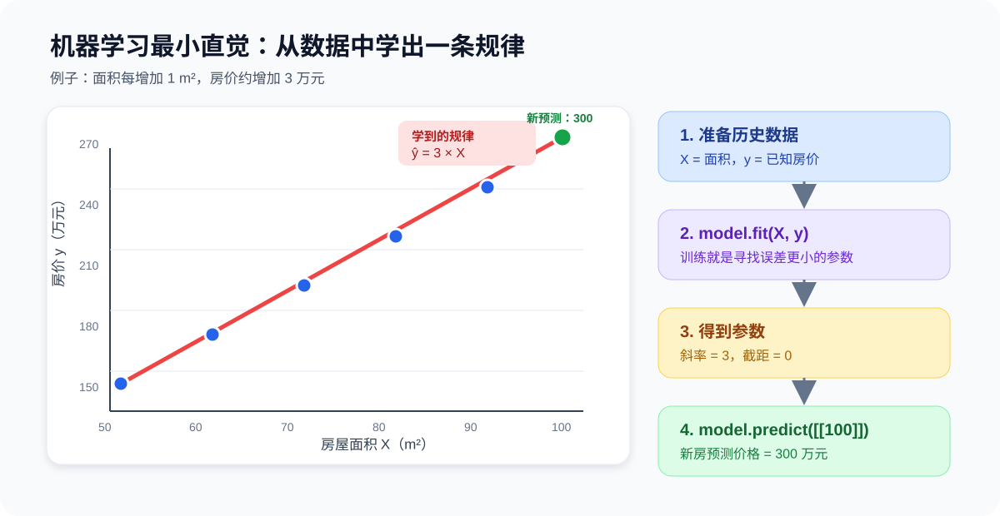
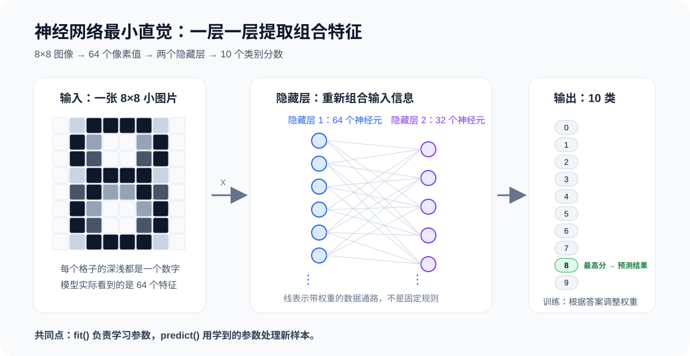

# 两个最小 AI 例子

## 1. 两个例子建立机器学习的感觉

通过两个可以直接运行的例子，观察模型怎样从数据中学习并完成预测：

1. 用线性回归预测房价，建立传统机器学习（Machine Learning，ML）的第一感觉。
2. 用多层感知机识别手写数字，建立深度学习（Deep Learning，DL）的第一感觉。

两个例子的共同流程是：

$$
\text{准备数据} \rightarrow \text{创建模型} \rightarrow \text{训练 fit} \rightarrow \text{预测 predict} \rightarrow \text{评估结果}
$$

传统机器学习、CNN、RNN、Transformer 和大模型微调都在扩展这条基本流程。

---

## 2. 学习目标

1. 看懂 `X`、`y`、模型、训练、预测分别是什么。
2. 知道 `fit()` 是让模型从历史样本中学习参数。
3. 知道 `predict()` 是让训练后的模型处理新样本。
4. 直观看到线性模型学习一条直线。
5. 直观看到神经网络把像素逐层变换成类别结果。
6. 能独立修改一两个数字并重新运行代码。

---

## 3. 两个例子先看全局

| 对比项 | 机器学习例子 | 深度学习例子 |
|---|---|---|
| 任务 | 根据面积预测房价 | 根据像素识别手写数字 |
| 输入 `X` | 每套房子的面积 | 每张图片的 64 个像素值 |
| 标签 `y` | 已知房价 | 数字类别 0～9 |
| 模型 | `LinearRegression` | `MLPClassifier` |
| 学习内容 | 一条直线的斜率和截距 | 多层网络中的大量权重和偏置 |
| 输出 | 一个连续价格 | 十个类别中的一个 |
| 最核心动作 | `fit()` 和 `predict()` | `fit()` 和 `predict()` |

两个例子包含五个核心概念：

- **数据**提供过去的例子。
- **模型**规定可以学习哪一类规律。
- **训练**调整模型内部参数。
- **预测**把学到的规律用于新数据。
- **评估**检查预测是否可靠。

---

## 4. 运行环境

安装三个依赖：

```bash
python -m pip install numpy matplotlib scikit-learn
```

| 库 | 本节用途 |
|---|---|
| NumPy | 创建和整理数字数组 |
| Matplotlib | 把数据、直线和手写数字画出来 |
| scikit-learn | 提供线性回归、数据集、数据切分、标准化和神经网络 |

建议把两个例子分别保存为：

```text
01_ml_linear_regression.py
02_dl_mlp_digits.py
```

然后在文件所在目录运行：

```bash
python 01_ml_linear_regression.py
python 02_dl_mlp_digits.py
```

---

## 5. 例子一：线性回归预测房价

### 5.1 问题

假设有五套房子的历史成交记录：

| 面积 `X`（平方米） | 房价 `y`（万元） |
|---:|---:|
| 50 | 150 |
| 60 | 180 |
| 70 | 210 |
| 80 | 240 |
| 90 | 270 |

肉眼可以看出：面积每增加 10 平方米，房价增加 30 万元。

模型要做的事情不是背住这五行数据，而是从中学到：

$$
\hat{y}=3X
$$

其中：

- $X$ 是房屋面积。
- $y$ 是历史真实房价。
- $\hat{y}$ 是模型预测房价。
- 数字 3 是模型通过训练得到的斜率。



---

### 5.2 完整代码

```python
import numpy as np
import matplotlib.pyplot as plt
from sklearn.linear_model import LinearRegression

X = np.array([[50], [60], [70], [80], [90]])
y = np.array([150, 180, 210, 240, 270])

model = LinearRegression()
model.fit(X, y)

new_house = np.array([[100]])
predicted_price = model.predict(new_house)

print("学到的斜率：", model.coef_[0])
print("学到的截距：", model.intercept_)
print("100 平方米预测价格：", predicted_price[0], "万元")

plt.scatter(X[:, 0], y, color="blue", label="history data")
plt.plot(X[:, 0], model.predict(X), color="red", label="learned line")
plt.scatter(100, predicted_price[0], color="green", s=100, label="new prediction")
plt.xlabel("area (m^2)")
plt.ylabel("price (10k yuan)")
plt.legend()
plt.show()
```

典型输出：

```text
学到的斜率： 3.0
学到的截距： 0.0
100 平方米预测价格： 300.0 万元
```

浮点数计算可能让截距显示成非常接近 0 的小数，例如 `-2.84e-14`。这仍然可以看作 0，不代表模型出错。

---

### 5.3 每行代码说明

| 代码 | 详细说明 |
|---|---|
| `import numpy as np` | 导入 NumPy，并把它简写成 `np`。后面使用 `np.array()` 创建模型需要的数字数组。 |
| `import matplotlib.pyplot as plt` | 导入绘图库中的 `pyplot`，简写成 `plt`。它负责画历史数据点、模型直线和新预测点。 |
| `from sklearn.linear_model import LinearRegression` | 从 scikit-learn 的线性模型模块中导入线性回归类。类可以理解为“创建模型的模板”。 |
| `X = np.array([[50], [60], [70], [80], [90]])` | 创建输入特征 `X`。一共有 5 行，表示 5 套房；每行只有 1 个数字，表示面积。外层每一行是一个样本，内层每一列是一个特征。 |
| `y = np.array([150, 180, 210, 240, 270])` | 创建标签 `y`。它保存 5 套房的真实成交价，顺序必须与 `X` 中的 5 套房完全对应。 |
| `model = LinearRegression()` | 创建一个尚未训练的线性回归模型。此时模型还不知道斜率和截距应该是多少。 |
| `model.fit(X, y)` | 用历史面积 `X` 和真实房价 `y` 训练模型。模型寻找一条总体误差最小的直线，并把学到的斜率和截距保存在自身内部。 |
| `new_house = np.array([[100]])` | 创建一个新样本：面积为 100 平方米。写成二维的 `[[100]]`，是因为 scikit-learn 约定输入形状为“样本数 × 特征数”，这里是 1 个样本、1 个特征。 |
| `predicted_price = model.predict(new_house)` | 使用已经训练好的模型预测新房价格。返回值仍然是数组，因为一次可以同时预测多套房。 |
| `print("学到的斜率：", model.coef_[0])` | 查看模型学到的第一个特征权重。这里结果约为 3，表示面积每增加 1 平方米，预测价格增加约 3 万元。 |
| `print("学到的截距：", model.intercept_)` | 查看模型学到的截距。截距是直线在 `X=0` 时的基础输出，本例约为 0。 |
| `print("100 平方米预测价格：", predicted_price[0], "万元")` | 取预测数组中的第一个结果并打印。本例只有一个新样本，因此使用 `[0]` 取出它的预测值。 |
| `plt.scatter(X[:, 0], y, ...)` | 绘制历史数据散点。`X[:, 0]` 表示取 `X` 的所有行以及第 0 列，也就是取出全部房屋面积。 |
| `plt.plot(X[:, 0], model.predict(X), ...)` | 让模型重新预测五个历史面积，并把这些预测值连接成红色直线。这条线就是模型学到的规律。 |
| `plt.scatter(100, predicted_price[0], ...)` | 用绿色大点画出 100 平方米的新样本及其预测价格。`s=100` 控制点的大小。 |
| `plt.xlabel("area (m^2)")` | 设置横轴名称。横轴表示房屋面积。 |
| `plt.ylabel("price (10k yuan)")` | 设置纵轴名称。纵轴表示以万元为单位的价格。 |
| `plt.legend()` | 显示图例，说明蓝点、红线和绿点分别代表什么。 |
| `plt.show()` | 打开绘图窗口。程序执行到这里时，才真正把图显示出来。 |

---

### 5.4 `fit()` 内部做了什么

线性回归模型形式为：

$$
\hat{y}=wX+b
$$

训练前，模型不知道 $w$ 和 $b$。

`model.fit(X, y)` 会寻找一组更合适的参数：

$$
w\approx3,\qquad b\approx0
$$

让五个预测值尽可能靠近五个真实房价。

| 阶段 | 模型状态 |
|---|---|
| 创建模型后 | 只有模型结构，还没有学到适合当前数据的参数 |
| 执行 `fit()` | 根据预测误差计算更合适的斜率和截距 |
| 训练完成后 | 参数保存在 `model.coef_` 和 `model.intercept_` 中 |
| 执行 `predict()` | 把新面积代入学到的直线，得到预测价格 |

最重要的直觉：

> 传统机器学习并不是把人工规则换一种写法，而是给出历史输入和答案，让算法从数据中估计参数。

---

### 5.5 第一次动手修改

把新房面积改成 110：

```python
new_house = np.array([[110]])
```

预测结果应接近：

```text
330 万元
```

再把历史数据中的最后一个房价从 270 改成 300：

```python
y = np.array([150, 180, 210, 240, 300])
```

此时所有点不再严格位于一条直线上，模型会寻找一条“整体最合适”的直线，而不是保证穿过每一个点。这就是拟合（Fitting）的基本感觉。

---

## 6. 例子二：神经网络识别手写数字

### 6.1 问题

现在不再预测一个连续价格，而是识别图片中的数字属于 `0～9` 中的哪一类。

scikit-learn 自带的手写数字数据集包含许多 `8×8` 灰度小图片。每张图片有 64 个像素，因此可以展开成 64 个输入特征。

$$
8\times8=64
$$

本例使用多层感知机分类器（Multi-layer Perceptron Classifier，MLPClassifier）：

$$
64\text{维输入}\rightarrow64\text{个隐藏神经元}\rightarrow32\text{个隐藏神经元}\rightarrow10\text{个类别}
$$



这里使用两个隐藏层，因此能够建立“多层神经网络”的直觉。不过，scikit-learn 的 MLP 主要适合教学和中小型数据；后续真正训练 CNN、RNN、Transformer 时会使用 PyTorch 等深度学习框架。

---

### 6.2 完整代码

```python
import matplotlib.pyplot as plt
from sklearn.datasets import load_digits
from sklearn.model_selection import train_test_split
from sklearn.preprocessing import StandardScaler
from sklearn.neural_network import MLPClassifier
from sklearn.metrics import accuracy_score

digits = load_digits()
X = digits.data
y = digits.target

X_train, X_test, y_train, y_test = train_test_split(
    X, y, test_size=0.2, random_state=42, stratify=y
)

first_image = X_test[0].copy().reshape(8, 8)
first_true_label = y_test[0]

scaler = StandardScaler()
X_train = scaler.fit_transform(X_train)
X_test = scaler.transform(X_test)

model = MLPClassifier(
    hidden_layer_sizes=(64, 32),
    activation="relu",
    solver="adam",
    max_iter=500,
    random_state=42,
)

model.fit(X_train, y_train)
y_pred = model.predict(X_test)
accuracy = accuracy_score(y_test, y_pred)

print("测试集准确率：", accuracy)
print("第一张图片的真实数字：", first_true_label)
print("第一张图片的预测数字：", y_pred[0])

plt.imshow(first_image, cmap="gray_r")
plt.title(f"true={first_true_label}, predict={y_pred[0]}")
plt.axis("off")
plt.show()
```

通常会看到接近下面的结果，但准确率可能随软件版本和运行环境略有差异：

```text
测试集准确率： 0.9666666666666667
第一张图片的真实数字： 5
第一张图片的预测数字： 5
```

准确率 `0.97` 的含义是：测试集每 100 张图片大约有 97 张预测正确，而不是某一张图片有 97% 的部分被识别正确。

---

### 6.3 导入工具

| 代码 | 详细说明 |
|---|---|
| `import matplotlib.pyplot as plt` | 导入绘图库，用于显示一张 `8×8` 的手写数字图片。 |
| `from sklearn.datasets import load_digits` | 导入 scikit-learn 自带的手写数字数据加载函数，避免第一次练习还要手动下载和清洗数据。 |
| `from sklearn.model_selection import train_test_split` | 导入数据切分函数。它负责把全部样本分成训练集和测试集。 |
| `from sklearn.preprocessing import StandardScaler` | 导入标准化工具。它会根据训练集计算每个特征的均值和标准差，让不同像素特征处于更适合神经网络训练的数值范围。 |
| `from sklearn.neural_network import MLPClassifier` | 导入多层感知机分类器。它是由全连接层和非线性激活函数组成的神经网络。 |
| `from sklearn.metrics import accuracy_score` | 导入准确率函数，用来比较真实标签和模型预测标签。 |

---

### 6.4 读取数据

| 代码 | 详细说明 |
|---|---|
| `digits = load_digits()` | 把手写数字数据加载到 `digits` 对象中。这个对象同时包含输入特征、标签、原始图片和数据说明。 |
| `X = digits.data` | 取出模型输入。每张 `8×8` 图片被展开为长度为 64 的一行数字，因此 `X` 的每一行代表一张图片。 |
| `y = digits.target` | 取出真实标签。每个标签是 `0～9` 中的一个整数，并且与 `X` 中相同行的图片对应。 |

可以先检查数据形状：

```python
print(X.shape)
print(y.shape)
```

典型结果：

```text
(1797, 64)
(1797,)
```

它表示共有 1797 张图片，每张图片有 64 个输入特征，每张图片对应一个数字标签。

---

### 6.5 切分训练集和测试集

```python
X_train, X_test, y_train, y_test = train_test_split(
    X, y, test_size=0.2, random_state=42, stratify=y
)
```

逐行理解：

| 代码 | 详细说明 |
|---|---|
| `X_train, X_test, y_train, y_test = train_test_split(` | 一次返回四份数据：训练输入、测试输入、训练标签、测试标签。训练集用于学习参数，测试集用于模拟模型遇到没参加训练的新样本。 |
| `X, y, ...` | 把完整输入 `X` 和完整标签 `y` 一起切分，函数会保证样本与其标签仍然一一对应。 |
| `test_size=0.2` | 把大约 20% 的样本留作测试集，其余约 80% 用于训练。 |
| `random_state=42` | 固定随机切分过程，使每次运行得到相同的数据划分，方便复现实验。数字 42 没有特殊数学含义，也可以换成其他整数。 |
| `stratify=y` | 按标签分层切分，使训练集和测试集中 `0～9` 各类别的比例尽量接近原始数据。 |
| `)` | 结束函数调用。代码分成多行只是为了更容易阅读，与写在一行的运行效果相同。 |

为什么不能全部用于训练？

如果模型只在参加训练的数据上得分很高，可能只是记住了训练样本。保留测试集，才能检查它对未见样本的泛化（Generalization）能力。

---

### 6.6 保存第一张原始图片

| 代码 | 详细说明 |
|---|---|
| `first_image = X_test[0].copy().reshape(8, 8)` | 取测试集第 0 个样本，也就是第一张图片。它原本是 64 个连续数字；`reshape(8, 8)` 把它还原为 8 行 8 列，`copy()` 保存标准化之前的原始像素。 |
| `first_true_label = y_test[0]` | 保存第一张测试图片的真实答案，后面用它与模型预测结果比较。 |

模型训练使用展开后的 64 个数字，绘图时则把同样的 64 个数字还原为 `8×8` 图片。这只是数据形状不同，信息并没有变化。

---

### 6.7 标准化

| 代码 | 详细说明 |
|---|---|
| `scaler = StandardScaler()` | 创建标准化工具。此时还没有计算任何均值和标准差。 |
| `X_train = scaler.fit_transform(X_train)` | `fit` 根据训练集计算每一列的均值和标准差，`transform` 再用这些统计量转换训练集。两个动作合并为 `fit_transform`。 |
| `X_test = scaler.transform(X_test)` | 使用训练集已经算出的规则转换测试集。这里不能再对测试集执行 `fit`，否则相当于提前偷看测试数据，造成数据泄漏（Data Leakage）。 |

标准化常写成：

$$
z=\frac{x-\mu}{\sigma}
$$

其中：

- $x$ 是原始像素特征。
- $\mu$ 是该特征在训练集中的均值。
- $\sigma$ 是该特征在训练集中的标准差。
- $z$ 是转换后的值。

它不会改变图片属于哪个数字，只是调整数值尺度，让神经网络更容易优化。

---

### 6.8 创建神经网络

```python
model = MLPClassifier(
    hidden_layer_sizes=(64, 32),
    activation="relu",
    solver="adam",
    max_iter=500,
    random_state=42,
)
```

逐行理解：

| 代码 | 详细说明 |
|---|---|
| `model = MLPClassifier(` | 创建一个多层感知机分类模型。此时只确定网络结构和训练配置，还没有从数据中学到权重。 |
| `hidden_layer_sizes=(64, 32),` | 设置两个隐藏层。第一隐藏层有 64 个神经元，第二隐藏层有 32 个神经元。输入层的 64 个像素特征和输出层的 10 个类别不写在这个参数中。 |
| `activation="relu",` | 隐藏层使用 ReLU 激活函数。它把负数变成 0、正数保留，使多层网络能够表达非线性关系。 |
| `solver="adam",` | 使用 Adam 优化器根据梯度更新网络权重。可以先把它理解为“决定参数每次应该怎样调整的算法”。 |
| `max_iter=500,` | 最多执行 500 轮迭代。模型可能提前达到停止条件，也可能在达到上限后停止。 |
| `random_state=42,` | 固定权重初始化和训练中的随机过程，使结果更容易复现。 |
| `)` | 完成模型创建。此刻网络有结构，但内部权重仍未针对手写数字训练。 |

这一行定义的网络不是“只有两个神经元”，而是：

| 层 | 神经元或输出数量 | 作用 |
|---|---:|---|
| 输入 | 64 个特征位置 | 接收 64 个像素值 |
| 隐藏层 1 | 64 | 对像素进行第一次带权组合和激活变换 |
| 隐藏层 2 | 32 | 把上一层特征继续组合成更抽象的模式 |
| 输出 | 10 个类别分数 | 对应数字 `0～9` |

---

### 6.9 训练、预测和评估

| 代码 | 详细说明 |
|---|---|
| `model.fit(X_train, y_train)` | 开始训练神经网络。内部会重复进行前向计算、计算分类误差、反向传播梯度和更新权重，直到满足停止条件或达到最大迭代次数。 |
| `y_pred = model.predict(X_test)` | 让训练后的网络预测测试集中的每一张图片，得到一组 `0～9` 的整数类别。 |
| `accuracy = accuracy_score(y_test, y_pred)` | 把预测类别与真实类别逐个比较，正确数量除以测试样本总数，得到准确率。 |
| `print("测试集准确率：", accuracy)` | 打印整个测试集上的准确率，它比只看某一张图片更能反映模型整体效果。 |
| `print("第一张图片的真实数字：", first_true_label)` | 打印第一张测试图片的正确答案。 |
| `print("第一张图片的预测数字：", y_pred[0])` | 打印模型对第一张测试图片的判断。若它与真实数字相同，这一个样本预测正确。 |

准确率公式：

$$
\text{Accuracy}=\frac{\text{预测正确的样本数}}{\text{测试样本总数}}
$$

例如测试集有 360 张图片，其中 350 张预测正确：

$$
\text{Accuracy}=\frac{350}{360}\approx0.9722
$$

---

### 6.10 显示预测图片

| 代码 | 详细说明 |
|---|---|
| `plt.imshow(first_image, cmap="gray_r")` | 把第一张 `8×8` 图片显示出来。`gray_r` 使用反向灰度色表，让较大的像素值显示得更深。 |
| `plt.title(f"true={first_true_label}, predict={y_pred[0]}")` | 设置图片标题。`f"..."` 会把变量值嵌入字符串，同时显示真实类别和预测类别。 |
| `plt.axis("off")` | 隐藏横纵坐标刻度，因为这里关心的是数字图形，不需要像素坐标轴。 |
| `plt.show()` | 打开绘图窗口并显示手写数字。 |

---

## 7. 神经网络的 `fit()` 为什么更复杂

线性回归只需要学习一组输入权重和一个截距。多层神经网络则需要学习层与层之间的大量连接权重。

以本例为例，主要带权连接包括：

$$
64\times64+64\times32+32\times10
$$

再加上每层偏置：

$$
64+32+10
$$

总参数量为：

$$
4096+2048+320+64+32+10=6570
$$

这 6570 个参数不是人工逐个填写的，而是 `model.fit()` 根据训练误差自动调整的。

| 步骤 | 神经网络内部发生的事情 |
|---|---|
| 前向传播 | 图片的 64 个像素值逐层计算，得到 10 个类别分数 |
| 计算损失 | 比较预测类别分布与真实数字，得到错误程度 |
| 反向传播 | 从损失开始，计算每个权重对错误的影响方向 |
| 更新参数 | Adam 根据梯度小幅调整权重和偏置 |
| 重复训练 | 多次观察样本，使分类错误逐渐减少 |

最重要的直觉：

> “网络”指许多计算位置以及它们之间的带权数据通路；“学习”指根据最终误差不断调整这些通路上的权重。

---

## 8. ML 和 DL 到底差在哪里

| 维度 | 线性回归 | 多层神经网络 |
|---|---|---|
| 输入 | 人工整理好的面积 | 图片展开后的 64 个像素 |
| 模型结构 | 一次线性加权 | 多层加权计算与非线性激活 |
| 参数数量 | 本例 2 个 | 本例 6570 个 |
| 能表达的关系 | 主要是线性趋势 | 能组合出更复杂的非线性模式 |
| 训练过程 | 可以直接求解或优化 | 通常使用前向传播、反向传播和优化器迭代 |
| 常见数据 | 表格、小中型结构化数据 | 图像、语音、文本以及复杂大规模数据 |
| 本例框架 | scikit-learn | scikit-learn 中的教学型 MLP |

但两者的代码外形非常相似：

```python
model = 某一种模型(...)
model.fit(X_train, y_train)
y_pred = model.predict(X_test)
```

相似的是建模接口，不同的是模型内部结构、参数数量、训练方式和适用问题。

---

## 9. 初学者最容易误解的地方

### 9.1 `fit()` 不是把数据装进模型

`fit()` 的核心是根据数据估计参数。训练完成后，真正被保留下来的主要是模型结构和学到的参数，而不是简单复制一张原始数据表。

### 9.2 `predict()` 不会继续训练

`predict()` 只使用当前参数进行前向计算，不会因为预测了一个新样本就自动改变模型权重。

### 9.3 深度学习不等于代码一定很长

scikit-learn 把训练循环封装在 `fit()` 内部，所以代码看起来很短。后续使用 PyTorch 时，会把前向传播、损失、反向传播和参数更新显式写出来。

### 9.4 神经元不是一个小机器人

神经元本质上是一个计算位置，典型计算包括：

$$
z=w_1x_1+w_2x_2+\cdots+w_nx_n+b
$$

再经过激活函数：

$$
a=\operatorname{ReLU}(z)
$$

一层中的“64 个神经元”，表示这一层会产生 64 个输出数字。

### 9.5 测试准确率高不等于可以直接上线

真实项目还需要检查数据质量、类别不平衡、业务成本、稳定性、推理速度、可解释性和数据漂移。这个例子只建立最小闭环，不代表完整工业流程。

---

## 10. 常见报错

| 报错或现象 | 常见原因 | 处理方法 |
|---|---|---|
| `ModuleNotFoundError: No module named 'sklearn'` | 没安装 scikit-learn，或运行代码的 Python 不是安装依赖的 Python | 执行 `python -m pip install scikit-learn`，并确认安装与运行使用同一个 `python` |
| `Expected 2D array` | 把单个样本写成 `[100]`，缺少“样本 × 特征”二维结构 | 改成 `[[100]]` 或使用 `.reshape(1, -1)` |
| 出现 `ConvergenceWarning` | MLP 达到最大迭代次数时仍未完全满足收敛条件 | 先确认已标准化，再适当增加 `max_iter`；警告不等于程序完全失败 |
| 每次结果不同 | 数据切分或模型初始化存在随机性 | 设置 `random_state` |
| 图片窗口没有出现 | 当前环境不支持桌面绘图窗口 | 在 Jupyter Notebook 运行，或把 `plt.show()` 改为 `plt.savefig("result.png")` |

---

## 11. 本课总结

| 必须记住的词 | 一句话理解 |
|---|---|
| 样本 | 一条可用于学习或预测的记录 |
| 特征 `X` | 模型用来做判断的输入信息 |
| 标签 `y` | 训练数据中已知的正确答案 |
| 模型 | 从输入到输出的可学习计算结构 |
| 参数 | 模型内部通过训练得到的权重和偏置 |
| `fit()` | 根据训练数据学习参数 |
| `predict()` | 使用已学参数预测新样本 |
| 训练集 | 用于调整模型参数的数据 |
| 测试集 | 不参与训练、用于检查泛化的数据 |
| ML | 常依赖更明确的特征表示和相对简单的模型结构 |
| DL | 使用多层神经网络逐层学习复杂表示 |

两个例子的共同骨架：

$$
(X,y)\rightarrow\text{fit}\rightarrow\text{参数}\rightarrow\text{predict}(X_{new})\rightarrow\hat{y}
$$

---

## 12. 课后练习

### 练习一：改变线性规律

把房价改为：

```python
y = np.array([100, 120, 140, 160, 180])
```

观察新的斜率、截距和 100 平方米预测值。

### 练习二：改变隐藏层

分别尝试：

```python
hidden_layer_sizes=(16,)
hidden_layer_sizes=(64, 32)
hidden_layer_sizes=(128, 64, 32)
```

记录每种结构的准确率和训练时间。不要预设“层越多一定越好”，以测试结果为准。

### 练习三：查看错误样本

找出第一个预测错误的位置：

```python
wrong_index = (y_pred != y_test).nonzero()[0][0]
print("真实数字：", y_test[wrong_index])
print("预测数字：", y_pred[wrong_index])
```

然后显示这张图片，观察它为什么可能让模型困惑。

---

## 13. 知识延伸

两个已经运行的例子还可以继续连接到五个核心问题：

1. 人工智能、机器学习、深度学习和大模型是什么关系。
2. 模型为什么能从误差中学习参数。
3. 训练集、验证集和测试集为什么必须分开。
4. 传统机器学习为什么需要特征工程。
5. 深度学习的层、神经元、激活函数、损失函数和反向传播分别做什么。

这些概念和公式都可以放回“数据、模型、训练、预测、评估”的完整流程中理解，而不是作为孤立定义记忆。
