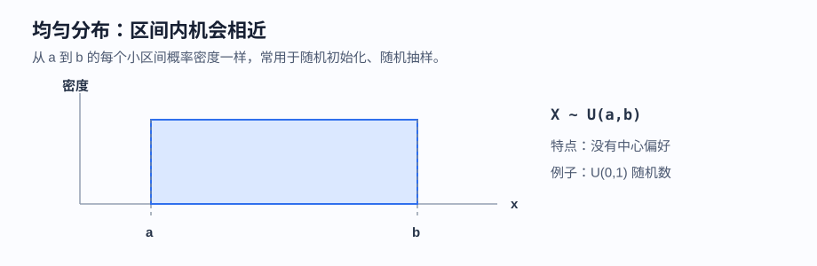
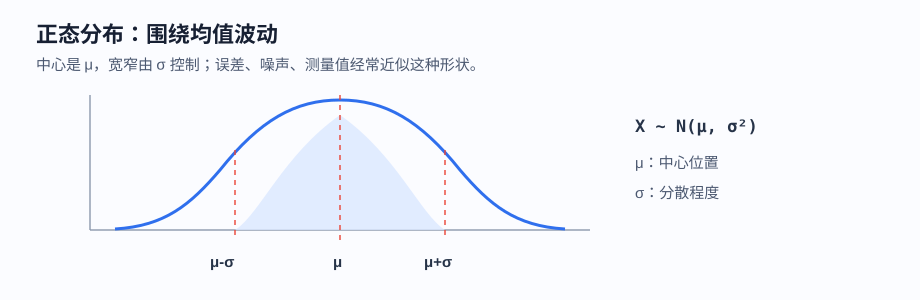
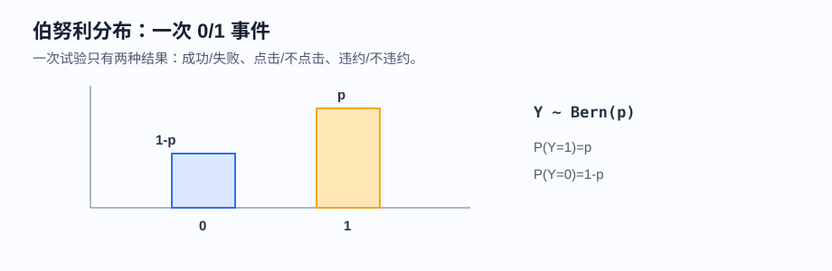
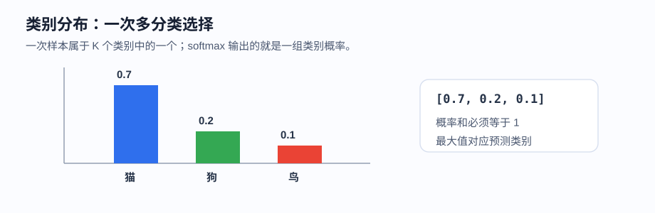
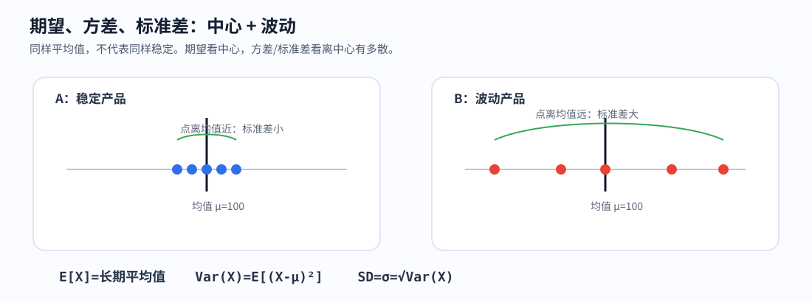
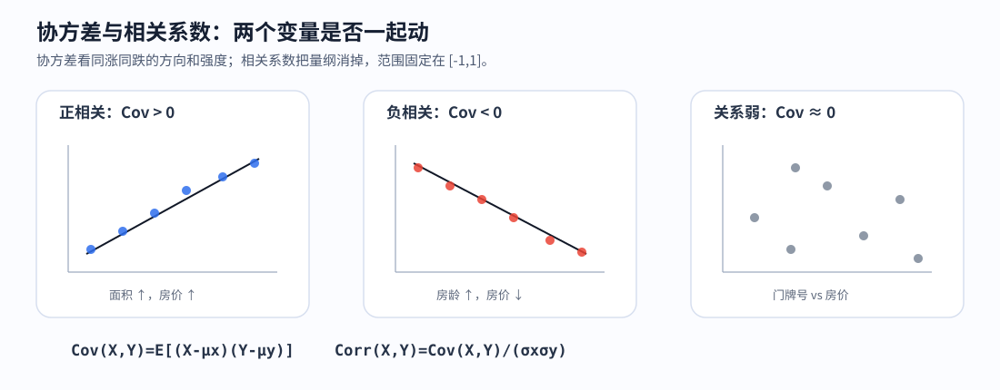
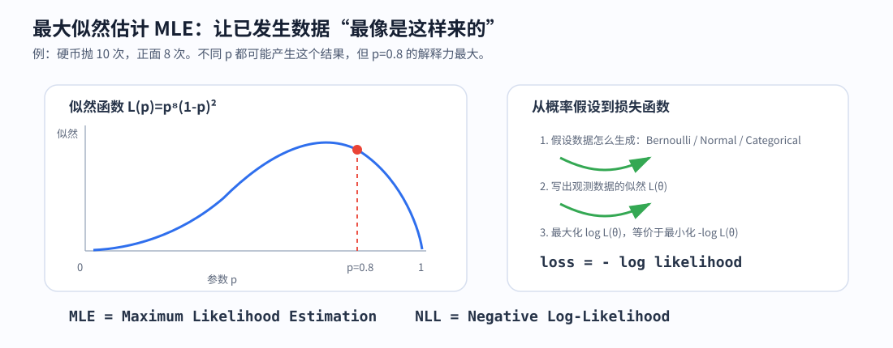

# 课时03-04：AI 必备数学核心

## 1. 课程定位

建立 AI 工程高频数学地图，不重学整套数学。

| 不追求 | 真正追求 |
|---|---|
| 会做复杂高数题 | 看懂数据形状、矩阵计算、损失变化 |
| 会背大量定义 | 知道概念在模型哪里出现 |
| 手推所有证明 | 能读懂公式、代码、报错、指标 |
| 数学孤立学习 | 数学服务建模、训练、评估、部署 |

核心链条：

$$
X,y \rightarrow \hat{y}=f(X) \rightarrow L(y,\hat{y}) \rightarrow \nabla L \rightarrow \text{更新参数}
$$

---

## 2. 学习目标

1. 看懂数据表示：能解释标量、向量、矩阵、张量、shape。
2. 看懂矩阵计算：能判断 $Xw$、$X^TX$、$X^Ty$ 的维度是否成立。
3. 看懂线性回归：能说明 $Xw+b$、MSE、正规方程、SVD 的关系。
4. 看懂概率统计：能解释分布、期望、方差、协方差、采样、数据集划分。
5. 看懂优化：能解释导数、偏导数、梯度、学习率（Learning Rate）、梯度下降（Gradient Descent）。
6. 看懂工程取舍：知道哪些数学必须熟，哪些只需理解用途。

---

## 3. 前置知识与本课关系

房价预测的最小闭环包含：

| 环节 | 公式 / 对象 | 对应的数学工具 |
|---|---|---|
| 数据 | $X,y$ | 矩阵、向量、shape |
| 模型 | $\hat{y}=Xw+b$ | 矩阵乘法、参数向量 |
| 误差 | $y-\hat{y}$ | 向量运算、范数直觉 |
| 损失 | $L=\frac{1}{m}\sum (y_i-\hat{y}_i)^2$ | 函数、凸性、平方惩罚 |
| 训练 | $\min L(w,b)$ | 导数、梯度、梯度下降 |
| 求解 | $w=(X^TX)^{-1}X^Ty$ 或 SVD | 转置、反向求解、有效信息维度、稳定解法 |

---

## 4. 数学地图

| 模块 | 解决什么 | 高频场景 |
|---|---|---|
| 线性代数 | 数据怎么表示、批量计算 | 特征矩阵、Embedding、神经网络权重 |
| 概率统计 | 数据为什么波动、预测多可信 | 分布、采样、泛化（Generalization）、分类概率 |
| 微积分优化 | 参数怎么被训练出来 | 损失函数、梯度下降、反向传播（Backpropagation） |
| 数值计算 | 公式怎样稳定落地 | SVD、伪逆、正则化（Regularization）、矩阵分解 |

一句话：**线代负责算，概率负责不确定性，微积分负责把模型调好。**

---

## 5. 线性代数

### 5.1 线性代数简史

线性代数不是先有抽象符号，再硬塞进机器学习。它最早解决的是“很多未知数、很多方程怎么一起算”。

核心演进：

| 大致阶段 | 代表问题 | 核心对象 | 今天对应到 AI |
|---|---|---|---|
| 古代到近代 | 多个方程怎么一起解 | 系数表、消元 | 求模型参数、最小二乘 |
| 17-18 世纪 | 方程组什么时候有唯一解 | 行列式 | 判断方程能否唯一反解、特征是否冗余 |
| 19 世纪 | 一组数能否当作独立对象运算 | 矩阵 | 线性层、Embedding 投影、Attention |
| 19-20 世纪 | 向量不只是箭头，也可以是函数 | 向量空间、基 | 特征空间、语义空间、隐空间 |
| 20 世纪 | 变换中哪些方向最重要 | 特征值、特征向量 | PCA、谱分解、图算法 |
| 20 世纪后期 | 公式如何稳定跑在计算机上 | QR、SVD、伪逆 | 大规模训练、推荐分解、数值稳定 |
| 深度学习时代 | 高维数组如何批量计算 | 张量 | 图片 batch、Transformer、GPU 计算 |

从这条线看，线性代数的核心问题一直没变：**怎么表示一批量，怎么变换一批量，怎么稳定求解一批量。**

不用背数学史名字，记住演进逻辑即可：

```text
解方程 → 判断能否解 → 抽象成矩阵 → 看成空间变换 → 找主方向 → 稳定计算 → 高维张量计算
```

例子：

$$
\begin{cases}
2x+3y=8\\
4x-y=2
\end{cases}
$$

系数表：

$$
\begin{bmatrix}
2 & 3\\
4 & -1
\end{bmatrix}
$$

增广表：

$$
\begin{bmatrix}
2 & 3 & 8\\
4 & -1 & 2
\end{bmatrix}
$$

行列式：

$$
\det\begin{bmatrix}2&3\\4&-1\end{bmatrix}
=2\times(-1)-3\times4=-14\ne0
$$

含义：这个方程组有唯一解。

为什么 $-14\ne0$ 就能判断“唯一解”：

1. 系数矩阵

$$
A=\begin{bmatrix}2&3\\4&-1\end{bmatrix}
$$

把未知数向量 $[x,y]^T$ 变成右侧结果 $[8,2]^T$。

2. 行列式表示这个变换对面积的缩放倍数。

$$
|\det(A)|=14
$$

说明二维平面没有被压扁成一条线或一个点。

3. 没有被压扁，就说明两个列向量不是同一方向：

$$
\begin{bmatrix}2\\4\end{bmatrix},\quad
\begin{bmatrix}3\\-1\end{bmatrix}
$$

它们能张成整个二维平面。于是任意一个右侧向量，比如 $[8,2]^T$，都能找到唯一的 $[x,y]^T$ 对应过去。

4. 如果 $\det(A)=0$，两个列向量共线，二维信息被压成一维。此时可能无解，也可能无穷多解，但不会有唯一解。

更直观地说：二元一次方程组对应两条直线；行列式不为 0，说明两条直线不是平行或重合，而是只交于一个点。

这个例子说明：线性代数不是孤立概念，而是从“解方程”一路发展到“研究线性变换”。矩阵真正重要的地方，不只是“把数字摆整齐”，而是它能表示一个线性操作：

$$
\begin{bmatrix}
2 & 3\\
4 & -1
\end{bmatrix}
\begin{bmatrix}x\\y\end{bmatrix}
=
\begin{bmatrix}
2x+3y\\
4x-y
\end{bmatrix}
$$

左边矩阵的每一行，都是一个“如何组合输入变量”的规则。

---

### 5.2 什么是线性

线性不是“长得像直线”这么简单。在线性代数里，一个变换 $f$ 只要同时满足两条规则，就叫线性：

$$
f(u+v)=f(u)+f(v)
$$

$$
f(cu)=cf(u)
$$

第一条叫加法保持：先把两个向量相加再变换，等于分别变换后再相加。第二条叫数乘保持：先把向量放大 $c$ 倍再变换，等于变换后再放大 $c$ 倍。

简单例子：

$$
f(x)=3x
$$

满足线性。因为：

$$
f(x_1+x_2)=3(x_1+x_2)=3x_1+3x_2=f(x_1)+f(x_2)
$$

不是线性的例子：

| 函数 | 为什么不是线性 |
|---|---|
| $f(x)=x^2$ | 输入翻倍，输出变 4 倍，不满足数乘保持 |
| $f(x)=3x+2$ | 有常数偏移，原点不会映射到原点 |
| if-else 规则 | 不同区域用不同规则，不是同一个线性变换 |

注意：机器学习里常说的“线性回归”通常写成：

$$
\hat{y}=Xw+b
$$

严格说，$Xw$ 是线性变换，$+b$ 之后叫仿射变换。工程上仍把它归入线性模型，因为它对特征的核心关系仍是加权求和。也可以给 $X$ 增加一列全 1，把 $b$ 合并进权重：

$$
\hat{y}=\begin{bmatrix}X&\mathbf{1}\end{bmatrix}
\begin{bmatrix}w\\b\end{bmatrix}
$$

为什么 AI 反复用线性：

1. 可批量计算：矩阵乘法能一次处理大量样本。
2. 可解释：权重表示每个特征的方向和强度。
3. 可优化：线性层配合损失函数，梯度容易计算。
4. 可组合：深度学习就是“线性变换 + 非线性激活”反复堆叠。

一句话：**线性代数研究的是向量空间里的线性关系、线性表示和线性变换。**

---

### 5.3 数据对象

| 名称 | 符号 | 形状 | 例子 | AI 中的位置 |
|---|---|---:|---|---|
| 标量 | $a$ | 0 维 | 一个 loss、一个学习率 | 指标、超参数 |
| 向量 | $x$ | 1 维 | 一个样本 `[面积, 房间数, 房龄]` | 样本特征、词向量 |
| 矩阵 | $X$ | 2 维 | 多个样本组成的数据表 | 训练数据、权重矩阵 |
| 张量 | $T$ | 多维 | 图片 batch、视频、激活值 | 深度学习主要数据结构 |

房价数据：

| 样本 | 面积 | 房间数 | 房龄 | 房价 $y$ |
|---:|---:|---:|---:|---:|
| 1 | 60 | 2 | 18 | 185 |
| 2 | 75 | 3 | 12 | 248 |
| 3 | 90 | 3 | 8 | 312 |
| 4 | 105 | 4 | 15 | 340 |

拆成特征矩阵和标签向量：

$$
X=\begin{bmatrix}
60 & 2 & 18\\
75 & 3 & 12\\
90 & 3 & 8\\
105 & 4 & 15
\end{bmatrix},\quad
 y=\begin{bmatrix}185\\248\\312\\340\end{bmatrix}
$$

维度：

| 对象 | shape | 含义 |
|---|---:|---|
| $X$ | $(4,3)$ | 4 个样本，3 个特征 |
| $y$ | $(4,1)$ | 4 个样本的真实房价 |
| $w$ | $(3,1)$ | 3 个特征对应 3 个权重 |
| $b$ | 标量 | 整体偏置 |
| $\hat{y}$ | $(4,1)$ | 4 个样本的预测房价 |

---

### 5.4 Shape 规则

Shape 是矩阵计算的第一道检查。公式对不对，先看维度能不能扣上。

矩阵乘法规则：

$$
(m,n)@(n,k)=(m,k)
$$

房价数据中：

$$
X:(4,3),\quad w:(3,1),\quad y:(4,1)
$$

| 表达式 | 维度 | 是否成立 | 结果 |
|---|---|---|---|
| $Xw$ | $(4,3)@(3,1)$ | 是 | $(4,1)$，每个样本一个预测值 |
| $wX$ | $(3,1)@(4,3)$ | 否 | 中间维度 $1\ne4$ |
| $X^TX$ | $(3,4)@(4,3)$ | 是 | $(3,3)$，特征和特征的关系 |
| $X^Ty$ | $(3,4)@(4,1)$ | 是 | $(3,1)$，特征和标签的关系 |

几个高频形状概念：

1. 方阵：行数等于列数的矩阵，shape 是 $(n,n)$。例如 $(2,2)$、$(3,3)$ 都是方阵，$(4,3)$ 不是方阵。
2. 主对角线：从左上到右下、行号等于列号的位置，即 $(1,1),(2,2),\ldots,(n,n)$。
3. 单位矩阵：记作 $I_n$，是 $n\times n$ 方阵；主对角线全是 1，其他位置全是 0。

$$
I_2=\begin{bmatrix}1&0\\0&1\end{bmatrix},\quad
I_3=\begin{bmatrix}1&0&0\\0&1&0\\0&0&1\end{bmatrix}
$$

单位矩阵的作用相当于数字里的 1：乘上它，不改变原对象。

$$
I_nx=x
$$

如果 $A\in\mathbb{R}^{m\times n}$，则：

$$
I_mA=A,\quad AI_n=A
$$

后面看到 $R^TR=I$，意思就是矩阵组合后等于“什么都没改变”的单位矩阵。

这里只先检查尺寸，$X^T$ 的含义在“转置”部分展开，$X^TX$ 和 $X^Ty$ 的业务含义在后面的高频组合里展开。

常见报错：

```text
ValueError: matmul: Input operand 1 has a mismatch in its core dimension
```

看到这类错误，不要先怀疑算法，先检查：

1. 样本是不是放在行上。
2. 特征是不是放在列上。
3. $w$ 是不是列向量。
4. `X.shape[1]` 是否等于 `w.shape[0]`。

一句话：**shape 是机器学习代码里的尺寸检查表。**

---

### 5.5 基、坐标与列空间

基可以理解为一组“坐标轴方向”。有了基，向量就能用一组数字表示。

二维标准基：

$$
e_1=\begin{bmatrix}1\\0\end{bmatrix},\quad
e_2=\begin{bmatrix}0\\1\end{bmatrix}
$$

向量：

$$
v=\begin{bmatrix}3\\2\end{bmatrix}
$$

意思是：

$$
v=3e_1+2e_2
$$

也就是沿第一个方向走 3 份，沿第二个方向走 2 份。

矩阵和基的关系非常关键：**矩阵的每一列，就是标准基向量变换后的结果。**

设：

$$
A=\begin{bmatrix}2&1\\0&1\end{bmatrix}
$$

作用到两个标准基：

$$
Ae_1=\begin{bmatrix}2\\0\end{bmatrix},\quad
Ae_2=\begin{bmatrix}1\\1\end{bmatrix}
$$

这两个结果正好是矩阵 $A$ 的第 1 列和第 2 列。

所以对任意向量：

$$
v=\begin{bmatrix}3\\2\end{bmatrix}=3e_1+2e_2
$$

有：

$$
Av=3Ae_1+2Ae_2
=3\begin{bmatrix}2\\0\end{bmatrix}
+2\begin{bmatrix}1\\1\end{bmatrix}
=\begin{bmatrix}8\\2\end{bmatrix}
$$

这解释了矩阵为什么能代表线性变换：只要知道基向量被送到哪里，就知道所有向量会被送到哪里。

列空间：矩阵所有列向量能组合出的空间。比如上面的 $A$ 有两列：

$$
\begin{bmatrix}2\\0\end{bmatrix},\quad
\begin{bmatrix}1\\1\end{bmatrix}
$$

它们不共线，所以能张成整个二维平面。如果两列共线，输出就只能落在一条线上，信息被压扁，后面讲“有效信息维度”和“反向还原”时会用到这个判断。

AI 用途：

1. 线性层：权重矩阵决定输入基方向如何被组合成输出表示。
2. PCA：换一组更适合数据的基，让主要变化方向排在前面。
3. Embedding：每个词或物品被表示成高维空间中的坐标。
4. 矩阵分解：用少数基方向近似大量用户、商品或特征关系。

---

### 5.6 矩阵乘法：线性函数的执行

矩阵乘法不是普通“逐个相乘”，而是**左边一行**和**右边一列**做内积。

单个样本预测：

$$
x=\begin{bmatrix}100 & 3 & 10\end{bmatrix},\quad
w=\begin{bmatrix}2.8\\15\\-1.5\end{bmatrix},\quad b=20
$$

$$
\hat{y}=xw+b=100\times2.8+3\times15+10\times(-1.5)+20=330
$$

注意：数据表里，一个样本常写成行向量；几何变换里，向量常写成列向量。二者不是矛盾，关键是把 shape 写清楚。

含义：

1. 面积贡献 $100\times2.8=280$。
2. 房间数贡献 $3\times15=45$。
3. 房龄贡献 $10\times(-1.5)=-15$。
4. 偏置贡献 $20$。

一批样本预测：

$$
\hat{y}=Xw+b
$$

如果 $X$ 有 4 行，表示 4 套房；$Xw$ 就会一次算出 4 个预测房价。

| 做法 | 计算方式 | 工程意义 |
|---|---|---|
| 循环逐条算 | 每个样本单独算一次 | 慢，代码多，不适合 GPU |
| 矩阵批量算 | 一次计算 $Xw$ | 快，可被 NumPy / GPU 优化 |

矩阵乘法在 AI 中反复出现：线性回归的 $Xw$、神经网络的 $Wx+b$、Attention 的 $QK^T$ 都是它。

更本质地说：**矩阵表示一个线性变换，也可以理解成一个线性函数**。

$$
A:\mathbb{R}^n\rightarrow \mathbb{R}^m
$$

$$
v\mapsto Av
$$

含义：输入一个向量 $v$，矩阵 $A$ 按固定规则把它变成另一个向量 $Av$。

例如：

$$
A=\begin{bmatrix}2&0\\0&3\end{bmatrix},\quad
v=\begin{bmatrix}1\\2\end{bmatrix}
$$

$$
Av=\begin{bmatrix}2\\6\end{bmatrix}
$$

这里 $A$ 不是一张普通表格，而是一个函数：

```text
输入 (1, 2) → 横向放大 2 倍、纵向放大 3 倍 → 输出 (2, 6)
```

所以矩阵乘法的核心不是“数字相乘”，而是：**用一个线性函数改变向量的表示**。

放到 AI 里看：

| 表达式 | 函数含义 | 输出 |
|---|---|---|
| $Xw$ | 用数据矩阵 $X$ 把参数 $w$ 映射成预测值 | $\hat{y}$ |
| $Wx+b$ | 用权重矩阵 $W$ 把输入表示映射成新表示 | 神经元输出 |
| $QK^T$ | 用矩阵乘法把 Query 和 Key 映射成两两相似度 | 注意力分数 |

一句话：**矩阵是函数，矩阵乘法是函数作用；多个矩阵相乘，就是多个线性函数复合。**

#### 5.6.1 为什么是左行乘右列

矩阵乘法定义成“左边一行乘右边一列”，不是为了形式好看，而是为了保住一个关键要求：**多个线性变换合成后，仍然能用一个矩阵表示。**

设：

$$
B=\begin{bmatrix}p&q\\r&s\end{bmatrix},\quad
A=\begin{bmatrix}a&b\\c&d\end{bmatrix},\quad
v=\begin{bmatrix}x\\y\end{bmatrix}
$$

先做 $B$：

$$
Bv=
\begin{bmatrix}
px+qy\\
rx+sy
\end{bmatrix}
$$

再做 $A$：

$$
A(Bv)=
\begin{bmatrix}
a(px+qy)+b(rx+sy)\\
c(px+qy)+d(rx+sy)
\end{bmatrix}
$$

展开：

$$
A(Bv)=
\begin{bmatrix}
(ap+br)x+(aq+bs)y\\
(cp+dr)x+(cq+ds)y
\end{bmatrix}
$$

如果希望它等价于一个总矩阵 $C$ 直接作用在 $v$ 上：

$$
C v=A(Bv)
$$

那么 $C$ 只能是：

$$
C=AB=
\begin{bmatrix}
ap+br & aq+bs\\
cp+dr & cq+ds
\end{bmatrix}
$$

这正好就是：

| $AB$ 的位置 | 计算方式 |
|---|---|
| 第 1 行第 1 列 | $A$ 第 1 行 $[a,b]$ · $B$ 第 1 列 $[p,r]^T$ |
| 第 1 行第 2 列 | $A$ 第 1 行 $[a,b]$ · $B$ 第 2 列 $[q,s]^T$ |
| 第 2 行第 1 列 | $A$ 第 2 行 $[c,d]$ · $B$ 第 1 列 $[p,r]^T$ |
| 第 2 行第 2 列 | $A$ 第 2 行 $[c,d]$ · $B$ 第 2 列 $[q,s]^T$ |

结论：**左行乘右列，是从“复合变换必须还能写成一个矩阵”推出来的。**

---

#### 5.6.2 为什么先做 $B$，却写成 $AB$

矩阵通常作用在列向量左边：

$$
v' = Av
$$

如果先做 $B$，再做 $A$，就是：

$$
v' = A(Bv)=(AB)v
$$

这和函数复合一致：

$$
f(g(x))
$$

$g$ 先执行，但写在里面；$f$ 后执行，但写在外面。矩阵复合也是这样。

读法口诀：

```text
ABv：谁离 v 近，谁先作用。
```

为什么不把先执行的操作写在最左边？因为矩阵不是只给二维图形用，它要和函数、求导、解方程统一。保住下面这个结构最重要：

$$
(AB)v=A(Bv)
$$

也就是：两个线性函数复合后，仍然是一个线性函数。

例子：先横向拉伸，再旋转。

$$
S=\begin{bmatrix}2&0\\0&1\end{bmatrix},\quad
R=\begin{bmatrix}0&-1\\1&0\end{bmatrix},\quad
v=\begin{bmatrix}1\\1\end{bmatrix}
$$

先拉伸：

$$
Sv=\begin{bmatrix}2\\1\end{bmatrix}
$$

再旋转：

$$
R(Sv)=\begin{bmatrix}-1\\2\end{bmatrix}
$$

总矩阵写成：

$$
RS=\begin{bmatrix}0&-1\\2&0\end{bmatrix}
$$

验证：

$$
(RS)v=\begin{bmatrix}-1\\2\end{bmatrix}
$$

如果写成 $SRv$，顺序就变成“先旋转，再拉伸”，结果不同：

$$
SRv=\begin{bmatrix}-2\\1\end{bmatrix}
$$

所以 $AB\ne BA$ 不是抽象规则，而是操作顺序真的变了。

直觉补充：如果是“整体等比例放大”，先转后放和先放后转可能一样；但如果只拉伸 $x$ 方向，就不一样。一个斜向量先被横向拉长再旋转，和先旋转再横向拉长，最后位置不同。

---

#### 5.6.3 线性变换的几种类型

线性变换可以理解成：不弯曲空间，只允许直线仍然变成直线，原点仍然在原点。常见类型如下。

| 类型 | 矩阵例子 | 对点 $(x,y)$ 的影响 | 能否完整还原 |
|---|---|---|---|
| 缩放 | $\begin{bmatrix}2&0\\0&3\end{bmatrix}$ | $x$ 变 2 倍，$y$ 变 3 倍 | 能 |
| 旋转 | $\begin{bmatrix}0&-1\\1&0\end{bmatrix}$ | 逆时针转 $90^\circ$ | 能 |
| 反射 | $\begin{bmatrix}1&0\\0&-1\end{bmatrix}$ | 关于 $x$ 轴镜像 | 能 |
| 剪切 | $\begin{bmatrix}1&1\\0&1\end{bmatrix}$ | 横向倾斜，$x'=x+y$ | 能 |
| 投影 | $\begin{bmatrix}1&0\\0&0\end{bmatrix}$ | 压到 $x$ 轴，$y$ 信息丢失 | 不能 |
| 置换 | $\begin{bmatrix}0&1\\1&0\end{bmatrix}$ | 交换 $x$ 和 $y$ | 能 |

具体看两个点。

缩放：

$$
\begin{bmatrix}2&0\\0&3\end{bmatrix}
\begin{bmatrix}1\\2\end{bmatrix}
=
\begin{bmatrix}2\\6\end{bmatrix}
$$

剪切：

$$
\begin{bmatrix}1&1\\0&1\end{bmatrix}
\begin{bmatrix}1\\2\end{bmatrix}
=
\begin{bmatrix}3\\2\end{bmatrix}
$$

投影：

$$
\begin{bmatrix}1&0\\0&0\end{bmatrix}
\begin{bmatrix}1\\2\end{bmatrix}
=
\begin{bmatrix}1\\0\end{bmatrix}
$$

投影不能完整还原，因为不同的点会被压成同一个点：

$$
\begin{bmatrix}1\\2\end{bmatrix},\quad
\begin{bmatrix}1\\5\end{bmatrix}
\quad\Rightarrow\quad
\begin{bmatrix}1\\0\end{bmatrix}
$$

这就是“信息丢失”。在机器学习里，降维、池化、特征压缩都要面对这个问题：压缩后更高效，但不可能完整恢复全部原始信息。

AI 对应关系：

| 线性变换 | AI 中的影子 |
|---|---|
| 缩放 | 特征标准化、权重放大或缩小 |
| 旋转 | 改变表示方向，PCA / 正交变换 / 3D 点云姿态处理中常见 |
| 投影 | PCA、Embedding 映射、线性层降维 |
| 剪切 | 特征之间互相混合 |
| 组合变换 | 多层网络连续做线性层和非线性激活 |

---

#### 5.6.4 旋转矩阵怎么来

二维点：

$$
v=\begin{bmatrix}x\\y\end{bmatrix}
$$

把点写成极坐标：

$$
x=r\cos\alpha,\quad y=r\sin\alpha
$$

逆时针旋转 $\theta$ 后，角度从 $\alpha$ 变成 $\alpha+\theta$：

$$
x'=r\cos(\alpha+\theta)
=r(\cos\alpha\cos\theta-\sin\alpha\sin\theta)
=x\cos\theta-y\sin\theta
$$

$$
y'=r\sin(\alpha+\theta)
=r(\sin\alpha\cos\theta+\cos\alpha\sin\theta)
=x\sin\theta+y\cos\theta
$$

写成矩阵：

$$
\begin{bmatrix}x'\\y'\end{bmatrix}
=
\begin{bmatrix}
\cos\theta & -\sin\theta\\
\sin\theta & \cos\theta
\end{bmatrix}
\begin{bmatrix}x\\y\end{bmatrix}
$$

这里每一行都是一个新坐标的计算规则：

| 行 | 计算出的新坐标 |
|---|---|
| 第 1 行 $[\cos\theta,-\sin\theta]$ | $x'=x\cos\theta-y\sin\theta$ |
| 第 2 行 $[\sin\theta,\cos\theta]$ | $y'=x\sin\theta+y\cos\theta$ |

所以旋转矩阵里的 $\cos\theta$、$-\sin\theta$、$\sin\theta$、$\cos\theta$ 不是硬背出来的，而是由三角恒等式推出的。

当 $\theta=90^\circ$：

$$
R=\begin{bmatrix}0&-1\\1&0\end{bmatrix}
$$

$$
R\begin{bmatrix}1\\0\end{bmatrix}
=
\begin{bmatrix}0\\1\end{bmatrix}
$$

含义：点 $(1,0)$ 逆时针转到 $(0,1)$。

---

#### 5.6.5 三维旋转矩阵

二维旋转只处理 $x,y$。三维空间里，绕哪个轴转，哪个轴坐标保持不变，另外两个坐标按二维旋转规则组合。

默认约定：列向量、右手坐标系、逆时针为正方向。

绕 $x$ 轴旋转：$x$ 不变，$y,z$ 在 $yz$ 平面旋转。

$$
R_x(\theta)=
\begin{bmatrix}
1&0&0\\
0&\cos\theta&-\sin\theta\\
0&\sin\theta&\cos\theta
\end{bmatrix}
$$

作用到点 $(x,y,z)$：

$$
\begin{bmatrix}x'\\y'\\z'\end{bmatrix}
=
R_x(\theta)
\begin{bmatrix}x\\y\\z\end{bmatrix}
=
\begin{bmatrix}
x\\
y\cos\theta-z\sin\theta\\
y\sin\theta+z\cos\theta
\end{bmatrix}
$$

绕 $y$ 轴旋转：$y$ 不变，$x,z$ 在 $xz$ 平面旋转。

$$
R_y(\theta)=
\begin{bmatrix}
\cos\theta&0&\sin\theta\\
0&1&0\\
-\sin\theta&0&\cos\theta
\end{bmatrix}
$$

作用到点 $(x,y,z)$：

$$
\begin{bmatrix}x'\\y'\\z'\end{bmatrix}
=
\begin{bmatrix}
x\cos\theta+z\sin\theta\\
y\\
-x\sin\theta+z\cos\theta
\end{bmatrix}
$$

绕 $z$ 轴旋转：$z$ 不变，$x,y$ 在 $xy$ 平面旋转。

$$
R_z(\theta)=
\begin{bmatrix}
\cos\theta&-\sin\theta&0\\
\sin\theta&\cos\theta&0\\
0&0&1
\end{bmatrix}
$$

作用到点 $(x,y,z)$：

$$
\begin{bmatrix}x'\\y'\\z'\end{bmatrix}
=
\begin{bmatrix}
x\cos\theta-y\sin\theta\\
x\sin\theta+y\cos\theta\\
z
\end{bmatrix}
$$

三个矩阵的共同规律：

| 旋转轴 | 不变坐标 | 被旋转的平面 |
|---|---|---|
| 绕 $x$ 轴 | $x$ | $yz$ 平面 |
| 绕 $y$ 轴 | $y$ | $xz$ 平面 |
| 绕 $z$ 轴 | $z$ | $xy$ 平面 |

注意 $R_y$ 的正负号最容易记错。不要靠背“哪个位置是负号”，要靠右手坐标系判断：正方向旋转时，$x$ 轴会朝 $-z$ 方向转过去，所以 $z'=-x\sin\theta+z\cos\theta$。

---

#### 5.6.6 任意轴旋转

如果旋转轴不是 $x/y/z$，而是一条穿过原点的任意方向，就用罗德里格斯旋转公式。

设旋转轴是单位向量：

$$
k=\begin{bmatrix}k_x\\k_y\\k_z\end{bmatrix},\quad \|k\|=1
$$

向量 $v$ 绕 $k$ 旋转 $\theta$ 后：

$$
v_{rot}=v\cos\theta+(k\times v)\sin\theta+k(k^Tv)(1-\cos\theta)
$$

三项含义：

| 项 | 含义 |
|---|---|
| $v\cos\theta$ | 保留原方向的一部分 |
| $(k\times v)\sin\theta$ | 产生垂直于 $k$ 和 $v$ 的旋转方向 |
| $k(k^Tv)(1-\cos\theta)$ | 保留沿旋转轴方向的分量 |

也可以写成矩阵形式：

$$
R=\cos\theta\,I+\sin\theta\,K+(1-\cos\theta)kk^T
$$

其中 $K$ 是由 $k$ 构造出的反对称矩阵：

$$
K=
\begin{bmatrix}
0&-k_z&k_y\\
k_z&0&-k_x\\
-k_y&k_x&0
\end{bmatrix}
$$

它的作用是把叉积写成矩阵乘法：

$$
Kv=k\times v
$$

什么时候会用：

| 场景 | 用法 |
|---|---|
| 3D 点云 | 把物体旋转到统一姿态，便于识别 |
| 机器人 | 描述机械臂姿态变化 |
| 图形学 / 游戏 | 控制相机、物体、骨骼动画 |
| 数据增强（Data Augmentation） | 对 3D 数据做随机旋转，提升模型鲁棒性 |

机器学习课程里不用手推复杂旋转，但要知道：旋转矩阵是线性变换的一种，且保持长度和角度不变。

旋转矩阵的两个验算条件：

$$
R^TR=I
$$

$$
\det(R)=1
$$

含义：

1. $R^TR=I$：长度和角度不变；从工程上看，旋转可以被稳定地“转回去”。
2. $\det(R)=1$：只旋转，不镜像；如果行列式是 $-1$，通常包含反射。

AI 对应：PCA 可以理解成在高维空间里换一组正交坐标轴；这些“坐标轴旋转”的本质也是正交变换。只是维度可能不是 3，而是 100、768、4096。

---

#### 5.6.7 列向量和行向量

本课程默认使用列向量：

$$
v'=Av
$$

这不是随便约定。它和函数写法一致：

$$
f(x),\quad A(v)
$$

操作在左，对象在右。多个操作复合时：

$$
A(Bv)=(AB)v
$$

所以“先做 $B$，再做 $A$”自然写成 $ABv$。这保住了函数复合的直觉。

行向量也能用，但必须整套规则一起换。设：

$$
u=v^T
$$

如果列向量里的同一个变换是：

$$
v'=Av
$$

行向量要得到完全相同的物理结果，应写成：

$$
u'=uA^T
$$

原因：

$$
(Av)^T=v^TA^T=uA^T
$$

例子：逆时针旋转 $90^\circ$。

列向量标准写法：

$$
A=\begin{bmatrix}0&-1\\1&0\end{bmatrix}
$$

$$
A\begin{bmatrix}1\\0\end{bmatrix}
=
\begin{bmatrix}0\\1\end{bmatrix}
$$

行向量等价写法必须用 $A^T$：

$$
\begin{bmatrix}1&0\end{bmatrix}
A^T
=
\begin{bmatrix}1&0\end{bmatrix}
\begin{bmatrix}0&1\\-1&0\end{bmatrix}
=
\begin{bmatrix}0&1\end{bmatrix}
$$

如果行向量直接乘原矩阵 $A$：

$$
\begin{bmatrix}1&0\end{bmatrix}
\begin{bmatrix}0&-1\\1&0\end{bmatrix}
=
\begin{bmatrix}0&-1\end{bmatrix}
$$

这不是“行向量也对”，而是换成了另一个变换；对旋转矩阵来说，转置后的矩阵表示反向旋转，所以方向反了。

复合变换也一样。列向量里先做 $B$ 再做 $A$：

$$
v'=ABv
$$

对应的行向量写法是：

$$
u'=uB^TA^T
$$

物理顺序还是先 $B$ 后 $A$，只是每个矩阵都要转置。

结论：列向量不是因为“行向量不能算”，而是因为 $Av$、$A(Bv)$ 与函数写法天然一致；用行向量可以，但必须同步改成转置矩阵，否则物理含义会变。

工程提醒：NumPy / PyTorch 里的二维数组有行列方向；一维数组常常没有明确“行/列”方向。写模型公式时最好明确 shape，避免把数学上的转置问题藏进代码里。

---

#### 5.6.8 哈达玛积：逐元素乘法

哈达玛积是逐元素相乘，符号常写作 $A\odot B$。

$$
\begin{bmatrix}1&2\\3&4\end{bmatrix}\odot
\begin{bmatrix}10&20\\30&40\end{bmatrix}
=
\begin{bmatrix}10&40\\90&160\end{bmatrix}
$$

它和矩阵乘法的区别：

| 运算 | 要求 | 结果方式 | 典型用途 |
|---|---|---|---|
| $AB$ | 左列数 = 右行数 | 行列内积 | 预测、线性层、Attention |
| $A\odot B$ | 形状相同或可广播 | 同位置相乘 | Mask、门控、权重过滤 |

具体例子：推荐系统过滤已下架商品。

$$
score=\begin{bmatrix}0.8&0.6&0.9&0.3\end{bmatrix}
$$

$$
mask=\begin{bmatrix}1&0&1&0\end{bmatrix}
$$

$$
score\odot mask=\begin{bmatrix}0.8&0&0.9&0\end{bmatrix}
$$

含义：第 2、4 个商品即使原始分数存在，也被 mask 置为 0，不参与推荐。

---

#### 5.6.9 回到机器学习

线性回归写成：

$$
\hat{y}=Xw+b
$$

其中：

$$
X=\begin{bmatrix}
\text{样本1的所有特征}\\
\text{样本2的所有特征}\\
\cdots\\
\text{样本m的所有特征}
\end{bmatrix},\quad
w=\begin{bmatrix}
\text{特征1权重}\\
\text{特征2权重}\\
\cdots\\
\text{特征n权重}
\end{bmatrix}
$$

$Xw$ 的每一行就是一个样本和权重做点积：

$$
\hat{y}_i=x_iw=x_{i1}w_1+x_{i2}w_2+\cdots+x_{in}w_n
$$

所以矩阵乘法在机器学习里特别自然：

| 场景 | 左边一行 | 右边一列 | 结果 |
|---|---|---|---|
| 线性回归 | 一个样本的全部特征 | 全部特征权重 | 一个预测值 |
| 神经网络线性层 | 一个 token / 样本表示 | 一个输出维度的权重 | 一个神经元输出 |
| Attention | 一个 Query | 一个 Key | 一个相似度分数 |

一句话：**左行乘右列，就是把“一个对象的全部信息”和“一套计算规则”做内积。**

---

### 5.7 转置：行列互换与高频组合

转置把行变列、列变行：

$$
X\in\mathbb{R}^{m\times n}\Rightarrow X^T\in\mathbb{R}^{n\times m}
$$

例子：

$$
X=\begin{bmatrix}
60&2&18\\
75&3&12
\end{bmatrix}
\quad\Rightarrow\quad
X^T=\begin{bmatrix}
60&75\\
2&3\\
18&12
\end{bmatrix}
$$

怎么看：原来每一行是一个样本；转置后，每一行变成一个特征的所有样本值。

---

转置经常和矩阵乘法一起出现。机器学习中最常见的是：

| 表达式 | 维度 | 作用 |
|---|---|---|
| $X^TX$ | $(n,m)@(m,n)=(n,n)$ | 特征和特征的关系 |
| $X^Ty$ | $(n,m)@(m,1)=(n,1)$ | 特征和标签的关系 |
| $QK^T$ | $(q,d)@(d,k)=(q,k)$ | Attention 相似度矩阵 |

直觉：$X^T$ 把“按样本组织的数据”转成“按特征组织的数据”。矩阵乘法中的“行列内积”，本质是在算两个向量的对齐程度：越同向，结果越大；方向相反，结果越小或为负。

#### 5.7.1 $X^TX$：特征和特征的关系

把 $X$ 看成由多个特征列组成：

$$
X=\begin{bmatrix}
| & | & |\\
x_{面积} & x_{房间数} & x_{房龄}\\
| & | & |
\end{bmatrix}
$$

那么：

$$
X^TX=
\begin{bmatrix}
x_{面积}^Tx_{面积} & x_{面积}^Tx_{房间数} & x_{面积}^Tx_{房龄}\\
x_{房间数}^Tx_{面积} & x_{房间数}^Tx_{房间数} & x_{房间数}^Tx_{房龄}\\
x_{房龄}^Tx_{面积} & x_{房龄}^Tx_{房间数} & x_{房龄}^Tx_{房龄}
\end{bmatrix}
$$

怎么看这个矩阵：

1. 对角线：一个特征和自己的关系，数值越大，通常表示该特征整体波动或尺度越大。
2. 非对角线：两个不同特征的关系，数值大表示它们经常同向变化，数值小表示关系弱，负数表示反向变化。
3. 如果先做中心化 / 标准化，$X^TX$ 会更接近“协方差 / 相关性”的直觉。

沿用房价数据，先把每列减去均值，得到中心化后的特征：

$$
X_c=\begin{bmatrix}
-22.5 & -1 & 4.75\\
-7.5 & 0 & -1.25\\
7.5 & 0 & -5.25\\
22.5 & 1 & 1.75
\end{bmatrix}
$$

其中三列仍然是面积、房间数、房龄，只是都减去了本列平均值。

计算：

$$
X_c^TX_c=\begin{bmatrix}
1125 & 45 & -97.5\\
45 & 2 & -3\\
-97.5 & -3 & 54.75
\end{bmatrix}
$$

含义：

| 位置 | 数值 | 含义 |
|---|---:|---|
| 面积-面积 | 1125 | 面积自身波动最大，尺度也最大 |
| 房间数-房间数 | 2 | 房间数变化范围小 |
| 房龄-房龄 | 54.75 | 房龄有一定波动 |
| 面积-房间数 | 45 | 面积越大，房间数通常越多 |
| 面积-房龄 | -97.5 | 面积越大，房龄整体偏低 |
| 房间数-房龄 | -3 | 房间数和房龄有弱负相关 |

业务解释：如果面积和房间数高度相关，模型可能很难分清“价格上涨到底来自面积，还是来自房间数”。这会导致权重不稳定：换一批数据，面积权重和房间数权重可能明显变化。

AI 用途：

1. 线性回归正规方程里有 $X^TX$，它决定特征之间是否冗余。
2. 如果 $X^TX$ 对应的信息几乎被压扁，说明特征共线性强，参数会不稳定；后面会进一步解释这个问题。
3. Ridge / L2 正则能缓解这个问题，因为它相当于给 $X^TX$ 加一个稳定项。

$$
X^TXw=X^Ty
$$

这里左边的 $X^TX$ 负责描述“特征之间如何互相影响”，不是单独看某一个特征。

#### 5.7.2 $X^Ty$：特征和标签的关系

$X^Ty$ 把每个特征列分别和标签 $y$ 做内积：

$$
X^Ty=\begin{bmatrix}
x_{面积}^Ty\\
x_{房间数}^Ty\\
x_{房龄}^Ty
\end{bmatrix}
$$

它回答的问题是：**每个特征和目标值的方向是否一致，关系有多强。**

仍然使用中心化后的标签：

$$
y_c=\begin{bmatrix}-86.25\\-23.25\\40.75\\68.75\end{bmatrix}
$$

计算：

$$
X_c^Ty_c=\begin{bmatrix}
3967.5\\
155\\
-474.25
\end{bmatrix}
$$

含义：

| 特征 | 与房价的关系值 | 解释 |
|---|---:|---|
| 面积 | 3967.5 | 面积越大，房价通常越高 |
| 房间数 | 155 | 房间数越多，房价通常越高 |
| 房龄 | -474.25 | 房龄越大，房价通常越低 |

这不是最终权重。原因是特征之间会互相影响：面积和房间数本身相关，不能只看“面积和房价的关系”，还要扣掉“房间数也在解释房价”的部分。

所以线性回归解的是：

$$
X^TXw=X^Ty
$$

直觉拆开：

| 部分 | 作用 |
|---|---|
| $X^TX$ | 特征之间的关系，决定哪些信息重复、哪些方向可靠 |
| $X^Ty$ | 特征和标签的关系，告诉模型每个特征大致该往哪个方向影响预测 |
| $w$ | 在特征互相影响之后，最终分到每个特征上的权重 |

一句话：$X^Ty$ 像“每个特征对标签的单独投票”，$X^TX$ 像“特征之间互相校正”，最终解出来的 $w$ 才是模型参数。

#### 5.7.3 $QK^T$：Attention 相似度矩阵

Attention 里的 $QK^T$ 和 $X^TX$ 很像，都是在做向量之间的内积。

区别是：

| 表达式 | 对象 | 算什么 |
|---|---|---|
| $X^TX$ | 特征列 vs 特征列 | 哪些特征相似或相关 |
| $QK^T$ | Query token vs Key token | 每个 token 应该关注哪些 token |

设一句话有 3 个 token，每个 token 用 2 维向量表示：

```text
1: 我
2: 爱
3: 机器学习
```

令：

$$
Q=\begin{bmatrix}
1 & 0\\
0.8 & 0.2\\
0.1 & 1
\end{bmatrix},
\quad
K=\begin{bmatrix}
1 & 0\\
0.8 & 0.2\\
0.1 & 1
\end{bmatrix}
$$

计算相似度：

$$
QK^T=\begin{bmatrix}
1 & 0.8 & 0.1\\
0.8 & 0.68 & 0.28\\
0.1 & 0.28 & 1.01
\end{bmatrix}
$$

怎么看：行是 Query，列是 Key。

| 位置 | 数值 | 含义 |
|---|---:|---|
| 第 1 行第 2 列 | 0.8 | “我”对“爱”的关注分数较高 |
| 第 1 行第 3 列 | 0.1 | “我”对“机器学习”的直接相似度较低 |
| 第 3 行第 3 列 | 1.01 | “机器学习”和自己最相似 |

真实 Transformer 不会直接把这个矩阵当最终结果，还会做缩放和 softmax：

$$
A=\text{softmax}\left(\frac{QK^T}{\sqrt{d}}\right)
$$

然后用注意力权重加权 $V$：

$$
O=AV
$$

含义：

1. $QK^T$ 先算“该关注谁”。
2. softmax 把分数变成概率权重，每一行加起来约等于 1。
3. $AV$ 按权重汇总信息，得到每个 token 的新表示。

和线性回归放在一起看：

| 场景 | 矩阵乘法 | 本质 |
|---|---|---|
| 线性回归预测 | $Xw$ | 样本和权重做内积，得到预测值 |
| 正规方程 | $X^TX$、$X^Ty$ | 特征关系、特征-标签关系 |
| Attention | $QK^T$ | token 之间两两打分 |

一句话：矩阵乘法不只是“批量计算”，更是在批量计算大量向量之间的关系。

---
### 5.8 稀疏矩阵

稀疏矩阵：大多数元素是 0 的矩阵。核心思想是**只存非零值**，不要把海量的 0 全部存进内存。

常见场景：

| 场景 | 为什么稀疏 | 用在哪里 |
|---|---|---|
| One-hot 编码 | 每个类别只有一个位置为 1 | 传统 ML、分类特征 |
| 用户-商品矩阵 | 用户只买过少量商品 | 推荐系统、召回、协同过滤 |
| 文本词袋 | 一篇文章只包含词表中少量词 | NLP 传统特征、搜索 |
| 图邻接矩阵 | 一个节点只连接少数节点 | 图算法、GNN |

具体场景：电商推荐。

假设有 4 个用户、6 个商品，用户买过记为 1，没买过记为 0：

$$
R=\begin{bmatrix}
0&1&0&0&0&1\\
1&0&0&0&0&0\\
0&0&0&1&0&0\\
0&1&0&0&1&0
\end{bmatrix}
$$

这个矩阵一共 24 个位置，只有 6 个非零值。

真实业务里可能是：

1. 100 万用户。
2. 10 万商品。
3. 理论矩阵大小 $1000000\times100000=1000$ 亿个位置。
4. 每个用户平均只买过几十个商品。

如果完整存储，绝大多数位置都是 0；如果只存非零记录，就变成：

```text
(user_id, item_id, value)
(u1, p2, 1)
(u1, p6, 1)
(u2, p1, 1)
(u3, p4, 1)
(u4, p2, 1)
(u4, p5, 1)
```

AI 中怎么用：

| 任务 | 用法 |
|---|---|
| 推荐召回 | 根据用户-商品稀疏矩阵找相似用户、相似商品 |
| 矩阵分解 | 把稀疏行为矩阵分解成用户向量和商品向量 |
| 文本分类 | 把词袋 / TF-IDF 特征以稀疏矩阵输入模型 |
| 图学习 | 用稀疏邻接矩阵表示节点连接关系 |

工程意义：普通 dense 矩阵会浪费内存；稀疏矩阵通常用 CSR / CSC / COO 格式，只存非零值和位置。

---

### 5.9 秩、线性相关、满秩

秩（rank）回答一个问题：**这个矩阵里真正独立的信息有几份。**

矩阵可以有很多列，但这些列不一定都提供新信息。如果一列能由其他列线性组合出来，它就不是新信息。

#### 5.9.1 先看两个矩阵

矩阵 A：

$$
A=\begin{bmatrix}
1&2\\
3&4
\end{bmatrix}
$$

两列分别是：

$$
\begin{bmatrix}1\\3\end{bmatrix},\quad
\begin{bmatrix}2\\4\end{bmatrix}
$$

第二列不是第一列的固定倍数，两列各自提供一份信息。也可以看行列式：

$$
\det(A)=1\times4-2\times3=-2\ne0
$$

所以：

$$
\operatorname{rank}(A)=2
$$

矩阵 B：

$$
B=\begin{bmatrix}
1&2\\
2&4
\end{bmatrix}
$$

第二列等于第一列的 2 倍：

$$
\begin{bmatrix}2\\4\end{bmatrix}=2\begin{bmatrix}1\\2\end{bmatrix}
$$

所以第二列只是复制信息。行列式也能看出来：

$$
\det(B)=1\times4-2\times2=0
$$

所以：

$$
\operatorname{rank}(B)=1
$$

记忆：**秩不是看列数，而是看独立列数。**

#### 5.9.2 怎么快速判断秩

| 方法 | 适用场景 | 怎么看 |
|---|---|---|
| 看倍数 | 小矩阵、肉眼检查 | 某列是否是另一列的倍数 |
| 看行列式 | $2\times2$ 或小方阵 | $\det(A)\ne0$ 表示满秩 |
| 行消元 | 通用方法 | 消元后非零行数就是秩 |
| 看奇异值 | 数值计算 | 非零奇异值个数就是秩 |

对 $B$ 做行消元：

$$
\begin{bmatrix}
1&2\\
2&4
\end{bmatrix}
\rightarrow
\begin{bmatrix}
1&2\\
0&0
\end{bmatrix}
$$

消元后只有 1 个非零行，所以 $\operatorname{rank}(B)=1$。

#### 5.9.3 用特征表理解秩

房价特征：

| 样本 | 面积 | 面积×2 | 房间数 |
|---:|---:|---:|---:|
| 1 | 60 | 120 | 2 |
| 2 | 75 | 150 | 3 |
| 3 | 90 | 180 | 3 |
| 4 | 105 | 210 | 4 |

这里：

$$
\text{面积×2}=2\times\text{面积}
$$

所以“面积×2”看起来是新特征，实际没有新信息。模型可能出现两个问题：

1. 参数不唯一：面积权重和面积×2 权重可以互相抵消。
2. 参数不稳定：数据稍微变化，权重就大幅变化。

更真实的近似冗余：

| 特征组合 | 问题 |
|---|---|
| 面积、建筑面积、套内面积 | 高度相关，不完全重复 |
| 原价、折扣、成交价 | 部分特征可由其他特征推导 |
| 日活、周活、月活 | 时间窗口不同，但信息重叠 |

#### 5.9.4 满秩、不满秩、近似不满秩

| 情况 | 含义 | 例子 | 后果 |
|---|---|---|---|
| 满秩 | 独立信息足够 | 面积、房龄、地铁距离 | 参数更稳定 |
| 不满秩 | 有重复或可推导特征 | 面积、面积×2 同时出现 | 参数不唯一，方程约束不足 |
| 近似不满秩 | 特征高度相关但不完全一样 | 面积、建筑面积、套内面积 | 参数容易被噪声影响 |

对于 $m\times n$ 矩阵，最大秩是 $\min(m,n)$。如果达到最大秩，就叫满秩。

线性回归里，如果 $X$ 的列不独立，那么 $X^TX$ 的有效信息不足。

这时正规方程可能无法稳定求解，或者算出的 $w$ 对噪声极敏感。下一节会解释它为什么会出问题。

#### 5.9.5 秩和维度压缩

秩也可以理解为数据真正需要的维度。

如果一个 $1000\times1000$ 的矩阵秩只有 20，说明它看起来有 1000 个维度，但主要信息集中在 20 个方向上。

AI 中常见用法：

1. 特征选择：删掉重复或高度相关的特征。
2. PCA 降维：保留主要独立方向。
3. 推荐系统：用户-商品矩阵很大，但兴趣结构通常是低秩的。
4. LoRA：用低秩矩阵近似大模型参数更新，减少训练参数量。

一句话：**秩是“有效信息维度”。**

---

### 5.10 逆矩阵

逆矩阵用于解线性方程。

如果：

$$
Aw=c
$$

且 $A$ 可逆，则：

$$
w=A^{-1}c
$$

直觉：$A$ 是一种线性变换，$A^{-1}$ 是把这个变换“倒回来”。

#### 5.10.1 什么时候有逆矩阵

矩阵可逆必须满足：

1. $A$ 是方阵。
2. $A$ 满秩。
3. $\det(A)\ne0$。
4. 方程 $Aw=0$ 只有零解。

这些条件本质上都在说一件事：$A$ 没有把不同方向压扁成同一个方向，信息没有丢失。

反例：

$$
B=\begin{bmatrix}1&2\\2&4\end{bmatrix}
$$

第二列是第一列的 2 倍，二维信息被压成一维，$B$ 没有逆矩阵。

#### 5.10.2 二阶矩阵怎么求逆

对 $2\times2$ 矩阵：

$$
A=\begin{bmatrix}a&b\\c&d\end{bmatrix}
$$

如果 $ad-bc\ne0$，则：

$$
A^{-1}=\frac{1}{ad-bc}\begin{bmatrix}d&-b\\-c&a\end{bmatrix}
$$

例子：

$$
A=\begin{bmatrix}2&1\\1&3\end{bmatrix}
$$

行列式：

$$
\det(A)=2\times3-1\times1=5
$$

所以：

$$
A^{-1}=\frac{1}{5}\begin{bmatrix}3&-1\\-1&2\end{bmatrix}
=
\begin{bmatrix}0.6&-0.2\\-0.2&0.4\end{bmatrix}
$$

验证：

$$
AA^{-1}=
\begin{bmatrix}2&1\\1&3\end{bmatrix}
\begin{bmatrix}0.6&-0.2\\-0.2&0.4\end{bmatrix}
=
\begin{bmatrix}1&0\\0&1\end{bmatrix}=I
$$

#### 5.10.3 用逆矩阵解方程

方程组：

$$
\begin{cases}
2w_1+w_2=8\\
w_1+3w_2=13
\end{cases}
$$

矩阵形式：

$$
\begin{bmatrix}2&1\\1&3\end{bmatrix}
\begin{bmatrix}w_1\\w_2\end{bmatrix}
=
\begin{bmatrix}8\\13\end{bmatrix}
$$

求解：

$$
w=A^{-1}c
=
\frac{1}{5}\begin{bmatrix}3&-1\\-1&2\end{bmatrix}
\begin{bmatrix}8\\13\end{bmatrix}
=
\begin{bmatrix}2.2\\3.6\end{bmatrix}
$$

所以：

$$
w_1=2.2,\quad w_2=3.6
$$

#### 5.10.4 高维矩阵怎么求逆

高维矩阵没有简单心算公式。书本上的通用做法是**高斯-约旦消元**：

$$
[A\mid I]\rightarrow[I\mid A^{-1}]
$$

还是用上面的矩阵：

$$
\left[
\begin{array}{cc|cc}
2&1&1&0\\
1&3&0&1
\end{array}
\right]
$$

消元目标：左边变成单位矩阵，右边就变成逆矩阵。

关键行变换：

```text
R1 ↔ R2
R2 ← R2 - 2R1
R2 ← (-1/5)R2
R1 ← R1 - 3R2
```

最后得到：

$$
\left[
\begin{array}{cc|cc}
1&0&3/5&-1/5\\
0&1&-1/5&2/5
\end{array}
\right]
$$

右半边就是：

$$
A^{-1}=\begin{bmatrix}3/5&-1/5\\-1/5&2/5\end{bmatrix}
$$

工程里通常不直接写 `inv(A)`，而是用 QR、SVD、`lstsq` 等更稳定的方法解方程。

#### 5.10.5 线性回归里的逆

线性回归正规方程：

$$
X^TXw=X^Ty
$$

若 $X^TX$ 可逆：

$$
w=(X^TX)^{-1}X^Ty
$$

这和 $Aw=c$ 是同一个结构：

| 一般线性方程 | 线性回归正规方程 |
|---|---|
| $A$ | $X^TX$ |
| $w$ | 权重参数 $w$ |
| $c$ | $X^Ty$ |
| $w=A^{-1}c$ | $w=(X^TX)^{-1}X^Ty$ |

不可逆或不建议直接求逆的情况：

| 情况 | 含义 | 后果 | 常用处理 |
|---|---|---|---|
| 特征重复 | 两列完全一样或成倍数 | $X^TX$ 不满秩 | 删除特征、正则化 |
| 样本太少 | 样本数小于特征数 | 方程约束不足 | 增加数据、降维 |
| 强相关 | 特征高度共线 | 参数不稳定 | Ridge、SVD |
| 尺度差异大 | 特征量级差别大 | 计算误差放大 | 标准化 |

---

### 5.11 对角矩阵、单位矩阵、正交矩阵

这些矩阵用于看懂分解、缩放、正则化和稳定计算。这里把前面出现过的 $I$ 系统补齐。

| 概念 | 形式 | 小例子 | AI 中用途 |
|---|---|---|---|
| 单位矩阵 $I_n$ | 方阵；主对角线为 1，其他为 0 | $I_nx=x$ | 恒等映射、残差连接（Residual Connection）、消元 |
| 对角矩阵 $D$ | 方阵；非对角线为 0 | 每个维度单独缩放 | 标准化、SVD 奇异值 |
| 正交矩阵 $Q$ | $Q^TQ=I$ | 旋转但不改变长度 | QR、SVD、数值稳定 |
| 正定矩阵 | $x^TAx>0$ | 碗口朝上 | 二次损失、凸优化 |
| 半正定矩阵 | $x^TAx\ge0$ | 可以有平方向 | 协方差矩阵、核方法 |

单位矩阵：

$$
I_2=\begin{bmatrix}1&0\\0&1\end{bmatrix},\quad
I_2\begin{bmatrix}5\\7\end{bmatrix}=\begin{bmatrix}5\\7\end{bmatrix}
$$

单位矩阵必须是方阵。$I_2$ 作用在二维向量上，$I_3$ 作用在三维向量上，维度必须对齐。

对角矩阵：

$$
D=\begin{bmatrix}2&0\\0&3\end{bmatrix},\quad
D\begin{bmatrix}5\\7\end{bmatrix}=\begin{bmatrix}10\\21\end{bmatrix}
$$

含义：第一个维度放大 2 倍，第二个维度放大 3 倍。SVD 里的 $\Sigma$ 就是用奇异值控制每个方向的强度。

正交矩阵：

$$
Q=\begin{bmatrix}0&-1\\1&0\end{bmatrix}
$$

$$
Q\begin{bmatrix}1\\0\end{bmatrix}=\begin{bmatrix}0\\1\end{bmatrix}
$$

它把向量旋转 90 度，但长度仍是 1。数值计算喜欢正交矩阵，因为它不随便放大误差。

正定矩阵：

$$
A=\begin{bmatrix}2&0\\0&3\end{bmatrix},\quad
x=\begin{bmatrix}1\\2\end{bmatrix}
$$

$$
x^TAx=2\times1^2+3\times2^2=14>0
$$

二次损失像一个碗，和正定 / 半正定有关。

---

### 5.12 内积与余弦相似度

内积衡量两个向量在同一方向上的重合程度：

$$
a\cdot b=\sum_i a_ib_i
$$

余弦相似度只看方向，不看长度：

$$
\cos(a,b)=\frac{a\cdot b}{\|a\|\|b\|}
$$

具体例子：

$$
a=\begin{bmatrix}1&0\end{bmatrix},\quad b=\begin{bmatrix}1&1\end{bmatrix}
$$

$$
a\cdot b=1,\quad \|a\|=1,\quad \|b\|=\sqrt{2}
$$

$$
\cos(a,b)=\frac{1}{\sqrt{2}}\approx0.707
$$

说明两个向量方向比较接近，但不是完全同向。

Embedding 检索中的直觉：

| 向量关系 | 余弦相似度 | 含义 |
|---|---:|---|
| 方向几乎相同 | 接近 1 | 语义相似，优先召回 |
| 方向无关 | 接近 0 | 关系弱 |
| 方向相反 | 接近 -1 | 含义冲突或相反 |

AI 用途：语义搜索、推荐召回、RAG 文档匹配、相似图片检索。

---

### 5.13 特征值、特征向量、SVD

特征向量：经过矩阵变换后，方向不变的向量。

特征值：这个方向被放大或缩小的倍数。

例子：

$$
A=\begin{bmatrix}2&0\\0&3\end{bmatrix}
$$

对第一个方向：

$$
A\begin{bmatrix}1\\0\end{bmatrix}
=
\begin{bmatrix}2\\0\end{bmatrix}
=2\begin{bmatrix}1\\0\end{bmatrix}
$$

方向没变，只是放大 2 倍，所以 $\begin{bmatrix}1\\0\end{bmatrix}$ 是特征向量，特征值是 2。

对第二个方向：

$$
A\begin{bmatrix}0\\1\end{bmatrix}
=
\begin{bmatrix}0\\3\end{bmatrix}
=3\begin{bmatrix}0\\1\end{bmatrix}
$$

特征值是 3。

对普通向量：

$$
A\begin{bmatrix}1\\1\end{bmatrix}=\begin{bmatrix}2\\3\end{bmatrix}
$$

方向变了，所以 $\begin{bmatrix}1\\1\end{bmatrix}$ 不是这个矩阵的特征向量。

SVD：

$$
X=U\Sigma V^T
$$

| 矩阵 | 含义 |
|---|---|
| $U$ | 输出侧方向 |
| $\Sigma$ | 每个方向的强度，奇异值越大越重要 |
| $V^T$ | 输入侧方向 |

SVD 和特征分解的区别：

| 方法 | 要求 | 适用 |
|---|---|---|
| 特征分解 | 通常讨论方阵 | 协方差矩阵、PCA、稳定方向 |
| SVD | 任意矩阵都能做 | 伪逆、降维、推荐、压缩 |

具体例子：图片压缩。

一张灰度图可以看成一个矩阵。SVD 会把它拆成很多“方向 + 强度”。只保留最大的 50 个奇异值，图片会变模糊一点，但主体仍在；保留太少，细节会丢失。

推荐系统也类似：用户-商品行为矩阵很大，但主要兴趣方向可能只有几十个，比如数码、母婴、运动、图书。SVD / 矩阵分解就是在找这些隐藏方向。

工程用途：

| 问题 | SVD 怎么帮忙 |
|---|---|
| $X^TX$ 不可逆 | 用伪逆 $X^+$ 稳定求解 |
| 特征维度太高 | 保留主要奇异值做降维 |
| 用户-商品矩阵稀疏 | 分解出用户兴趣和商品主题 |
| 数据噪声大 | 丢掉很小的奇异值，减少噪声影响 |
| 大模型微调成本高 | LoRA 用低秩矩阵表示参数增量 |

---

### 5.14 线代重要定理

这些定理不用死背证明，但要知道它们在 AI 里解决什么问题。

#### 5.14.1 可逆矩阵定理

对方阵 $A$，下面说法等价：

1. $A$ 可逆。
2. $A$ 满秩。
3. $\det(A)\ne0$。
4. $Ax=0$ 只有零解。
5. $A$ 的列向量线性无关。

例子：房价特征里同时放入“面积”和“面积×2”，列向量线性相关，矩阵不满秩，正规方程可能无法直接求逆。

AI 用途：判断 $X^TX$ 能不能直接求逆；判断特征是否冗余。

#### 5.14.2 秩-零化度定理

若 $A\in\mathbb{R}^{m\times n}$：

$$
\operatorname{rank}(A)+\operatorname{nullity}(A)=n
$$

含义：输入的 $n$ 个方向里，一部分被矩阵保留下来，一部分被压成 0 方向。

例子：3 个输入特征里只有 2 个真正独立，剩下 1 个方向就是冗余方向。

AI 用途：理解降维、特征冗余、欠定方程、低秩近似。

#### 5.14.3 最小二乘投影定理

线性回归通常不能让所有点都落在一条直线上。最小二乘解等价于：把 $y$ 投影到 $X$ 的列空间中。

最优点满足：

$$
X^T(Xw-y)=0
$$

含义：残差 $Xw-y$ 和每个特征方向都正交；也就是模型已经无法再沿任何特征方向继续降低误差。

整理得到正规方程：

$$
X^TXw=X^Ty
$$

AI 用途：解释为什么“令梯度为 0”会得到正规方程。

#### 5.14.4 谱定理

实对称矩阵可以被正交对角化：

$$
A=Q\Lambda Q^T
$$

其中 $Q$ 是正交矩阵，$\Lambda$ 是特征值对角矩阵。

例子：协方差矩阵是对称矩阵，可以分解出主方向；PCA 保留方差最大的方向。

AI 用途：PCA、协方差矩阵分析、二次损失曲率分析。

#### 5.14.5 SVD 存在定理

任意矩阵都可以做奇异值分解：

$$
X=U\Sigma V^T
$$

这比特征分解适用范围更广，因为 $X$ 不必是方阵。

例子：推荐系统中，用户-商品矩阵不是方阵，也能用 SVD 找隐藏兴趣方向。

AI 用途：伪逆、推荐系统矩阵分解、降维、压缩、LoRA 低秩思想。

#### 5.14.6 正半定定理

任意矩阵 $A$，都有：

$$
A^TA \succeq 0
$$

因为对任意向量 $x$：

$$
x^TA^TAx=\|Ax\|^2\ge0
$$

例子：

$$
X^TX
$$

一定是半正定矩阵，所以它常出现在最小二乘、协方差、核方法中。

AI 用途：理解二次损失为什么经常是凸的；理解协方差矩阵为什么不会产生“负方差”。

#### 5.14.7 柯西-施瓦茨不等式

$$
|a\cdot b|\le \|a\|\|b\|
$$

所以余弦相似度一定在 $[-1,1]$ 之间：

$$
-1\le \frac{a\cdot b}{\|a\|\|b\|}\le1
$$

例子：两个 embedding 的余弦相似度不会超过 1；如果计算结果超过 1，通常是数值误差或公式写错。

AI 用途：Embedding 相似度、向量检索、RAG 召回。

---

### 5.15 线代常用结论

| 结论 | 工程含义 |
|---|---|
| $AB\ne BA$ | 神经网络层顺序不能随便换 |
| $(AB)^T=B^TA^T$ | 推导梯度和 Attention 维度时常用 |
| $\operatorname{rank}(A)=\operatorname{rank}(A^T)$ | 行信息和列信息的有效维度相同 |
| $\operatorname{rank}(AB)\le \min(\operatorname{rank}(A),\operatorname{rank}(B))$ | 多层线性变换不会凭空制造新维度 |
| $A^{-1}$ 存在要求方阵满秩 | 特征冗余会导致正规方程不稳定 |
| $X^TX$ 一定对称且半正定 | 正规方程、协方差、PCA 中常见 |
| 协方差矩阵半正定 | 特征关系矩阵不会产生负方差 |
| 标准化很重要 | 特征尺度影响梯度和数值稳定 |
| 不直接求逆 | 工程用 QR / SVD / `lstsq` 更稳 |

---

### 5.16 线代小结

| 问题 | 线代答案 |
|---|---|
| 数据怎么进模型 | 表格变矩阵，样本变向量 |
| 模型怎么批量预测 | $\hat{y}=Xw+b$ |
| 为什么会报 shape 错 | 矩阵乘法维度没对上 |
| 矩阵乘法算什么 | 左行和右列做内积；既能做加权求和，也能表示线性变换复合 |
| 行列式不为 0 意味着什么 | 线性变换没有把空间压扁，方程组有唯一解，矩阵可逆 |
| 常见线性变换有哪些 | 缩放、旋转、反射、剪切、投影、置换 |
| 三维旋转怎么记 | 绕哪个轴转，哪个坐标不变，另外两个坐标按二维旋转组合 |
| 旋转矩阵怎么验算 | $R^TR=I$ 且 $\det(R)=1$ |
| 为什么是左行乘右列 | 为了保证 $(AB)v=A(Bv)$，让多个线性变换能合成一个矩阵 |
| 为什么先做 $B$ 却写 $AB$ | 列向量约定下，谁离 $v$ 近谁先作用，和 $f(g(x))$ 一样 |
| 哈达玛积解决什么 | 同位置过滤、加权、mask |
| 转置解决什么 | 把样本视角切换成特征视角 |
| 稀疏矩阵解决什么 | 只存非零值，支撑推荐、文本、图数据 |
| 秩是什么 | 有效信息维度，判断特征是否重复或冗余 |
| 为什么特征相关会出问题 | 矩阵不满秩或近似不满秩，求解不稳定 |
| 矩阵怎么求逆 | 二阶矩阵用公式，高维用消元；工程中常用分解法替代直接求逆 |
| SVD 解决什么 | 稳定求伪逆、降维、压缩、推荐分解 |
| 为什么重要定理要知道 | 可逆、投影、SVD、半正定直接对应训练稳定性和模型解释 |

---

## 6. 概率统计

### 6.1 为什么需要概率统计

真实数据有波动，同样面积的房子价格也不同。

| 波动来源 | 例子 | 对模型的影响 |
|---|---|---|
| 隐藏变量 | 地段、楼层、装修 | 特征不全，预测有误差 |
| 市场变化 | 房价周期、政策变化 | 训练分布和线上分布不同 |
| 样本噪声 | 录入错误、爬虫错误 | 异常值影响参数 |
| 随机行为 | 用户点击、购买、流失 | 只能预测概率，不能保证结果 |

概率统计回答：数据从哪里来、波动多大、样本是否代表总体、预测是否可信。

---

### 6.2 概率与条件概率

| 概念 | 公式 | 含义 | 例子 |
|---|---|---|---|
| 概率 | $0\le P(A)\le 1$ | 事件发生可能性 | $P(点击)=0.03$ |
| 条件概率 | $P(A\mid B)$ | 已知 $B$ 后 $A$ 的概率 | $P(购买\mid 点击)$ |
| 联合概率 | $P(A,B)$ | $A$ 和 $B$ 同时发生 | 点击且购买 |
| 独立事件 | $P(A,B)=P(A)P(B)$ | 两件事互不影响 | 两次正常抛硬币 |

业务理解：

| 输出 | 正确解释 | 错误解释 |
|---|---|---|
| 违约概率 0.8 | 风险很高，需要拦截或复核 | 这个客户一定违约 |
| 点击概率 0.03 | 千次曝光约 30 次点击 | 这个用户一定不点 |
| 流失概率 0.75 | 应优先触达挽留 | 已经确认流失 |

小例子：广告投放 10000 次，点击 300 次，点击后购买 60 次。

$$
P(点击)=\frac{300}{10000}=0.03
$$

$$
P(购买\mid 点击)=\frac{60}{300}=0.20
$$

$$
P(点击,购买)=\frac{60}{10000}=0.006
$$

这三个数不是一回事：点击率看曝光效果，点击后购买率看落地页/商品转化，联合概率看整体成交效率。

分类模型经常在估计：

$$
P(y\mid x)
$$

即给定特征 $x$，标签 $y$ 出现的概率。

---

### 6.3 先验与后验

| 概念 | 含义 | 例子 | AI 中作用 |
|---|---|---|---|
| 先验概率 | 看到当前证据前的背景概率 | 平台整体流失率 10% | 提供整体背景 |
| 证据 | 当前样本的特征 | 30 天没登录、无消费、投诉过 | 修正判断 |
| 后验概率 | 看到证据后的更新概率 | 该用户流失概率 75% | 输出个体风险 |

核心关系：

$$
\text{先验}+\text{证据}\rightarrow\text{后验}
$$

机器学习直觉：模型根据特征证据，把整体概率更新成个体概率。

---

### 6.4 常见分布

分布描述“数据可能怎样出现”。先判断任务输出是什么类型，再选合适的分布假设。


常用缩写：

1. PMF（Probability Mass Function，概率质量函数）：离散变量每个取值的概率，例如 $P(Y=1)=0.8$。
2. PDF（Probability Density Function，概率密度函数）：连续变量在某个位置附近的密度。连续变量某个精确点的概率通常为 0，要看区间概率。
3. CDF（Cumulative Distribution Function，累积分布函数）：$P(X\le x)$，表示变量不超过某个值的概率。
4. $\mu$：均值，分布中心。
5. $\sigma$：标准差，分布宽窄。
6. $p$：事件发生概率，常用于 0/1 事件。
7. $K$：类别数，常用于多分类。

#### 6.4.1 均匀分布 Uniform



均匀分布表示在某个范围内，每个位置机会相近。

$$
X\sim U(a,b)
$$

含义：$X$ 落在 $a$ 到 $b$ 之间，区间内部没有明显偏好。

例子：从 0 到 1 随机抽一个数。

$$
X\sim U(0,1)
$$

工程用途：

1. 随机初始化参数。
2. 随机抽样、随机打乱数据。
3. 随机生成训练扰动，例如数据增强中的随机裁剪比例。

注意：真实业务数据很少严格均匀。均匀分布更多用于“人为制造随机性”。

#### 6.4.2 正态分布 Normal / Gaussian



正态分布也叫高斯分布。它描述大量自然波动：大多数值靠近中心，越偏离中心越少见。

$$
X\sim N(\mu,\sigma^2)
$$

参数含义：

1. $\mu$：均值，曲线中心。
2. $\sigma$：标准差，曲线宽度。
3. $\sigma^2$：方差，标准差的平方。

直觉：

| 参数变化 | 图形变化 | 含义 |
|---|---|---|
| $\mu$ 变大 | 曲线整体右移 | 平均水平变高 |
| $\sigma$ 变大 | 曲线变宽变矮 | 数据更分散 |
| $\sigma$ 变小 | 曲线变窄变高 | 数据更集中 |

常用经验：如果数据近似正态，约 68% 的值落在 $\mu\pm1\sigma$，约 95% 落在 $\mu\pm2\sigma$，约 99.7% 落在 $\mu\pm3\sigma$。

AI 用途：

1. 回归误差建模：线性回归常假设误差近似正态。
2. 异常检测：距离均值超过多个标准差的样本需要重点检查。
3. 生成噪声：扩散模型、变分自编码器等模型大量使用高斯噪声。
4. 参数初始化：很多初始化方法都来自均匀分布或正态分布。

#### 6.4.3 伯努利分布 Bernoulli



伯努利分布描述一次 0/1 试验。

$$
Y\sim Bern(p),\quad Y\in\{0,1\}
$$

含义：

$$
P(Y=1)=p,\quad P(Y=0)=1-p
$$

例子：广告是否被点击。

$$
Y=1: 点击,\quad Y=0: 未点击
$$

如果模型输出 $p=0.03$，意思是“点击概率为 3%”，不是“这个用户一定不点”。

AI 用途：

1. 二分类标签：点击/不点击、违约/不违约、流失/不流失。
2. 逻辑回归输出：$P(y=1\mid x)$。
3. 二分类神经网络输出：sigmoid 后得到正类概率。

#### 6.4.4 类别分布 Categorical 与多项分布 Multinomial



类别分布描述“一次试验，从 $K$ 个类别里选一个”。

$$
Y\sim Cat(p_1,p_2,\ldots,p_K)
$$

要求：

$$
p_1+p_2+\cdots+p_K=1
$$

例子：图片分类。

$$
[猫,狗,鸟]=[0.7,0.2,0.1]
$$

含义：模型认为“猫”的概率最高。

多项分布描述“重复做多次类别试验后，各类别出现多少次”。例如投放 1000 次广告后，分别进入 A/B/C 三个页面的人数。

工程区分：

| 名称 | 英文 | 适用对象 | 常见模型输出 |
|---|---|---|---|
| 类别分布 | Categorical | 单个样本属于哪个类 | softmax 概率向量 |
| 多项分布 | Multinomial | 多次试验后的类别计数 | 类别统计、词频计数 |

多分类神经网络通常说“softmax + cross-entropy”，背后更接近类别分布；如果讨论一批计数，才更接近多项分布。

#### 6.4.5 分布和任务的对应关系

| 任务输出 | 典型分布 | 模型输出 | 常见损失 |
|---|---|---|---|
| 连续数值 | 正态分布 | 房价、销量、温度 | MSE / MAE / Huber |
| 0/1 标签 | 伯努利分布 | 点击概率、违约概率 | BCE / Log Loss |
| 单个多类别 | 类别分布 | softmax 概率向量 | Cross-Entropy |
| 类别计数 | 多项分布 | 各类别次数 | 交叉熵（Cross-Entropy）、似然相关目标 |

核心判断：先看 $y$ 是什么，再看用什么分布描述它，最后才是选损失函数。

---

### 6.5 期望、方差、标准差

期望看中心，方差和标准差看波动。同样的平均值，风险可能完全不同。


常用缩写：

1. $E[X]$：Expectation，期望。
2. $Var(X)$：Variance，方差。
3. $SD$ 或 $\sigma$：Standard Deviation，标准差。
4. $\mu$：总体均值。
5. $\bar{x}$：样本均值。
6. $z$-score：标准分，表示一个值离均值有几个标准差。

#### 6.5.1 期望：长期平均水平

离散变量的期望：

$$
E[X]=\sum_i x_iP(X=x_i)
$$

如果样本数据是：

$$
[95,100,105]
$$

样本均值：

$$
\bar{x}=\frac{95+100+105}{3}=100
$$

期望不是“下一次一定等于 100”，而是长期平均水平接近 100。

业务例子：某广告点击率是 3%，投放 10000 次，期望点击数约为：

$$
10000\times0.03=300
$$

不是保证一定 300 次，而是长期平均接近 300 次。

#### 6.5.2 方差：离中心有多远



方差衡量数据围绕均值的平均偏离程度。

总体方差：

$$
Var(X)=E[(X-\mu)^2]
$$

样本方差常写作：

$$
s^2=\frac{1}{n-1}\sum_{i=1}^{n}(x_i-\bar{x})^2
$$

为什么要平方：

1. 防止正负偏离量相互抵消。
2. 放大大的偏离量，让异常波动更显眼。
3. 数学上更容易求导，适合优化。

两个产品的销量：

| 产品 | 3 天销量 | 均值 | 波动直觉 |
|---|---|---:|---|
| A | $[95,100,105]$ | 100 | 很稳定 |
| B | $[60,100,140]$ | 100 | 波动大 |

二者均值一样，但 B 的库存风险更高。只看平均值会漏掉稳定性问题。

#### 6.5.3 标准差：回到原单位的波动

方差的单位是原单位的平方，不直观；标准差是方差开平方，单位和原数据一致。

$$
SD(X)=\sigma=\sqrt{Var(X)}
$$

如果销量的标准差是 5，意思是销量通常围绕均值上下波动几个单位；如果标准差是 40，备货、排班、现金流风险都会更高。

#### 6.5.4 z-score 与 3-sigma

标准分：

$$
z=\frac{x-\mu}{\sigma}
$$

含义：$x$ 离均值有几个标准差。

例子：某商品平均日销量 $\mu=100$，标准差 $\sigma=10$。今天销量 $x=135$。

$$
z=\frac{135-100}{10}=3.5
$$

这表示今天销量比平均水平高 3.5 个标准差，需要检查：是否有促销、爬虫异常、统计口径变化、库存补录。

工程用途：

1. 异常检测：$|z|>3$ 常作为初筛规则。
2. 特征标准化：把不同量纲的特征转成可比较尺度。
3. 监控报警：指标突然偏离历史均值时触发告警。
4. 风控阈值：识别异常交易金额、异常登录频次。

---

### 6.6 协方差与相关性

协方差和相关系数都在回答：两个变量是否一起变化。


常用缩写：

1. $Cov(X,Y)$：Covariance，协方差。
2. $Corr(X,Y)$：Correlation，相关系数。
3. $\rho$：总体相关系数，常读作 rho。
4. $r$：样本相关系数，实际数据分析中常用。
5. Pearson correlation：皮尔逊相关系数，衡量线性相关。

#### 6.6.1 协方差：同涨同跌的平均程度



协方差公式：

$$
Cov(X,Y)=\frac{1}{m}\sum_{i=1}^{m}(x_i-\bar{x})(y_i-\bar{y})
$$

看每个样本：

| 情况 | $(x_i-\bar{x})$ | $(y_i-\bar{y})$ | 乘积 | 对协方差贡献 |
|---|---:|---:|---:|---|
| 两者都高于均值 | 正 | 正 | 正 | 推高协方差 |
| 两者都低于均值 | 负 | 负 | 正 | 推高协方差 |
| 一个高一个低 | 正/负 | 负/正 | 负 | 拉低协方差 |

所以：

1. $Cov(X,Y)>0$：同向变化，$X$ 大时 $Y$ 往往也大。
2. $Cov(X,Y)<0$：反向变化，$X$ 大时 $Y$ 往往小。
3. $Cov(X,Y)\approx0$：线性同向/反向关系弱。

房价例子：

1. 面积和房价：通常正协方差。
2. 房龄和房价：很多城市里可能负协方差。
3. 门牌号和房价：通常接近 0。

#### 6.6.2 相关系数：把量纲消掉

协方差有单位，数值大小受量纲影响。面积用平方米还是平方厘米，协方差会变，但关系本身没变。

相关系数把协方差除以两个变量的标准差：

$$
Corr(X,Y)=\frac{Cov(X,Y)}{\sigma_X\sigma_Y}
$$

范围固定：

$$
-1\le Corr(X,Y)\le1
$$

怎么看：

| 相关系数 | 含义 | 例子 |
|---:|---|---|
| 接近 1 | 强正线性相关 | 面积越大，房价越高 |
| 接近 -1 | 强负线性相关 | 房龄越大，价格越低 |
| 接近 0 | 线性关系弱 | 门牌号与房价 |

注意：相关系数接近 0，只能说明线性关系弱，不代表完全没关系。某些非线性关系也可能相关系数接近 0。

#### 6.6.3 协方差矩阵

如果有多个特征，协方差矩阵一次性表示所有特征之间的关系。

设 $X_c=X-\bar{X}$ 表示中心化后的特征矩阵：

$$
\Sigma=\frac{1}{m}X_c^TX_c
$$

三特征例子：面积、房间数、房龄。

$$
\Sigma=
\begin{bmatrix}
Var(面积)&Cov(面积,房间数)&Cov(面积,房龄)\\
Cov(房间数,面积)&Var(房间数)&Cov(房间数,房龄)\\
Cov(房龄,面积)&Cov(房龄,房间数)&Var(房龄)
\end{bmatrix}
$$

怎么看：

1. 对角线：每个特征自己的方差。
2. 非对角线：两个特征之间的协方差。
3. 矩阵是对称的：$Cov(X,Y)=Cov(Y,X)$。

AI 用途：

1. 多重共线性判断：面积和房间数高度相关时，线性回归权重可能不稳定。
2. PCA：通过协方差矩阵找到数据变化最大的方向。
3. 异常检测：一个样本单看每个特征正常，但组合关系异常，也可能是异常点。
4. 特征筛选：删除重复信息过强的特征。

#### 6.6.4 相关不等于因果

相关性只说明变量一起变化，不说明谁导致谁。

例子：冰淇淋销量和中暑人数可能正相关，但不是冰淇淋导致中暑，而是高温同时影响了两者。

工程上要区分：

1. 相关性：适合做预测、筛特征、发现模式。
2. 因果性：需要实验设计、A/B 测试、因果推断。

模型能利用相关性提高预测，但业务决策如果要“证明某动作导致某结果”，不能只靠相关系数。

---

### 6.7 最大似然估计

最大似然估计把训练问题换成一句话：选择参数，让已经发生的数据最容易被解释。


常用缩写：

1. MLE（Maximum Likelihood Estimation）：最大似然估计。
2. Likelihood：似然，记作 $L(\theta)$。
3. LL（Log-Likelihood）：对数似然，记作 $\ell(\theta)$。
4. NLL（Negative Log-Likelihood）：负对数似然，很多损失函数本质上是它。
5. i.i.d.（independent and identically distributed）：独立同分布，表示样本来自同一分布且相互独立。
6. $\theta$：模型参数的统称，可以是 $w,b$，也可以是神经网络的所有权重。

#### 6.7.1 概率和似然的区别

概率：参数已知，问数据会怎样。

$$
P(D\mid\theta)
$$

似然：数据已知，比较哪个参数更能解释数据。

$$
L(\theta)=P(D\mid\theta)
$$

符号一样，但视角不同：

| 视角 | 已知 | 变化对象 | 问题 |
|---|---|---|---|
| 概率 | 参数 $\theta$ | 数据 $D$ | 这种数据出现概率多大 |
| 似然 | 数据 $D$ | 参数 $\theta$ | 哪个参数最能解释这些数据 |

#### 6.7.2 硬币例子：为什么答案是 0.8



观察数据：抛 10 次，8 次正面，2 次反面。

设正面概率是 $p$。这组数据的似然和下面表达式成正比：

$$
L(p)=p^8(1-p)^2
$$

不同参数的解释力：

| 参数 $p$ | 直觉 | 似然相对情况 |
|---:|---|---|
| 0.5 | 公平硬币也可能出现 8 次正面 | 能解释，但不最强 |
| 0.8 | 正面概率和观测频率一致 | 最强 |
| 0.95 | 太偏正面，2 次反面变得不合理 | 解释力下降 |

最大似然估计就是：

$$
\hat{p}=\arg\max_p L(p)
$$

这个例子里：

$$
\hat{p}=\frac{8}{10}=0.8
$$

#### 6.7.3 为什么要取 log

如果有很多样本，联合概率要连乘：

$$
L(\theta)=\prod_{i=1}^{m}P(x_i\mid\theta)
$$

大量小于 1 的概率相乘会非常小，计算机容易下溢；连乘也不好求导。

所以取对数：

$$
\ell(\theta)=\log L(\theta)=\sum_{i=1}^{m}\log P(x_i\mid\theta)
$$

好处：

1. 连乘变求和，数值更稳定。
2. 对数函数单调递增，最大化 $L(\theta)$ 等价于最大化 $\ell(\theta)$。
3. 求导更方便。

训练时通常最小化负对数似然：

$$
NLL(\theta)=-\ell(\theta)
$$

所以：

$$
\max \ell(\theta)\quad\Longleftrightarrow\quad\min -\ell(\theta)
$$

#### 6.7.4 MLE 如何连接损失函数

很多常见损失函数都可以从“分布假设 + 最大似然”推出来。

| 概率假设 | 模型在假设什么 | NLL 形式 | 常见损失 |
|---|---|---|---|
| 回归误差服从正态分布 | 预测误差大多围绕 0 波动 | 误差平方和 | MSE |
| 二分类标签服从伯努利分布 | 标签是 0/1 事件 | $-[y\log p+(1-y)\log(1-p)]$ | BCE / Log Loss |
| 多分类标签服从类别分布 | 标签是 $K$ 类之一 | $-\sum_k y_k\log p_k$ | Cross-Entropy |

BCE（Binary Cross-Entropy，二元交叉熵）：

$$
BCE=-[y\log p+(1-y)\log(1-p)]
$$

CE（Cross-Entropy，交叉熵）：

$$
CE=-\sum_{k=1}^{K}y_k\log p_k
$$

MSE（Mean Squared Error，均方误差（Mean Squared Error, MSE））：

$$
MSE=\frac{1}{m}\sum_{i=1}^{m}(y_i-\hat{y}_i)^2
$$

结论：损失函数不是随便选的。回归用 MSE，常隐含“误差近似正态”；二分类用 BCE，常隐含“标签服从伯努利分布”；多分类用 CE，常隐含“标签服从类别分布”。

#### 6.7.5 工程判断

1. 如果输出是连续值，先考虑回归损失：MSE、MAE、Huber。
2. 如果输出是 0/1 概率，优先考虑 sigmoid + BCE。
3. 如果输出是单个多类别，优先考虑 softmax + CE。
4. 如果数据有大量离群点，MSE 的正态误差假设可能不稳，Huber 或 MAE 更合适。
5. 如果类别极不均衡，只用 BCE / CE 可能偏向多数类，需要类别权重、重采样或 focal loss。

---

### 6.8 采样与数据集划分

| 概念 | 作用 | 常见风险 | 处理方式 |
|---|---|---|---|
| 随机采样 | 从总体抽样 | 小样本不均衡 | 增加样本、分层采样 |
| 分层采样 | 保持类别比例 | 需要可靠类别字段 | 分层切分 |
| 过采样 | 增加少数类样本 | 可能过拟合（Overfitting）少数类 | 配合验证集检查 |
| 欠采样 | 减少多数类样本 | 可能丢信息 | 多次采样取平均 |
| 类别权重 | 不改变样本数，调整损失权重 | 权重过大训练不稳 | 网格搜索（Grid Search）/验证集 |

数据集划分：

| 数据集 | 用途 | 禁忌 |
|---|---|---|
| 训练集 | 训练参数 | 不代表最终泛化能力 |
| 验证集 | 调参、选模型 | 不要当最终成绩 |
| 测试集 | 最终评估 | 不要反复调参 |

时间序列、金融风控、用户行为等场景要按时间切分，避免未来信息泄漏。

---

### 6.9 熵（Entropy）、交叉熵（Cross-Entropy）、KL 散度（KL Divergence）

| 概念 | 解决什么 | 直觉 | AI 用途 |
|---|---|---|---|
| 熵 | 一个分布有多不确定 | 越混乱，熵越高 | 决策树、分类不确定性 |
| 交叉熵 | 预测分布和真实分布差多远 | 真实类别概率越高，损失越小 | 分类损失函数 |
| KL 散度 | 用 $Q$ 近似 $P$ 损失多少信息 | 两个分布越接近，KL 越小 | 蒸馏、RLHF、VAE |

三分类例子：真实类别是猫。

| 预测分布 $\hat{p}$ | 判断 | 损失直觉 |
|---|---|---|
| $[0.8,0.1,0.1]$ | 猫概率高 | 损失小 |
| $[0.1,0.8,0.1]$ | 猫概率低 | 损失大 |

KL 散度在模型蒸馏中：教师模型输出概率分布，学生模型学习接近它。

---

### 6.10 概率统计小结

| 问题 | 概率统计答案 |
|---|---|
| 为什么同样特征结果不同 | 真实数据有噪声和隐藏变量 |
| 为什么模型输出概率 | 许多任务无法确定，只能估计风险 |
| 为什么要划分训练/验证/测试集 | 检查泛化，避免只记住训练集 |
| 为什么要看分布 | 发现异常值、偏移、样本不均衡 |
| 为什么分类用交叉熵 | 它直接惩罚真实类别概率过低 |

---

## 7. 微积分与优化

### 7.1 为什么需要微积分

训练模型就是找参数，让损失最小。

| 对象 | 数学角色 | 例子 |
|---|---|---|
| 参数 | 可调整变量 | $w,b$ |
| 预测 | 参数决定的输出 | $\hat{y}=Xw+b$ |
| 损失 | 参数决定的函数 | $L(w,b)$ |
| 训练 | 最小化损失 | $\min L(w,b)$ |

微积分回答：参数往哪个方向改、每次改多少、什么时候停。

---

### 7.2 函数、导数、偏导数、梯度

| 概念 | 适用对象 | 含义 | AI 中用途 |
|---|---|---|---|
| 函数 | 输入到输出的关系 | $y=f(x)$ | 模型本身 |
| 导数 | 一元函数 | 某点变化率 | 判断单参数损失怎么变 |
| 偏导数 | 多元函数 | 只看一个变量方向的变化率 | 分别看 $w_1,w_2,b$ 怎么影响 loss |
| 梯度 | 多个偏导数组成的向量 | 上升最快方向 | 反方向就是下降最快方向 |

例子：

$$
L(w)=(w-3)^2
$$

$$
\frac{dL}{dw}=2(w-3)
$$

| $w$ | $L(w)$ | 导数 | 含义 |
|---:|---:|---:|---|
| 10 | 49 | 14 | $w$ 太大，应减小 |
| 3 | 0 | 0 | 到达最小点 |
| 0 | 9 | -6 | $w$ 太小，应增大 |

---

### 7.3 极值与凸函数

极值点通常满足导数为 0：

$$
\frac{dL}{dw}=0
$$

多参数时：

$$
\nabla L=\begin{bmatrix}
\frac{\partial L}{\partial w_1}\\
\frac{\partial L}{\partial w_2}\\
\frac{\partial L}{\partial b}
\end{bmatrix}=0
$$

| 损失形状 | 特点 | 求解难度 |
|---|---|---|
| 凸函数 | 像碗，只有一个全局最小 | 线性回归 MSE 较好解 |
| 非凸函数 | 山谷很多，有局部最小 | 深度学习常见，需要迭代优化 |

线性回归使用 MSE 时，损失对参数是凸二次函数；令梯度为 0 可以得到正规方程。

进一步证明见：[MSE 为什么是凸函数：二阶导数与凸凹性证明](../notes/MSE为什么是凸函数_二阶导数与凸凹性证明.md)。

---

### 7.4 线性回归的梯度

对单样本：

$$
\hat{y}=wx+b
$$

$$
L=(y-\hat{y})^2
$$

令误差：

$$
e=\hat{y}-y
$$

则：

$$
\frac{\partial L}{\partial w}=2ex,\quad
\frac{\partial L}{\partial b}=2e
$$

对多样本，MSE：

$$
L=\frac{1}{m}\sum_{i=1}^{m}(y_i-\hat{y}_i)^2
$$

梯度：

$$
\nabla_w L=\frac{2}{m}X^T(Xw+b-y)
$$

关键直觉：误差越大、特征值越大，对参数更新的影响越大。

具体例子：

$$
x=100,\quad y=300,\quad w=2,\quad b=20
$$

$$
\hat{y}=wx+b=220,\quad e=\hat{y}-y=-80
$$

$$
\frac{\partial L}{\partial w}=2ex=2\times(-80)\times100=-16000
$$

$$
\frac{\partial L}{\partial b}=2e=-160
$$

梯度是负数，按 $w\leftarrow w-\eta\nabla L$ 更新时，$w$ 和 $b$ 会变大，预测值被往上拉。这里 $x=100$ 让 $w$ 的梯度很大，也说明特征标准化为什么重要。

---

### 7.5 梯度下降（Gradient Descent）

更新公式：

$$
w_{new}=w_{old}-\eta \nabla_w L
$$

| 符号 | 含义 |
|---|---|
| $w_{old}$ | 当前参数 |
| $\eta$ | 学习率，控制步子大小 |
| $\nabla_w L$ | 损失上升最快方向 |
| $-\nabla_w L$ | 损失下降最快方向 |
| $w_{new}$ | 更新后的参数 |

学习率影响：

| 学习率 | 现象 | 后果 |
|---|---|---|
| 太小 | 每步很短 | 收敛慢 |
| 合适 | loss 稳定下降 | 训练正常 |
| 太大 | 来回越过最低点 | 震荡甚至发散 |

---

### 7.6 链式法则

链式法则处理“函数套函数”的求导。

神经网络就是多层函数嵌套：

$$
x \rightarrow h_1 \rightarrow h_2 \rightarrow \hat{y} \rightarrow L
$$

反向传播本质：从 loss 开始，把梯度一层层传回去。

| 层级 | 前向作用 | 反向要算什么 |
|---|---|---|
| 输出层 | 得到预测 $\hat{y}$ | 预测错多少 |
| 隐藏层 | 提取中间特征 | 这一层参数对错误贡献多大 |
| 输入层附近 | 接收原始特征 | 早期特征如何影响最终损失 |

---

### 7.7 解析解与迭代解

| 解法 | 做法 | 优点 | 局限 | 典型场景 |
|---|---|---|---|---|
| 解析解 | 公式一步算出最优参数 | 精确、可解释 | 大矩阵求逆成本高，可能不稳定 | 小中型线性回归 |
| 梯度下降 | 反复按梯度更新参数 | 适合大数据、大模型 | 依赖学习率和迭代次数 | 深度学习、大规模训练 |

线性回归两条路：

| 路线 | 核心公式 | 工程实现 |
|---|---|---|
| 正规方程 | $X^TXw=X^Ty$ | `np.linalg.lstsq`、SVD |
| 梯度下降 | $w\leftarrow w-\eta\nabla L$ | sklearn、PyTorch、TensorFlow |

---

### 7.8 优化小结

| 问题 | 优化答案 |
|---|---|
| 为什么训练能变好 | 损失函数告诉模型错多少 |
| 为什么要求导 | 导数告诉参数怎么改能降低损失 |
| 为什么是梯度反方向 | 梯度是上升最快方向，反方向下降最快 |
| 为什么学习率重要 | 它决定每次走多远 |
| 为什么深度学习难训练 | 非凸、参数多、尺度敏感、梯度可能消失/爆炸 |

---

## 8. 工程取舍

### 8.1 工程学习要求

| 层级 | 必须掌握 | 达标标准 |
|---|---|---|
| 数据表示 | shape、矩阵、向量、张量 | 能定位维度错误 |
| 建模公式 | $\hat{y}=Xw+b$、loss | 能把业务问题写成输入输出 |
| 优化直觉 | 梯度、学习率、收敛 | 能解释训练过程 |
| 概率统计 | 分布、采样、泛化 | 能判断数据是否可靠 |
| 数值稳定 | 标准化、正则化、SVD | 知道什么时候公式会炸 |

---

### 8.2 科研学习要求

| 层级 | 需要补强 | 典型内容 |
|---|---|---|
| 理论推导 | 证明、收敛性、泛化界 | 优化理论、统计学习理论 |
| 矩阵分析 | 谱分解、条件数、随机矩阵 | 大模型训练稳定性 |
| 概率理论 | 贝叶斯、信息论、随机过程 | 不确定性建模、生成模型 |
| 优化理论 | 凸优化、非凸优化、二阶方法 | 新优化器（Optimizer）、新训练算法 |

---

### 8.3 常见坑

| 坑 | 表现 | 修正方式 |
|---|---|---|
| 一开始啃证明 | 很久没有项目产出 | 先理解用途，再补推导 |
| 只会调包 | 报错不会查、参数不会解释 | 每个模型至少看输入、输出、loss |
| 不看维度 | shape 错误频繁 | 每一步写清 shape |
| 只看公式 | 不知道业务怎么用 | 公式必须绑定案例 |
| 不做标准化 | 梯度慢或不稳定 | 连续特征先标准化 |

---

### 8.4 数学到 AI 的映射

| 数学概念 | 对应 AI 位置 |
|---|---|
| 向量 | 单个样本、Embedding |
| 矩阵 | 数据集、权重、Attention 分数 |
| 矩阵乘法 | 线性层、批量预测、Attention |
| 稀疏矩阵 | 推荐、文本、图数据 |
| 秩 / SVD | 降维、伪逆、LoRA、压缩 |
| 概率 | 分类输出、风险评分 |
| 分布 | 数据生成、异常值、漂移检测 |
| 期望 / 方差 | 指标稳定性、采样评估 |
| 协方差 | 特征相关性、PCA |
| 熵 / 交叉熵 | 分类损失、决策树、对齐训练 |
| 导数 / 梯度 | 参数更新、反向传播 |
| 凸函数 | 可求全局最优的损失场景 |
| 链式法则 | 深度网络反向传播 |

---

## 9. 练习与代码实操

### 9.1 练习：看 shape

判断下列表达式是否能计算：

| 已知 | 表达式 | 判断 |
|---|---|---|
| $X:(5,3)$，$w:(3,1)$ | $Xw$ | 能，结果 $(5,1)$ |
| $X:(5,3)$，$y:(5,1)$ | $X^Ty$ | 能，结果 $(3,1)$ |
| $X:(5,3)$，$w:(5,1)$ | $Xw$ | 不能，中间维度不匹配 |
| $A:(2,4)$，$B:(4,6)$ | $AB$ | 能，结果 $(2,6)$ |
| $A:(2,4)$，$B:(2,4)$ | $AB$ | 不能；可做哈达玛积 $A\odot B$ |

---

### 9.2 练习：手算预测

给定：

$$
x=\begin{bmatrix}100 & 3 & 10\end{bmatrix},\quad
w=\begin{bmatrix}3.0\\12.0\\-2.0\end{bmatrix},\quad
b=20
$$

预测：

$$
\hat{y}=100\times3+3\times12+10\times(-2)+20=336
$$

含义：模型预测该房价为 336 万元。

---

### 9.3 练习：理解梯度

给定：

$$
L(w)=(w-3)^2
$$

| $w$ | $L(w)$ | $\frac{dL}{dw}$ | 更新方向 |
|---:|---:|---:|---|
| 10 | 49 | 14 | 减小 $w$ |
| 5 | 4 | 4 | 减小 $w$ |
| 3 | 0 | 0 | 停止 |
| 1 | 4 | -4 | 增大 $w$ |

结论：导数符号决定方向，导数绝对值影响更新强度。

---

### 9.4 代码：环境安装

```bash
uv venv
source .venv/bin/activate
uv pip install numpy matplotlib
```

验证：

```bash
python -c "import numpy as np; print(np.__version__)"
```

---

### 9.5 代码：向量与矩阵

```python
import numpy as np

x = np.array([[100, 3, 10]])
w = np.array([[3.0], [12.0], [-2.0]])
b = 20

y_hat = x @ w + b

print("x.shape =", x.shape)
print("w.shape =", w.shape)
print("y_hat.shape =", y_hat.shape)
print("y_hat =", y_hat)
```

输出重点：

| 变量 | shape | 含义 |
|---|---:|---|
| `x` | `(1, 3)` | 1 个样本，3 个特征 |
| `w` | `(3, 1)` | 3 个权重 |
| `y_hat` | `(1, 1)` | 1 个预测值 |

---

### 9.6 代码：批量预测

```python
import numpy as np

X = np.array([
    [60, 2, 18],
    [75, 3, 12],
    [90, 3, 8],
    [105, 4, 15],
])

w = np.array([[3.0], [12.0], [-2.0]])
b = 20

y_hat = X @ w + b

print("X.shape =", X.shape)
print("y_hat.shape =", y_hat.shape)
print(y_hat)
```

结论：`X @ w` 一次算出全部样本预测值。

---

### 9.7 代码：余弦相似度

```python
import numpy as np

def cosine(a, b):
    return np.dot(a, b) / (np.linalg.norm(a) * np.linalg.norm(b))

q = np.array([1.0, 0.2, 0.1])
doc_a = np.array([0.9, 0.1, 0.2])
doc_b = np.array([0.1, 0.8, 0.3])

print("q vs doc_a:", cosine(q, doc_a))
print("q vs doc_b:", cosine(q, doc_b))
```

对应关系：query 和文档都变成向量，余弦相似度越高，越应该召回。

---

### 9.8 代码：正态分布

```python
import numpy as np
import matplotlib.pyplot as plt

x = np.linspace(-5, 5, 300)

for sigma in [0.5, 1.0, 2.0]:
    y = 1 / (sigma * np.sqrt(2 * np.pi)) * np.exp(-(x ** 2) / (2 * sigma ** 2))
    plt.plot(x, y, label=f"sigma={sigma}")

plt.legend()
plt.title("Normal Distribution")
plt.show()
```

观察点：标准差越大，曲线越矮越宽；标准差越小，曲线越高越窄。

---

### 9.9 代码：梯度下降（Gradient Descent）直觉

```python
w = 10.0
alpha = 0.1

for step in range(20):
    loss = (w - 3) ** 2
    grad = 2 * (w - 3)
    w = w - alpha * grad
    print(step, "w=", round(w, 4), "loss=", round(loss, 4))
```

观察点：$w$ 逐步靠近 3，loss 逐步下降。

---

## 10. 本课总结

| 模块 | 本课结论 |
|---|---|
| 线性代数 | 数据用矩阵表示；稀疏矩阵、逆矩阵、秩、SVD、重要定理支撑工程计算 |
| 概率统计 | 数据有噪声和不确定性，预测常常是概率判断 |
| 微积分优化 | 损失函数衡量错误，梯度指导参数更新 |
| 数值稳定 | 可逆、满秩、标准化、SVD 会影响模型是否稳定 |
| 工程学习 | 先掌握 shape、loss、梯度、分布，再补复杂证明 |

最小主线：

$$
X,y \rightarrow \hat{y}=f(X) \rightarrow L(y,\hat{y}) \rightarrow \nabla L \rightarrow \theta_{new}=\theta_{old}-\eta\nabla L
$$

---

## 11. 课后作业

### 作业 1：环境升级

| 任务 | 提交物 |
|---|---|
| 创建环境 | `uv venv` 执行记录 |
| 激活环境 | `source .venv/bin/activate` 执行记录 |
| 安装依赖 | `uv pip install numpy matplotlib` 执行记录 |
| 验证环境 | `numpy` 版本输出 |

### 作业 2：矩阵运算

| 任务 | 提交物 |
|---|---|
| 创建 $5\times3$ 特征矩阵 `X` | 代码 |
| 创建 $3\times1$ 权重向量 `w` | 代码 |
| 计算 `X @ w` | 输出结果 |
| 打印每一步 shape | shape 解释 |
| 故意写一个维度错误乘法 | 报错信息和原因 |
| 计算 $A=\begin{bmatrix}2&1\\1&3\end{bmatrix}$ 的逆 | 手算过程或 NumPy 输出 |
| 验证 $AA^{-1}=I$ | 代码和结果 |

### 作业 3：稀疏矩阵场景

| 任务 | 提交物 |
|---|---|
| 构造一个用户-商品矩阵 | 至少 5 个用户、8 个商品 |
| 标出非零位置 | 非零三元组 `(user,item,value)` |
| 计算稀疏率 | 非零值数量 / 全部位置数量 |
| 说明业务用途 | 推荐、召回、相似商品任选一个 |

### 作业 4：余弦相似度

| 任务 | 提交物 |
|---|---|
| 手写 cosine 函数 | 代码 |
| 比较 3 组向量 | 输出结果 |
| 找出最相似的一组 | 一句话解释 |
| 不直接调用 sklearn | 代码自查 |

### 作业 5：正态分布可视化

| 任务 | 提交物 |
|---|---|
| 绘制 $\mu=0,\sigma=0.5$ | 图像 |
| 绘制 $\mu=0,\sigma=1$ | 图像 |
| 绘制 $\mu=0,\sigma=2$ | 图像 |
| 比较曲线形状 | 对标准差作用的解释 |

### 作业 6：梯度下降（Gradient Descent）

| 任务 | 提交物 |
|---|---|
| 实现 $L(w)=(w-3)^2$ | 代码 |
| 设置 $w=10$ | 初始输出 |
| 测试学习率 `0.01`、`0.1`、`1.1` | 三组 loss 变化 |
| 解释差异 | 学习率太小、合适、太大的现象 |

---

## 12. 知识延伸

数学工具会在完整机器学习流程中发挥以下作用：

| 数学基础 | 建模中的用途 |
|---|---|
| $X,y$ 的表示 | 数据清洗和特征工程（Feature Engineering） |
| $\hat{y}=f(X)$ | 训练集、验证集和测试集上的预测 |
| $L(y,\hat{y})$ | 回归、分类和评估指标 |
| $\nabla L$ | 模型训练与参数优化 |
| 工程取舍 | 让实验从 demo 走向可复盘项目 |
