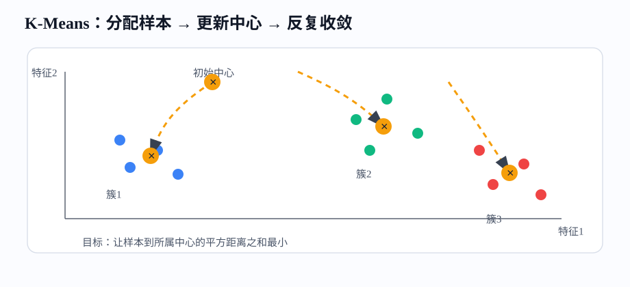
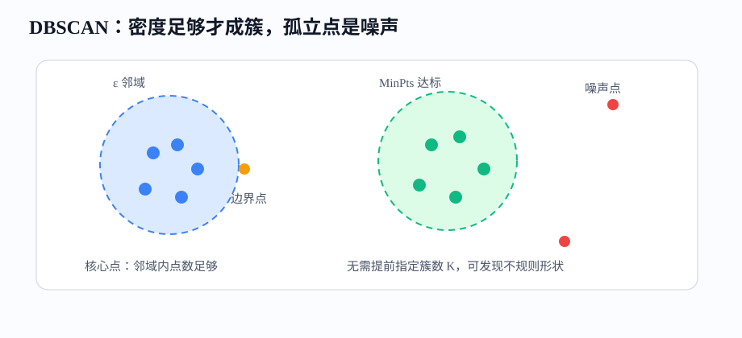
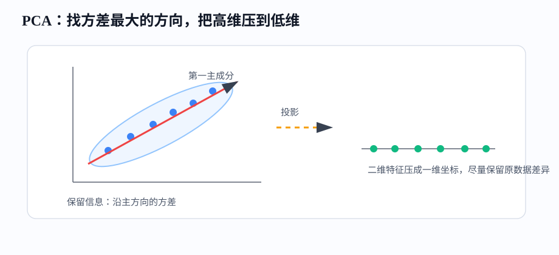

# 课时09-10：传统聚类与降维算法

## 1. 课程定位

本课进入无监督学习：没有标签 $y$，只给特征矩阵 $X$，模型要从数据内部结构中找到分组、低维表示或异常点。

| 监督学习 | 无监督学习 |
|---|---|
| 数据是 $(X,y)$ | 数据主要是 $X$ |
| 学“特征到标签”的映射 | 学“样本之间”和“特征之间”的结构 |
| 常见任务：回归、分类 | 常见任务：聚类、降维、异常检测 |
| 评价指标相对直接 | 评价更依赖业务解释 |

目标：建立两条工程直觉：

1. 聚类：把相似样本放到一起，用于分群、分层、探索和运营策略。
2. 降维：把高维特征压缩成更少维度，用于可视化、去噪、压缩和后续建模。

---

## 2. 学习目标

1. 能区分分类、聚类、降维的目标差异。
2. 能解释距离度量为什么会决定聚类结果。
3. 能说清 K-Means 的目标函数、迭代过程、$K$ 值选择和局限。
4. 能理解 DBSCAN 如何用密度发现不规则簇和噪声点。
5. 能解释 PCA 的核心：找最大方差方向并投影。
6. 能用 sklearn 完成聚类、PCA、二维可视化和基础评价。
7. 能把聚类结果翻译成业务分群，而不是停留在 cluster 0、cluster 1。

---

## 3. 前置知识与本课关系

无监督学习沿用完整建模流水线，但要解决一个不同的问题：如果没有标签 $y$，模型还能从 $X$ 中学到什么？

| 已有基础 | 在无监督学习中的作用 |
|---|---|
| 特征矩阵 $X$ | 无监督学习只看 $X$ 的结构 |
| 距离、内积、协方差 | 用来衡量样本相似、特征相关和主方向 |
| 标准化 | 距离算法和 PCA 前通常必须做 |
| 评价指标 | 无监督评价要结合数学指标和业务含义 |

主线：

$$
X \rightarrow 相似度/距离 \rightarrow 聚类或降维 \rightarrow 可解释分群/低维表示 \rightarrow 业务动作
$$

---

## 4. 无监督学习总览

### 4.1 无监督学习解决什么

无监督学习不告诉模型“正确答案”，而是让模型回答三类问题：

1. 哪些样本像一类？对应聚类。
2. 哪些特征可以压缩？对应降维。
3. 哪些样本不像正常数据？对应异常检测。

业务例子：

| 场景 | 输入特征 | 输出 | 后续动作 |
|---|---|---|---|
| 用户分群 | 活跃天数、消费金额、品类偏好 | 高价值、价格敏感、沉默用户等分组 | 分层运营 |
| 商品分组 | 价格、销量、退货率、类目向量 | 相似商品簇 | 推荐、补货、定价 |
| 风险探索 | 登录频率、设备数、IP 变化 | 异常簇或孤立点 | 人工审核 |
| 特征压缩 | 上百个行为特征 | 少数主成分 | 建模、可视化 |

无监督学习的结果只是“结构线索”，不是天然正确答案。最终要靠业务解释、稳定性和后续效果验证。

---

### 4.2 聚类和分类的区别

1. 分类：训练时知道标签，例如“是否流失”。模型学习边界，新样本直接预测类别。
2. 聚类：训练时没有标签。模型按相似度分组，分完后还要人为解释每组含义。

例子：客户数据有三个字段：近 30 天登录次数、近 30 天消费金额、优惠券使用率。

| 用户 | 登录次数 | 消费金额 | 优惠券使用率 | 可能聚类解释 |
|---:|---:|---:|---:|---|
| A | 25 | 3000 | 0.10 | 高活跃高价值 |
| B | 3 | 80 | 0.90 | 价格敏感低消费 |
| C | 1 | 0 | 0.00 | 沉默用户 |

聚类结果不能直接叫“好用户”“坏用户”。正确做法是先看每个簇的特征均值、人数占比、转化率、留存率，再命名。

---

## 5. 距离与相似度

### 5.1 为什么距离重要

多数聚类算法先回答一个基础问题：两个样本像不像。距离越小，通常越相似。

用户样本：

$$
x_i=[登录次数,消费金额,优惠券使用率]
$$

如果两个用户在三个维度上都接近，就可能被放到同一簇。

但距离会被量纲影响。消费金额可能是几千，优惠券使用率只有 0 到 1。如果不标准化，聚类几乎只看消费金额。

---

### 5.2 常见距离

| 距离 | 公式直觉 | 适合场景 |
|---|---|---|
| 欧氏距离 | 直线距离 | 连续数值特征，K-Means 常用 |
| 曼哈顿距离 | 坐标差绝对值相加 | 网格路径、对异常值略稳 |
| 余弦相似度 | 看方向是否接近 | 文本向量、Embedding、推荐召回 |
| Hamming 距离 | 不同位置个数 | 离散编码、标签集合 |

欧氏距离：

$$
d(x_i,x_j)=\sqrt{\sum_{k=1}^{n}(x_{ik}-x_{jk})^2}
$$

余弦相似度：

$$
cos(x_i,x_j)=\frac{x_i\cdot x_j}{\lVert x_i\rVert \lVert x_j\rVert}
$$

小例子：

1. 两个用户消费金额接近、活跃频次接近：欧氏距离小。
2. 两篇文章长度不同，但主题词方向接近：余弦相似度高。
3. 两个商品标签集合差异很少：Hamming 距离小。

---

### 5.3 标准化必须先做

距离算法对尺度敏感。标准化常用：

$$
z=\frac{x-\mu}{\sigma}
$$

标准化后每个特征大致变成均值为 0、标准差为 1，距离计算不会被“大数值字段”垄断。

工程判断：

1. K-Means、KNN、PCA、线性模型梯度下降（Gradient Descent）：通常要标准化。
2. 决策树、随机森林、GBDT：通常不强依赖标准化。
3. 金额类字段长尾严重时，先做 `log1p` 再标准化更稳。

---

## 6. K-Means 聚类

### 6.1 核心思想

K-Means 把样本分成 $K$ 个簇，每个簇有一个中心点。算法目标是让样本尽量靠近自己的簇中心。

目标函数：

$$
J=\sum_{i=1}^{m}\lVert x_i-c_{z_i}\rVert^2
$$

其中：

1. $x_i$ 是第 $i$ 个样本。
2. $z_i$ 是样本所属簇编号。
3. $c_{z_i}$ 是该簇中心。
4. $J$ 是簇内平方距离和。



---

### 6.2 迭代过程

K-Means 只有两步，循环执行：

1. 分配样本：每个样本分给最近的中心。
2. 更新中心：每个簇中心改为该簇所有样本的均值。

伪代码：

```text
初始化 K 个中心
重复直到中心变化很小：
    对每个样本，找到最近中心
    对每个簇，计算新中心 = 簇内样本均值
输出每个样本的簇编号
```

为什么中心取均值？因为在平方误差下，一组点到某个点的距离平方和最小时，这个点就是均值。

---

### 6.3 K 值怎么选

$K$ 是人为指定的簇数。常用判断方式：

1. 业务先验：运营本来就只能承接 3 类策略，则先试 $K=3$。
2. 肘部法：画 $K$ 与簇内误差 $J$ 的关系，下降明显变慢的位置是候选。
3. 轮廓系数：同时考虑“簇内近”和“簇间远”。
4. 稳定性：换随机种子、换时间窗口后，分群是否还相似。

轮廓系数直觉：

$$
s=\frac{b-a}{\max(a,b)}
$$

其中 $a$ 是样本到本簇其他点的平均距离，$b$ 是样本到最近其他簇的平均距离。$s$ 越接近 1，说明分得越清楚。

---

### 6.4 K-Means 的优缺点

| 优点 | 缺点 |
|---|---|
| 简单、快、可解释 | 必须先指定 $K$ |
| 适合球状簇 | 不适合弯月形、环形等复杂形状 |
| 大数据可扩展 | 对异常点敏感 |
| 结果容易转成业务人群 | 对尺度和初始化敏感 |

适合场景：用户价值分层、门店画像分组、商品粗粒度分群、特征探索。

不适合场景：簇形状很不规则、噪声很多、簇大小差异极大。

---

## 7. 层次聚类

### 7.1 基本思路

层次聚类不是先指定中心，而是逐步合并或拆分样本，形成一棵聚类树。

凝聚式层次聚类流程：

1. 每个样本先自成一簇。
2. 找到距离最近的两个簇合并。
3. 重复合并，直到所有样本成为一棵树。
4. 在合适高度切一刀，得到若干簇。

常见簇间距离：

| 方法 | 含义 | 倾向 |
|---|---|---|
| Single Linkage | 两簇最近点距离 | 容易形成链状簇 |
| Complete Linkage | 两簇最远点距离 | 簇更紧凑 |
| Average Linkage | 两簇平均距离 | 折中 |
| Ward | 合并后方差增加最小 | 常用于数值特征 |

---

### 7.2 什么时候用

层次聚类适合样本量不大、需要看层级结构的场景。

例子：商品类目治理。

1. 一级：食品、服饰、数码。
2. 二级：数码下面分手机、电脑、配件。
3. 三级：手机下面分品牌、价位、功能段。

如果业务希望得到“树状分组”，层次聚类比 K-Means 更直观。

局限：样本量大时计算成本高，切分高度也需要人工判断。

---

## 8. DBSCAN

### 8.1 核心思想

DBSCAN 全称是 Density-Based Spatial Clustering of Applications with Noise，按密度聚类：一个区域里点足够密，就形成簇；孤立点是噪声。

两个关键参数：

1. $\varepsilon$：邻域半径。
2. `min_samples`：半径内至少多少点才算核心点。

点的类型：

1. 核心点：$\varepsilon$ 邻域内样本数达到 `min_samples`。
2. 边界点：自己不是核心点，但落在某个核心点邻域内。
3. 噪声点：既不是核心点，也不属于任何核心点邻域。



---

### 8.2 算法步骤

DBSCAN 的算法过程可以按下面的顺序理解。

**第一步：给定两个参数。**

```python
eps = 0.55
min_samples = 8
```

含义是：

1. 以某个样本为中心，半径 `eps` 以内的样本算邻居。
2. 这个半径内如果至少有 `min_samples` 个样本，这个中心样本就是核心点。

在 sklearn 里，`min_samples` 包含样本自己。因此 `min_samples=8` 表示：

```text
自己 + 附近其他样本，合计至少 8 个。
```

**第二步：判断每个点是不是核心点。**

对每个样本都画一个半径为 `eps` 的邻域圈：

```text
圈内样本数 >= min_samples  → 核心点
圈内样本数 <  min_samples  → 不是核心点
```

不是核心点，不等于一定是噪声点。它还可能是边界点。

**第三步：从核心点向外扩展簇。**

如果点 A 是核心点，A 的 `eps` 邻域里的点会被放进同一个簇。

如果 A 邻域里还有另一个核心点 B，算法会继续从 B 往外扩展。

所以 DBSCAN 的一个簇不是一个固定大小的圆，而是由很多相互连接的核心点邻域扩展出来的密集区域。

**第四步：处理边界点和噪声点。**

1. 不是核心点，但落在某个核心点邻域内：边界点，归入那个簇。
2. 不是核心点，也不落在任何核心点邻域内：噪声点，标签为 `-1`。

因此，DBSCAN 的簇数量不是提前指定的，而是由 `eps` 和 `min_samples` 共同决定的。

---

### 8.3 `NearestNeighbors` 和 DBSCAN 的关系

代码里先出现了：

```python
nn = NearestNeighbors(n_neighbors=min_samples)
```

这一步不是在做 DBSCAN 聚类，而是在帮我们选择 `eps`。

以 `min_samples=8` 为例，`NearestNeighbors(n_neighbors=8)` 会对每个点找最近的 8 个点，并返回距离：

```text
点 A 最近 8 个点的距离：[0.000, 0.120, 0.180, 0.210, 0.260, 0.310, 0.370, 0.450]
```

最后一个 `0.450` 是点 A 到第 8 个近邻的距离。它也可以理解成：

```text
点 A 想在自己的邻域里凑够 8 个样本，半径至少要开到 0.450。
```

然后代码取出所有样本的第 8 近邻距离：

```python
k_distance = np.sort(distances[:, -1])
```

如果一个点的第 8 近邻距离小，说明它周围密。  
如果一个点的第 8 近邻距离大，说明它周围稀。

所以：

```python
print("largest k-distances:", k_distance[-10:].round(3))
```

只是打印最大的 10 个第 8 近邻距离，用来看最稀疏的那批点大概有多稀。这里的 10 没有算法含义，只是避免把所有样本的距离都打印出来。

如果输出是：

```text
largest k-distances: [0.709 0.738 0.755 0.771 0.771 0.792 0.794 0.808 0.813 1.093]
```

含义是：

```text
最稀疏的 10 个样本，要凑够 8 个近邻，需要的半径在 0.709 到 1.093 之间。
```

真正决定一个点是不是核心点，要看：

```text
这个点的第 8 近邻距离 <= eps 吗？
```

如果成立，说明这个点在半径 `eps` 内能凑够 8 个样本，所以它是核心点。  
如果不成立，说明它自己不是核心点，但它仍然可能是边界点。

---

### 8.4 `eps` 大小对结果的影响

`eps` 是 DBSCAN 最敏感的参数。

如果 `eps` 太小：

```text
很多点的邻域里凑不够 min_samples 个样本。
结果：噪声点变多，簇可能被切得太碎。
```

如果 `eps` 太大：

```text
原本应该分开的密集区域可能被连接起来。
结果：簇数量变少，不同群体可能被合并。
```

结合当前示例：

```text
k-distance quantiles 50%/90%/95%/99%: [0.347 0.530 0.599 0.771]
```

可以这样读：

1. 50% 的样本，第 8 近邻距离不超过 0.347。
2. 90% 的样本，第 8 近邻距离不超过 0.530。
3. 95% 的样本，第 8 近邻距离不超过 0.599。
4. 99% 的样本，第 8 近邻距离不超过 0.771。

所以可以先试 `eps=0.55`。它接近 90% 到 95% 分位之间，能保留主要密集区域，同时允许少数稀疏点成为噪声点。

如果试 `eps=0.90`，它已经超过 99% 分位，半径过宽，相邻密度区域更容易被连成一个簇。

---


### 8.5 DBSCAN 的工程价值

DBSCAN 的优势：

1. 不用提前指定簇数。
2. 能识别噪声点。
3. 能发现不规则形状的簇。

常见用途：

1. 设备异常登录：多数设备行为集中，异常设备孤立。
2. 地理位置聚类：商圈、配送点、共享单车停放区。
3. 异常订单探索：少量订单模式和主流完全不同。

局限：

1. 对参数 $\varepsilon$ 很敏感。
2. 不同簇密度差异很大时效果差。
3. 高维空间里距离会失真，需要先降维或筛特征。

---

## 9. 聚类评价

### 9.1 数学指标

| 指标 | 看什么 | 注意 |
|---|---|---|
| Inertia | 簇内平方距离和 | 只适合 K-Means 直觉，随 $K$ 增大必降 |
| Silhouette | 簇内近、簇间远 | 值越高越好，但不是业务真理 |
| Davies-Bouldin | 簇紧凑度与分离度 | 越低越好 |
| Calinski-Harabasz | 簇间离散 / 簇内离散 | 越高越好 |

如果有少量业务标签，可以做辅助验证。例如聚类后发现某簇流失率明显高，说明分群可能有业务价值。

---

### 9.2 业务评价

聚类不能只看指标。更重要的是回答：

1. 每个簇能不能命名？例如“高价值稳定用户”“低频价格敏感用户”。
2. 每个簇规模是否可运营？如果某簇只有 5 人，可能无法单独制定策略。
3. 每个簇是否稳定？下个月重新跑，用户画像是否大体一致。
4. 每个簇是否能带来动作差异？不同簇如果策略一样，分群就没有价值。

聚类报告至少包含：簇规模、关键特征均值、业务指标、建议动作。

---

## 10. 降维问题

### 10.1 为什么降维

高维特征常见问题：

1. 计算慢：特征越多，训练和预测成本越高。
2. 噪声多：很多特征只带来随机波动。
3. 可视化困难：超过三维人无法直接看。
4. 共线性强：多个特征表达同一信息，影响线性模型稳定。
5. 距离失效：高维空间中样本距离容易变得都差不多。

降维的目标不是随便删列，而是在损失尽量少的前提下压缩信息。

---

### 10.2 两类降维

| 类型 | 方法 | 输出含义 | 适合用途 |
|---|---|---|---|
| 特征选择 | 删除部分原始特征 | 保留原字段含义 | 建模解释、特征治理 |
| 特征提取 | 组合生成新特征 | 新维度是原特征组合 | 压缩、去噪、可视化 |

PCA 属于特征提取。它生成的新特征叫主成分，通常不再对应某一个原始字段，而是多个字段的线性组合。

---

## 11. PCA 主成分分析

### 11.1 PCA 想解决什么

PCA 全称是 Principal Component Analysis，中文是主成分分析。它找数据变化最大的方向，再把数据投影到这些方向上。变化大意味着该方向更能区分样本。



一个二维例子：用户有两个高度相关特征。

1. 近 30 天消费金额。
2. 近 30 天订单金额。

这两个字段通常一起变大，一起变小。PCA 会找到“总体消费强度”这个主方向，用一个新维度表示大部分信息。

---

### 11.2 PCA 的数学流程

输入矩阵：

$$
X\in \mathbb{R}^{m\times n}
$$

其中 $m$ 是样本数，$n$ 是特征数。

步骤：

1. 标准化：消除量纲影响。
2. 中心化：每列减去均值。
3. 计算协方差矩阵：

$$
\Sigma=\frac{1}{m}X^TX
$$

4. 求特征值和特征向量。
5. 按特征值从大到小排序。
6. 选前 $k$ 个特征向量组成投影矩阵。
7. 得到低维表示：

$$
Z=XW_k
$$

特征值表示该方向保留的方差大小，特征向量表示方向。

---

### 11.3 解释方差率

解释方差率衡量每个主成分保留了多少信息。

$$
ratio_j=\frac{\lambda_j}{\sum_{i=1}^{n}\lambda_i}
$$

例子：

| 主成分 | 解释方差率 | 累计解释方差率 |
|---:|---:|---:|
| PC1 | 0.62 | 0.62 |
| PC2 | 0.21 | 0.83 |
| PC3 | 0.09 | 0.92 |
| PC4 | 0.04 | 0.96 |

如果保留前 3 个主成分，意味着大约保留 92% 的线性方差信息。

---

### 11.4 PCA 的用途和限制

用途：

1. 可视化：高维数据压到 2D 或 3D，看分布和聚类。
2. 去噪：丢掉小方差方向，减少随机扰动。
3. 加速：减少特征维度，提升训练速度。
4. 缓解共线性：把相关特征转换为互相正交的主成分。

限制：

1. PCA 只捕捉线性结构。
2. 主成分可解释性弱，不如原始字段直观。
3. 标准化方式会影响结果。
4. 小方差方向不一定没业务价值，例如罕见风险信号可能方差很小。

---

## 12. t-SNE 与 UMAP

### 12.1 用途定位

PCA 偏工程压缩，t-SNE 和 UMAP 更偏可视化探索。t-SNE 是 t-distributed Stochastic Neighbor Embedding，UMAP 是 Uniform Manifold Approximation and Projection。

| 方法 | 核心 | 常见用途 | 注意 |
|---|---|---|---|
| PCA | 线性投影，保留最大方差 | 压缩、降噪、baseline | 可解释、速度快 |
| t-SNE | 保留局部邻域 | 高维嵌入可视化 | 不适合直接当训练特征 |
| UMAP | 保留局部与部分全局结构 | Embedding 可视化、聚类前探索 | 参数影响形状 |

工程取舍：PCA 可以进入生产特征管线；t-SNE / UMAP 多用于分析，不轻易作为线上模型输入。

---

### 12.2 怎么看二维可视化

二维图上的簇只能作为线索，不能过度解读。

正确看法：

1. 同一颜色是否大致集中：说明聚类或标签有结构。
2. 不同颜色是否明显分开：说明特征有区分能力。
3. 是否有孤立点：可能是异常样本，也可能是数据错误。
4. 多次运行是否稳定：t-SNE 对随机种子和参数敏感。

低质量解读：

1. 把二维距离当作原始高维距离的精确等价。
2. 看到两个团就立即下业务结论。
3. 不看原始特征统计，只凭图片命名人群。

---

## 13. 工业案例：用户行为分群

### 13.1 数据设计

假设有一张用户月度行为表：

| 字段 | 含义 | 处理建议 |
|---|---|---|
| login_days_30d | 近 30 天登录天数 | 标准化 |
| pay_amount_30d | 近 30 天支付金额 | `log1p` 后标准化 |
| order_cnt_30d | 近 30 天下单次数 | `log1p` 后标准化 |
| coupon_use_rate | 优惠券使用率 | 缺失填 0 |
| last_active_days | 距最后活跃天数 | 可截尾 |
| refund_rate | 退款率 | 异常值检查 |

建模流程：

$$
原始表 \rightarrow 清洗 \rightarrow 特征缩放 \rightarrow K-Means/DBSCAN \rightarrow 簇画像 \rightarrow 运营策略
$$

---

### 13.2 簇画像怎么写

低价值输出：

```text
cluster=0, cluster=1, cluster=2
```

高价值输出：转成业务语言。

| 簇 | 特征表现 | 命名 | 动作 |
|---:|---|---|---|
| 0 | 登录高、消费高、优惠券低 | 高价值稳定用户 | 会员权益、复购激励 |
| 1 | 登录中、消费低、优惠券高 | 价格敏感用户 | 定向优惠、组合券 |
| 2 | 登录低、最近未活跃 | 流失风险用户 | 召回、低成本触达 |
| 3 | 退款率高、设备变化多 | 风险异常用户 | 限制权益、人工审核 |

聚类真正交付物是“可行动的人群分层”，不是算法结果截图。

---

## 14. 代码实操

### 14.1 K-Means + PCA 用户分群

完整脚本见：[K-Means + PCA 用户分群](../codes/lesson_09_10_clustering_pca/00_kmeans_pca_user_segments.py)。

```python
import numpy as np
import pandas as pd
from sklearn.preprocessing import StandardScaler
from sklearn.cluster import KMeans
from sklearn.decomposition import PCA
from sklearn.metrics import silhouette_score

rng = np.random.default_rng(42)

n = 600
high_value = np.column_stack([
    rng.normal(24, 4, n // 3),
    rng.lognormal(7.7, 0.35, n // 3),
    rng.normal(18, 4, n // 3),
    rng.normal(0.10, 0.04, n // 3),
])
price_sensitive = np.column_stack([
    rng.normal(12, 4, n // 3),
    rng.lognormal(6.0, 0.45, n // 3),
    rng.normal(5, 2, n // 3),
    rng.normal(0.72, 0.10, n // 3),
])
silent = np.column_stack([
    rng.normal(3, 2, n // 3),
    rng.lognormal(4.8, 0.5, n // 3),
    rng.normal(1, 1, n // 3),
    rng.normal(0.30, 0.15, n // 3),
])

X = np.vstack([high_value, price_sensitive, silent])
df = pd.DataFrame(X, columns=[
    "login_days_30d", "pay_amount_30d", "order_cnt_30d", "coupon_use_rate"
])
df["login_days_30d"] = df["login_days_30d"].clip(0, 30)
df["order_cnt_30d"] = df["order_cnt_30d"].clip(0)
df["coupon_use_rate"] = df["coupon_use_rate"].clip(0, 1)

df_model = df.copy()
df_model["pay_amount_30d"] = np.log1p(df_model["pay_amount_30d"])

scaler = StandardScaler()
X_scaled = scaler.fit_transform(df_model)

for k in range(2, 7):
    km = KMeans(n_clusters=k, random_state=42, n_init=10)
    labels = km.fit_predict(X_scaled)
    score = silhouette_score(X_scaled, labels)
    print(k, round(score, 3), round(km.inertia_, 1))

km = KMeans(n_clusters=3, random_state=42, n_init=10)
df["cluster"] = km.fit_predict(X_scaled)

profile = df.groupby("cluster").mean().round(2)
print(profile)

pca = PCA(n_components=2)
Z = pca.fit_transform(X_scaled)
explained_ratio = pca.explained_variance_ratio_
print("explained variance by component:", explained_ratio.round(3))
print("total explained variance:", round(explained_ratio.sum(), 3))
```

代码重点：

1. 金额长尾先做 `log1p`。
2. 聚类前做标准化。
3. 先用多个 $K$ 对比，再选候选值。
4. PCA 二维结果用于观察，不直接替代业务解释。`total explained variance` 表示这两个维度合计保留了多少原始差异。

---

### 14.2 DBSCAN 识别异常群体

完整脚本见：[DBSCAN 识别异常群体](../codes/lesson_09_10_clustering_pca/01_dbscan_outliers.py)。

```python
from sklearn.cluster import DBSCAN
from sklearn.neighbors import NearestNeighbors

# min_samples 可先设为 特征数 * 2
min_samples = X_scaled.shape[1] * 2

# 第一步：先用 NearestNeighbors 计算近邻距离
# 这一步不做聚类，只是为了给 DBSCAN 的 eps 找一个参考范围
nn = NearestNeighbors(n_neighbors=min_samples)
nn.fit(X_scaled)
distances, _ = nn.kneighbors(X_scaled)

# 第二步：取每个样本到“第 min_samples 个近邻”的距离
# 如果这个距离很大，说明这个样本周围比较稀疏
k_distance = np.sort(distances[:, -1])
print("largest k-distances:", k_distance[-10:].round(3))
print("k-distance quantiles 50%/90%/95%/99%:", np.quantile(k_distance, [0.5, 0.9, 0.95, 0.99]).round(3))

# 根据上面的距离分布，选择候选 eps，再运行 DBSCAN
for eps in [0.55, 0.90]:
    db = DBSCAN(eps=eps, min_samples=min_samples)
    df["dbscan_label"] = db.fit_predict(X_scaled)
    print(f"eps={eps}")
    print(df["dbscan_label"].value_counts().sort_index())
```

这段程序分成两步：

1. 先用 `NearestNeighbors(n_neighbors=min_samples)` 计算近邻距离。这一步不产生簇，只用于观察“每个点要凑够 `min_samples` 个近邻，大概要多大的半径”。
2. 再根据距离分布选择候选 `eps`，把 `eps` 和 `min_samples` 交给 `DBSCAN` 做聚类。

`dbscan_label=-1` 表示噪声点。噪声点不一定都是坏样本，但值得单独检查。`largest k-distances` 不是簇数量，而是最稀疏样本到第 `min_samples` 个近邻的距离；`eps` 取得越大，越容易把相邻的密度区域连成一个簇。

---

## 15. 常见问题

1. 聚类结果每次不一样：K-Means 初始化有随机性，设置 `random_state`，并观察多次运行稳定性。
2. 轮廓系数高但业务解释差：数学分得开不等于业务可行动，必须做簇画像。
3. PCA 后指标下降：降维丢失了有效信息，减少压缩强度或改用特征选择。
4. t-SNE 图很漂亮但上线无收益：二维可视化只是探索工具，不是业务动作。
5. 高维聚类效果差：先做标准化、特征筛选、PCA，再尝试聚类。

---

## 16. 本课总结

1. 无监督学习只有 $X$，目标是发现结构，不是预测已知标签。
2. 聚类依赖距离或密度，特征尺度会直接影响结果。
3. K-Means 简单高效，适合球状簇和分层运营 baseline。
4. DBSCAN 能识别噪声和不规则簇，但参数敏感。
5. PCA 通过主成分保留最大方差信息，适合压缩、去噪和可视化。
6. 聚类落地必须输出簇画像、规模、业务指标和动作策略。

---

## 17. 课后作业

1. 用一个公开表格数据集完成 K-Means 分群，至少尝试 $K=2$ 到 $K=6$。
2. 输出每个 $K$ 的 inertia 和 silhouette，并说明最终选择理由。
3. 对最终聚类结果做簇画像：人数占比、关键特征均值、业务命名、策略建议。
4. 使用 PCA 降到二维，画出聚类散点图，并说明图中结构是否可信。
5. 使用 DBSCAN 找噪声点，抽样检查噪声样本有什么共同特征。

---

## 18. 知识延伸

聚类和降维主要依赖距离、密度和方差；树模型采用另一种思路，用一连串条件切分样本，不要求数据满足全局线性关系，也不主要依赖样本距离。决策树是随机森林、GBDT、XGBoost 和 LightGBM 的结构基础。
