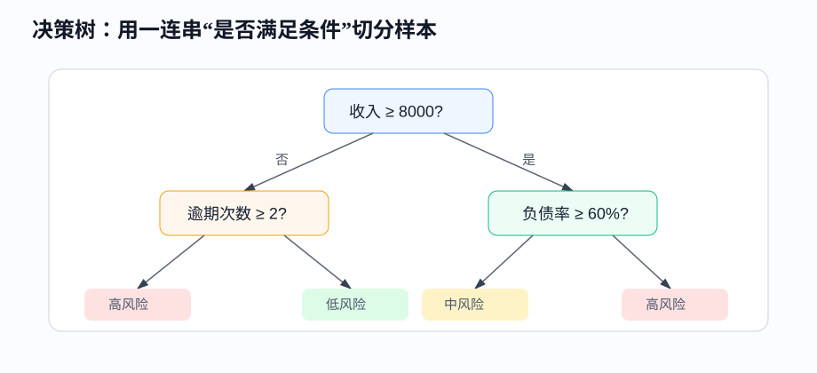
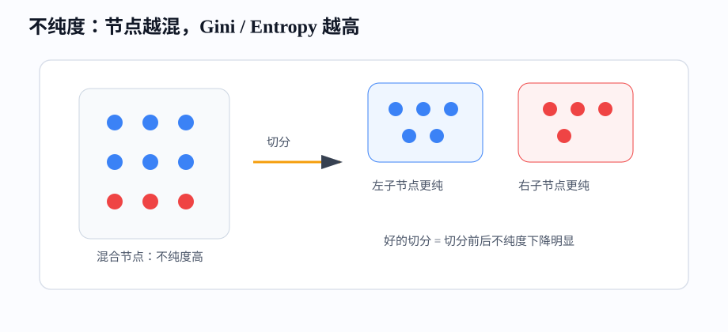
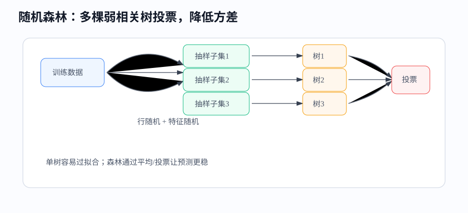

# 课时11-12：树模型基础

## 1. 课程定位

本课进入树模型。树模型是传统机器学习里最适合表格数据的模型族之一，核心能力是用条件切分处理非线性、特征交互和不同尺度字段。

| 线性模型 | 树模型 |
|---|---|
| 用加权求和表达关系 | 用条件分裂表达规则 |
| 强依赖特征缩放和线性关系 | 对缩放不敏感，能处理非线性 |
| 可解释性来自权重 | 可解释性来自切分路径和特征重要性 |
| baseline 简洁稳定 | 表格数据上经常更强 |

主线：

$$
样本 \rightarrow 条件切分 \rightarrow 叶子节点 \rightarrow 分类概率或回归值
$$

---

## 2. 学习目标

1. 能解释决策树如何用条件切分样本。
2. 能理解分类树中的 Gini、Entropy、信息增益。
3. 能理解回归树为什么用 MSE 或方差下降选择切分。
4. 能解释树模型为什么容易过拟合（Overfitting），以及如何剪枝。
5. 能说清随机森林如何通过 Bagging 降低方差。
6. 能读取树模型的特征重要性，并知道它的局限。
7. 能用 sklearn 完成决策树、随机森林训练、评估和调参。

---

## 3. 前置知识与本课关系

树模型采用不同于线性模型和距离模型的表达方式：它不使用一个全局公式覆盖所有样本，而是把样本切分到不同区域，再为每个区域给出预测。

| 已有知识 | 树模型中的对应 |
|---|---|
| 过拟合和泛化（Generalization） | 树太深会记住训练样本 |
| 损失和指标 | 切分要让节点更纯或误差更小 |
| 特征工程（Feature Engineering） | 树能自动处理部分非线性和交互 |
| 训练/验证划分 | 调参必须看验证集，不能只看训练集 |

---

## 4. 为什么需要树模型

### 4.1 线性模型的表达限制

线性模型常见形式：

$$
\hat{y}=w_1x_1+w_2x_2+\cdots+w_nx_n+b
$$

它默认每个特征对结果的影响是全局一致的。现实业务中经常不是这样。

例子：优惠券对购买概率的影响。

1. 新用户：小额券可能明显提升首单。
2. 老用户：优惠券影响不大，服务体验更重要。
3. 价格敏感用户：券金额越高越容易转化。
4. 高价值用户：频繁发券可能反而降低利润。

树模型可以表达：

```text
如果 用户类型=新用户 且 浏览次数高 → 发券有效
如果 用户类型=老用户 且 最近已购买 → 发券收益低
```

这种分段规则对表格业务很自然。

---

### 4.2 树模型的优势

1. 能处理非线性：不同区间可以有不同预测。
2. 能处理特征交互：先按收入切，再按负债率切。
3. 对特征尺度不敏感：金额是否标准化通常不影响切分顺序。
4. 可解释：可以查看路径、叶子、特征重要性。
5. 对混合字段友好：数值、类别、缺失值经过适当处理都能用。

局限：单棵树容易过拟合，边界呈阶梯状，对小数据扰动敏感。

---

## 5. 决策树基本思想

### 5.1 树如何做判断

决策树由三类节点组成：

1. 根节点：第一次切分，全体样本从这里进入。
2. 内部节点：继续根据条件分裂。
3. 叶子节点：不再分裂，给出预测结果。



一条样本的预测路径：

```text
收入 ≥ 8000 → 是
负债率 ≥ 60% → 是
预测：高风险
```

分类树的叶子输出通常是类别概率；回归树的叶子输出通常是该叶子训练样本标签均值。

---

### 5.2 特征切分是什么

一次切分就是选择一个特征和一个阈值，把样本分成左右两部分。

数值特征：

```text
age <= 35
income > 8000
debt_ratio <= 0.6
```

类别特征：

```text
city in {北京, 上海, 深圳}
channel in {自然流量, 付费广告}
```

sklearn 的基础决策树需要把类别特征先编码。LightGBM、CatBoost 等工程模型对类别特征支持更丰富，但也要注意编码方式和泄漏问题。

---

### 5.3 什么是“好切分”

好切分让子节点更纯。

分类任务：一个节点里全是同一类，最好；正负样本混在一起，不好。

回归任务：一个节点里标签值都接近，最好；有高有低，误差大。

树训练过程：

1. 枚举候选特征和阈值。
2. 计算切分前后的不纯度或误差下降。
3. 选择下降最大的切分。
4. 递归处理左右子节点。
5. 达到停止条件后生成叶子。

---

## 6. 分类树：Gini、Entropy、信息增益

### 6.1 Gini 系数

Gini 衡量节点类别混乱程度：

$$
Gini=1-\sum_{k=1}^{K}p_k^2
$$

其中 $p_k$ 是节点中第 $k$ 类样本占比。

二分类例子：

| 节点 | 正样本占比 | 负样本占比 | Gini |
|---|---:|---:|---:|
| A | 0.5 | 0.5 | 0.5 |
| B | 0.9 | 0.1 | 0.18 |
| C | 1.0 | 0.0 | 0 |

Gini 越低，节点越纯。



---

### 6.2 Entropy 和信息增益

信息熵衡量不确定性：

$$
Entropy=-\sum_{k=1}^{K}p_k\log_2 p_k
$$

二分类中：

1. $p=0.5$ 时最混乱，熵最高。
2. $p=0$ 或 $p=1$ 时完全确定，熵为 0。

信息增益：

$$
Gain=Entropy(parent)-\sum_j\frac{m_j}{m}Entropy(child_j)
$$

含义：切分后不确定性下降了多少。

几个名字的含义：ID3 是早期分类树算法，核心用信息增益；C4.5 是 ID3 的改进版，常用信息增益率；CART 是 Classification And Regression Tree，同时支持分类树和回归树，常用 Gini 或 MSE。

工业理解抓住一点：这些算法都在找“让子节点更纯”的切分。

---

### 6.3 Gini 和 Entropy 怎么选

两者通常结果接近。

| 对比 | Gini | Entropy |
|---|---|---|
| 计算 | 更简单 | 需要对数 |
| 直觉 | 随机抽错概率 | 不确定性 |
| sklearn 默认 | CART 分类树常用 | 可手动指定 |
| 实战差异 | 通常很小 | 通常很小 |

工程上优先通过验证集调参，不要在 Gini 和 Entropy 上纠结太久。

---

## 7. 回归树

### 7.1 叶子节点怎么预测

回归树用于预测连续值。一个叶子节点中可能有多个训练样本，叶子预测值通常取这些样本标签的均值。

例子：某叶子节点里房价为：

$$
[280,300,320]
$$

叶子预测：

$$
\hat{y}=\frac{280+300+320}{3}=300
$$

新样本落到这个叶子，就预测 300。

---

### 7.2 回归树如何选择切分

回归树希望切分后每个子节点内部标签更接近。常用标准是 MSE 下降。

切分前误差：

$$
SSE_{parent}=\sum_i(y_i-\bar{y})^2
$$

切分后误差：

$$
SSE_{split}=SSE_{left}+SSE_{right}
$$

选择让下面这个值最大的切分：

$$
Gain=SSE_{parent}-SSE_{split}
$$

小例子：

| 样本 | 面积 | 房价 |
|---:|---:|---:|
| A | 60 | 180 |
| B | 70 | 210 |
| C | 120 | 390 |
| D | 130 | 420 |

按面积 $\le 90$ 切分后，左边房价接近 180、210，右边接近 390、420，两个叶子都更纯，MSE 大幅下降。

---

## 8. 树为什么容易过拟合（Overfitting）

### 8.1 过拟合（Overfitting）来源

如果树不断分裂，最终可能每个叶子只有一个样本。训练集误差接近 0，但新数据效果差。

常见信号：

1. 训练集准确率（Accuracy）极高，验证集明显低。
2. 树深度很大，叶子很多。
3. 部分叶子样本数很少。
4. 特征重要性集中在可疑字段上，例如 ID、时间戳、泄漏字段。

---

### 8.2 控制复杂度的参数

| 参数 | 作用 | 直觉 |
|---|---|---|
| `max_depth` | 限制最大深度 | 树不能无限细分 |
| `min_samples_split` | 节点继续分裂所需最小样本数 | 小节点别再切 |
| `min_samples_leaf` | 叶子最少样本数 | 避免一叶一个样本 |
| `max_leaf_nodes` | 限制叶子数量 | 控制规则数量 |
| `ccp_alpha` | 代价复杂度剪枝 | 用惩罚项砍掉收益小的分支 |

调参经验：先限制 `max_depth` 和 `min_samples_leaf`，看验证集是否改善。

---

### 8.3 预剪枝与后剪枝

1. 预剪枝：训练过程中提前停止分裂，例如限制深度、叶子最小样本数。
2. 后剪枝：先长出较完整的树，再删除收益不大的分支。

工程里常用预剪枝，因为简单稳定。后剪枝适合需要进一步压缩模型复杂度的场景。

---

## 9. 随机森林

### 9.1 Bagging 思想

Bagging 是 Bootstrap Aggregating 的缩写：

1. 从训练集中有放回抽样，得到多个子训练集。
2. 每个子训练集训练一棵树。
3. 分类用投票，回归用平均。

随机森林在 Bagging 基础上又增加“特征随机”：每个节点切分时只看一部分特征。



---

### 9.2 随机森林为什么更稳

单棵树方差高：训练数据稍微变动，树结构可能大变。

随机森林降低方差的方式：

1. 每棵树看到的数据不同。
2. 每个节点看到的候选特征不同。
3. 多棵树平均后，单棵树的偶然错误被抵消。

类比：一个人做判断容易偏，多个独立专家投票更稳。前提是这些专家不要完全一样，所以要引入随机性。

---

### 9.3 OOB 误差

OOB 是 Out-Of-Bag。每棵树训练时只抽到部分样本，没被抽到的样本可以当作该树的验证样本。

用途：

1. 不额外划分验证集时，粗略估计泛化误差。
2. 小数据场景下节省验证数据。
3. 对比不同超参数的大致效果。

注意：OOB 不能替代最终测试集。

---

## 10. Extra Trees

Extra Trees 全称是 Extremely Randomized Trees。它比随机森林更随机：

1. 随机森林通常为候选特征寻找较优切分点。
2. Extra Trees 可以随机选择切分阈值，再从随机候选里选较好的。

效果：

1. 方差更低。
2. 训练可能更快。
3. 偏差可能更高。

适合快速构建强 baseline，尤其是特征多、单棵树容易过拟合时。

---

## 11. 特征重要性

### 11.1 Impurity Importance

树模型常见特征重要性来自“不纯度下降贡献”。某个特征越经常带来有效切分，重要性越高。

优点：训练后直接得到，速度快。

局限：

1. 取值范围多的特征可能被偏爱。
2. 强相关特征会互相分摊重要性。
3. 重要性高不代表因果关系。
4. 泄漏字段可能显示极高重要性。

---

### 11.2 Permutation Importance

Permutation Importance 的做法：打乱某个特征，看模型指标下降多少。

如果打乱 `income` 后 AUC 明显下降，说明模型依赖这个字段。

步骤：

1. 在验证集上记录原始指标。
2. 随机打乱某一列。
3. 再次预测并计算指标。
4. 指标下降越多，该特征越重要。

它更贴近模型预测效果，但计算更慢。

---

### 11.3 如何读特征重要性

正确用法：

1. 排查泄漏：异常高的重要性要先怀疑。
2. 做特征筛选：删除长期无贡献字段。
3. 解释模型：说明模型主要依赖哪些维度。
4. 发现业务线索：高重要性特征可能对应关键业务杠杆。

不要把特征重要性解读成“这个因素一定导致结果”。机器学习相关性不等于因果。

---

## 12. 代码实操

### 12.1 决策树与随机森林对比

完整脚本见：[决策树与随机森林对比](../codes/lesson_11_12_tree_models/00_decision_tree_random_forest.py)。

```python
from sklearn.datasets import load_breast_cancer
from sklearn.model_selection import train_test_split
from sklearn.tree import DecisionTreeClassifier, export_text
from sklearn.ensemble import RandomForestClassifier, ExtraTreesClassifier
from sklearn.metrics import accuracy_score, roc_auc_score, classification_report

X, y = load_breast_cancer(return_X_y=True)
feature_names = load_breast_cancer().feature_names

X_train, X_test, y_train, y_test = train_test_split(
    X, y, test_size=0.25, random_state=42, stratify=y
)

models = {
    "tree_deep": DecisionTreeClassifier(random_state=42),
    "tree_pruned": DecisionTreeClassifier(max_depth=4, min_samples_leaf=10, random_state=42),
    "forest": RandomForestClassifier(
        n_estimators=200, max_depth=None, min_samples_leaf=3,
        random_state=42, n_jobs=-1, oob_score=True
    ),
    "extra_trees": ExtraTreesClassifier(
        n_estimators=200, min_samples_leaf=3,
        random_state=42, n_jobs=-1
    ),
}

for name, model in models.items():
    model.fit(X_train, y_train)
    pred = model.predict(X_test)
    proba = model.predict_proba(X_test)[:, 1]
    print(name)
    print("accuracy:", round(accuracy_score(y_test, pred), 4))
    print("auc:", round(roc_auc_score(y_test, proba), 4))
    if hasattr(model, "oob_score_"):
        print("oob:", round(model.oob_score_, 4))
    print()

small_tree = models["tree_pruned"]
print(export_text(small_tree, feature_names=list(feature_names), max_depth=3))
```

观察重点：深树训练集通常更好，但测试集不一定更好；剪枝树更可解释；随机森林更稳。

---

### 12.2 特征重要性

完整脚本见：[特征重要性](../codes/lesson_11_12_tree_models/01_feature_importance.py)。

```python
import pandas as pd
from sklearn.inspection import permutation_importance

rf = models["forest"]
importance = pd.DataFrame({
    "feature": feature_names,
    "impurity_importance": rf.feature_importances_,
}).sort_values("impurity_importance", ascending=False)
print(importance.head(10))

perm = permutation_importance(
    rf, X_test, y_test, scoring="roc_auc", n_repeats=10, random_state=42, n_jobs=-1
)
perm_importance = pd.DataFrame({
    "feature": feature_names,
    "perm_importance": perm.importances_mean,
}).sort_values("perm_importance", ascending=False)
print(perm_importance.head(10))
```

对比两种重要性。如果排名差异很大，要检查特征相关性、样本量和指标稳定性。

---

## 13. 常见问题

1. 树模型是否需要标准化：通常不需要，因为树只关心排序和阈值。
2. 类别特征怎么处理：基础 sklearn 可用 One-Hot、OrdinalEncoder；高基数类别要防止维度爆炸和泄漏。
3. 树越深越好吗：训练集会更好，泛化不一定更好。
4. 随机森林为什么比单树强：多棵弱相关树平均，降低方差。
5. 特征重要性能否说明因果：不能，只说明模型预测依赖。
6. 树模型能外推吗：很弱。训练集中面积最大 150 平米，回归树很难自然外推到 300 平米的线性趋势。

---

## 14. 本课总结

1. 决策树通过条件切分把复杂问题拆成多个局部规则。
2. 分类树用 Gini 或 Entropy 衡量节点纯度，回归树用 MSE 或方差下降。
3. 单棵树可解释但容易过拟合，需要限制深度、叶子样本数或剪枝。
4. 随机森林通过样本随机和特征随机训练多棵树，预测更稳。
5. 特征重要性有价值，但必须结合泄漏检查、相关性和业务常识。
6. 树模型是后续 GBDT、XGBoost、LightGBM 的基础。

---

## 15. 课后作业

1. 使用 sklearn 训练一棵不限制深度的决策树，再训练一棵限制 `max_depth=4` 的决策树，对比训练集和测试集指标。
2. 调整 `min_samples_leaf`，记录过拟合变化。
3. 训练随机森林，输出 OOB 分数、测试集 AUC 和前 10 个特征重要性。
4. 用 `export_text` 打印一棵小树，用自然语言解释 3 条预测路径。
5. 找一个业务表格场景，写出树模型可能学到的 5 条条件规则。

---

## 16. 知识延伸

GBDT、XGBoost 和 LightGBM 都建立在决策树之上。它们把随机森林的“多棵树并行投票或平均”改为“多棵树串行纠错”，形成表格建模中常用的强模型体系。
