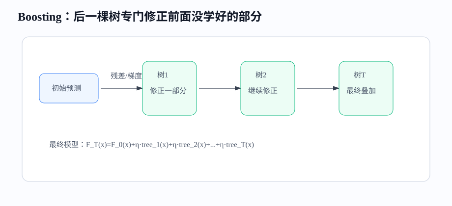
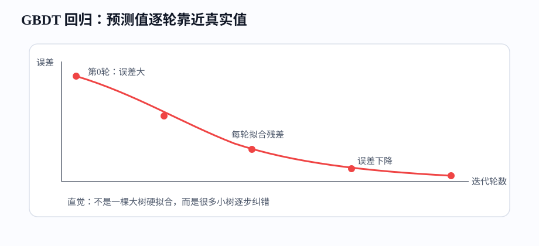
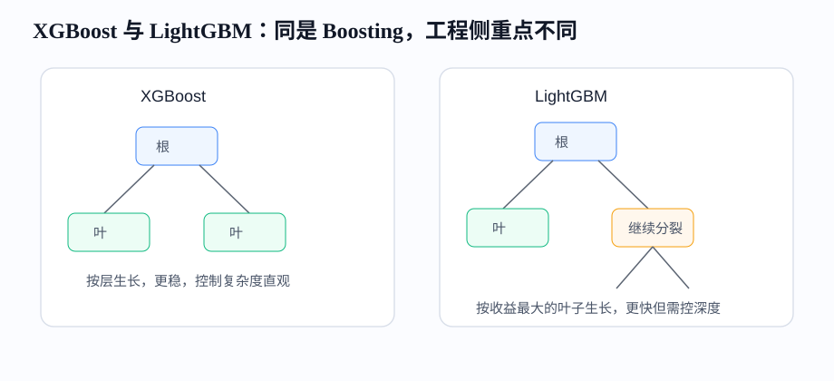

# 课时13-14：工业王牌模型 GBDT / XGBoost / LightGBM

## 1. 课程定位

本课学习传统机器学习中最重要的工业模型族：GBDT、XGBoost、LightGBM。它们长期占据风控、广告、推荐、销量预测、用户增长等表格数据场景。

| 模型 | 全称 | 核心定位 |
|---|---|---|
| GBDT | Gradient Boosting Decision Tree | 梯度提升树的基本思想，理解 Boosting 的根 |
| XGBoost | eXtreme Gradient Boosting | 在 GBDT 上加入二阶梯度、正则化（Regularization）、缺失值处理和工程优化 |
| LightGBM | Light Gradient Boosting Machine | 面向大规模数据的高效 GBDT 实现，速度和内存更优 |

主线：

$$
单棵树 \rightarrow 多棵树集成 \rightarrow Boosting 串行纠错 \rightarrow 工业高性能表格模型
$$

---

## 2. 学习目标

1. 能区分 Bagging 和 Boosting。
2. 能解释 GBDT 为什么是“逐轮修正错误”。
3. 能理解回归 GBDT 中残差的含义。
4. 能理解 XGBoost 的二阶梯度、正则化、缺失值方向和采样。
5. 能理解 LightGBM 的 Histogram、Leaf-wise、GOSS、EFB。
6. 能根据数据量、精度、速度、可解释性选择模型。
7. 能完成一次 XGBoost / LightGBM 训练、评估和调参。

---

## 3. 前置知识与本课关系

GBDT、XGBoost 和 LightGBM 都以决策树为基础。随机森林让多棵树并行训练，最后投票或平均；Boosting 则串行训练，让后一棵树重点修正前面模型的错误。

| 模型 | 树之间关系 | 主要解决 |
|---|---|---|
| 单棵树 | 一棵树独立预测 | 可解释、易过拟合（Overfitting） |
| 随机森林 | 多棵树并行，结果平均 | 降低方差 |
| GBDT 系列 | 多棵树串行，逐步纠错 | 降低偏差，提升精度 |

---

## 4. Boosting 总览

### 4.1 Bagging 与 Boosting

Bagging 的每棵树相对独立，目标是平均掉不稳定性。Boosting 的每棵树有顺序，目标是一步步把预测推向正确方向。

| 对比 | Bagging / 随机森林 | Boosting / GBDT |
|---|---|---|
| 训练方式 | 并行 | 串行 |
| 每棵树目标 | 独立学习完整任务 | 学上一轮没学好的部分 |
| 降低什么 | 方差 | 偏差，也会控制方差 |
| 典型模型 | RandomForest | GBDT、XGBoost、LightGBM |
| 调参重点 | 树数量、深度、特征采样 | 学习率（Learning Rate）、树数量、叶子复杂度、正则 |



---

### 4.2 加法模型

Boosting 最终模型是很多弱学习器相加：

$$
F_T(x)=F_0(x)+\eta f_1(x)+\eta f_2(x)+\cdots+\eta f_T(x)
$$

其中：

1. $F_0(x)$ 是初始预测。
2. $f_t(x)$ 是第 $t$ 棵树。
3. $\eta$ 是学习率。
4. $T$ 是树的数量。

学习率小，每棵树走得慢，需要更多树，但通常更稳。学习率大，收敛快，但容易过拟合或震荡。

---

## 5. GBDT

### 5.1 从残差学习到梯度提升

回归任务中，如果损失是 MSE，残差很直观：

$$
r_i=y_i-\hat{y}_i
$$

GBDT 的直觉：第一轮预测不准，就让下一棵树拟合残差，逐步修正。



小例子：真实销量为 100。

| 轮次 | 当前预测 | 残差 | 新树修正 | 更新后预测 |
|---:|---:|---:|---:|---:|
| 0 | 60 | 40 | 25 | 85 |
| 1 | 85 | 15 | 10 | 95 |
| 2 | 95 | 5 | 3 | 98 |

如果学习率 $\eta=0.5$，每轮只吸收新树输出的一半，更新更保守。

---

### 5.2 梯度是什么意思

更一般地，GBDT 不一定直接拟合残差，而是拟合损失函数的负梯度。

$$
r_{it}=-\left[\frac{\partial L(y_i,F(x_i))}{\partial F(x_i)}\right]_{F=F_{t-1}}
$$

对于 MSE，负梯度正好和残差同方向。所以“拟合残差”是 GBDT 在平方损失下的特例。

分类任务中损失通常是 Log Loss，此时每轮树拟合的是让 Log Loss 下降最快的方向。

---

### 5.3 回归 GBDT

回归 GBDT 常见流程：

1. 初始预测取 $y$ 的均值。
2. 计算每个样本残差。
3. 训练一棵小回归树拟合残差。
4. 更新预测。
5. 重复多轮。

适合场景：销量预测、价格预估、点击率分数回归、风控损失金额预测。

优点：能自动学习非线性和特征交互；对特征缩放不敏感；表格数据强。

局限：串行训练，速度不如完全并行模型；参数多；外推能力仍然弱。

---

### 5.4 分类 GBDT

二分类中，模型输出不是直接类别，而是 logit 分数：

$$
p=\frac{1}{1+e^{-F(x)}}
$$

训练目标是降低 Log Loss：

$$
L=-\sum_i[y_i\log p_i+(1-y_i)\log(1-p_i)]
$$

工业中常见输出：用户违约概率、点击概率、购买概率、流失概率。

注意：模型分数能排序，不等于概率一定准。需要概率解释时，要做校准。

---

## 6. XGBoost

### 6.1 XGBoost 做了什么增强

XGBoost 可以理解为工程强化版 GBDT。核心增强：

1. 二阶梯度：同时使用一阶梯度和二阶梯度，分裂评估更精细。
2. 正则化：惩罚叶子数量和叶子权重，控制复杂度。
3. 缺失值方向：自动学习缺失值走左还是走右。
4. 行采样、列采样：降低过拟合，提高速度。
5. 并行候选切分：提升训练效率。

目标函数结构：

$$
Obj=\sum_i L(y_i,\hat{y}_i)+\sum_t\Omega(f_t)
$$

损失项保证拟合数据，正则项限制树过于复杂。

---

### 6.2 二阶梯度

普通梯度告诉模型“往哪个方向能让损失下降”。二阶梯度还告诉模型“这个方向的弯曲程度”。

XGBoost 对目标函数做二阶泰勒展开：

$$
Obj^{(t)}\approx\sum_i[g_i f_t(x_i)+\frac{1}{2}h_i f_t^2(x_i)]+\Omega(f_t)
$$

其中：

1. $g_i$ 是一阶梯度。
2. $h_i$ 是二阶梯度。
3. $f_t$ 是本轮新树。

直觉：只看一阶梯度像只知道坡往哪边下；加二阶梯度后，还知道坡有多弯，步子可以更稳。

---

### 6.3 正则化（Regularization）

XGBoost 的树复杂度惩罚常写成：

$$
\Omega(f)=\gamma T+\frac{1}{2}\lambda\sum_{j=1}^{T}w_j^2
$$

其中：

1. $T$ 是叶子数量。
2. $w_j$ 是第 $j$ 个叶子的分数。
3. $\gamma$ 惩罚新增叶子。
4. $\lambda$ 惩罚叶子分数过大。

作用：

1. 防止树长得过细。
2. 防止少量样本生成极端叶子分数。
3. 提升线上稳定性。

---

### 6.4 缺失值方向

XGBoost 在训练时会尝试：缺失值走左、缺失值走右，选择损失下降更大的方向。

这对工业数据很重要，因为缺失本身可能有业务含义。

例子：贷款申请表中“工作单位”缺失。

1. 可能只是用户没填。
2. 也可能代表资料质量差。
3. 模型可以学习缺失值更像哪个风险方向。

但不能因此忽视数据治理。缺失字段比例、缺失机制、采集逻辑仍然要检查。

---

### 6.5 行采样与列采样

常用参数：

| 参数 | 含义 | 作用 |
|---|---|---|
| `subsample` | 每轮使用多少样本 | 降低过拟合，提速 |
| `colsample_bytree` | 每棵树使用多少特征 | 降低特征依赖 |
| `colsample_bylevel` | 每层使用多少特征 | 增加随机性 |
| `colsample_bynode` | 每个节点使用多少特征 | 更强随机性 |

采样让每棵树看到的信息略有不同，避免模型过度依赖少数字段。

---

## 7. LightGBM

### 7.1 LightGBM 的定位

LightGBM 也是 GBDT 系列，但更强调大规模训练效率和低内存。

它常见优势：

1. 训练速度快。
2. 内存占用低。
3. 支持大数据和高维稀疏特征。
4. 对工业表格任务效果强。

如果数据量大、特征多、需要快速迭代，LightGBM 经常是首选。

---

### 7.2 Histogram

传统切分可能枚举连续特征的大量候选阈值。Histogram 思想是先把连续值分桶。

例子：年龄字段不逐个枚举 18、19、20，而是分成若干桶：

```text
[0,20), [20,30), [30,40), [40,60), [60,+∞)
```

好处：

1. 减少候选切分点。
2. 加速训练。
3. 降低内存。
4. 对少量噪声更稳。

代价：分桶会损失一点精细度，但通常换来明显速度收益。

---

### 7.3 Leaf-wise 生长

传统 level-wise 按层生长，每一层节点一起扩展。LightGBM 常用 leaf-wise：每次选择收益最大的叶子继续分裂。



Leaf-wise 的特点：

1. 同样叶子数下，可能获得更大损失下降。
2. 训练更高效，精度经常更好。
3. 如果不限制，容易长出很深的局部分支。

关键参数：

1. `num_leaves`：限制叶子数。
2. `max_depth`：限制深度。
3. `min_data_in_leaf`：叶子最小样本数。

---

### 7.4 GOSS

GOSS 是 Gradient-based One-Side Sampling。它保留梯度大的样本，同时从梯度小的样本中抽样。

直觉：

1. 梯度大的样本：当前模型没学好，必须重点看。
2. 梯度小的样本：当前模型已经学得不错，可抽样减少计算。

适合大数据场景加速训练。样本很少时，强采样可能丢信息，需要保守使用。

---

### 7.5 EFB

EFB 是 Exclusive Feature Bundling。它把互斥稀疏特征捆绑到一起，减少特征维度。

例子：广告来源 One-Hot 特征。

```text
source_app, source_search, source_ad, source_referral
```

同一个样本通常只会有一个来源为 1，其余为 0。这些特征互斥，可以打包成更少的特征表示，减少计算。

适合高维稀疏特征，例如广告、推荐、搜索里的类别编码。

---

## 8. 三者对比与选型

| 维度 | GBDT | XGBoost | LightGBM |
|---|---|---|---|
| 学习价值 | 理解基础原理 | 工业强 baseline | 大规模高效训练 |
| 训练速度 | 中等 | 快 | 通常更快 |
| 正则控制 | 基础 | 强 | 强 |
| 缺失处理 | 视实现而定 | 自动学习方向 | 支持缺失处理 |
| 大数据能力 | 一般 | 强 | 很强 |
| 调参复杂度 | 中 | 高 | 高 |

选型建议：

1. 学原理：先理解 GBDT。
2. 中小表格数据：XGBoost 和 LightGBM 都可做主力。
3. 大数据、高维稀疏：优先 LightGBM。
4. 稳定可控、比赛或复杂调参：XGBoost 很常用。
5. 强类别特征场景：也可进一步考虑 CatBoost。

---

## 9. 工业应用场景

GBDT 系列适合结构化表格数据：

1. 风控：违约概率、欺诈识别、额度策略。
2. 广告：CTR、CVR、转化价值预估。
3. 推荐：召回后排序、特征交叉建模。
4. 增长：流失预测、复购预测、营销响应预测。
5. 供应链：销量预测、库存预警、补货优先级。
6. 客服运营：投诉风险、工单优先级。

为什么强：

1. 自动学习非线性和特征交互。
2. 对表格数据非常适配。
3. 训练成本远低于深度模型。
4. 调参和解释工具成熟。
5. 小中数据也能有效。

---

## 10. 代码实操

### 10.1 sklearn GBDT baseline

完整脚本见：[sklearn GBDT baseline](../codes/lesson_13_14_gbdt_xgboost_lightgbm/00_sklearn_gbdt_baseline.py)。

```python
from sklearn.datasets import load_breast_cancer
from sklearn.model_selection import train_test_split
from sklearn.ensemble import GradientBoostingClassifier
from sklearn.metrics import roc_auc_score, classification_report

X, y = load_breast_cancer(return_X_y=True)
X_train, X_test, y_train, y_test = train_test_split(
    X, y, test_size=0.25, random_state=42, stratify=y
)

model = GradientBoostingClassifier(
    n_estimators=200,
    learning_rate=0.05,
    max_depth=3,
    subsample=0.8,
    random_state=42,
)
model.fit(X_train, y_train)
proba = model.predict_proba(X_test)[:, 1]
pred = (proba >= 0.5).astype(int)

print("AUC:", round(roc_auc_score(y_test, proba), 4))
print(classification_report(y_test, pred))
```

---

### 10.2 XGBoost / LightGBM 训练模板

如果本地已安装 XGBoost：

完整脚本见：[XGBoost 训练模板](../codes/lesson_13_14_gbdt_xgboost_lightgbm/01_xgboost_template.py)。

```python
from xgboost import XGBClassifier

xgb = XGBClassifier(
    n_estimators=400,
    learning_rate=0.03,
    max_depth=4,
    subsample=0.8,
    colsample_bytree=0.8,
    reg_lambda=1.0,
    reg_alpha=0.0,
    objective="binary:logistic",
    eval_metric="auc",
    random_state=42,
    n_jobs=-1,
)

xgb.fit(X_train, y_train)
proba = xgb.predict_proba(X_test)[:, 1]
print("XGBoost AUC:", round(roc_auc_score(y_test, proba), 4))
```

如果本地已安装 LightGBM：

完整脚本见：[LightGBM 训练模板](../codes/lesson_13_14_gbdt_xgboost_lightgbm/02_lightgbm_template.py)。

```python
from lightgbm import LGBMClassifier

lgb = LGBMClassifier(
    n_estimators=600,
    learning_rate=0.03,
    num_leaves=31,
    max_depth=-1,
    min_child_samples=20,
    subsample=0.8,
    colsample_bytree=0.8,
    reg_lambda=1.0,
    objective="binary",
    random_state=42,
    n_jobs=-1,
)

lgb.fit(X_train, y_train)
proba = lgb.predict_proba(X_test)[:, 1]
print("LightGBM AUC:", round(roc_auc_score(y_test, proba), 4))
```

如果安装失败，先完成 sklearn GBDT，原理和调参主线一致。

---

## 11. 调参路线

### 11.1 先搭 baseline

先固定一组稳健参数：

1. `learning_rate` 小一些，例如 0.03 到 0.1。
2. `n_estimators` 多一些，并配合 early stopping。
3. 树深不要太深，例如 3 到 6。
4. 加行采样和列采样，例如 0.7 到 0.9。
5. 先看验证集 AUC、KS、RMSE 或业务指标。

先跑通数据、指标、泄漏检查和 baseline，再逐步扩大参数搜索。

---

### 11.2 关键参数含义

| 参数 | 控制什么 | 过大风险 | 过小风险 |
|---|---|---|---|
| `n_estimators` | 树数量 | 过拟合、训练慢 | 欠拟合（Underfitting） |
| `learning_rate` | 每棵树贡献 | 不稳定 | 收敛慢 |
| `max_depth` | 单树深度 | 过拟合 | 表达不足 |
| `num_leaves` | LightGBM 叶子数 | 过拟合 | 表达不足 |
| `min_child_samples` | 叶子最小样本 | 欠拟合 | 叶子过细 |
| `subsample` | 样本采样 | 信息不足 | 过拟合 |
| `colsample_bytree` | 特征采样 | 信息不足 | 过拟合 |
| `reg_lambda` | L2 正则 | 欠拟合 | 过拟合 |

---

### 11.3 调参顺序

推荐顺序：

1. 确认数据切分：时间穿越和标签泄漏（Label Leakage）先排除。
2. 确定评价指标：分类看 AUC、PR-AUC、KS；回归看 MAE、RMSE、业务误差。
3. 调模型容量：`max_depth`、`num_leaves`、`min_child_samples`。
4. 调学习节奏：`learning_rate`、`n_estimators`、early stopping。
5. 调采样：`subsample`、`colsample_bytree`。
6. 调正则：`reg_alpha`、`reg_lambda`、`gamma`。
7. 做稳定性验证：换时间窗口、换随机种子、看线上监控。

---

## 12. 常见问题

1. 为什么训练分数很高、测试分数一般：树太深、叶子太细、泄漏字段或验证划分不合理。
2. 为什么 LightGBM 警告找不到有效切分：特征太弱、参数限制过强、叶子最小样本过大。
3. 类别不均衡怎么办：使用 `scale_pos_weight`、采样、阈值优化、PR-AUC，不只看 accuracy。
4. 特征要不要标准化：通常不用，但缺失、异常、类别编码、时间穿越要认真处理。
5. AUC 提升一点是否有价值：要换算到业务收益、坏账减少、转化提升或触达成本。
6. 模型解释怎么做：先用特征重要性和分群指标，复杂场景再用 SHAP。

---

## 13. 本课总结

1. GBDT 系列的核心是多棵树串行纠错。
2. GBDT 在 MSE 回归中可直观看成逐轮拟合残差。
3. XGBoost 强在二阶梯度、正则化、缺失处理和工程优化。
4. LightGBM 强在 Histogram、Leaf-wise、GOSS、EFB，适合大规模表格数据。
5. 调参先控制树复杂度和学习节奏，再调采样和正则。
6. 工业落地不只看离线指标，还要看稳定性、成本、解释和上线收益。

---

## 14. 课后作业

1. 用同一数据集分别训练 sklearn GBDT、XGBoost、LightGBM，记录训练时间和测试指标。
2. 固定其他参数，只调整 `learning_rate` 和 `n_estimators`，观察欠拟合与过拟合变化。
3. 调整 `max_depth` 或 `num_leaves`，记录验证集指标和训练时间。
4. 对类别不均衡数据，比较 AUC、PR-AUC、Recall、Precision 的变化。
5. 输出特征重要性 Top 10，并检查是否存在泄漏字段。

---

## 15. 知识延伸

强表格模型输出的分数只是业务系统的中间结果。真正落地还需要处理数据质量、样本不均衡、阈值选择、概率校准、线上监控和业务收益评估。
