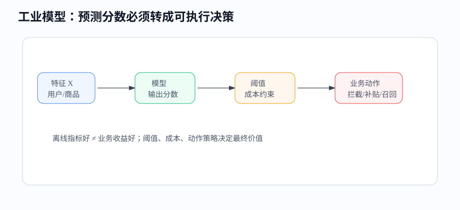
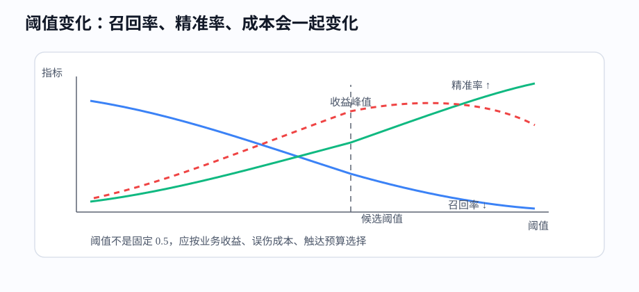
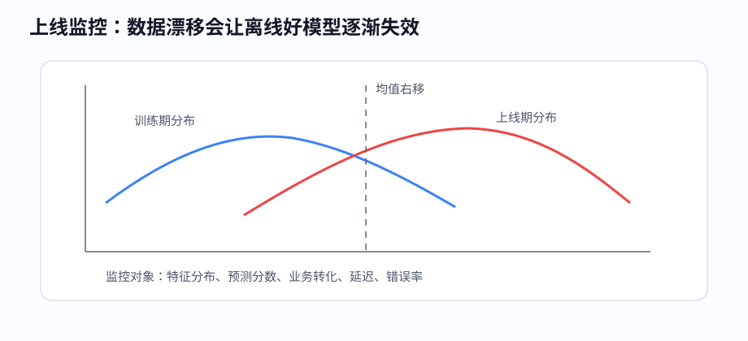

# 课时15-16：传统模型工程优化与决策优化实战

## 1. 课程定位

本课是传统机器学习模块的工程收束：从“训练出一个模型”推进到“让模型稳定产生业务价值”。

| 建模阶段 | 工程落地阶段 |
|---|---|
| 关注离线指标 | 关注上线收益、稳定性、可解释性 |
| 输出预测分数 | 输出动作策略和阈值 |
| 处理训练数据 | 持续处理新数据、漂移、监控 |
| 模型调参为主 | 数据治理、阈值优化、A/B 测试同样重要 |

落地点：预测分数要转成业务动作，动作产生收益。

---

## 2. 学习目标

1. 能把模型分数转换成业务动作。
2. 能识别数据质量、标签定义、样本偏差对模型的影响。
3. 能处理类别不均衡，并选择合适评价指标。
4. 能理解阈值优化、成本敏感学习和收益最大化。
5. 能理解概率校准为什么影响决策。
6. 能设计模型上线后的基础监控指标。
7. 能完成一个从特征优化到决策阈值的传统模型项目闭环。

---

## 3. 前置知识与本课关系

线性模型、聚类、树模型和 GBDT 解决了“怎样建模”，模型工程与决策优化继续解决企业项目中的实际问题：

1. 数据脏，模型怎么稳？
2. 正负样本比例极端，指标怎么看？
3. AUC 提升了，为什么业务没收益？
4. 阈值为什么不能永远用 0.5？
5. 模型上线后怎么发现它变差？

传统机器学习模块的最终主线：

$$
业务目标 \rightarrow 数据治理 \rightarrow 特征优化 \rightarrow 模型训练 \rightarrow 阈值决策 \rightarrow 上线监控 \rightarrow 复盘迭代
$$

---

## 4. 从模型分数到业务决策

### 4.1 模型输出到业务动作

分类模型通常输出概率或分数：

$$
score=P(y=1\mid x)
$$

但业务需要动作：

1. 风控：通过、拒绝、人工审核、降额。
2. 营销：不触达、短信、券、电话、会员权益。
3. 流失召回：观察、低成本召回、高成本召回。
4. 供应链：不补货、少量补货、大量补货。



同一个模型分数，在不同业务成本下动作不同。

---

### 4.2 阈值不能固定为 0.5

假设流失召回模型输出流失概率。

| 用户 | 流失概率 | 预计召回收益 | 触达成本 | 是否触达 |
|---:|---:|---:|---:|---|
| A | 0.45 | 80 | 5 | 值得触达 |
| B | 0.70 | 10 | 8 | 未必触达 |

阈值是业务策略参数，由收益、成本、容量共同决定。

基础决策规则：

$$
期望收益=p\times 收益-(1-p)\times 误伤成本-触达成本
$$

当期望收益大于 0，动作才值得执行。

---

## 5. 特征工程（Feature Engineering）优化

### 5.1 特征优化方向

好特征通常来自业务机制，不只是字段堆叠。

| 方向 | 例子 | 价值 |
|---|---|---|
| 时间窗口 | 近 7 天、30 天、90 天消费 | 捕捉短期和长期变化 |
| 比率特征 | 退款率、点击转化率、负债率 | 消除规模差异 |
| 趋势特征 | 本月比上月下降多少 | 捕捉变化方向 |
| 交互特征 | 高收入且高负债 | 表达组合风险 |
| 稳定性特征 | 登录间隔方差、消费波动 | 识别行为是否稳定 |
| 排名分位 | 城市内消费分位 | 解决区域差异 |

树模型能自动学习部分交互，但明确构造强业务特征仍然常有收益。

---

### 5.2 特征筛选

特征越多不一定越好。常见筛选方式：

1. 缺失率：缺失过高且无业务含义的字段先删除或单独处理。
2. 单一值比例：几乎全一样的字段信息少。
3. 相关性：高度重复字段会增加冗余。
4. 模型重要性：长期贡献低的字段可移除。
5. 稳定性：训练期有效、上线期漂移严重的字段要谨慎。
6. 可获得性：线上预测时拿不到的字段必须删除。

特征筛选同时服务指标、延迟、存储、维护成本和泄漏风险控制。

---

### 5.3 泄漏字段排查

标签泄漏（Label Leakage）是工业建模大坑：训练时模型看到未来信息，离线指标虚高，上线失效。

典型泄漏：

1. 预测是否逾期，却使用了逾期后的催收结果。
2. 预测是否流失，却使用了流失后 30 天的行为。
3. 预测是否购买，却使用了订单支付后的字段。
4. 随机划分时间序列数据，导致未来样本信息混入训练。

排查方法：

1. 给每个字段标注产生时间。
2. 明确预测时点，只允许使用预测时点之前的数据。
3. 对异常高的重要性字段做人工审查。
4. 使用按时间切分的验证集。

---

## 6. 数据质量与标签治理

### 6.1 缺失值

缺失值有三种常见含义：

1. 真缺失：采集失败或数据丢失。
2. 不适用：用户没有该行为，所以字段为空。
3. 有业务含义：用户刻意不填，或系统没有采到，可能代表风险。

处理方式：

1. 数值缺失：中位数、固定值、模型内置缺失处理。
2. 类别缺失：填充 `unknown`。
3. 缺失指示器：新增 `is_missing` 特征。
4. 高缺失字段：评估是否删除。

---

### 6.2 异常值

异常值不一定都是错误。要区分：

1. 数据错误：年龄 300、负金额、未来时间。
2. 极端真实值：超高消费用户、超大订单。
3. 风险信号：异常登录次数、设备频繁切换。

处理方式：

1. 规则修正：明显错误改为空或剔除。
2. 截尾：把极端值限制在分位数范围内。
3. log 变换：长尾金额用 `log1p`。
4. 单独标记：极端行为可能是有效风险特征。

---

### 6.3 标签定义

标签决定模型学什么。标签定义不清，模型再强也没用。

例子：用户流失。

| 标签定义 | 问题 |
|---|---|
| 7 天未登录算流失 | 可能把正常低频用户误判为流失 |
| 30 天未登录算流失 | 更稳定，但响应变慢 |
| 30 天未购买算流失 | 适合电商，不适合内容产品 |
| 未来 14 天是否购买 | 更像转化预测，不是流失预测 |

标签治理要明确：观察窗口、表现窗口、预测时点、正负样本定义。

---

## 7. 类别不均衡处理

### 7.1 不均衡为什么麻烦

风控欺诈、流失、故障、投诉等任务常见正样本很少。

例子：欺诈率 1%。模型全部预测“不欺诈”，accuracy 也有 99%，但毫无价值。

因此不能只看 accuracy，要看：

1. Precision：拦截的人里有多少是真的。
2. Recall：真实风险中拦住了多少。
3. F1：Precision 和 Recall 的折中。
4. PR-AUC：正样本稀少时比 ROC-AUC 更敏感。
5. TopK 命中率：预算有限时看前 K 个高风险样本。

---

### 7.2 常见处理方式

| 方法 | 做法 | 风险 |
|---|---|---|
| 欠采样 | 减少负样本 | 丢失信息 |
| 过采样 | 复制或生成正样本 | 过拟合（Overfitting）正样本 |
| 类别权重 | 正样本错分惩罚更高 | 权重过大导致误报多 |
| 阈值调整 | 降低正类判定阈值 | Precision 下降 |
| 分层建模 | 先筛高风险群，再细分 | 流程复杂 |

工程中常见组合：按时间切分数据，使用类别权重训练，用 PR-AUC 和业务收益选阈值。

---

## 8. 阈值优化

### 8.1 阈值影响什么

阈值升高：预测为正的样本变少，Precision 往往升高，Recall 往往下降。

阈值降低：覆盖更多正样本，Recall 往往升高，但误报增加。



阈值选择要和业务容量绑定：

1. 人工审核一天只能处理 1000 单：取风险分最高的 Top 1000。
2. 营销预算只能触达 5 万人：取预期收益最高的 5 万人。
3. 风控误杀成本高：阈值要更保守。
4. 故障预警漏报成本高：阈值要更激进。

---

### 8.2 用收益函数选阈值

二分类混淆矩阵（Confusion Matrix）对应四种结果：

| 结果 | 含义 | 业务影响 |
|---|---|---|
| TP | 预测正，实际正 | 成功拦截风险或成功触达 |
| FP | 预测正，实际负 | 误伤、浪费成本 |
| FN | 预测负，实际正 | 漏掉风险或机会 |
| TN | 预测负，实际负 | 正常放行 |

可以定义收益：

$$
Profit=TP\times gain_{TP}-FP\times cost_{FP}-FN\times cost_{FN}-ActionCost
$$

遍历阈值，选择收益最高的阈值，而不是默认 0.5。

---

## 9. 成本敏感学习

### 9.1 为什么要成本敏感

分类错误的成本不一定对称。

风控：

1. 把坏人放过，可能造成坏账损失。
2. 把好人拒绝，可能损失利息收入和用户体验。

医疗预警：

1. 漏报重病风险极高。
2. 误报会增加检查成本，但通常可接受。

成本不同，模型训练和阈值都应调整。

---

### 9.2 实现方式

1. 样本权重：给高成本样本更高权重。
2. 类别权重：正负类错分代价不同。
3. 自定义损失：直接把业务成本写进优化目标。
4. 后处理阈值：模型训练不变，决策阶段按成本选阈值。
5. 分层策略：高风险直接拦截，中风险人工审核，低风险放行。

常用起点：先不改模型结构，使用类别权重加阈值优化，简单可控。

---

## 10. 概率校准

### 10.1 分数准不准

AUC 高说明排序好，不说明概率准。

例子：模型预测 1000 个用户违约概率都在 0.8 左右，如果实际只有 500 人违约，模型概率偏高。

概率校准关注：预测为 0.8 的样本，实际发生率是否接近 80%。

常见方法：

1. Platt Scaling：用逻辑回归校准分数。
2. Isotonic Regression：非参数单调校准。
3. 分桶校准：按预测概率分桶，对比预测均值和真实发生率。

---

### 10.2 什么时候必须校准

1. 模型分数直接用于金额决策，例如授信额度、保险定价。
2. 业务方需要解释概率含义。
3. 多模型分数要融合。
4. 阈值根据期望收益公式计算。

如果只是排序取 TopK，概率校准不是第一优先级；如果要算期望收益，校准非常关键。

---

## 11. 交叉验证（Cross-Validation）与时间验证

### 11.1 普通 K 折交叉验证

K 折交叉验证把训练数据分成 $K$ 份，每次用其中一份验证，其余训练，最后取平均指标。

适合：样本独立同分布，时间因素弱，数据量不大。

优点：指标更稳定，减少一次随机划分带来的偶然性。

缺点：训练成本变成约 $K$ 倍。

---

### 11.2 时间序列验证

很多业务数据有时间顺序，不能随机打乱。

正确方式：

```text
训练：1-3月 → 验证：4月
训练：1-4月 → 验证：5月
训练：1-5月 → 验证：6月
```

适合：风控、销量预测、流失预测、广告转化预测。

原因：线上永远是用过去预测未来，验证也应模拟这个方向。

---

## 12. 模型监控（Model Monitoring）

### 12.1 监控什么

模型上线后，数据和业务会变化。监控至少覆盖四层：

1. 数据层：缺失率、异常值比例、特征分布、枚举值变化。
2. 模型层：预测分数分布、正例率、置信度、延迟、错误率。
3. 业务层：转化率、坏账率、召回率（Recall）、ROI、人工审核通过率。
4. 稳定性：不同渠道、地区、人群的指标是否异常。



---

### 12.2 数据漂移（Data Drift）

数据漂移是输入分布变化。

例子：促销活动后，用户消费金额整体上升；新渠道上线后，低质量流量增多；节假日导致访问时间分布改变。

常见检测：

1. PSI：Population Stability Index，比较训练期和上线期分布差异。
2. KS：Kolmogorov-Smirnov，比较两个分布的最大差距。
3. 均值、分位数、缺失率变化。
4. 类别枚举值新增或占比变化。

监控报警后的排查顺序：数据采集是否异常，业务活动是否变化，标签是否延迟，模型收益是否真的下降。确认原因后再决定是否重训。

---

## 13. A/B 测试与上线复盘

### 13.1 为什么需要 A/B 测试

离线指标只能说明历史数据上表现更好，不能保证线上收益更好。

A/B 测试做法：

1. 随机把用户或请求分为实验组和对照组。
2. 对照组使用旧策略，实验组使用新模型或新阈值。
3. 观察核心业务指标。
4. 判断收益是否显著，是否有副作用。

核心指标：

1. 主指标：收入、坏账率、转化率、留存率。
2. 护栏指标：投诉率、延迟、误杀率、客诉、成本。
3. 分群指标：新老用户、渠道、城市、设备类型。

---

### 13.2 上线复盘

一次模型上线至少复盘：

1. 目标是否达成：离线指标和线上指标是否一致。
2. 分群效果：哪些人群收益，哪些人群受损。
3. 成本变化：计算、人工、营销、误伤是否可接受。
4. 稳定性：是否出现数据漂移和系统异常。
5. 迭代方向：补数据、改标签、调阈值、重训、换模型。

---

## 14. 决策优化案例

### 14.1 风控策略

输入：用户申请信息、历史行为、征信特征。

模型输出：违约概率 $p$。

动作策略：

1. $p<0.05$：自动通过。
2. $0.05\le p<0.15$：降额或提高利率。
3. $0.15\le p<0.30$：人工审核。
4. $p\ge 0.30$：拒绝。

关键不是模型是否把每个人分类正确，而是在通过率、坏账率、利润之间找到平衡。

---

### 14.2 营销触达

输入：用户画像、浏览行为、历史购买、价格敏感度。

模型输出：购买概率或 uplift 分数。

低效策略：只给购买概率最高的人发券。这些人可能本来就会买，发券会浪费预算。

更好策略：优先触达“因为触达才更可能购买”的人，即增量收益更高的人。

基础收益：

$$
ExpectedProfit=p_{buy}\times margin-coupon-cost-contactCost
$$

如果能估计 uplift，则更应使用：

$$
IncrementalProfit=uplift\times margin-coupon-cost-contactCost
$$

---

### 14.3 用户流失召回

输入：活跃下降、消费下降、投诉、竞品迁移信号。

模型输出：未来 30 天流失概率。

策略分层：

1. 高价值高流失：重点召回，允许较高成本。
2. 高价值低流失：维护体验，不乱发券。
3. 低价值高流失：低成本自动触达。
4. 低价值低流失：观察。

召回任务不能只追求 Recall。把所有人都召回，成本会爆炸，且可能打扰用户。

---

## 15. 代码实操

### 15.1 阈值收益优化

完整脚本见：[阈值收益优化](../codes/lesson_15_16_ml_engineering/00_threshold_profit_optimization.py)。

```python
import numpy as np
from sklearn.datasets import make_classification
from sklearn.model_selection import train_test_split
from sklearn.ensemble import GradientBoostingClassifier
from sklearn.metrics import precision_score, recall_score, f1_score, roc_auc_score

X, y = make_classification(
    n_samples=5000,
    n_features=20,
    n_informative=8,
    weights=[0.92, 0.08],
    random_state=42,
)

X_train, X_test, y_train, y_test = train_test_split(
    X, y, test_size=0.3, random_state=42, stratify=y
)

model = GradientBoostingClassifier(random_state=42)
model.fit(X_train, y_train)
proba = model.predict_proba(X_test)[:, 1]
print("AUC:", round(roc_auc_score(y_test, proba), 4))

def profit_at_threshold(y_true, score, threshold):
    pred = score >= threshold
    tp = np.sum((pred == 1) & (y_true == 1))
    fp = np.sum((pred == 1) & (y_true == 0))
    fn = np.sum((pred == 0) & (y_true == 1))
    gain_tp = 100
    cost_fp = 8
    cost_fn = 120
    action_cost = 2 * np.sum(pred)
    return tp * gain_tp - fp * cost_fp - fn * cost_fn - action_cost

rows = []
for t in np.linspace(0.05, 0.95, 19):
    pred = proba >= t
    rows.append({
        "threshold": round(float(t), 2),
        "precision": precision_score(y_test, pred, zero_division=0),
        "recall": recall_score(y_test, pred, zero_division=0),
        "f1": f1_score(y_test, pred, zero_division=0),
        "profit": profit_at_threshold(y_test, proba, t),
        "actions": int(pred.sum()),
    })

best = max(rows, key=lambda x: x["profit"])
print(best)
```

观察：F1 最优阈值、Recall 最优阈值、收益最优阈值可能不是同一个。

---

### 15.2 概率校准

完整脚本见：[概率校准](../codes/lesson_15_16_ml_engineering/01_probability_calibration.py)。

```python
from sklearn.calibration import CalibratedClassifierCV
from sklearn.metrics import brier_score_loss

base_model = GradientBoostingClassifier(random_state=42)
calibrated = CalibratedClassifierCV(base_model, method="isotonic", cv=3)
calibrated.fit(X_train, y_train)

raw = model.predict_proba(X_test)[:, 1]
cal = calibrated.predict_proba(X_test)[:, 1]

print("raw brier:", round(brier_score_loss(y_test, raw), 4))
print("calibrated brier:", round(brier_score_loss(y_test, cal), 4))
```

Brier Score 衡量概率预测和真实标签的均方差，越低代表概率越准。

---

## 16. 常见问题

1. 离线 AUC 高，上线没收益：阈值、策略、样本分布、业务成本或实验设计可能有问题。
2. 正样本少，accuracy 很高：accuracy 失真，改看 PR-AUC、Recall、Precision、TopK 命中。
3. 只调模型不涨分：问题可能在标签、泄漏、特征窗口、异常值和数据口径。
4. 模型分数不能解释为概率：需要做校准，尤其是收益决策和额度决策。
5. 阈值上线后效果变差：数据分布、业务流量、竞争环境、用户行为可能变化。
6. 业务方不接受模型：给出规则路径、特征贡献、分群效果和收益测算，而不是只给指标。

---

## 17. 本课总结

1. 传统机器学习落地不是只训练模型，还要完成数据、特征、阈值、策略、监控闭环。
2. 特征工程要围绕业务机制设计，重点检查缺失、异常、泄漏和稳定性。
3. 类别不均衡下 accuracy 容易误导，应使用 PR-AUC、Recall、Precision、TopK 和收益指标。
4. 阈值是业务决策参数，应按成本、预算和收益优化。
5. AUC 高只代表排序能力好，概率用于决策前需要校准。
6. 上线后必须监控数据漂移、分数分布、业务指标和系统稳定性。

---

## 18. 课后作业

1. 选择一个二分类数据集，训练 GBDT 或 LightGBM baseline。
2. 构造不均衡场景，对比 accuracy、ROC-AUC、PR-AUC、Recall、Precision。
3. 设计一个收益函数，遍历阈值，找到收益最高的阈值。
4. 输出阈值变化下的动作人数、Precision、Recall、收益表。
5. 做一次特征质量检查：缺失率、异常值、单一值比例、疑似泄漏字段。
6. 写一页项目复盘：模型指标、业务阈值、上线风险、监控指标和下一步优化。

---

## 19. 知识延伸

深度学习延续传统机器学习中的损失函数、梯度、泛化和数据划分原则，同时引入神经网络、前向传播（Forward Propagation）、反向传播（Backpropagation）、全连接网络（Fully Connected Network / MLP）以及端到端表示学习（Representation Learning）。
