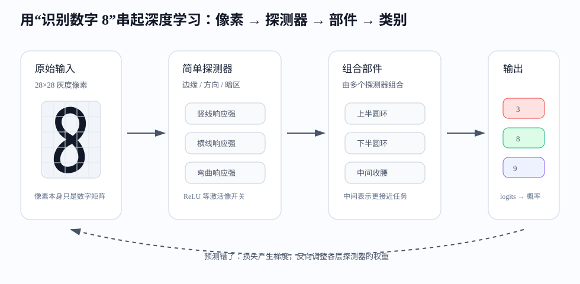
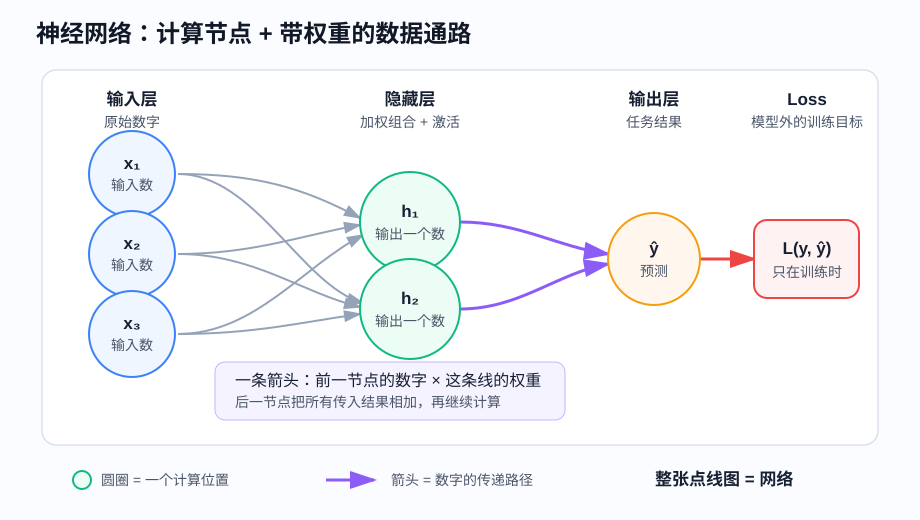
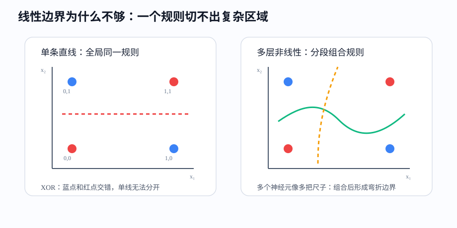
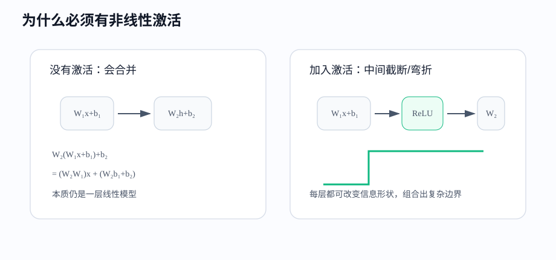
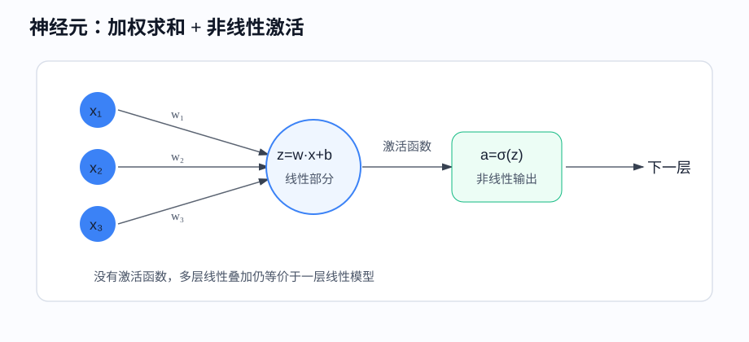
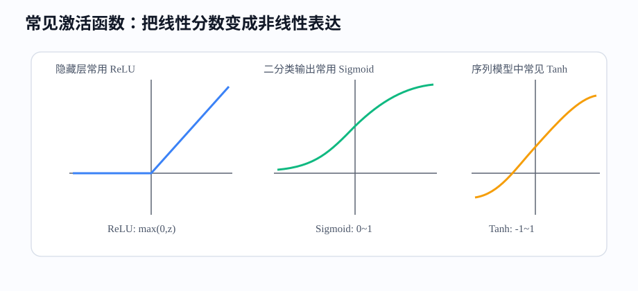
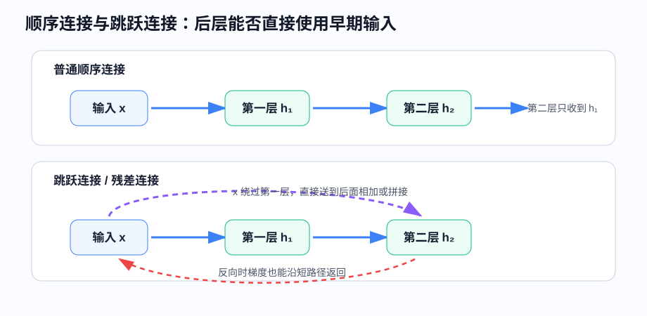
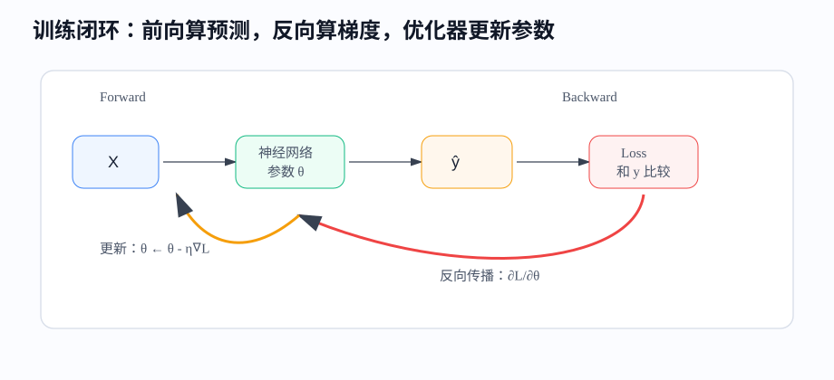

# 课时17-18：深度学习基础与全连接网络（Fully Connected Network / MLP）

## 1. 课程定位

本课进入深度学习（Deep Learning）。它不是把传统机器学习推倒重来，而是把前面学过的“模型、损失、梯度、泛化（Generalization）”继续放大：模型从一层变成多层，参数从少量变成大量，输入从表格特征扩展到图像、语音、文本、序列等复杂数据。

深度学习最关键的变化是表示学习（Representation Learning）：传统机器学习通常依赖人工设计特征，深度学习让模型自己学习中间特征。全连接网络（Fully Connected Network / Multilayer Perceptron, MLP）是最基础的神经网络结构，适合用来建立深度学习的整体理解。

| 对比点 | 传统机器学习 | 深度学习 |
|---|---|---|
| 特征来源 | 人工特征工程（Feature Engineering）占比高 | 模型学习多层表示 |
| 模型形态 | 线性模型、树、集成模型 | 多层可微函数组合 |
| 适合数据 | 表格、小中规模数据 | 图像、语音、文本、大规模数据 |
| 训练方式 | 优化损失函数 | 同样优化损失函数，只是参数更多 |
| 工程重点 | 特征、规则、可解释性 | 数据、算力、网络结构、训练稳定性 |

---

## 2. 学习目标

1. 能说清深度学习的主线：输入 → 多层变换 → 预测 → 损失 → 反向传播（Backpropagation） → 参数更新。
2. 能解释神经元（Neuron）、连接（Connection）、层（Layer）、权重（Weight）、偏置（Bias）、激活函数（Activation Function）的作用。
3. 能区分输入层、隐藏层、输出层等位置名称，以及全连接、卷积、池化、归一化、激活等功能名称。
4. 能说明线性模型为什么难表达复杂模式。
5. 能理解“多层线性变换 + 非线性激活”为什么比单层线性模型更强。
6. 能看懂全连接层（Fully Connected Layer）的矩阵维度、层宽与参数量。
7. 能解释损失函数、前向传播（Forward Propagation）和反向传播（Backpropagation）的关系。
8. 能说明顺序连接与跳跃连接（Skip Connection）的差异。
9. 能理解批次（Batch）、轮次（Epoch）、迭代（Iteration）、学习率（Learning Rate）、优化器（Optimizer）。
10. 能用 PyTorch 搭建一个简单 MLP 分类模型。

---

## 3. 前置知识与本课关系

深度学习延续线性回归、逻辑回归和树模型使用的机器学习闭环：

```text
数据 X → 模型 fθ(X) → 预测 ŷ → 损失 L(y, ŷ) → 梯度 ∇L → 更新参数 θ
```

符号对应：

| 机器学习概念 | 深度学习中的对应物 |
|---|---|
| 特征矩阵 $X$ | 输入张量（Input Tensor） |
| 权重 $w$、偏置 $b$ | 多层权重矩阵和偏置向量 |
| 预测值 $\hat{y}$ | 网络输出，分类时常叫 logits / probabilities |
| 损失函数 $L$ | 回归常用 MSE，分类常用交叉熵（Cross-Entropy） |
| 求导和梯度下降（Gradient Descent） | 反向传播算梯度，优化器（Optimizer）更新参数 |
| 泛化能力 | 验证集表现、正则化（Regularization）、早停（Early Stopping）、数据增强（Data Augmentation） |

深度学习难点不在“完全陌生”，而在“同一套概念被堆成了更大的系统”。

---

## 4. 深度学习整体图景

### 4.1 用一个例子先把整体串起来

先看一个具体任务：识别一张手写数字图片是不是 `8`。

输入不是“数字 8”这个概念，而是一堆像素值。例如 MNIST 图片是 $28\times28$ 的灰度矩阵，每个位置只是一个亮度数字。模型真正面对的是：

```text
784 个像素数字 → 判断它属于 0 到 9 的哪一类
```

如果直接用线性模型，它相当于给每个像素一个固定权重，然后一次性算出“像不像 8”。这会很脆弱：数字稍微平移、变粗、变细、倾斜，原来那套像素权重就可能对不上。

深度学习（Deep Learning）的思路不是一步从像素跳到类别，而是把问题拆成多层中间判断：

```text
像素 → 边缘/方向探测器 → 笔画/圆环部件 → 数字形状 → 类别概率
```



这张图里有两个方向：

1. 前向传播（Forward Propagation）：从像素往后算，逐层得到当前预测。
2. 反向传播（Backpropagation）：预测错了以后，从损失往前追责，调整每层探测器。

所以深度学习的整体感觉应该是：模型内部逐层搭出一套“可训练的特征加工流水线”。前面层负责发现简单模式，后面层负责组合简单模式，最后输出任务答案。

---

### 4.2 “探测器”不是人工写死的

探测器（Detector）可以理解成一个小判断器：某种模式出现时，它输出高；没有出现时，它输出低。

以数字 `8` 为例，模型中可能形成这些中间信号：

1. 这里是否有竖向边缘？
2. 这里是否有横向边缘？
3. 上半部分是否像一个圆环？
4. 下半部分是否像一个圆环？
5. 中间是否有收腰？
6. 整体是否更像 `8`，而不是 `3` 或 `9`？

这些探测器不是老师手工告诉模型的。训练刚开始时，权重通常是随机的，探测器没有明确含义。模型先胡乱预测，损失函数（Loss Function）衡量错得多严重，然后反向传播根据梯度调整权重。大量样本反复训练后，某些神经元才逐渐对边缘、笔画、圆环这类模式敏感。

决定探测器怎么变好的因素主要有五个：

1. 数据：样本里反复出现什么模式。
2. 标签：什么输出才算对。
3. 损失函数：错在哪里、错得多严重。
4. 当前激活值：哪些探测器参与了这次判断。
5. 梯度和学习率（Learning Rate）：每个参数往哪个方向调、调多大。

不是“模型自己神秘地懂了”，而是每次预测错误都会产生一组可计算的调整信号。

---

### 4.3 前向决定预测，后向决定学习

前向传播（Forward Propagation）负责回答：当前这套参数会怎么判断？

```text
像素输入 → 探测器响应 → 部件响应 → 类别分数 logits → 概率
```

假设一张真实标签是 `8` 的图片，模型输出：

```text
P(3)=0.55, P(8)=0.30, P(9)=0.10
```

这说明当前网络更相信它是 `3`，预测错了。损失会变大。反向传播接着做两类调整：

1. 增强那些能提高 `8` 分数的路径，例如“上圆环”“下圆环”“中间收腰”等探测器到 `8` 输出的连接。
2. 削弱那些错误提高 `3` 分数的路径，例如把某些“右侧弧线”误当成 `3` 的连接。

参数更新仍然是同一个公式：

$$
\theta \leftarrow \theta-\eta\nabla_\theta L
$$

如果某个权重增大会让损失下降，它就会被调大；如果某个权重增大会让损失上升，它就会被调小。这个过程在成千上万张图片上重复，网络内部的探测器就会从随机响应，逐渐变成对任务有用的特征。

所以“前向”和“后向”的分工很清楚：

| 环节 | 解决的问题 | 由什么决定 |
|---|---|---|
| 前向传播 | 当前模型怎么预测 | 输入数据、当前权重、激活函数（Activation Function） |
| 损失函数 | 当前预测错多少 | 预测值、真实标签、损失定义 |
| 反向传播 | 每个参数该负多少责任 | 链式法则、当前激活路径、损失梯度 |
| 参数更新 | 参数具体改多少 | 梯度、学习率、优化器 |

---

### 4.4 “网络”指的是计算点和数据通路

神经网络中的“网络”，不是指互联网，也不只是“一堆神经元”。它是一张有方向的计算图（Computational Graph）：圆点表示计算位置，箭头表示数据从哪里流向哪里，箭头上的权重决定一个输入对下一个计算位置有多大影响。



以前一层输出 $h_i$、后一层神经元 $z_j$ 为例：

$$
z_j=\sum_i w_{ij}h_i+b_j
$$

这条公式对应三件事：

1. 前一层每个计算位置输出一个数 $h_i$。
2. 每条连接把这个数乘以自己的权重 $w_{ij}$。
3. 后一层把收到的结果相加，再加偏置 $b_j$，然后通常经过激活函数。

因此，知识不只与“有多少神经元”有关，更大量地存放在连接权重中。例如从 784 维输入连接到 128 个隐藏神经元，神经元只有 128 个，但这一层有：

$$
784\times128+128=100480
$$

个可训练参数。神经元数量描述层的宽度（Width），参数量描述需要学习多少个数，两者不能混为一谈。

最简单的网络像一条链，但“网络”不要求只能逐层直连。它也可以分叉、汇合或跨层连接。只要某个计算结果通过一条边送到另一个计算位置，它们就在同一张计算图中。

---

### 4.5 为什么多层比一层更有必要

多层不是为了把模型做复杂，而是为了把困难问题拆成可复用的中间问题。

一层模型的压力很大：它要直接从原始像素判断类别。每个像素权重只服务最终分类，难以表达“先识别边缘，再组合成笔画，再判断数字”的过程。

多层网络的优势在于：

1. 分层抽象：浅层学简单模式，深层学复杂组合。
2. 特征复用：竖线、横线、圆环不只服务 `8`，也服务 `0`、`6`、`9`。
3. 非线性组合：不同探测器可以形成“同时满足 A 和 B，但不满足 C”的规则。
4. 局部容错：只要关键部件还在，局部像素变化不一定改变最终判断。
5. 端到端学习：不用人工设计“圆环检测器”，模型从数据中学习。

对比一下：

| 问题 | 单层线性模型 | 多层深度模型 |
|---|---|---|
| 输入到输出 | 像素直接到类别 | 像素先变成多层表示 |
| 特征来源 | 人工特征或固定像素权重 | 训练中自动学习中间特征 |
| 表达方式 | 一个全局线性规则 | 多个局部规则组合成复杂边界 |
| 对变形的适应 | 较弱 | 可通过层级表示和数据学习增强 |
| 图像任务 | 难利用边缘、纹理、部件结构 | 天然适合逐层组合视觉模式 |

这就是深度学习的必要性：当原始输入离最终概念很远时，中间表示非常重要。图像里的“猫”“车”“数字 8”不是某一个像素决定的，而是大量局部模式按空间关系组合出来的。

---

### 4.6 为什么深度学习特别适合图像

图像识别需要从低级信号逐步走向高级语义：

```text
像素亮度 → 边缘 → 纹理 → 局部部件 → 整体物体 → 类别
```

这条路径正好适合深度网络的层级结构。尤其是卷积神经网络（Convolutional Neural Network, CNN），进一步把图像规律写进网络结构：

1. 局部性：相邻像素关系最重要，卷积核先看局部窗口。
2. 参数共享：同一个边缘探测器可以在图片任意位置使用。
3. 层级组合：浅层边缘组合成纹理，中层纹理组合成部件，深层部件组合成物体。
4. 平移鲁棒：目标稍微移动，局部探测器仍可能响应。
5. 大规模训练：图片数据多，GPU 擅长矩阵和卷积计算。

传统机器学习也能做图像，但通常要先人工设计特征，例如边缘、角点、纹理描述子。深度学习把这部分大量人工特征工程变成可训练过程，所以在图像、语音、文本这类原始信号复杂的任务上优势明显。

但这不等于深度学习在所有场景都更好。表格数据、小样本、强解释要求场景，树模型和线性模型仍然常用。深度学习最有价值的地方，是原始数据复杂、人工特征难设计、数据量足够、任务需要自动学习表示。

---

## 5. 从线性模型到神经网络

### 5.1 线性模型的骨架

线性模型（Linear Model）的核心公式：

$$
z=w^Tx+b
$$

如果 $z$ 直接作为连续预测，就是线性回归（Linear Regression）；如果把 $z$ 放进 Sigmoid 得到概率，就是逻辑回归（Logistic Regression）。

线性模型的问题不是“不能用”，而是表达能力有明确上限：它只能用一个全局规则处理所有样本。

1. 在二维空间里，它是一条直线。
2. 在三维空间里，它是一个平面。
3. 在更高维空间里，它是一个超平面（Hyperplane）。

这个规则一旦确定，所有区域都按同一套斜率和方向判断。它很难表达“不同区域使用不同规则”的模式。

---

### 5.2 为什么线性模型难表达复杂模式

看一个最经典的 XOR 例子：

| $x_1$ | $x_2$ | 标签 $y$ |
|---:|---:|---:|
| 0 | 0 | 0 |
| 1 | 1 | 0 |
| 1 | 0 | 1 |
| 0 | 1 | 1 |

正类在左上和右下，负类在左下和右上。任何一条直线都无法把两个正类点放到一边、两个负类点放到另一边。



业务场景也类似。优惠券对购买的影响不是固定的：

1. 新用户 + 高浏览 + 有券：优惠券可能显著提升转化。
2. 老用户 + 高复购 + 有券：可能只是减少利润，不明显提升购买。
3. 沉默用户 + 最近回访 + 有券：可能重新激活。

如果只用一个线性权重描述“优惠券的作用”，它只能学到一个全局平均效果。真实业务中，经常需要“在某些条件组合下才成立”的规则。

---

### 5.3 神经网络怎么扩展表达能力

神经网络（Neural Network）把许多简单函数接起来。每一层做两步：

1. 线性变换（Linear Transformation）：计算一组加权得分。
2. 非线性激活（Nonlinear Activation）：把得分变成“是否通过、通过多少”的信号。

两层 MLP 可以写成：

$$
h_1=\sigma(XW_1+b_1)
$$

$$
h_2=\sigma(h_1W_2+b_2)
$$

$$
logits=h_2W_3+b_3
$$

不要把这个公式看成黑盒。它的含义是：

1. 第一层从原始特征里造出一批简单探测器（Detector），例如“面积是否够大”“房龄是否偏新”“用户是否近期活跃”。
2. 激活函数决定每个探测器是否输出信号，以及输出多强。
3. 第二层把简单探测器组合成更复杂概念，例如“高价值房源”“高购买意愿用户”。
4. 输出层把这些概念转换成最终预测。

---

### 5.4 为什么激活函数不可省

如果没有激活函数，多层线性变换会合并成一层线性变换：

$$
W_2(W_1x+b_1)+b_2=(W_2W_1)x+(W_2b_1+b_2)
$$

右边仍然是 $Ax+c$ 的形式，本质还是线性模型。堆再多层，也只是把一条直线换成另一条直线。



激活函数的作用可以理解成“门”或“开关”：某个线性条件满足时信号通过，不满足时信号被压低或截断。多个这样的门组合起来，就能形成分段规则和复杂边界。

---

## 6. 神经元：一个可训练探测器

### 6.1 神经元的标准定义

人工神经元（Artificial Neuron）是神经网络里最小的计算单元。标准形式包含两步：

1. 仿射变换（Affine Transformation）：对输入加权求和，再加偏置，得到预激活值（Pre-activation）$z$。
2. 激活变换（Activation）：把 $z$ 送入激活函数，得到输出激活值（Activation / Output）$a$。

完整写法：

$$
z=w_1x_1+w_2x_2+\cdots+w_nx_n+b
$$

向量形式：

$$
z=w^Tx+b
$$

激活输出：

$$
a=\sigma(z)
$$



所以，一个完整神经元通常可以写成：

$$
a=\sigma(w^Tx+b)
$$

其中：

1. $x$：输入向量（Input Vector）。
2. $w$：权重向量（Weight Vector），决定每个输入维度的重要性和方向。
3. $b$：偏置（Bias），控制触发门槛或整体平移。
4. $z$：预激活值（Pre-activation），也叫线性得分。
5. $\sigma$：激活函数（Activation Function），引入非线性。
6. $a$：神经元输出（Activation / Output），传给下一层。

---

### 6.2 神经元包含激活函数吗

答案：**看语境，但学习深度学习时建议把“神经元”理解为包含激活函数的完整单元**。

| 语境 | “神经元”通常指什么 | 例子 |
|---|---|---|
| 数学/入门解释 | 仿射变换 + 激活函数 | $a=\sigma(w^Tx+b)$ |
| 说“某个神经元激活了” | 激活函数后的输出 $a$ 变大 | ReLU 输出从 0 变成 6 |
| PyTorch 代码 | `nn.Linear` 只做仿射变换，激活函数单独写 | `nn.Linear(...)` 后接 `nn.ReLU()` |
| 严格区分时 | $z$ 是神经元的线性得分，$a$ 是激活输出 | $z=w^Tx+b, a=\sigma(z)$ |

为什么框架里经常把 `Linear` 和 `ReLU` 分开？因为工程实现要灵活：同一个线性层后面可以接 ReLU、Sigmoid、Tanh，也可以不接激活函数。分开写不代表概念上激活函数不重要。

把神经元理解成“探测器”更容易：

1. $w^Tx+b$：计算某个模式的匹配分数。
2. $\sigma(z)$：决定这个模式是否输出信号、输出多强。
3. $a$：探测器传给下一层的信号强度。

---

### 6.3 一个具体数值例子

假设一个神经元想探测“房子是否偏适合成交”，输入是：

$$
x=[面积标准分, 房间数标准分, 房龄标准分]
$$

设：

$$
w=[1.2,0.8,-1.5],\quad b=0.3
$$

计算：

$$
z=1.2x_1+0.8x_2-1.5x_3+0.3
$$

含义：

1. 面积越大，得分越高。
2. 房间数越多，得分越高。
3. 房龄越老，得分越低，因为权重是负数。
4. $b=0.3$ 让整体更容易激活。

如果某个样本 $x=[1.0,0.5,1.2]$：

$$
z=1.2\times1.0+0.8\times0.5-1.5\times1.2+0.3=0.1
$$

如果用 ReLU 激活：

$$
a=max(0,0.1)=0.1
$$

这个探测器有轻微响应。如果 $z=-2.0$，ReLU 输出 0，表示这个条件基本不成立。

---

### 6.4 一层有多少神经元，以及“层”的两套名字

“层”有两套常用命名，先分开理解可以避免大量混乱。

| 命名角度 | 常见名称 | 回答的问题 |
|---|---|---|
| 按位置命名 | 输入层、隐藏层、输出层 | 这一层位于网络哪里？ |
| 按功能命名 | 全连接层、卷积层、池化层、归一化层、激活层、注意力层 | 这一层做什么计算？ |

输入层（Input Layer）表示原始数据从哪里进入，通常不承担复杂的可训练计算。输出层（Output Layer）把最后的隐藏表示变成任务结果。两者之间的计算统称隐藏层（Hidden Layer），也常被口语化地叫中间层。

同一个层可以同时拥有两个身份。例如，一个卷积层位于输入和输出之间时，它的位置身份是隐藏层，功能身份是卷积层。隐藏部分既可以包含有大量权重的全连接层、卷积层，也可以包含通常没有权重的激活层、池化层，以及只有少量缩放和平移参数的归一化层。

神经元数量没有统一标准，它是网络结构设计的一部分：

| 场景 | 常见宽度或描述方式 |
|---|---|
| 小型 MLP 练习 | 8、16、32、64 个隐藏神经元 |
| 一般表格 MLP | 32 到 256 个隐藏神经元 |
| 较大的隐藏表示 | 数百到数千维 |
| CNN | 更常说输出通道数与 $H\times W$ 特征图，而不是只报神经元数 |
| Transformer | 更常说隐藏维度、前馈层宽度和 token 数 |

输入层宽度通常由特征数决定，输出层宽度由任务决定。例如手写数字分类可以是 `784 → 128 → 64 → 10`。中间的 128 和 64 是设计者选择的隐藏宽度，不是固定规律。增加宽度会提高容量和计算成本，也可能增加过拟合风险，并不是越宽越好。

“第一个层是不是全连接层”也取决于网络类型：MLP 的第一个可训练层通常是全连接层；CNN 通常从卷积层开始；语言模型通常先把 token 编号送入嵌入层（Embedding Layer）。输入层本身只是数据入口，不等于全连接层。

---

## 7. 激活函数（Activation Function）

### 7.1 “激活”到底是什么意思

激活函数（Activation Function）不是装饰项。它负责把线性得分 $z$ 转成下一层可用的信号 $a$。

以 ReLU 为例：

$$
ReLU(z)=max(0,z)
$$

如果神经元计算：

$$
z=2x_1-x_2-1
$$

两个样本：

1. $x=[1,4]$：$z=2\times1-4-1=-3$，$ReLU(z)=0$。条件不满足，信号被关掉。
2. $x=[4,1]$：$z=2\times4-1-1=6$，$ReLU(z)=6$。条件满足，信号强烈通过。

所以 ReLU 可以看成一个简单规则：当 $2x_1-x_2$ 足够大时，这个神经元才输出有效信号。很多 ReLU 神经元叠在一起，就形成许多局部规则。



---

### 7.2 常见激活函数怎么选

| 激活函数 | 英文 | 形状与含义 | 常见位置 |
|---|---|---|---|
| ReLU | Rectified Linear Unit | 负数截断为 0，正数原样保留 | 隐藏层默认首选 |
| Sigmoid | Sigmoid | 输出 $0$ 到 $1$，像概率 | 二分类输出层或门控结构 |
| Tanh | Hyperbolic Tangent | 输出 $-1$ 到 $1$，中心在 0 | RNN/LSTM 内部常见 |
| Softmax | Softmax | 多个分数归一成概率分布 | 多分类输出层 |

ReLU 常用，不是因为它最复杂，而是因为它简单、梯度稳定、计算快。Sigmoid 和 Tanh 在输入特别大或特别小时会进入饱和区，导数接近 0，深层网络中容易造成梯度消失（Vanishing Gradient）。

---

### 7.3 Softmax 与 logits

多分类模型最后通常输出一组原始分数，叫 logits：

$$
z=[z_1,z_2,\cdots,z_K]
$$

Softmax 把 logits 变成概率：

$$
p_k=\frac{e^{z_k}}{\sum_{j=1}^{K}e^{z_j}}
$$

例子：三个类别的 logits 是 $[2.0,1.0,0.1]$。Softmax 后，第一个类别概率最大，但三个概率加起来一定等于 1。

PyTorch 的 `nn.CrossEntropyLoss` 内部已经包含 `LogSoftmax + NLLLoss`，所以分类模型最后一层通常直接输出 logits，不手动加 Softmax。

---

## 8. 全连接网络（Fully Connected Network / MLP）

### 8.1 什么是全连接层

全连接层（Fully Connected Layer / Dense Layer）指：上一层的每个输入维度，都连接到下一层的每个神经元。

矩阵形式：

$$
H=XW+b
$$

具体维度例子：

| 对象 | 形状 | 含义 |
|---|---:|---|
| $X$ | $4\times3$ | 一个 batch 有 4 个样本，每个样本 3 个特征 |
| $W$ | $3\times5$ | 从 3 维输入映射到 5 个隐藏神经元 |
| $b$ | $5$ | 每个隐藏神经元一个偏置 |
| $H$ | $4\times5$ | 每个样本得到 5 个新表示 |

矩阵乘法一次处理整个 batch。不是一个样本一个样本手算，而是让 GPU 同时算大量样本和大量神经元。

---

### 8.2 MLP 的结构

一个典型 MLP：

```text
输入层 → Linear → ReLU → Linear → ReLU → Linear → logits
```

对应公式：

$$
H_1=ReLU(XW_1+b_1)
$$

$$
H_2=ReLU(H_1W_2+b_2)
$$

$$
logits=H_2W_3+b_3
$$

每一层的输出都可以理解为新的特征表。第一层的特征更接近原始输入，越往后越接近任务目标。

---

### 8.3 参数量怎么估算

全连接层参数量：

$$
\text{参数量}=\text{输入维度}\times\text{输出维度}+\text{输出维度}
$$

例子：输入是 $784$ 维，隐藏层有 $128$ 个神经元：

$$
784\times128+128=100480
$$

参数量的影响：

1. 参数多，模型容量（Capacity）更强，能拟合更复杂模式。
2. 参数多，需要更多数据，否则容易过拟合（Overfitting）。
3. 参数多，训练更慢，占用更多内存和显存。

---

### 8.4 顺序连接与跳跃连接

最基础的 MLP 使用顺序连接（Sequential Connection）：

$$
h_1=f_1(x),\qquad h_2=f_2(h_1)
$$

此时第二个隐藏层只接收第一个隐藏层的输出，不直接读取原始输入 $x$。

神经网络也可以增加跳跃连接（Skip Connection），让后面的层直接使用更早的表示：

$$
h_2=f_2(h_1)+x
$$

或者把两份表示拼接后再计算：

$$
h_2=f_2([h_1,x])
$$



跳跃连接说明神经网络本质上是一张计算图，而不一定是一条直线。ResNet 使用残差连接（Residual Connection）让输入绕过若干层后与新结果相加；U-Net 和 DenseNet 常把不同层的表示拼接。只要张量形状能够相加，或经过投影后能够匹配，后面的层就可以直接利用更早的输入。

反向传播也会沿所有有效路径返回。如果输入通过两条路径影响损失，那么两条路径产生的梯度会在汇合处相加。短路径可以让梯度更容易到达前面的层，这是残差网络能够训练得很深的重要原因之一。

---

## 9. 前向传播（Forward Propagation）、损失、反向传播（Backpropagation）

### 9.1 前向传播（Forward Propagation）：先算当前模型怎么预测

前向传播（Forward Propagation）就是把输入一层层算到输出。它回答的问题是：在当前参数下，模型会怎么判断？

```text
X → 第一层表示 H1 → 第二层表示 H2 → logits → 概率/预测
```

这一步不修改参数，只产生预测结果。

---

### 9.2 损失函数：通常只监督最终输出

损失函数（Loss Function）把“预测好不好”变成一个标量。优化器只能最小化数字，所以必须有损失函数。标准监督学习通常只在最终输出处计算主损失，而不会在每个隐藏激活层后面都放一个损失函数：

```text
输入 → 隐藏计算 → 激活 → 隐藏计算 → 输出/logits → 主损失 Loss
```

原因是训练集通常只提供最终标签，并没有规定每个隐藏神经元应该输出什么。隐藏层通过最终损失反向传回的梯度间接学习。

分类常用交叉熵（Cross-Entropy）：

$$
L=-\sum_{k=1}^{K}y_k\log p_k
$$

如果真实类别是第 3 类，模型给第 3 类概率越低，损失越大。回归常用均方误差（Mean Squared Error, MSE）：

$$
L=\frac{1}{m}\sum_{i=1}^{m}(y_i-\hat{y}_i)^2
$$

输出层和损失之间是否显式出现激活函数，取决于任务与实现：

| 任务 | 常见输出 | 损失连接方式 |
|---|---|---|
| 多分类 | logits | `CrossEntropyLoss` 内部完成数值稳定的 Softmax 相关计算 |
| 二分类 | 单个 logit | 常用 Sigmoid 与二元交叉熵的组合实现 |
| 回归 | 连续数值 | 常直接接 MSE、MAE 等损失 |

因此，代码中没有单独写 Softmax 或 Sigmoid，不等于没有对应的概率变换，它可能已经和损失合并。选择损失函数，就是在告诉模型什么样的错误更严重。

训练时需要真实标签来计算损失；推理时通常没有真实答案，只做前向传播，不计算主损失，也不执行反向传播。少数模型会在中间层增加辅助输出与辅助损失（Auxiliary Loss / Deep Supervision），但这是特殊设计，不是每个激活层都配一个损失。

---

### 9.3 反向传播：从损失开始，逐层计算梯度

严格来说，反向传播不是从某个激活层主动开始，也不只是“从输出层开始”，而是从最终损失 $L$ 开始。损失先给出预测误差对模型输出的梯度，然后梯度沿计算图反方向传播：

```text
Loss → 输出计算/输出激活 → 最后一个隐藏层 → 更早的隐藏层 → 第一层 → 输入
```



每个可微计算接到上游梯度后，会做两件事：

1. 计算自己的参数梯度，例如 $\partial L/\partial W$ 和 $\partial L/\partial b$。
2. 计算损失对自己输入的梯度，并继续传给前一个计算节点。

激活层通常没有可训练权重，但梯度仍要穿过它。例如 ReLU 在正向输入大于 0 的区域让梯度通过，在小于 0 的区域把局部梯度变成 0。因此，激活函数既改变前向表示，也改变反向信号。

反向传播可能算到输入 $x$ 的梯度，但普通监督训练不会修改原始图片或表格数据。通常只有 `requires_grad=True` 的模型参数会交给优化器更新；输入梯度主要用于对抗样本、可解释性、输入优化等特殊任务。

反向传播和参数更新也不是同一件事。标准训练步骤是：

```text
前向得到预测 → 计算 Loss → backward() 计算全部梯度 → optimizer.step() 更新参数
```

反向传播使用链式法则（Chain Rule）计算：

$$
\frac{\partial L}{\partial W_1},\frac{\partial L}{\partial b_1},\frac{\partial L}{\partial W_2},\frac{\partial L}{\partial b_2}\cdots
$$

优化器再执行参数更新：

$$
\theta \leftarrow \theta-\eta\nabla_\theta L
$$

其中 $\theta$ 是所有可训练参数，$\nabla_\theta L$ 是损失对参数的梯度，$\eta$ 是学习率（Learning Rate）。

---

## 10. 优化器与训练单位

### 10.1 SGD、Momentum、Adam

随机梯度下降（Stochastic Gradient Descent, SGD）每次用一个 batch 估计梯度并更新参数。它简单可靠，但可能收敛慢，对学习率敏感。

动量法（Momentum）给梯度下降加入惯性。连续几个 batch 都指向类似方向时，更新会加速；如果梯度来回震荡，惯性会抵消一部分横向抖动。

Adam（Adaptive Moment Estimation）给每个参数维护自适应步长，同时估计梯度的一阶矩和二阶矩。工程里常用 Adam 或 AdamW 作为初始选择，再结合验证集调整学习率。

常见起点：

1. MLP 小任务：`AdamW(lr=1e-3)`。
2. 深层网络或预训练模型微调：`AdamW(lr=1e-4)` 到 `1e-5`。
3. Loss 上下剧烈震荡：先降低学习率。
4. Loss 几乎不动：检查数据、标准化、模型输出、学习率是否过小或梯度是否消失。

---

### 10.2 Batch、Epoch、Iteration

1. 批次（Batch）：一次送进模型的一小批样本。
2. 轮次（Epoch）：完整遍历训练集一次。
3. 迭代（Iteration / Step）：完成一次前向、反向、参数更新。

例子：训练集 10000 条，`batch_size=100`。

$$
1\ \text{epoch}=10000/100=100\ \text{iterations}
$$

Batch 太小，梯度噪声大，训练曲线抖；Batch 太大，占显存，并且泛化不一定更好。

---

## 11. 训练问题与泛化（Generalization）

### 11.1 梯度消失

梯度消失（Vanishing Gradient）来自反向传播中的连续相乘。如果很多层的导数都小于 1，梯度传到前面层时会越来越小。

简单数字感受：

$$
0.5^{10}=0.000976
$$

如果前面层收到的梯度接近 0，它几乎不会更新，表现为模型“后面层在学，前面层学不动”。

常见原因：

1. Sigmoid / Tanh 进入饱和区。
2. 网络太深。
3. 初始化不合适。
4. 序列模型时间步太长。

缓解方式：ReLU、合适初始化、Batch Normalization、残差连接（Residual Connection）、LSTM/GRU、梯度裁剪（Gradient Clipping）。

---

### 11.2 梯度爆炸

梯度爆炸（Exploding Gradient）也是连续相乘导致的。如果很多因子大于 1，梯度会越来越大。

$$
1.5^{20}\approx3325
$$

表现：

1. loss 突然变得极大或出现 NaN。
2. 参数数值剧烈变化。
3. 训练结果对随机种子和学习率异常敏感。

处理：降低学习率、梯度裁剪（Gradient Clipping）、输入标准化、合适初始化、检查异常值。

---

### 11.3 正则化（Regularization）与泛化（Generalization）

正则化（Regularization）不是为了降低训练集 loss，而是为了提升验证集和真实场景表现。

| 方法 | 作用 |
|---|---|
| 权重衰减（Weight Decay） | 惩罚过大权重，减少模型过度依赖少数特征 |
| 随机失活（Dropout） | 训练时随机关掉部分神经元，逼模型不要只靠某几个通道 |
| 早停（Early Stopping） | 验证集不提升就停止，防止继续记忆训练集 |
| 数据增强（Data Augmentation） | 制造合理变化，让模型见到更多样本形态 |
| 批归一化（Batch Normalization） | 稳定中间层分布，加速训练，减轻初始化敏感性 |

判断过拟合（Overfitting）的典型信号：训练集 loss 继续下降，验证集 loss 不降反升。

---

## 12. 代码实操

### 12.1 PyTorch 全连接分类网络

```python
import torch
from torch import nn
from torch.utils.data import DataLoader, TensorDataset
from sklearn.datasets import load_breast_cancer
from sklearn.model_selection import train_test_split
from sklearn.preprocessing import StandardScaler
from sklearn.metrics import accuracy_score, roc_auc_score

X, y = load_breast_cancer(return_X_y=True)
X_train, X_test, y_train, y_test = train_test_split(
    X, y, test_size=0.25, random_state=42, stratify=y
)

scaler = StandardScaler()
X_train = scaler.fit_transform(X_train)
X_test = scaler.transform(X_test)

train_ds = TensorDataset(
    torch.tensor(X_train, dtype=torch.float32),
    torch.tensor(y_train, dtype=torch.long),
)
train_loader = DataLoader(train_ds, batch_size=32, shuffle=True)

model = nn.Sequential(
    nn.Linear(X_train.shape[1], 64),   # 输入维度 -> 64 个隐藏神经元
    nn.ReLU(),                         # 非线性激活
    nn.Dropout(0.2),                   # 正则化
    nn.Linear(64, 32),
    nn.ReLU(),
    nn.Linear(32, 2),                  # 输出两个类别的 logits
)

loss_fn = nn.CrossEntropyLoss()
optimizer = torch.optim.AdamW(model.parameters(), lr=1e-3)

for epoch in range(30):
    model.train()
    total_loss = 0.0

    for xb, yb in train_loader:
        logits = model(xb)             # 前向传播
        loss = loss_fn(logits, yb)     # 计算损失

        optimizer.zero_grad()          # 清空旧梯度
        loss.backward()                # 反向传播
        optimizer.step()               # 更新参数

        total_loss += loss.item() * len(xb)

    if (epoch + 1) % 5 == 0:
        print(epoch + 1, total_loss / len(train_ds))

model.eval()
with torch.no_grad():
    test_x = torch.tensor(X_test, dtype=torch.float32)
    logits = model(test_x)
    prob = torch.softmax(logits, dim=1)[:, 1].numpy()
    pred = logits.argmax(dim=1).numpy()

print("accuracy:", accuracy_score(y_test, pred))
print("auc:", roc_auc_score(y_test, prob))
```

关键代码含义：

1. `nn.Linear(a, b)`：一个全连接层，把 $a$ 维输入变成 $b$ 维输出。
2. `nn.ReLU()`：加入非线性，不让多层网络退化成单层线性模型。
3. `CrossEntropyLoss`：接收 logits 和整数类别标签。
4. `zero_grad()`：清掉上一个 batch 的梯度，避免梯度累加。
5. `backward()`：自动求导（Automatic Differentiation），计算所有参数梯度。
6. `step()`：优化器根据梯度更新参数。

---

### 12.2 训练日志怎么读

训练时至少看四类信号：

1. 训练 loss：是否整体下降。
2. 验证 loss：是否和训练 loss 同步改善。
3. 指标：分类看 accuracy、precision、recall、AUC；回归看 MAE、RMSE、R²。
4. 异常：loss 是否 NaN、指标是否卡死、预测是否全是一个类别。

常见诊断：

| 现象 | 可能原因 | 优先检查 |
|---|---|---|
| 训练 loss 不降 | 学习率、数据标准化、标签、模型输出 | 输入 shape、loss 用法、lr |
| 训练好验证差 | 过拟合 | Dropout、Weight Decay、Early Stopping、更多数据 |
| loss 变 NaN | 学习率过大、异常值、梯度爆炸 | 降 lr、裁剪梯度、查数据 |
| 指标像随机 | 标签错位、类别不平衡、模型太弱 | 数据切分、标签分布、混淆矩阵（Confusion Matrix） |

---

## 13. 常见问题

1. “网络”具体指什么？指计算节点以及节点之间的数据通路。节点输出数字，连接决定数字送到哪里，权重决定这条通路的影响大小。
2. 中间层和隐藏层是两种层吗？通常不是。中间层是口语叫法，输入与输出之间的计算一般统称隐藏层。
3. 激活函数为什么常单独写成一层？工程实现便于替换；数学上仍可把 `Linear + Activation` 看成一个完整神经元变换。
4. 每个激活层后面都有损失函数吗？通常没有。主损失一般只监督最终输出，隐藏层接收主损失反向传回的梯度。
5. 反向传播从哪里开始？严格从最终损失开始，先经过输出计算，再逐层返回；优化器在梯度算完后才更新参数。
6. 第二个隐藏层能直接使用原始输入吗？可以，但需要显式跳跃连接、相加或拼接；普通顺序 MLP 默认只接收前一层输出。
7. 全连接网络能不能处理图像？能，但会丢掉空间结构，参数量也很大。CNN 更适合图像。
8. 网络越深或越宽越好吗？不一定。容量增加也会带来优化难度、过拟合风险和计算成本。
9. 为什么分类模型输出 logits？因为交叉熵内部会做稳定的 Softmax 相关计算，直接输出 logits 数值更稳定。
10. 激活函数是不是越复杂越好？不是。激活函数要考虑梯度稳定、计算成本和模型结构，ReLU 简单但非常有效。

---

## 14. 本课总结

1. 深度学习的核心是表示学习（Representation Learning）：让模型自己学习中间特征。
2. 神经网络是一张有方向的计算图：节点执行计算，连接传递数字，权重决定通路影响。
3. 输入层、隐藏层、输出层是位置名称；全连接、卷积、池化、归一化、激活是功能名称。
4. 神经元是可训练探测器：加权求和、加偏置、再经过激活函数。
5. 激活函数引入非线性；没有激活，多层线性网络会退化成一层线性模型。
6. 层宽描述输出多少个数，参数量描述学习多少个数；网络越深或越宽都不保证更好。
7. 普通 MLP 顺序连接各层，跳跃连接可以让后层直接使用更早的输入并提供更短的梯度路径。
8. 主损失通常位于最终输出后面；反向传播严格从损失开始，逐层计算梯度，优化器随后更新参数。
9. 训练深层网络要关注梯度消失、梯度爆炸、过拟合和验证集表现。

---

## 15. 课后作业

1. 手算一个神经元：给定 $x=[2,1,-1]$，$w=[0.5,2,-1]$，$b=0.2$，分别计算 $z$ 和 $ReLU(z)$。
2. 解释为什么没有激活函数的三层线性网络仍等价于一层线性网络。
3. 修改代码中的隐藏层宽度：`64→128→256`，观察训练 loss、验证指标和训练时间变化。
4. 把 `AdamW(lr=1e-3)` 改成 `SGD(lr=1e-2)`，比较收敛速度。
5. 画出 `输入 → Linear → ReLU → Linear → logits → Loss` 的正向路径，并反向标出梯度经过的顺序；说明哪些节点有参数、哪些没有。
6. 记录一次过拟合现象：训练 loss 下降但测试 AUC 不提升时，尝试 Dropout 或 Weight Decay。

---

## 16. 知识延伸

全连接网络把输入的所有维度都当成普通向量处理。CNN 卷积神经网络（Convolutional Neural Network）进一步利用图像的空间结构，通过卷积核、通道、池化和感受野提取局部模式。
