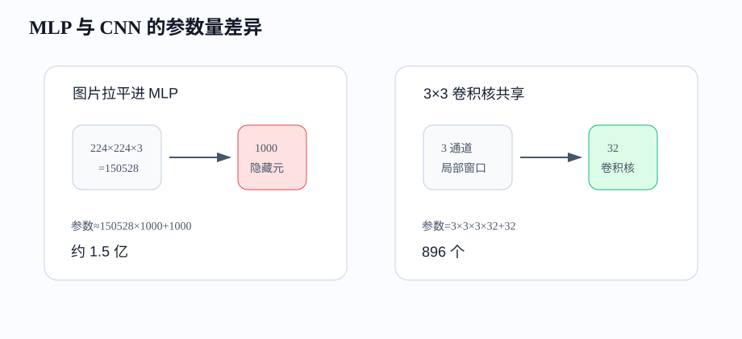
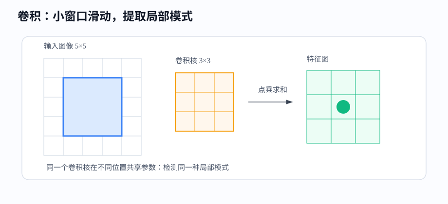
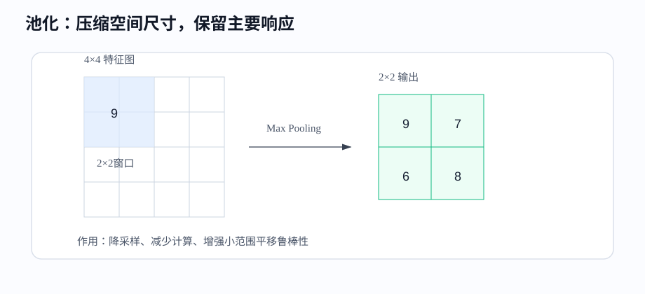
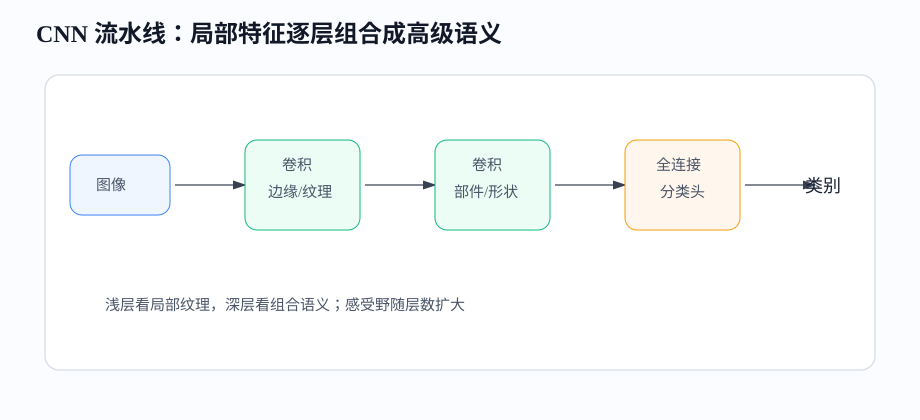

# 课时19-20：CNN 卷积神经网络理论与实战

## 1. 课程定位

卷积神经网络（Convolutional Neural Network，CNN）专门利用图像的空间结构。全连接网络（Fully Connected Network / MLP）把输入看成普通向量，适合结构化特征和小规模向量输入；图像则包含上下左右关系，边缘、纹理、角点和局部形状还会在不同位置重复出现。

CNN 的核心是把“图像结构”写进模型：局部连接（Local Connection）减少无关连接，参数共享（Parameter Sharing）让同一个检测器在不同位置复用，逐层堆叠形成从边缘到物体部件再到类别的表示。

---

## 2. 学习目标

1. 能解释图像张量（Image Tensor）的形状：高度、宽度、通道。
2. 能说明为什么 MLP 直接处理图像参数量大、空间结构利用差。
3. 能解释“卷积”名称的来源，并手算一个小卷积窗口的输出。
4. 能解释卷积核（Kernel / Filter）、特征图（Feature Map）、步幅（Stride）、填充（Padding）、通道（Channel）。
5. 能理解感受野（Receptive Field）如何随层数变大。
6. 能看懂 CNN 的基本结构：卷积、激活、池化、展平、分类头。
7. 能用 PyTorch 搭建一个小型 CNN。

---

## 3. 前置知识与本课关系

MLP 的训练闭环仍然适用于 CNN：

```text
图像 X → CNN → logits → loss → backpropagation → optimizer.step()
```

变化在模型结构：MLP 的核心层是 `Linear`，CNN 的核心层是 `Conv2d`。`Conv2d` 不是随便换了一个算子，而是把图像的两个基本事实放进模型：

1. 局部像素更相关：一个边缘通常由相邻像素共同决定。
2. 模式可迁移：同一个“竖线检测器”可以在左上角用，也可以在右下角用。

---

## 4. 图像张量

### 4.1 图像在计算机中的形状

灰度图可以看成二维矩阵：

$$
H\times W
$$

彩色图通常有 RGB 三个通道：

$$
C\times H\times W
$$

在 PyTorch 中，一个 batch 的图像常用形状：

$$
N\times C\times H\times W
$$

含义：

1. $N$：batch size，一次送入多少张图。
2. $C$：通道数（Channel），RGB 图像为 3，灰度图为 1。
3. $H$：高度（Height）。
4. $W$：宽度（Width）。

例子：`32 × 3 × 224 × 224` 表示一次输入 32 张 RGB 图片，每张大小 224×224。

---

### 4.2 为什么不能简单拉平

把图片拉平成向量后也能送进 MLP，例如：

$$
224\times224\times3=150528
$$

如果第一层有 1000 个隐藏神经元，参数量约为：

$$
150528\times1000+1000\approx1.5亿
$$



更大的问题是空间结构被破坏。拉平后，第 1 个像素和第 2 个像素相邻，但第 224 个和第 225 个可能在二维图像上换行相邻。MLP 不知道“上下左右”的几何关系，只能靠数据量硬学。

CNN 不把图像当成一长串数字，而是保留二维网格结构，用小窗口在图上滑动，提取局部模式。

---

## 5. 卷积

### 5.1 卷积是什么

卷积（Convolution）可以理解成：拿一个小矩阵在图像上滑动，每到一个位置，就和该位置的局部区域做对应元素相乘再求和。

“卷积”这个名字来自数学中的 convolution。原始数学操作包含翻转、移动、重叠、对应相乘和求和：“积”容易理解为乘积，“卷”对应翻转后滑动重叠的过程。图像本身并没有真的卷起来，真正需要记住的动作只有四步：

```text
覆盖一个局部窗口 → 对应位置相乘 → 全部求和 → 移动到下一个位置
```

严格来说，现代深度学习框架中的 `Conv2d` 通常直接滑动卷积核而不先翻转，数学上更接近互相关（Cross-Correlation）。由于卷积核参数本来就会通过训练学习，是否预先翻转不会限制可学到的模式，因此工程上一直沿用“卷积层”这个名称。

这个小矩阵叫卷积核（Kernel）或滤波器（Filter）。一个卷积核像一个可以训练的局部探测器：

1. 有的卷积核学会检测竖边。
2. 有的卷积核学会检测横边。
3. 有的卷积核学会检测颜色变化。
4. 深层卷积核会组合成纹理、部件、形状。



---

### 5.2 小例子

输入局部区域：

$$
\begin{bmatrix}
1&2&0\\
0&1&3\\
2&1&1
\end{bmatrix}
$$

卷积核：

$$
\begin{bmatrix}
1&0&-1\\
1&0&-1\\
1&0&-1
\end{bmatrix}
$$

输出值：

$$
1\times1+2\times0+0\times(-1)+0\times1+1\times0+3\times(-1)+2\times1+1\times0+1\times(-1)=-1
$$

这个卷积核左列是正权重，右列是负权重，它对“左亮右暗”或“左强右弱”的局部模式敏感。训练过程中，卷积核里的数字不是人工指定，而是通过反向传播（Backpropagation）学出来。

---

### 5.3 特征图

卷积核在整张图上滑动，会得到一张输出图，叫特征图（Feature Map）。

如果一个卷积层有 32 个卷积核，就会输出 32 张特征图。每张特征图代表一种局部模式在各个位置的响应强度。

直觉：

```text
原图 → 竖边响应图、横边响应图、颜色变化响应图、纹理响应图...
```

网络越深，特征图越抽象：

1. 浅层：边缘、角点、颜色块。
2. 中层：纹理、局部形状、物体部件。
3. 深层：类别相关模式，例如猫耳、车轮、文字区域。

---

### 5.4 参数共享

参数共享（Parameter Sharing）指同一个卷积核在所有空间位置使用同一组参数。

它带来两个好处：

1. 参数少：不用给每个位置单独学习一套权重。
2. 位置泛化（Generalization）：同一个模式出现在不同位置，都能被同一个卷积核检测到。

例子：检测“竖边”的卷积核，不应该只在图片左侧有效。车牌边缘、商品轮廓、人脸轮廓可能出现在任意位置，共享参数让检测器可以到处使用。

---

## 6. 卷积层关键参数

### 6.1 卷积核大小

卷积核大小（Kernel Size）决定每次看多大的局部区域。常见大小：`3×3`、`5×5`、`7×7`。

`3×3` 很常用，因为：

1. 参数少。
2. 可以堆叠扩大感受野。
3. 多个 `3×3` 中间有激活函数（Activation Function），表达能力比一个大卷积更强。

两个 `3×3` 卷积堆叠后，有效感受野接近 `5×5`，但参数通常更少，还多了一次非线性。

---

### 6.2 步幅

步幅（Stride）表示卷积核每次移动几格。

1. `stride=1`：逐格滑动，保留更多空间细节。
2. `stride=2`：隔一格滑动，输出图尺寸变小，计算量下降。

输出尺寸公式（单个空间维度）：

$$
Output=\left\lfloor\frac{Input+2\times Padding-Kernel}{Stride}\right\rfloor+1
$$

例子：输入 32，卷积核 3，padding 1，stride 1：

$$
Output=\left\lfloor\frac{32+2-3}{1}\right\rfloor+1=32
$$

---

### 6.3 填充

填充（Padding）是在图片边缘补 0 或其他值。常见用途：

1. 保持输出尺寸不变。
2. 让边缘像素也能被充分计算。
3. 控制下采样节奏。

如果没有 padding，边缘像素参与卷积的次数少，输出尺寸也会不断缩小。`3×3` 卷积配 `padding=1` 可以保持空间尺寸不变。

---

### 6.4 通道

通道（Channel）是图像或特征图的深度维度。RGB 图片有 3 个输入通道。卷积层输出通道数等于卷积核个数。

如果输入通道是 3，输出通道是 32，卷积核大小是 `3×3`，参数量：

$$
3\times3\times3\times32+32=896
$$

含义：每个卷积核不是二维的 `3×3`，而是覆盖所有输入通道的 `3×3×3` 小立方体。它同时看 R、G、B 三个通道的局部信息。

---

## 7. 池化

### 7.1 池化做什么

池化（Pooling）把局部区域压缩成一个值。最常见的是最大池化（Max Pooling）和平均池化（Average Pooling）。



最大池化例子：

$$
\begin{bmatrix}
1&3\\
2&4
\end{bmatrix}\rightarrow4
$$

它保留局部最强响应，常用于“这个区域有没有某个模式”。平均池化更像平滑，保留区域平均强度。

---

### 7.2 池化的价值

池化带来三个效果：

1. 降低空间尺寸，减少后续计算量。
2. 增强小范围平移鲁棒性：目标稍微移动，最大响应仍可能保留。
3. 扩大后续神经元看到的原图范围。

现代 CNN 中，也常用 stride 卷积替代部分池化。核心思想相同：逐步压缩空间尺寸，同时增加语义抽象程度。

---

## 8. 感受野

感受野（Receptive Field）指某个输出位置能看到原图中多大范围。

浅层神经元只看很小区域，例如边缘；深层神经元通过多层叠加，能间接看到更大区域，例如眼睛、轮子、文字块甚至整个物体。

例子：连续堆叠 `3×3, stride=1` 卷积：

1. 第 1 层某个点看原图 `3×3`。
2. 第 2 层某个点看第 1 层的 `3×3`，折回原图约为 `5×5`。
3. 第 3 层约为 `7×7`。

所以 CNN 不是一开始就理解整张图，而是局部模式逐层合成全局语义。

---

## 9. CNN 网络结构

### 9.1 典型结构

```text
Input → Conv → ReLU → Conv → ReLU → Pool → Conv → ReLU → Pool → Classifier
```



含义：

1. 卷积层（Convolution Layer）：提取局部模式。
2. 激活函数（Activation Function）：引入非线性。
3. 池化或步幅卷积：压缩空间尺寸。
4. 分类头（Classifier Head）：把高层特征转成类别 logits。

---

### 9.2 Flatten 与全局平均池化

展平（Flatten）把特征图拉成向量，再接全连接层。例如特征图形状是 `64×7×7`，展平后是 `3136` 维。

缺点：如果展平后的维度很大，后面的全连接层参数量会增加。

全局平均池化（Global Average Pooling, GAP）对每个通道取空间平均，把 `C×H×W` 变成 `C`。它减少参数，也让模型更关注“某种语义是否出现”，而不是过度依赖具体位置。

---

## 10. 经典 CNN 架构

1. LeNet：早期手写数字识别网络，结构简单，展示了卷积 + 池化 + 全连接的基本套路。
2. AlexNet：使用 ReLU、Dropout、GPU 训练，在大规模图像分类上带来突破。
3. VGG：大量使用小卷积核堆叠，结构规整，易理解。
4. ResNet：引入残差连接（Residual Connection），缓解深层网络训练困难。

ResNet 的核心直觉：如果新层暂时学不到有用变化，至少可以让输入直接绕过去，减少“网络越深越难训练”的问题。

---

## 11. CNN 的优势与短板

### 11.1 优势

1. 利用空间局部性，比 MLP 更适合图像。
2. 参数共享显著减少参数量。
3. 对局部平移有一定鲁棒性。
4. 多层结构能从低级视觉特征组合到高级语义。
5. 计算高度并行，适合 GPU。

---

### 11.2 短板

1. 全局关系不直接：远距离区域要通过多层才能交互。
2. 对旋转、尺度、遮挡仍需数据增强（Data Augmentation）或特殊结构。
3. 需要较多标注数据。
4. 对表格数据通常不如 GBDT 类模型自然。
5. 对长文本和长序列，CNN 不如 Attention 直接。

---

## 12. 工业场景

CNN 常见应用：

1. 质检：识别划痕、污点、裂纹、缺件。
2. OCR：票据、车牌、证件文字区域识别。
3. 医学影像：病灶检测、分割辅助。
4. 安防：目标检测、行为识别、人脸相关任务。
5. 商品理解：商品图分类、相似商品检索、主图质量评估。

落地要点：

1. 数据标注质量比模型花样更关键。
2. 线上图片分布要和训练数据一致。
3. 需要关注推理延迟、模型大小、显存、吞吐。
4. 错误样本要持续回流，形成数据闭环。

---

## 13. 代码实操

### 13.1 PyTorch 简单 CNN

```python
import torch
from torch import nn

class SmallCNN(nn.Module):
    def __init__(self, num_classes=10):
        super().__init__()
        self.features = nn.Sequential(
            nn.Conv2d(1, 16, kernel_size=3, padding=1),  # N×1×28×28 -> N×16×28×28
            nn.ReLU(),
            nn.MaxPool2d(kernel_size=2),                 # N×16×14×14
            nn.Conv2d(16, 32, kernel_size=3, padding=1), # N×32×14×14
            nn.ReLU(),
            nn.MaxPool2d(kernel_size=2),                 # N×32×7×7
        )
        self.classifier = nn.Sequential(
            nn.Flatten(),
            nn.Linear(32 * 7 * 7, 128),
            nn.ReLU(),
            nn.Linear(128, num_classes),
        )

    def forward(self, x):
        x = self.features(x)
        return self.classifier(x)

model = SmallCNN(num_classes=10)
x = torch.randn(8, 1, 28, 28)
logits = model(x)
print(logits.shape)  # torch.Size([8, 10])
```

---

### 13.2 Shape 检查

CNN 代码最容易错在 shape。建议每加一层就检查一次：

```python
x = torch.randn(8, 1, 28, 28)
for layer in model.features:
    x = layer(x)
    print(layer.__class__.__name__, x.shape)
```

典型输出：

```text
Conv2d torch.Size([8, 16, 28, 28])
ReLU torch.Size([8, 16, 28, 28])
MaxPool2d torch.Size([8, 16, 14, 14])
Conv2d torch.Size([8, 32, 14, 14])
ReLU torch.Size([8, 32, 14, 14])
MaxPool2d torch.Size([8, 32, 7, 7])
```

看 shape 时抓四个数字：`N, C, H, W`。卷积通常改变 $C$，池化或 stride 通常改变 $H,W$。

---

## 14. 常见问题

1. 为什么叫卷积层？因为它使用卷积式的局部滑动、对应相乘与求和计算；名称来自数学中的 convolution。
2. 深度学习框架算的是严格卷积吗？通常更接近不翻转卷积核的互相关，但卷积核可训练，因此不影响它学习局部模式，工程上仍称卷积。
3. 卷积核是人工设计的吗？现代 CNN 中卷积核参数通过训练学习出来。
4. 卷积是不是只能处理图片？不是，也可处理语音谱图、时间序列、文本局部 n-gram，但图像最典型。
5. 池化会不会丢信息？会，所以不能过度池化；它是在细节和鲁棒性之间取舍。
6. CNN 为什么对位置有一定鲁棒性？因为卷积核共享参数，池化保留局部强响应。
7. CNN 和全连接能混用吗？能，传统 CNN 最后常接全连接分类头。

---

## 15. 本课总结

1. 图像是带空间结构的张量，不适合直接当普通长向量处理。
2. CNN 用局部连接和参数共享提取可迁移的局部模式。
3. “卷积”名称来自数学中的翻转、滑动、对应相乘与求和；深度学习框架通常实现不翻转卷积核的互相关，但沿用卷积名称。
4. 卷积核像可训练的局部探测器，滑动后生成特征图。
5. Stride、Padding、Kernel Size、Channel 决定输出尺寸、计算量和表达能力。
6. 池化压缩空间尺寸，增强局部平移鲁棒性。
7. 感受野解释了 CNN 如何从局部特征逐步形成全局语义。
8. 工业落地时，数据质量、推理成本和错误样本回流同样重要。

---

## 16. 课后作业

1. 用“覆盖局部窗口、对应相乘、求和、移动”四个动作解释为什么叫卷积，并手算一个 `3×3` 窗口的输出。
2. 给定输入 `32×3×224×224`，计算 `Conv2d(3,64,kernel_size=3,padding=1)` 的输出 shape 和参数量。
3. 把代码中的第二个卷积层输出通道从 32 改为 64，调整全连接层输入维度。
4. 对比有无 `MaxPool2d` 的训练速度和准确率（Accuracy）。
5. 找一个工业视觉场景，说明 CNN 适合提取哪些局部模式。

---

## 17. 知识延伸

CNN 擅长处理空间结构；序列数据还要求模型理解时间顺序，并把过去的信息传递到当前时刻。RNN、LSTM 和 GRU 通过隐藏状态处理这种序列依赖。
