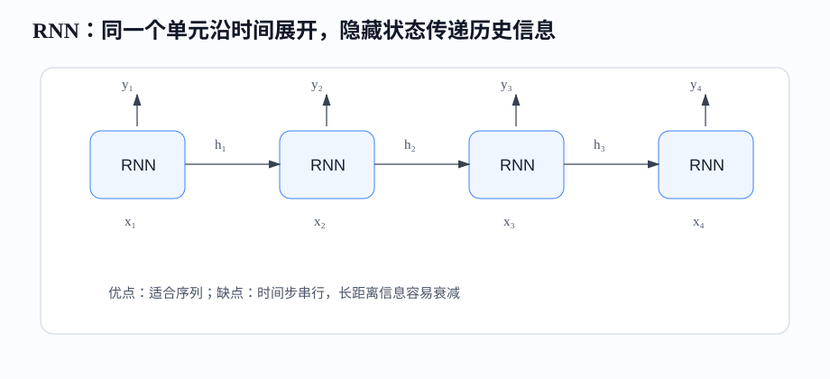
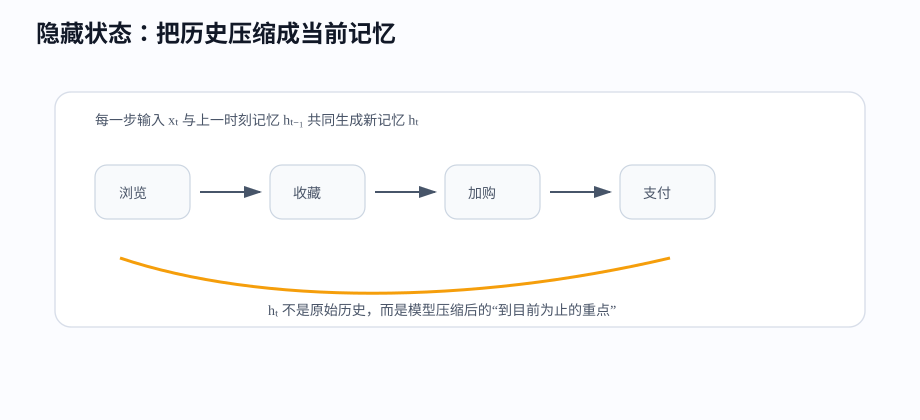
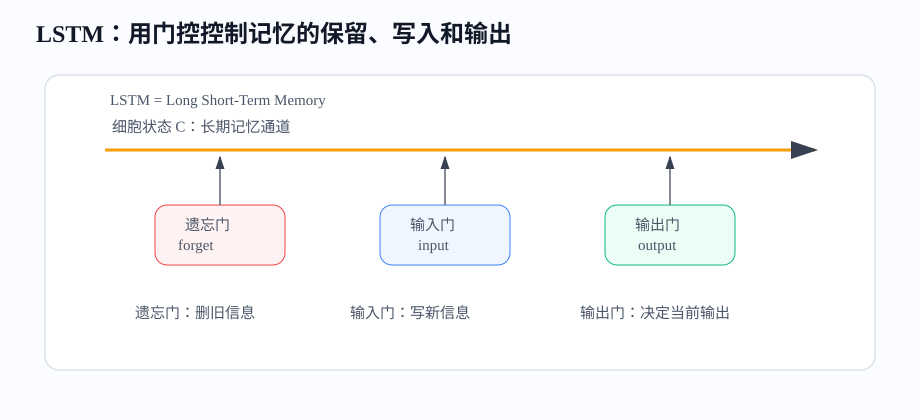
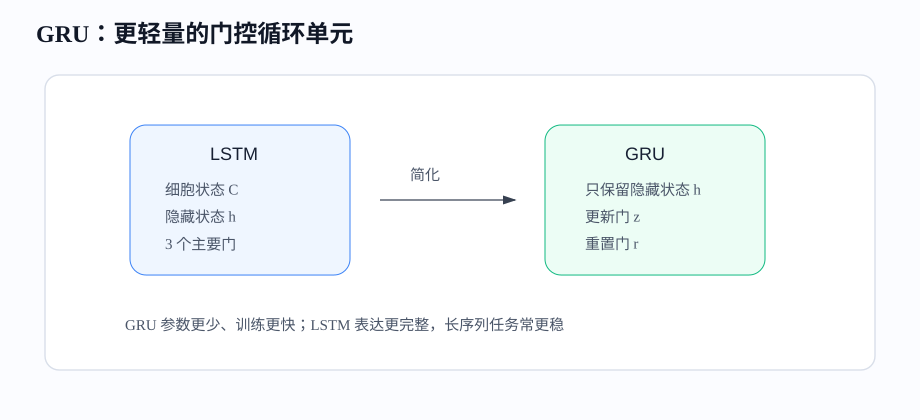

# 课时21-22：RNN / LSTM / GRU 时序网络

## 1. 课程定位

本课学习序列建模（Sequence Modeling）。CNN 关注空间邻域，全连接网络（Fully Connected Network / MLP）把输入看成固定向量；但很多数据天然带顺序：一句话的词顺序、用户点击路径、设备传感器时间线、股票价格序列。

循环神经网络（Recurrent Neural Network, RNN）的核心是隐藏状态（Hidden State）：模型每处理一个时间步（Time Step），都会把“当前输入”和“过去记忆”合并成新的记忆。LSTM 和 GRU 是 RNN 的改进版本，用门控机制缓解长序列记忆衰减。

---

## 2. 学习目标

1. 能说明什么是序列数据，以及为什么顺序重要。
2. 能解释 RNN 的隐藏状态如何携带历史信息。
3. 能看懂 RNN 的基本公式和输入输出形状。
4. 能理解通过时间反向传播（Backpropagation Through Time, BPTT）。
5. 能解释 RNN 为什么容易梯度消失、梯度爆炸。
6. 能说明 LSTM（Long Short-Term Memory）三个门的作用。
7. 能说明 GRU（Gated Recurrent Unit）与 LSTM 的取舍。
8. 能用 PyTorch 搭建一个 GRU 序列分类模型。

---

## 3. 前置知识与本课关系

深度学习训练闭环不变：

```text
输入 → 网络 → 预测 → 损失 → 反向传播（Backpropagation） → 更新参数
```

序列模型的变化在输入结构。普通 MLP 一次看一个固定向量，CNN 看局部空间窗口，RNN 一步一步看序列，并把历史压缩到隐藏状态里。

```text
x1 → h1 → x2 → h2 → x3 → h3 → ... → ht
```

其中 $h_t$ 是到第 $t$ 步为止的状态摘要。

---

## 4. 序列数据

### 4.1 常见序列任务

1. 文本分类：一段评论 → 情感正负。
2. 命名实体识别：一句话 → 每个词是否是人名、地点、机构。
3. 时间序列预测：过去 30 天销量 → 明天销量。
4. 用户行为建模：浏览、收藏、加购、购买 → 下一步转化概率。
5. 设备异常检测：传感器连续读数 → 是否异常。

顺序很重要。例如“不错，不推荐”和“不推荐，不错”包含相同词，但语义可能不同。用户“浏览→收藏→加购”和“加购→取消→长期不访问”也不是同一个状态。

---

### 4.2 输入形状

序列输入常见形状：

$$
Batch\times Time\times Feature
$$

例子：`64 × 20 × 8` 表示：

1. batch 中有 64 条序列。
2. 每条序列有 20 个时间步。
3. 每个时间步有 8 个特征。

文本任务中，每个词先变成词向量（Embedding），再组成序列。用户行为任务中，每个行为也可以被编码成向量，例如行为类型、商品类目、价格段、时间间隔。

---

## 5. RNN

### 5.1 核心公式

RNN 每个时间步重复使用同一组参数：

$$
h_t=\phi(W_xx_t+W_hh_{t-1}+b)
$$

$$
\hat{y}_t=W_yh_t+b_y
$$

符号含义：

1. $x_t$：第 $t$ 个时间步的输入。
2. $h_{t-1}$：上一时刻的隐藏状态。
3. $h_t$：当前时刻的新隐藏状态。
4. $W_x$：当前输入到隐藏状态的权重。
5. $W_h$：历史状态到当前状态的权重。
6. $\phi$：激活函数（Activation Function），常见为 Tanh。



---

### 5.2 隐藏状态是什么

隐藏状态（Hidden State）不是把所有历史原样存起来，而是把历史压缩成一个向量。它保存模型认为对任务有用的信息。



用户行为例子：

```text
浏览 → 收藏 → 加购 → 支付
```

当模型处理到“加购”时，隐藏状态可能已经包含：这个用户看过商品、产生兴趣、没有立即离开。处理到“支付”前，模型不需要记住每个字段的原始细节，但需要保留“购买意愿正在增强”的信息。

隐藏状态越短，压缩越强，容易丢细节；隐藏状态越长，参数和计算成本越高。

---

### 5.3 RNN 的输入输出形式

RNN 常见用法：

| 形式 | 输入 | 输出 | 任务例子 |
|---|---|---|---|
| many-to-one | 多个时间步 | 一个结果 | 评论情感分类、用户转化预测 |
| many-to-many | 多个时间步 | 每步一个结果 | 序列标注、异常检测 |
| seq-to-seq | 一个序列 | 另一个序列 | 机器翻译、摘要生成 |

对初学者最先掌握 many-to-one：读完整条序列，用最后一个隐藏状态做分类或回归。

---

## 6. RNN 的训练问题

### 6.1 串行计算慢

RNN 的第 $t$ 步依赖 $h_{t-1}$，所以不能像 CNN 或 MLP 那样把所有位置完全并行计算。

```text
h1 必须先算完 → 才能算 h2 → 才能算 h3
```

这让 RNN 在长文本、大 batch、大模型场景下不如 CNN 和 Transformer 高效。

---

### 6.2 通过时间反向传播（Backpropagation Through Time, BPTT）

通过时间反向传播（Backpropagation Through Time, BPTT）可以理解成：把 RNN 沿时间展开成很多层，然后从最后一步往前求梯度。

如果序列有 100 个时间步，梯度可能要穿过 100 次状态转换。路径越长，梯度越容易衰减或放大。

---

### 6.3 梯度消失

梯度消失（Vanishing Gradient）意味着早期时间步很难收到有效更新。模型更容易记住近处信息，忘记远处信息。

文本例子：

```text
虽然这家店排队很久、环境一般、服务也慢，但是味道确实很好。
```

最终情感偏正面，但“虽然”之后有很多负面词，真正转折在“但是”。普通 RNN 容易被近处词影响，难以稳定保留远处结构。

---

### 6.4 梯度爆炸

梯度爆炸（Exploding Gradient）表现为 loss 突然变成 NaN、参数暴涨、训练不稳定。RNN 中常用梯度裁剪（Gradient Clipping）限制梯度范数：

完整脚本见：[梯度裁剪最小示例](../codes/lesson_21_22_rnn_lstm_gru/00_gradient_clipping_demo.py)。

```python
torch.nn.utils.clip_grad_norm_(model.parameters(), max_norm=1.0)
```

---

## 7. LSTM

### 7.1 LSTM 解决什么

长短期记忆网络（Long Short-Term Memory, LSTM）解决普通 RNN 的长距离记忆问题。它把“状态”拆成两类：

1. 细胞状态（Cell State）$c_t$：更像长期记忆通道。
2. 隐藏状态（Hidden State）$h_t$：当前对外输出的短期状态。

LSTM 通过门控（Gate）控制信息：哪些旧信息保留，哪些新信息写入，哪些内容输出。



---

### 7.2 三个门

LSTM 主要有三个门：

| 门 | 英文 | 作用 | 直觉 |
|---|---|---|---|
| 遗忘门 | Forget Gate | 决定旧记忆 $c_{t-1}$ 保留多少 | 无关历史少留 |
| 输入门 | Input Gate | 决定新信息写入多少 | 重要新线索多写 |
| 输出门 | Output Gate | 决定当前记忆对外暴露多少 | 当前要用什么 |

门的输出通常经过 Sigmoid，范围在 $0$ 到 $1$：

1. 接近 0：关门，信息基本不通过。
2. 接近 1：开门，信息充分通过。
3. 介于中间：部分通过。

---

### 7.3 细胞状态更新

LSTM 的核心更新可以简化理解为：

$$
c_t=f_t\odot c_{t-1}+i_t\odot \tilde{c}_t
$$

含义：

1. $f_t\odot c_{t-1}$：旧记忆保留多少。
2. $i_t\odot \tilde{c}_t$：新候选记忆写入多少。
3. 两部分相加得到新的长期记忆 $c_t$。

这比普通 RNN 更容易保留长距离信息，因为长期记忆有一条相对稳定的传递通道，不需要每一步都被完全重写。

---

## 8. GRU

### 8.1 GRU 的定位

门控循环单元（Gated Recurrent Unit, GRU）可以看成更简化的 LSTM。它没有单独的细胞状态 $c_t$，只维护隐藏状态 $h_t$，结构更轻，训练更快。



---

### 8.2 GRU 的两个门

GRU 主要有两个门：

1. 更新门（Update Gate）$z_t$：控制保留多少旧状态、写入多少新状态。
2. 重置门（Reset Gate）$r_t$：控制计算新候选状态时，参考多少历史。

简化公式：

$$
z_t=\sigma(W_zx_t+U_zh_{t-1})
$$

$$
r_t=\sigma(W_rx_t+U_rh_{t-1})
$$

$$
\tilde{h}_t=tanh(W_hx_t+U_h(r_t\odot h_{t-1}))
$$

$$
h_t=(1-z_t)\odot h_{t-1}+z_t\odot\tilde{h}_t
$$

如果只记直觉：GRU 用更少的门完成“保留旧信息”和“写入新信息”的平衡。

---

## 9. LSTM 与 GRU 选型

| 维度 | LSTM | GRU |
|---|---|---|
| 状态 | $h_t$ 和 $c_t$ | 只有 $h_t$ |
| 门数量 | 多，控制更细 | 少，结构更简单 |
| 参数量 | 较大 | 较小 |
| 训练速度 | 稍慢 | 稍快 |
| 长依赖能力 | 通常更强 | 多数任务足够 |
| 工程起点 | 长序列、复杂任务 | 快速 baseline、资源有限 |

实际项目中，先做 GRU baseline 往往更快；如果长依赖明显、数据充足，再尝试 LSTM 或 Attention/Transformer。

---

## 10. 序列建模关键问题

### 10.1 序列长度

序列越长，模型越难训练，计算越慢，也越容易把关键信息淹没。常见处理：

1. 截断：只取最近 $T$ 步，例如最近 100 次行为。
2. 滑窗：用多个窗口训练，覆盖更长历史。
3. 聚合特征：把很久以前的信息转成统计特征，例如近 30 天购买次数。
4. 分层建模：先在短窗口内建表示，再汇总到长周期。

---

### 10.2 Padding 与 Mask

同一个 batch 里序列长度通常不同，需要填充（Padding）到统一长度。

例子：

```text
A: [浏览, 收藏, 加购]
B: [浏览, 支付]

补齐后：
A: [浏览, 收藏, 加购]
B: [浏览, 支付, PAD]
```

掩码（Mask）告诉模型哪些位置是真实数据，哪些位置是补齐数据。否则模型可能把 PAD 当成有效行为学习。

---

### 10.3 Teacher Forcing

教师强制（Teacher Forcing）常用于序列生成任务。训练时，下一步输入使用真实上一步 token，而不是模型自己刚预测的 token。

优点：训练更稳定、收敛更快。

问题：训练时看到的历史很干净，推理时历史来自模型自己，错误会累积。这叫暴露偏差（Exposure Bias）。

---

## 11. 工业场景

RNN/LSTM/GRU 常见应用：

1. 用户行为序列：预测点击、转化、流失。
2. 时间序列：销量、流量、库存、能耗预测。
3. 文本分类：评论情感、工单分类、风险文本识别。
4. 设备监控：连续传感器异常检测。
5. 金融风控：交易序列、登录序列、支付行为序列。

工程要点：

1. 先定义时间窗口和预测目标，避免使用未来信息。
2. 对序列长度做截断或分桶，减少 padding 浪费。
3. 保留时间间隔、行为类型、对象属性等关键信息。
4. 用验证集模拟真实时间顺序，避免随机切分造成泄漏。

---

## 12. 代码实操

### 12.1 GRU 做序列分类

完整脚本见：[GRU 序列分类](../codes/lesson_21_22_rnn_lstm_gru/01_gru_sequence_classification.py)。

```python
import torch
from torch import nn
from torch.utils.data import DataLoader, TensorDataset

num_samples = 1000
seq_len = 20
feature_dim = 4

X = torch.randn(num_samples, seq_len, feature_dim)
y = (X[:, -5:, :].mean(dim=(1, 2)) > X[:, :5, :].mean(dim=(1, 2))).long()

dataset = TensorDataset(X, y)
loader = DataLoader(dataset, batch_size=32, shuffle=True)

class GRUClassifier(nn.Module):
    def __init__(self, input_dim, hidden_dim, num_classes):
        super().__init__()
        self.gru = nn.GRU(
            input_size=input_dim,
            hidden_size=hidden_dim,
            batch_first=True,
        )
        self.fc = nn.Linear(hidden_dim, num_classes)

    def forward(self, x):
        out, h_n = self.gru(x)      # out: N×T×H, h_n: 1×N×H
        last_hidden = h_n[-1]       # N×H
        logits = self.fc(last_hidden)
        return logits

model = GRUClassifier(input_dim=feature_dim, hidden_dim=32, num_classes=2)
loss_fn = nn.CrossEntropyLoss()
optimizer = torch.optim.AdamW(model.parameters(), lr=1e-3)

for epoch in range(10):
    total_loss = 0.0
    for xb, yb in loader:
        logits = model(xb)
        loss = loss_fn(logits, yb)

        optimizer.zero_grad()
        loss.backward()
        torch.nn.utils.clip_grad_norm_(model.parameters(), max_norm=1.0)
        optimizer.step()

        total_loss += loss.item() * len(xb)
    print(epoch + 1, total_loss / len(dataset))
```

---

### 12.2 输出怎么理解

`nn.GRU` 返回两个东西：

1. `out`：每个时间步的输出，形状是 `N×T×H`。
2. `h_n`：最后时刻隐藏状态，形状是 `num_layers×N×H`。

如果做整条序列分类，常用最后一个隐藏状态；如果做每个时间步的标注，就会使用 `out` 中每一步的表示。

---

## 13. 常见问题

1. RNN 为什么叫循环？因为每个时间步使用同一套参数，并把隐藏状态传给下一步。
2. LSTM 一定比 GRU 好吗？不一定。GRU 参数少、速度快，很多任务足够。
3. 序列越长越好吗？不一定。太长会带来噪声、计算成本和长依赖困难。
4. Padding 会影响结果吗？如果不用 Mask，可能会。
5. 现在还有必要学 RNN 吗？有。它是理解序列建模、门控机制和 Transformer 之前技术瓶颈的重要基础。

---

## 14. 本课总结

1. 序列数据的关键是顺序和历史依赖。
2. RNN 用隐藏状态压缩历史信息，并在每个时间步递推更新。
3. BPTT 把 RNN 沿时间展开后反向求梯度，长序列容易出现梯度问题。
4. LSTM 用遗忘门、输入门、输出门控制长期记忆。
5. GRU 用更简洁的门控结构实现类似效果，适合快速 baseline。
6. 工程中要处理序列长度、Padding、Mask、时间切分和未来信息泄漏。

---

## 15. 课后作业

1. 用自己的话解释隐藏状态为什么不是“完整历史”，而是“历史摘要”。
2. 给定 `batch=16, time=30, feature=8, hidden=64`，写出 GRU 输入输出 shape。
3. 在代码中把 `hidden_dim=32` 改成 64 和 128，观察 loss 变化。
4. 加入一层 `nn.GRU(..., num_layers=2)`，比较训练速度和效果。
5. 找一个用户行为序列场景，设计输入特征、标签和时间窗口。

---

## 16. 知识延伸

CNN 擅长空间局部结构，RNN 擅长时间顺序结构，但二者都存在全局交互瓶颈。Attention 允许不同位置直接建立关系，Transformer 则以注意力为核心建立更适合并行训练和大规模预训练的结构。
