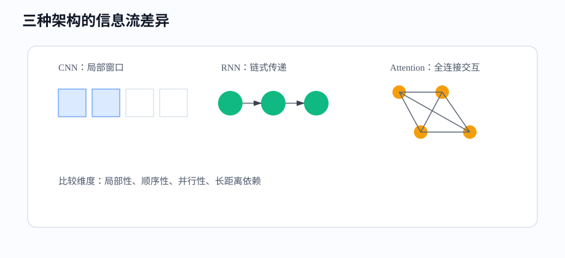
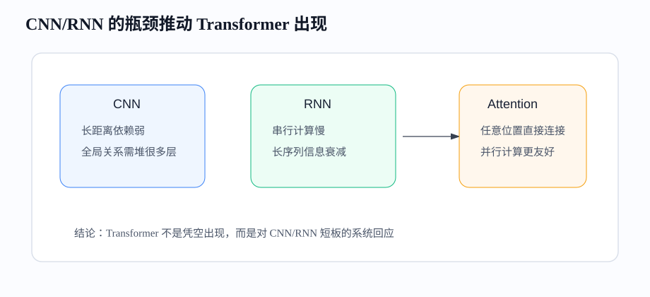
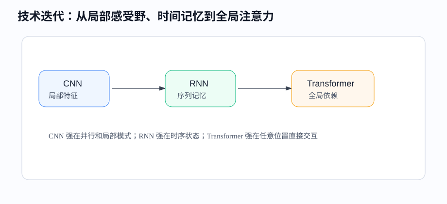

# 课时23-24：CNN/RNN 对比复盘与技术迭代总结

## 1. 课程定位

本课对经典深度学习结构做阶段复盘：全连接网络（Fully Connected Network / MLP）、卷积神经网络（Convolutional Neural Network, CNN）、循环神经网络（Recurrent Neural Network, RNN）、LSTM、GRU。

重点不是背结构名称，而是理解每种结构背后的数据假设：MLP 假设输入是固定向量，CNN 假设局部空间模式可共享，RNN 假设序列历史需要递推记忆。后续 Transformer 不是凭空出现，而是在解决 CNN/RNN 的长距离依赖和并行效率瓶颈。

---

## 2. 学习目标

1. 能从数据结构角度区分 MLP、CNN、RNN/LSTM/GRU。
2. 能解释参数共享（Parameter Sharing）在 CNN 和 RNN 中的不同含义。
3. 能说明神经网络是一张计算图，并解释顺序连接与跳跃连接的差异。
4. 能说明 CNN 的局部感受野（Local Receptive Field）优势与长距离瓶颈。
5. 能说明 RNN 的隐藏状态（Hidden State）优势与串行瓶颈。
6. 能从瓶颈自然推导注意力机制（Attention）的需求。
7. 能为表格、图像、文本、时间序列任务选择合理 baseline。
8. 能设计一个公平的模型对比实验。

---

## 3. 前置知识与本课关系

MLP、CNN 和 RNN 形成一条结构演进主线：

```text
MLP：通用向量映射
CNN：利用空间局部结构
RNN/LSTM/GRU：利用时间顺序结构
```

它们都遵循同一训练闭环：

```text
输入 → 网络结构 → 表示 → 输出 → 损失 → 梯度 → 参数更新
```

差异主要来自“网络结构如何利用数据结构”。

---

## 4. 三类网络的核心假设

### 4.1 MLP

多层感知机（Multilayer Perceptron, MLP）假设输入已经整理成固定长度向量，每个维度都可以和下一层任意神经元连接。

适合：

1. 表格特征经过预处理后的向量。
2. 小规模、固定长度输入。
3. 作为 CNN、RNN、Transformer 后面的分类头或回归头。

短板：不主动利用空间邻域，也不主动利用时间顺序。图片拉平后，像素的上下左右关系丢失；序列拉平后，时间步关系也不自然。

---

### 4.2 CNN

CNN 假设：局部邻域很重要，同一种局部模式可能出现在不同位置。

适合：

1. 图像分类、检测、分割。
2. OCR 和工业质检。
3. 有局部结构的语音谱图、传感器片段。
4. 短文本局部 n-gram 特征。

短板：长距离依赖（Long-Range Dependency）不直接。左上角和右下角两个区域要交互，通常需要多层卷积逐步扩大感受野。

---

### 4.3 RNN / LSTM / GRU

RNN 系列假设：数据按时间顺序到来，当前判断需要参考历史状态。

适合：

1. 用户行为序列。
2. 时间序列预测。
3. 文本、语音、传感器数据。
4. 需要递推状态的流式任务。

短板：串行依赖强。第 100 步必须等前 99 步算完，训练并行性差；长序列还容易出现信息压缩和梯度问题。

---

## 5. 架构对比

### 5.1 信息流差异



| 维度 | MLP | CNN | RNN/LSTM/GRU |
|---|---|---|---|
| 输入结构 | 固定向量 | 网格/图像 | 序列 |
| 关键机制 | 全连接权重 | 卷积核滑动 | 隐藏状态递推 |
| 参数共享 | 弱 | 空间共享 | 时间共享 |
| 并行能力 | 强 | 强 | 弱 |
| 长距离依赖 | 依赖人工特征 | 需要多层间接传递 | 理论可行，实践困难 |
| 典型任务 | 表格、分类头 | 图像、OCR、检测 | 文本、行为、时序 |

---

### 5.2 参数共享的差异

CNN 的参数共享：同一个卷积核扫过不同空间位置。它回答的是：“这个局部模式在哪里出现都算数吗？”

RNN 的参数共享：同一组循环参数用于不同时间步。它回答的是：“每个时间点是否用同一套状态更新规则？”

两者都减少参数量，但共享方向不同：

1. CNN 沿空间共享，重点是位置可迁移。
2. RNN 沿时间共享，重点是过程可递推。

---

### 5.3 网络不一定是一条顺序链

入门网络常写成 `输入 → 第一层 → 第二层 → 输出`，但实际神经网络是一张计算图，可以分叉、汇合和跨层连接。后面的层只会使用有连接路径送来的数据；如果希望第二层或更深层直接使用原始输入，必须增加跳跃连接（Skip Connection）。

ResNet 的残差结构是典型例子：

$$
y=F(x)+x
$$

主路径 $F(x)$ 学习新的变换，捷径把 $x$ 直接送到后面相加。正向传播时数据沿两条路径前进，反向传播时梯度也沿两条路径返回并在汇合处相加。这个设计既保留早期信息，也给深层网络提供更短的梯度通路。

因此，比较 MLP、CNN、RNN 或 Transformer 时，不只要看“用了什么层”，还要看“这些层之间如何连接”。网络结构的本质是数据通路与参数共享方式。

---

## 6. CNN/RNN 的核心瓶颈

### 6.1 CNN 的瓶颈

CNN 通过局部卷积逐层扩大感受野。局部模式学习很强，但全局关系不直接。

例子：图片中左上角是“红绿灯”，右下角是“车辆”。判断交通场景时，两者关系重要。浅层 CNN 只能看局部；深层 CNN 需要多次卷积和下采样，才可能把远距离信息汇合。

问题：

1. 任意两个远位置不能一开始就直接交互。
2. 全局关系依赖层数堆叠。
3. 空间分辨率下采样后，细节可能丢失。

---

### 6.2 RNN 的瓶颈

RNN 用一个隐藏状态压缩历史。这个设计适合流式序列，但长序列会有两个问题。

第一，计算串行：

```text
h1 → h2 → h3 → ... → h100
```

第 100 步不能绕过前 99 步直接计算。

第二，信息压缩：很早的信息必须不断被写入、保留、转移。序列越长，越容易被后续信息覆盖。

---

### 6.3 技术瓶颈汇总



| 瓶颈 | CNN | RNN |
|---|---|---|
| 长距离依赖 | 需要堆很多层 | 容易遗忘或被压缩 |
| 并行训练 | 较好 | 较差 |
| 全局交互 | 不直接 | 通过隐藏状态间接交互 |
| 大规模扩展 | 适合视觉，但不适合语言全局关系 | 长序列越长越慢 |

这些瓶颈共同推动了注意力机制（Attention）和 Transformer 的出现。

---

## 7. 从短板推导 Attention

### 7.1 需求一：任意位置直接交互

如果一个序列中第 1 个 token 和第 100 个 token 有强关系，理想结构应该让它们直接计算相关性，而不是通过 99 次状态传递。

Attention 的核心：每个位置都可以看其他位置，并按相关性加权汇总信息。

```text
当前位置表示 = 对所有位置的信息做加权求和
权重大小 = 当前 token 与其他 token 的相关程度
```

---

### 7.2 需求二：并行计算

RNN 的递推是顺序依赖，天然难并行。Attention 直接构造两两关系矩阵，可以一次性计算所有 token 的关系，更适合 GPU。

这不是小优化，而是大模型可扩展性的基础。长文本、大 batch、大参数规模都要求训练过程尽可能矩阵化和并行化。

---

### 7.3 需求三：保留全局上下文

Attention 使用查询（Query, Q）、键（Key, K）、值（Value, V）：

$$
Attention(Q,K,V)=softmax\left(\frac{QK^T}{\sqrt{d_k}}\right)V
$$

直觉：

1. $QK^T$：计算每个位置和其他位置的相似度。
2. $softmax$：把相似度变成权重。
3. 乘以 $V$：按权重汇总信息。

CNN 通过层数扩大感受野，RNN 通过隐藏状态传递历史，Attention 让位置之间直接建立连接。

---

## 8. 技术演进图



演进逻辑：

1. MLP：通用函数拟合，但不利用结构。
2. CNN：利用局部空间结构，推动图像识别突破。
3. RNN：利用时间顺序，处理文本和时序。
4. LSTM / GRU：用门控缓解长依赖。
5. Attention：让任意位置直接交互。
6. Transformer：基于 Attention 构建可并行、可扩展的大模型架构。

---

## 9. 任务选型

### 9.1 表格数据

优先路线：

1. 线性回归 / 逻辑回归做 baseline。
2. RandomForest / GBDT / XGBoost / LightGBM 做主力。
3. 深度学习只在数据量大、特征交互复杂、需要端到端表示时考虑。

表格数据上，树模型仍然非常强，因为它能自然处理非线性分裂、特征交互和不同区域规则。

---

### 9.2 图像数据

优先路线：

1. 简单图像分类：CNN baseline。
2. 检测分割：使用成熟视觉模型。
3. 大规模视觉任务：考虑 ResNet、EfficientNet、Vision Transformer 或多模态模型。

CNN 仍然是理解视觉模型的基础，因为卷积、通道、特征图、感受野等概念在现代视觉模型中仍有影响。

---

### 9.3 文本数据

历史路线：

1. 传统特征：TF-IDF + 线性模型。
2. TextCNN：提取局部 n-gram 模式。
3. RNN / LSTM / GRU：建模顺序状态。
4. Transformer：用 Attention 建模全局关系。
5. 大语言模型（Large Language Model, LLM）：基于大规模预训练和生成式建模。

现在做文本任务，通常直接优先考虑预训练模型或大模型，但理解 CNN/RNN 有助于理解 Transformer 解决了什么问题。

---

### 9.4 时间序列

路线选择：

1. 强业务解释、小数据：统计模型、特征工程（Feature Engineering） + GBDT。
2. 中等规模序列：GRU/LSTM baseline。
3. 长序列、多变量、大数据：Temporal CNN、Transformer、Informer 等结构。
4. 高风险场景：模型效果之外，还要做异常检测、监控和人工兜底。

不要只看模型名字，要看数据规模、预测窗口、延迟要求、解释要求和上线成本。

---

## 10. 模型对比实验设计

### 10.1 对比要公平

模型对比不能只跑一个默认参数就下结论。公平对比至少保证：

1. 同一训练集、验证集、测试集。
2. 同一评价指标。
3. 类似的调参预算。
4. 记录训练时间和推理延迟。
5. 多次随机种子取平均。

如果 CNN 比 MLP 好，要确认不是因为 CNN 训练更久、参数更多或数据增强（Data Augmentation）更多。

---

### 10.2 记录维度

建议记录：

1. 训练指标：loss、accuracy、AUC、F1、MAE 等。
2. 泛化（Generalization）指标：验证集和测试集表现。
3. 成本指标：参数量、显存、训练时间、推理延迟。
4. 稳定性：随机种子波动、异常样本表现。
5. 工程性：部署难度、监控难度、解释难度。

工业项目里，“效果提升 0.2% 但延迟翻倍”不一定值得上线。

---

## 11. 阶段项目建议

### 11.1 图像分类项目

目标：用 CNN 完成一个小型图像分类任务。

核心产出：

1. 数据读取与预处理。
2. CNN baseline。
3. 训练曲线和混淆矩阵（Confusion Matrix）。
4. 错误样本分析。
5. 一版可复现实验记录。

---

### 11.2 文本分类项目

目标：对比 TF-IDF + 线性模型、TextCNN、GRU 的效果。

核心产出：

1. 统一数据切分。
2. 统一评价指标。
3. 三类模型训练结果。
4. 错误案例对比。
5. 总结每种模型适合的文本模式。

---

### 11.3 时间序列项目

目标：用窗口特征和 GRU 分别预测一个时间序列标签。

核心产出：

1. 时间顺序切分，避免未来信息泄漏。
2. 窗口长度选择。
3. baseline 模型。
4. GRU 模型。
5. 误差分布和异常样本分析。

---

## 12. 代码实操：同一思想的最小对比

### 12.1 MLP 与 CNN 对比入口

```python
# MLP: 把图片拉平
mlp = nn.Sequential(
    nn.Flatten(),
    nn.Linear(1 * 28 * 28, 128),
    nn.ReLU(),
    nn.Linear(128, 10),
)

# CNN: 保留空间结构
cnn = nn.Sequential(
    nn.Conv2d(1, 16, kernel_size=3, padding=1),
    nn.ReLU(),
    nn.MaxPool2d(2),
    nn.Conv2d(16, 32, kernel_size=3, padding=1),
    nn.ReLU(),
    nn.MaxPool2d(2),
    nn.Flatten(),
    nn.Linear(32 * 7 * 7, 10),
)
```

对比点：MLP 的第一层直接处理全部像素；CNN 先用局部卷积提取空间模式。

---

### 12.2 RNN 与窗口特征对比入口

```python
# 传统 ML 思路：把序列压成统计特征
features = torch.cat([
    seq.mean(dim=1),
    seq.max(dim=1).values,
    seq[:, -1, :],
], dim=1)

# RNN 思路：直接输入序列
rnn = nn.GRU(input_size=feature_dim, hidden_size=64, batch_first=True)
out, h_n = rnn(seq)
last_hidden = h_n[-1]
```

对比点：窗口统计特征可解释、轻量；RNN 能学习顺序变化，但训练和部署成本更高。

---

## 13. 常见误区

1. “深度学习一定更好”：错误。表格和小数据场景，传统模型经常更稳。
2. “CNN 只会看局部”：不准确。深层 CNN 能形成全局语义，但路径不如 Attention 直接。
3. “RNN 能记住所有历史”：不准确。隐藏状态是压缩记忆，长序列会丢信息。
4. “Transformer 完全替代 CNN/RNN”：不准确。许多视觉、边缘设备、时序小模型场景仍会使用 CNN/RNN 思想。
5. “模型选型只看准确率（Accuracy）”：错误。还要看延迟、成本、解释性、稳定性和维护成本。

---

## 14. 本课总结

1. MLP、CNN、RNN 的差异来自对数据结构的不同假设。
2. CNN 用局部连接和空间参数共享处理图像结构。
3. RNN 用隐藏状态和时间参数共享处理序列结构。
4. CNN 的长距离交互不直接，RNN 的长序列并行性差。
5. Attention 让任意位置直接交互，并适合 GPU 并行。
6. Transformer 是对这些瓶颈的系统性回应，不是凭空出现的新名词。
7. 工业选型要同时考虑效果、成本、可解释性、稳定性和上线难度。

---

## 15. 课后作业

1. 用一段话说明 MLP、CNN、RNN 分别利用了什么数据假设。
2. 举一个 CNN 不擅长的长距离关系例子。
3. 举一个 RNN 不擅长并行计算的例子。
4. 设计一个表格、图像、文本任务的模型选型方案，并说明理由。
5. 对比两个模型时，列出至少 5 个必须记录的实验维度。

---

## 16. 知识延伸

Transformer 使用 Attention 直接计算 token 之间的关系。理解 Q/K/V、多头注意力、位置编码和信息流动方式，是理解 BERT、GPT、T5 以及大模型预训练的基础。
