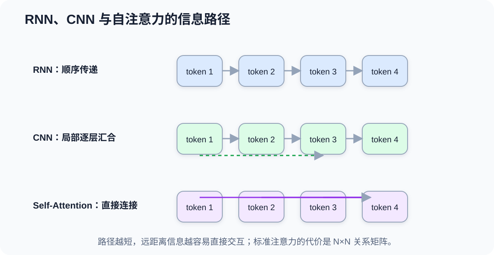
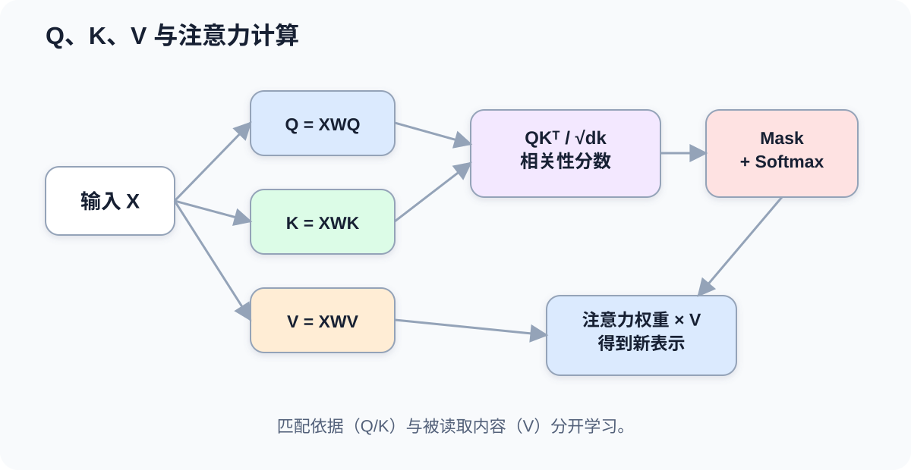
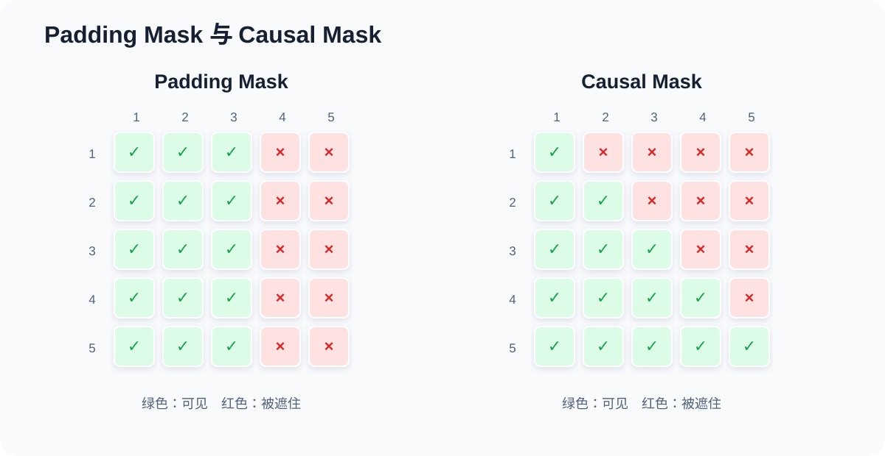
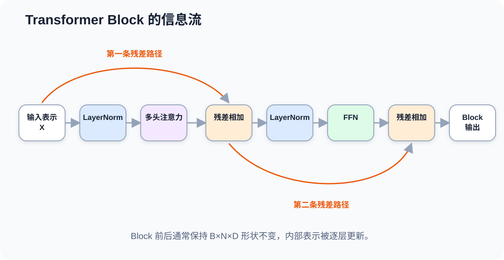

# 课时25-26：Transformer 核心架构与自注意力机制

## 1. 课程定位

Transformer 的核心不是“模型很大”，而是改变了序列中信息交互的方式。RNN 让信息按时间步依次传递，CNN 依靠局部窗口逐层扩大感受野；Transformer 使用注意力机制（Attention），让序列中的任意位置直接读取其他位置的信息，并且可以并行处理整段序列。

本课先建立完整心智模型，再拆解自注意力（Self-Attention）、Q/K/V、掩码、位置编码、多头注意力、前馈网络、残差连接和层归一化。理解这些部件后，BERT、GPT、T5 等模型只是在“使用哪些模块、信息允许怎样流动”上做不同组合。

---

## 2. 学习目标

1. 能从 CNN/RNN 的瓶颈解释 Transformer 为什么出现。
2. 能说明 token、Embedding 和上下文化表示的区别。
3. 能解释 Query、Key、Value 分别承担什么作用。
4. 能手算一个小型注意力权重与加权求和过程。
5. 能写出缩放点积注意力公式，并解释缩放、Softmax 和掩码。
6. 能区分 Padding Mask 与 Causal Mask。
7. 能解释多头注意力、位置编码、FFN、残差连接和 LayerNorm。
8. 能读懂一个 Transformer Block 的张量形状。
9. 能使用 PyTorch 手写简化版自注意力与位置编码。

---

## 3. 贯穿例子：代词到底指谁

考虑句子：

```text
小王没有批准小李的申请，因为他认为材料不完整。
```

模型要理解“他”更可能指“小王”，不能只看“他”左右紧邻的字，还需要同时考虑“批准”“认为”“材料不完整”等远处信息。

三类结构处理这件事的路径不同：

| 结构 | 信息怎么到达“他” | 主要限制 |
|---|---|---|
| RNN | 从前到后压进隐藏状态 | 路径长、串行、早期信息可能衰减 |
| CNN | 通过多层局部卷积逐步汇合 | 需要堆层才能覆盖远距离 |
| Self-Attention | “他”直接给句中所有 token 分配权重 | 长序列计算和显存成本高 |

Transformer 中，“他”不是被动等待前文信息传过来，而是主动查询整句话：哪些位置与当前理解最相关？这种“每个位置都可以读取其他位置”的机制，就是自注意力。



训练仍然遵循前面学过的闭环：

```text
文本 → token → 向量 → Transformer → 预测 → Loss → 反向传播 → 更新参数
```

改变的是中间表示如何建立，不是训练基本规律。

---

## 4. 从文本到矩阵

### 4.1 Token 不是单词的同义词

分词器（Tokenizer）把原始文本转换成 token。一个 token 可能是一个汉字、一个词、一个子词、标点或特殊符号，具体由词表和分词算法决定。

```text
原始文本：“机器学习很好用”
可能的 token： [机器] [学习] [很] [好用]
token id：       [351]  [982] [47] [1206]
```

Token ID 只是词表中的整数编号，编号大小没有语义距离。`1206` 不表示“好用”比 `47` 更重要。

### 4.2 Embedding 把编号变成向量

嵌入层（Embedding Layer）本质是一张可训练查找表：

$$
E\in\mathbb{R}^{V\times d_{model}}
$$

其中：

1. $V$ 是词表大小。
2. $d_{model}$ 是模型隐藏维度。
3. 第 $i$ 个 token 的初始向量是矩阵 $E$ 的第 $i$ 行。

若一句话有 $n$ 个 token，把它们的向量排成矩阵：

$$
X\in\mathbb{R}^{n\times d_{model}}
$$

例如 `6` 个 token、每个向量 `512` 维，则 $X$ 的形状是 `6×512`。批量输入时通常是：

```text
batch_size × sequence_length × hidden_size
B × N × D
```

初始 Token Embedding 主要表示 token 身份。经过多层 Transformer 后，每个位置的向量吸收了上下文，变成上下文化表示（Contextual Representation）。同一个“苹果”出现在“吃苹果”和“苹果发布手机”中，最终向量会不同。

---

## 5. 自注意力的核心直觉

### 5.1 每个 token 做三份投影

对输入矩阵 $X$ 做三次线性变换：

$$
Q=XW_Q,\qquad K=XW_K,\qquad V=XW_V
$$

其中 $W_Q,W_K,W_V$ 都是训练得到的权重矩阵。

可以把三种角色理解为：

| 名称 | 直觉问题 | 在检索中的类比 |
|---|---|---|
| Query（查询） | 我现在想找什么信息？ | 搜索请求 |
| Key（键） | 我这里有什么信息可供匹配？ | 索引标签 |
| Value（值） | 如果选中我，真正取走什么内容？ | 文档内容 |

重要限定：Q、K、V 不是人工规定的固定含义，也不保证某一维就是“主语”或“情绪”。它们是训练过程中学出的不同投影空间。

### 5.2 为什么既要 Key 又要 Value

匹配依据和被读取内容可以不同。图书馆用“书名、作者、主题标签”帮助检索，但最后拿走的是书的正文。Key 负责“是否相关”，Value 负责“相关后传递什么”。

如果只保留一份向量，模型就难以分别优化“匹配方式”和“传递内容”。



---

## 6. 缩放点积注意力

### 6.1 完整公式

单头注意力写成：

$$
Attention(Q,K,V)=Softmax\left(\frac{QK^T}{\sqrt{d_k}}+M\right)V
$$

计算分为五步：

1. $QK^T$：每个 Query 与所有 Key 做点积，得到相关性分数。
2. 除以 $\sqrt{d_k}$：避免维度较大时点积数值过大。
3. 加入掩码 $M$：把不允许关注的位置设成极小值。
4. Softmax：把每一行分数转换成和为 1 的权重。
5. 乘以 $V$：按权重汇总各位置的信息。

若 $Q,K\in\mathbb{R}^{n\times d_k}$，则：

$$
QK^T\in\mathbb{R}^{n\times n}
$$

这张 `n×n` 矩阵就是 token 两两关系表。第 $i$ 行表示“第 $i$ 个位置看其他所有位置时，各自有多重要”。

### 6.2 一个三位置小例子

假设当前 Query 是：

$$
q=[1,0]
$$

三个位置的 Key 是：

$$
k_1=[1,0],\quad k_2=[0,1],\quad k_3=[1,1]
$$

点积得分为：

$$
qk_1^T=1,\qquad qk_2^T=0,\qquad qk_3^T=1
$$

暂时忽略缩放，经过 Softmax 后，权重大约是：

$$
[0.422,\ 0.155,\ 0.422]
$$

若三个 Value 是：

$$
v_1=[2,0],\quad v_2=[0,4],\quad v_3=[1,1]
$$

最终输出为：

$$
0.422v_1+0.155v_2+0.422v_3\approx[1.266,1.042]
$$

这不是挑出唯一一个位置，而是按相关性把多处信息混合成新的表示。

### 6.3 为什么要除以 $\sqrt{d_k}$

当向量维度很大时，点积是许多乘积的累加，数值波动会随维度变大。过大的分数进入 Softmax 后容易变得极端：一个位置接近 1，其余位置接近 0，梯度也可能变小。

除以 $\sqrt{d_k}$ 的作用是控制分数量级，让 Softmax 工作在更适合学习的区域。这就是“缩放点积注意力”（Scaled Dot-Product Attention）中“缩放”的来源。

### 6.4 注意力权重不等于完整解释

注意力权重能显示当前层、当前头如何混合 Value，但不能自动等价为模型的完整推理原因：

1. 模型有多层、多头，关系会继续变化。
2. 残差路径和 FFN 也会影响结果。
3. 最终输出是整张计算图共同作用的结果。

因此可以把注意力权重当作观察窗口，但不能仅凭一张热力图断言模型“为什么这样判断”。

---

## 7. 掩码：哪些位置不允许被看见

### 7.1 Padding Mask

不同句子长度不同，组成 batch 时常补齐到相同长度：

```text
句子 A：[我, 喜欢, 机器, 学习]
句子 B：[天气, 好, PAD, PAD]
```

Padding Mask 让真实 token 不关注补齐位置，否则模型会把无意义的 PAD 当作内容。

### 7.2 Causal Mask

自回归生成模型预测第 $t$ 个位置时，不能偷看未来答案。Causal Mask 把注意力矩阵右上角遮住：

```text
第1个位置：只能看 1
第2个位置：可以看 1,2
第3个位置：可以看 1,2,3
第4个位置：可以看 1,2,3,4
```

被遮住的位置在 Softmax 前加上负无穷近似值，Softmax 后权重变成 0。



| Mask | 防止什么 | 常见位置 |
|---|---|---|
| Padding Mask | 读取补齐 token | 几乎所有批量序列模型 |
| Causal Mask | 预测时看到未来 token | GPT 类 Decoder |
| 业务 Mask | 读取不允许访问的对象 | 推荐、图结构、权限约束等场景 |

---

## 8. 多头注意力

单头注意力只在一组投影空间中建立关系。多头注意力（Multi-Head Attention）并行学习多组 $W_Q,W_K,W_V$：

$$
head_i=Attention(Q_i,K_i,V_i)
$$

$$
MultiHead(Q,K,V)=Concat(head_1,\ldots,head_h)W_O
$$

直觉上，不同头可能更容易关注不同关系，例如：

1. 局部搭配关系。
2. 主谓关系。
3. 指代关系。
4. 长距离主题关系。

但这只是可能出现的学习结果，不应该事先把每个头强行命名。多个头也可能功能重叠。

若隐藏维度 $d_{model}=512$、头数 $h=8$，常见设置是每头维度：

$$
d_{head}=512/8=64
$$

头数不是越多越好。必须保证隐藏维度可合理分配，并综合考虑显存、速度和任务效果。

---

## 9. 位置编码

### 9.1 为什么注意力本身不知道顺序

如果只对 token 向量做自注意力，操作主要依赖内容相似度。交换两个 token 的位置，相同内容之间的匹配关系仍可能非常相近。模型需要额外信息区分：

```text
“猫追狗” 与 “狗追猫”
```

因此输入通常包含 Token Embedding 与位置信息：

$$
X_{input}=X_{token}+X_{position}
$$

### 9.2 正弦位置编码

经典 Transformer 使用：

$$
PE(pos,2i)=\sin\left(\frac{pos}{10000^{2i/d_{model}}}\right)
$$

$$
PE(pos,2i+1)=\cos\left(\frac{pos}{10000^{2i/d_{model}}}\right)
$$

其中 $pos$ 是位置，$i$ 是向量维度编号。不同维度使用不同频率，组合后让每个位置获得独特模式，并能表达一定的相对位移关系。

现代模型也常使用可学习位置向量、相对位置偏置或旋转位置编码（Rotary Position Embedding, RoPE）。这些方案实现不同，但解决的是同一个问题：**内容告诉模型“是什么”，位置机制告诉模型“在哪里、先后关系是什么”。**

---

## 10. Transformer Block

一个典型 Transformer Block 包含两大计算子层：

1. 多头注意力：负责不同位置之间交换信息。
2. 前馈网络（Feed-Forward Network, FFN）：负责每个位置内部做非线性特征变换。

每个子层外通常还有残差连接（Residual Connection）和层归一化（Layer Normalization, LayerNorm）。



### 10.1 FFN 做什么

FFN 对每个 token 位置独立使用同一组参数：

$$
FFN(x)=W_2\phi(W_1x+b_1)+b_2
$$

它通常先把维度扩宽，再投影回隐藏维度。例如：

```text
768 → 3072 → 768
```

注意力负责“从别的位置拿什么信息”，FFN 负责“拿到信息后，在当前位置怎样加工”。两者职责不同，不能互相替代。

### 10.2 残差连接做什么

残差连接把子层输入直接加到输出：

$$
y=x+Sublayer(x)
$$

它保留原有信息，并给梯度提供更短路径。相加要求形状一致；如果不一致，需要先做投影。

### 10.3 LayerNorm 做什么

LayerNorm 通常沿每个 token 的隐藏维度做归一化：

$$
\hat{x}=\frac{x-\mu}{\sqrt{\sigma^2+\epsilon}},\qquad y=\gamma\hat{x}+\beta
$$

它帮助控制中间数值尺度，让深层训练更稳定。$\gamma$ 和 $\beta$ 是可训练的缩放和平移参数。

工程中会看到 Pre-LN 和 Post-LN 两种顺序：

```text
Pre-LN：  x + Sublayer(LN(x))
Post-LN： LN(x + Sublayer(x))
```

它们都属于 Transformer，区别主要影响深层网络的训练稳定性和实现细节。

---

## 11. 张量形状跟踪

设输入：

```text
B = 32       batch size
N = 128      sequence length
D = 768      hidden size
H = 12       attention heads
Dh = 64      head dimension
```

常见形状如下：

| 张量 | 形状 | 含义 |
|---|---:|---|
| 输入 $X$ | `32×128×768` | 每个 token 一个 768 维向量 |
| Q/K/V | `32×12×128×64` | 拆成 12 个头 |
| 注意力分数 | `32×12×128×128` | 每头一张 token 关系矩阵 |
| 加权结果 | `32×12×128×64` | 每头汇总 Value |
| 拼接输出 | `32×128×768` | 恢复隐藏维度 |
| FFN 中间层 | `32×128×3072` | 每个位置扩宽 |
| Block 输出 | `32×128×768` | 形状不变，表示已更新 |

注意力矩阵包含 $N^2$ 个位置关系。序列长度从 1,000 增加到 2,000 时，关系数量约从 100 万增加到 400 万，这也是标准注意力处理长上下文时成本高的根源。

---

## 12. Transformer 的优势与限制

| 维度 | 优势 | 限制 |
|---|---|---|
| 信息交互 | 任意位置可以直接建立联系 | 标准注意力随序列长度呈二次增长 |
| 训练并行 | 整段序列可以矩阵化计算 | 自回归推理仍需逐 token 生成 |
| 表示能力 | 多层、多头建立复杂上下文关系 | 需要大量数据和计算资源 |
| 长距离依赖 | 交互路径短 | 上下文窗口仍有限，长文本不等于永久记忆 |
| 工程生态 | 易扩展到文本、图像、语音、多模态 | 显存、延迟、部署成本较高 |

Transformer 不是在所有任务上都自动优于 CNN/RNN。小数据、低延迟、流式状态、边缘设备等场景，传统结构仍可能更合适。

---

## 13. 代码实操

### 13.1 手写缩放点积注意力

```python
import math
import torch


def scaled_dot_product_attention(q, k, v, mask=None):
    # q: [B, H, Nq, Dh]
    # k: [B, H, Nk, Dh]
    # v: [B, H, Nk, Dv]
    scores = q @ k.transpose(-2, -1)
    scores = scores / math.sqrt(q.size(-1))

    if mask is not None:
        # mask=True 表示允许关注；False 表示遮住
        scores = scores.masked_fill(~mask, float("-inf"))

    weights = torch.softmax(scores, dim=-1)
    output = weights @ v
    return output, weights


B, H, N, Dh = 2, 4, 6, 8
q = torch.randn(B, H, N, Dh)
k = torch.randn(B, H, N, Dh)
v = torch.randn(B, H, N, Dh)

# 下三角因果掩码：[1, 1, N, N]，可广播到 batch 和 head
causal_mask = torch.tril(torch.ones(N, N, dtype=torch.bool))[None, None]
out, attn = scaled_dot_product_attention(q, k, v, causal_mask)

print(out.shape)   # [2, 4, 6, 8]
print(attn.shape)  # [2, 4, 6, 6]
```

需要检查两点：

1. Softmax 必须沿 Key 位置所在的最后一维计算。
2. Mask 必须在 Softmax 前加入，否则被遮位置仍会分到权重。

### 13.2 实现正弦位置编码

```python
import math
import torch


def sinusoidal_position_encoding(max_len, d_model):
    position = torch.arange(max_len).unsqueeze(1).float()
    div_term = torch.exp(
        torch.arange(0, d_model, 2).float()
        * (-math.log(10000.0) / d_model)
    )

    pe = torch.zeros(max_len, d_model)
    pe[:, 0::2] = torch.sin(position * div_term)
    pe[:, 1::2] = torch.cos(position * div_term)
    return pe


pe = sinusoidal_position_encoding(max_len=128, d_model=64)
print(pe.shape)  # [128, 64]
```

实际输入一个 batch 时，可以使用 `x + pe[:sequence_length]`，位置向量会沿 batch 维广播。

### 13.3 使用 PyTorch 多头注意力

```python
import torch
from torch import nn

mha = nn.MultiheadAttention(
    embed_dim=64,
    num_heads=4,
    batch_first=True,
)

x = torch.randn(2, 10, 64)  # [B, N, D]
causal_mask = torch.triu(
    torch.ones(10, 10, dtype=torch.bool),
    diagonal=1,
)

out, weights = mha(
    query=x,
    key=x,
    value=x,
    attn_mask=causal_mask,
    need_weights=True,
)

print(out.shape)      # [2, 10, 64]
print(weights.shape)  # 默认对 head 求平均后为 [2, 10, 10]
```

不同 API 对布尔 Mask 中 `True/False` 的含义可能不同，使用前必须查看当前函数文档，不能只凭记忆复制。

---

## 14. 常见问题

1. **Self-Attention 为什么叫“自”注意力？** Query、Key、Value 都来自同一段输入表示；Cross-Attention 的 Query 与 Key/Value 来自不同序列。
2. **注意力是不是只挑一个词？** 不是。Softmax 通常产生一组连续权重，输出是多个 Value 的加权组合。
3. **Q/K/V 是三份独立输入吗？** 通常由同一个 $X$ 经过三组不同权重投影得到。
4. **有 Attention 就不需要 FFN 吗？** 需要。Attention 负责跨位置混合，FFN 负责位置内部的非线性加工。
5. **Transformer 完全没有顺序吗？** 注意力计算本身不主动编码顺序，所以必须加入位置机制。
6. **训练能并行，为什么生成仍然慢？** 训练时完整目标序列已知，可并行计算各位置损失；自回归生成时下一个 token 依赖刚生成的 token，只能逐步进行。
7. **注意力权重就是模型解释吗？** 不是完整解释，只反映某层某头的一部分信息混合方式。
8. **层越多、头越多越好吗？** 不一定，还受数据、优化、显存、延迟和过拟合约束。

---

## 15. 本课总结

1. Transformer 让序列中的任意位置通过注意力直接交换信息。
2. Token ID 先经 Embedding 变成向量，多层计算后形成上下文化表示。
3. Query 表示查询需求，Key 用于匹配，Value 提供真正被汇总的内容。
4. 缩放点积注意力依次完成相关性计算、缩放、掩码、Softmax 和 Value 加权。
5. Padding Mask 排除补齐位置，Causal Mask 防止模型偷看未来。
6. 多头注意力在多个投影空间并行建立关系。
7. 位置编码补充先后顺序；FFN 加工每个位置；残差和 LayerNorm 稳定深层训练。
8. 标准注意力的核心代价来自 `N×N` 关系矩阵，长序列成本按 $N^2$ 增长。

---

## 16. 课后作业

1. 用自己的话解释 Q、K、V，并举一个“检索—匹配—取内容”的现实例子。
2. 手算本课三位置注意力例子，修改一个 Key，观察最终权重如何变化。
3. 使用 PyTorch 实现 Padding Mask 与 Causal Mask，打印 Softmax 后被遮位置的权重。
4. 修改 `B、H、N、Dh`，记录注意力分数矩阵的形状与元素数量。
5. 实现一个简化 Transformer Block：`LayerNorm → MultiheadAttention → Residual → LayerNorm → FFN → Residual`。
6. 用一段话比较 RNN、CNN、Self-Attention 中两个远距离 token 建立联系的路径。

---

## 17. 知识延伸

Transformer Block 可以组合成三类主要架构：Encoder 负责理解和编码，Decoder 负责自回归生成，Encoder-Decoder 用一端读取输入、另一端生成输出。BERT、GPT 和 T5 的核心差异首先来自信息流和训练目标。
