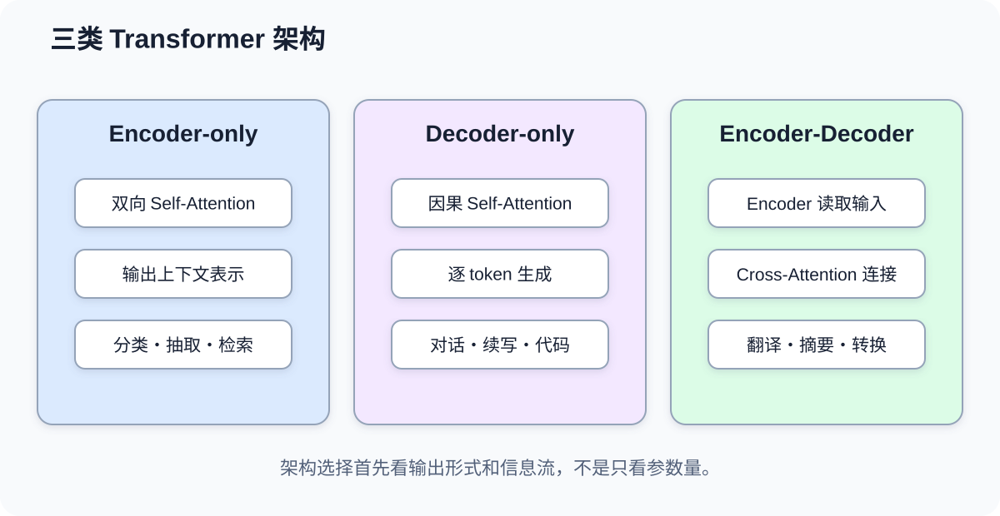
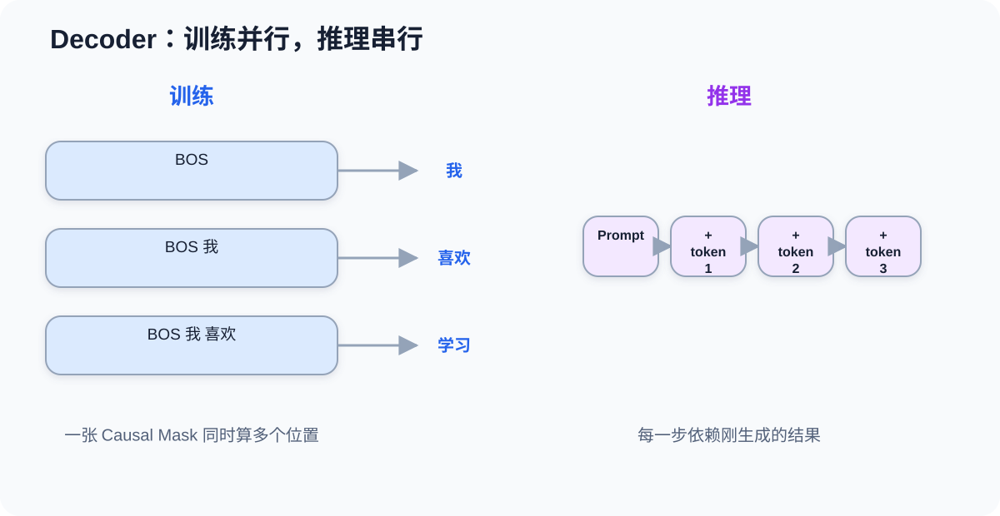
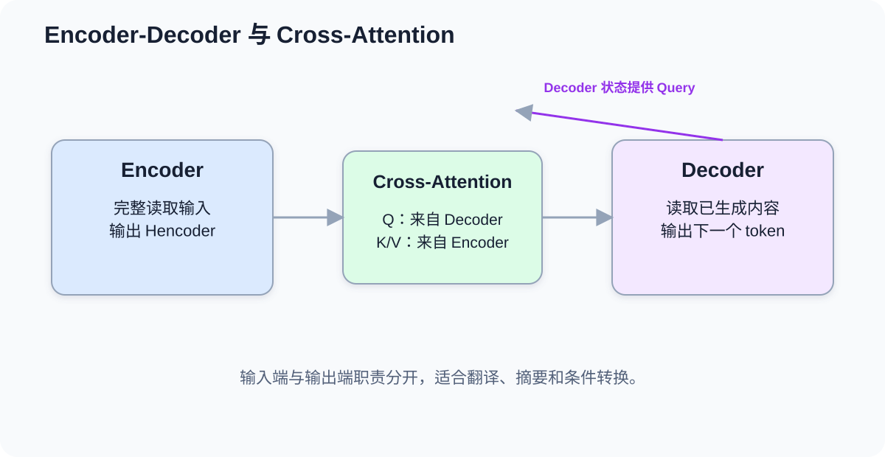

# 课时27-28：Encoder / Decoder 架构差异与选型

## 1. 课程定位

Transformer 不是一种固定形状的模型。相同的注意力、FFN、残差连接和 LayerNorm，可以组合成三类主要架构：Encoder-only、Decoder-only、Encoder-Decoder。

最简心智模型是：

```text
Encoder：读懂整段输入
Decoder：根据已有内容继续写
Encoder-Decoder：先读输入，再按输入生成另一段输出
```

BERT、GPT、T5 的根本差异，不只是模型名字，而是每个 token 允许看见哪些位置、使用什么预训练目标，以及最终服务什么任务。

---

## 2. 学习目标

1. 能区分 Encoder、Decoder 和 Encoder-Decoder 的信息流。
2. 能解释双向注意力与因果注意力的区别。
3. 能说明 BERT 类模型为什么适合理解任务。
4. 能说明 GPT 类模型为什么适合开放式生成。
5. 能解释 Cross-Attention 如何连接输入端和输出端。
6. 能区分训练时并行计算与推理时逐 token 生成。
7. 能理解 KV Cache 的作用和边界。
8. 能根据任务目标、延迟和部署条件选择架构。
9. 能用 Transformers 库完成分类、生成和文本到文本推理。

---

## 3. 贯穿例子：客服工单如何处理

假设输入是一段客户投诉：

```text
“昨天扣款两次，退款还没有到账，请尽快处理。”
```

业务可能有三种任务：

1. **分类**：判断属于“重复扣款”“退款延迟”还是其他问题。
2. **续写/回复**：生成一段客服回复。
3. **结构转换**：把投诉转换成标准工单字段或指定语言。

三种架构的适配关系：

| 任务 | 更自然的架构 | 原因 |
|---|---|---|
| 文本分类、实体识别 | Encoder-only | 每个位置能同时利用左右上下文 |
| 对话、续写、代码生成 | Decoder-only | 与逐 token 生成过程一致 |
| 翻译、摘要、格式转换 | Encoder-Decoder | 输入和输出职责分开，Cross-Attention 对齐两端 |

这不是绝对边界。Decoder-only 也可以通过提示完成分类和翻译，Encoder-only 加合适任务头也能完成多种理解任务。架构选择讨论的是“天然适配程度”和工程代价，不是“能与不能”的二元判断。



---

## 4. Encoder-only：把输入编码成上下文表示

### 4.1 信息可见范围

Encoder 中通常使用双向自注意力（Bidirectional Self-Attention）：一个位置可以同时关注左侧和右侧的有效 token。

以句子为例：

```text
这家银行服务很好。
河岸边有很多树。
```

“银行/河岸”的含义要依赖左右上下文。双向注意力允许每个位置在同一层读取整句信息，因此适合建立理解型表示。

Encoder 的注意力可见矩阵通常近似全开放，只遮住 PAD：

```text
      看1 看2 看3 看4
位置1  ✓   ✓   ✓   ✓
位置2  ✓   ✓   ✓   ✓
位置3  ✓   ✓   ✓   ✓
位置4  ✓   ✓   ✓   ✓
```

### 4.2 BERT 类模型的典型预训练

BERT 类 Encoder 常使用掩码语言建模（Masked Language Modeling, MLM）：把输入中的部分 token 遮住，让模型结合两侧上下文恢复它们。

```text
输入：机器学习可以用于 [MASK] 分类
目标：文本
```

损失通常只在被选中预测的位置计算。因为模型可以看左右两侧，所以它学习的是“整段输入如何互相解释”，而不是严格的从左到右生成。

### 4.3 输出怎样用于任务

Encoder 输出每个 token 的上下文化向量：

$$
H=[h_1,h_2,\ldots,h_n]\in\mathbb{R}^{n\times d}
$$

不同任务读取方式不同：

| 任务 | 读取方式 |
|---|---|
| 文本分类 | 读取特殊聚合位置，或对所有 token 做 pooling |
| 序列标注 | 每个 token 的向量分别接分类头 |
| 语义检索 | 把句子压成固定维向量，再计算相似度 |
| 抽取式问答 | 为每个 token 预测答案起点和终点 |

“Encoder 负责理解”不是说它输出人类可读解释，而是输出便于下游任务使用的上下文化向量。

### 4.4 优势与限制

| 优势 | 限制 |
|---|---|
| 左右上下文同时可用 | 不天然支持无限续写 |
| 分类、标注、检索效率高 | 生成任务需要额外解码结构 |
| 输入可并行编码 | 每个任务常需任务头或微调 |
| 同长度下通常比大生成模型轻 | 双向注意力仍有长序列成本 |

---

## 5. Decoder-only：根据前文预测下一个 token

### 5.1 因果注意力

Decoder-only 模型使用因果掩码（Causal Mask）。第 $t$ 个位置只能看见自己及之前的位置，不能看到未来：

$$
p(x_1,\ldots,x_T)=\prod_{t=1}^{T}p(x_t\mid x_{<t})
$$

这表示整段文本的概率被拆成一系列“给定前文，预测当前 token”的条件概率。

例如：

```text
输入：机器学习可以帮助
目标：预测“企业”

下一步输入：机器学习可以帮助企业
目标：预测“发现”
```

这种训练方式与实际生成过程一致，因此 GPT 类模型天然适合续写、对话、代码生成和开放式文本生成。

### 5.2 训练为什么能并行

虽然公式按位置分解，但训练时完整目标序列已经存在。使用一张下三角 Mask，可以一次计算所有位置的预测：

```text
位置1 根据 BOS       预测 x1
位置2 根据 BOS,x1    预测 x2
位置3 根据 BOS,x1,x2 预测 x3
```

各位置通过矩阵运算并行完成，不需要像 RNN 那样真的等待前一个隐藏状态计算结束。

### 5.3 推理为什么仍然串行

推理时未来 token 不存在：

```text
Prompt → 生成 token1
Prompt + token1 → 生成 token2
Prompt + token1 + token2 → 生成 token3
```

每一步生成的结果都会成为下一步输入，所以自回归推理仍有串行瓶颈。



### 5.4 KV Cache

在生成第 $t$ 个 token 时，前面 token 的 Key 和 Value 已经计算过。KV Cache 保存各层历史位置的 K/V，下一步只需计算新 token 的 Q/K/V，再与缓存交互。

它减少了重复计算，但有三个边界：

1. 不能消除逐 token 串行生成。
2. 上下文越长、层数越多、并发越高，KV Cache 占用显存越大。
3. Batch、量化、分页缓存和并发调度会显著影响服务吞吐。

### 5.5 解码策略

模型输出的是下一个 token 的概率分布，如何选 token 由解码策略决定：

| 策略 | 做法 | 特点 |
|---|---|---|
| Greedy | 每次选概率最大项 | 稳定、快，但可能单调 |
| Beam Search | 保留多条高分候选 | 适合确定性序列任务，成本更高 |
| Temperature | 调整分布尖锐程度 | 低温更确定，高温更多样 |
| Top-k | 只在前 k 个候选中采样 | 排除极低概率 token |
| Top-p | 在累计概率达到 p 的集合中采样 | 候选数量随分布变化 |

温度不创造知识，只改变抽样方式。提高温度通常增加多样性，也可能增加错误和不稳定。

---

## 6. Encoder-Decoder：输入端与输出端分工

### 6.1 三种注意力

Encoder-Decoder 架构通常包含：

1. Encoder Self-Attention：输入 token 彼此双向交互。
2. Decoder Masked Self-Attention：输出端只能看已生成内容。
3. Cross-Attention：Decoder 的 Query 读取 Encoder 输出的 Key/Value。

Cross-Attention 可写成：

$$
Q=H_{decoder}W_Q,\qquad K=H_{encoder}W_K,\qquad V=H_{encoder}W_V
$$

它回答的问题是：“当前准备生成输出的这个位置，应该从输入的哪些位置提取信息？”



### 6.2 翻译例子

输入：

```text
I love machine learning.
```

Encoder 先把整句英语编码成上下文表示。Decoder 生成中文时：

```text
<BOS> → 我 → 喜欢 → 机器 → 学习 → <EOS>
```

每一步既关注已生成的中文，又通过 Cross-Attention 读取英文输入。相比把所有内容混在一个序列里，输入和输出职责更清晰。

### 6.3 Teacher Forcing

训练时常把真实目标序列右移后送入 Decoder：

```text
Decoder 输入：<BOS> 我 喜欢 机器 学习
监督目标：     我 喜欢 机器 学习 <EOS>
```

这种方式称为 Teacher Forcing。训练时每一步看到的历史通常是真实 token；推理时看到的是模型自己生成的 token，因此错误可能逐步累积，这种差异称为暴露偏差（Exposure Bias）。

### 6.4 适用任务

Encoder-Decoder 尤其适合输入和输出边界明确的条件生成：

1. 机器翻译。
2. 摘要生成。
3. 文本改写。
4. 语法纠错。
5. 结构化信息到文本。
6. 语音识别或多模态到文本。

---

## 7. 三类架构的核心差异

### 7.1 信息流对比

| 维度 | Encoder-only | Decoder-only | Encoder-Decoder |
|---|---|---|---|
| 输入内部 | 双向可见 | 因果可见 | Encoder 双向可见 |
| 输出生成 | 非核心能力 | 自回归生成 | Decoder 自回归生成 |
| 输入输出连接 | 无独立输出端 | 通常拼成同一上下文 | Cross-Attention |
| 典型模型 | BERT、RoBERTa | GPT、Llama | T5、BART |
| 天然强项 | 分类、标注、抽取、检索 | 对话、续写、通用生成 | 翻译、摘要、条件转换 |
| 推理特点 | 一次编码 | 逐 token 解码 | 先编码，再逐 token 解码 |

### 7.2 参数量不是唯一选型标准

同样参数量下，不同架构的任务效率可能不同。选型应同时看：

1. 输出是标签、向量还是一段文本。
2. 是否需要开放式生成。
3. 输入与输出是否有清晰边界。
4. 吞吐、首 token 延迟和总生成时长。
5. 是否需要在端侧运行。
6. 是否有足够标注数据进行微调。
7. 是否需要结构化、可约束的输出。

---

## 8. 任务头：基础模型怎样变成业务模型

Transformer 主干输出隐藏表示，任务头（Task Head）把表示转成具体结果。

| 任务头 | 输入 | 输出 | 常用 Loss |
|---|---|---|---|
| Sequence Classification | 句子聚合向量 | 类别 logits | Cross-Entropy |
| Token Classification | 每个 token 向量 | 每位置类别 | Cross-Entropy + Mask |
| Question Answering | 每个 token 向量 | 起止位置 logits | 两个位置损失 |
| Causal LM Head | 每个位置向量 | 下一 token 词表 logits | Token Cross-Entropy |
| Seq2Seq LM Head | Decoder 各位置向量 | 目标 token logits | Token Cross-Entropy |

“预训练模型”与“下游模型”经常共享主干，但任务头和训练数据不同。看到 `AutoModel`、`AutoModelForSequenceClassification`、`AutoModelForCausalLM` 时，要关注后缀代表的任务头。

---

## 9. 工业选型

### 9.1 分类与抽取

如果输出是少量类别、实体位置或向量，优先考虑 Encoder-only：

1. 输出长度固定，没必要承担逐 token 生成成本。
2. 更容易控制标签空间。
3. 通常吞吐更高、输出更稳定。
4. 更方便计算离线 Embedding 和建立向量索引。

但如果业务已经统一使用一个 Decoder 大模型，且类别频繁变化、需要少样本泛化，也可以采用提示式分类。要实际比较成本和效果。

### 9.2 对话和内容生成

输出长度不固定、需要开放式表达时，Decoder-only 更自然。工程上需要额外控制：

1. 最大生成长度。
2. 停止 token。
3. 采样参数。
4. 内容安全。
5. 事实校验。
6. JSON 或函数调用格式约束。

### 9.3 翻译与确定性转换

输入和输出边界清晰、任务相对固定时，Encoder-Decoder 仍有价值。它不一定比通用 Decoder 大模型更“流行”，但可能在特定任务上更轻、更稳定、更易微调。

### 9.4 选型决策表

| 业务问题 | 首选起点 | 需要验证的风险 |
|---|---|---|
| 情感分类、意图识别 | Encoder-only | 标签漂移、长文本截断 |
| 实体识别、关键信息抽取 | Encoder-only | token 对齐、嵌套实体 |
| 智能客服、问答、代码生成 | Decoder-only | 幻觉、成本、延迟、安全 |
| 翻译、摘要、改写 | Encoder-Decoder 或 Decoder-only | 事实遗漏、术语一致性 |
| 语义检索 | Encoder / Embedding 模型 | 向量质量、索引更新、召回率 |
| 端侧固定任务 | 小型 Encoder 或专用模型 | 模型大小、量化损失、设备兼容 |

---

## 10. 代码实操

### 10.1 环境准备

```bash
python -m pip install torch transformers
```

`torchvision` 主要服务图像数据和视觉模型。如果本课只做文本 Transformer，不必为了“依赖齐全”强制安装无关包。生产项目应固定依赖版本并保存模型来源与哈希信息。

### 10.2 Encoder 做文本分类

```python
from transformers import pipeline

classifier = pipeline(
    task="text-classification",
    model="distilbert/distilbert-base-uncased-finetuned-sst-2-english",
)

result = classifier("The service was fast and reliable.")
print(result)
```

这里得到的是固定标签及分数。模型主干负责编码，分类头负责把聚合表示映射成类别 logits。

### 10.3 Decoder 做文本生成

```python
from transformers import pipeline

generator = pipeline(
    task="text-generation",
    model="openai-community/gpt2",
)

result = generator(
    "Machine learning systems should be evaluated by",
    max_new_tokens=40,
    do_sample=True,
    temperature=0.8,
    top_p=0.9,
)
print(result[0]["generated_text"])
```

需要区分：

1. `max_new_tokens` 控制新生成长度。
2. `temperature/top_p` 控制采样，不提高事实正确率。
3. 基础 GPT-2 不是指令对齐模型，不能期待它像聊天助手一样稳定服从命令。

### 10.4 Encoder-Decoder 做文本到文本生成

```python
from transformers import AutoModelForSeq2SeqLM, AutoTokenizer

model_id = "google/flan-t5-small"
tokenizer = AutoTokenizer.from_pretrained(model_id)
model = AutoModelForSeq2SeqLM.from_pretrained(model_id)

prompt = "Translate to German: The model reads the input first."
batch = tokenizer(prompt, return_tensors="pt")
output_ids = model.generate(**batch, max_new_tokens=40)
print(tokenizer.decode(output_ids[0], skip_special_tokens=True))
```

T5 把不同任务统一成“文本输入 → 文本输出”。这里使用经过指令训练的 FLAN-T5，小型示例中的任务说明告诉模型当前需要做什么。

### 10.5 观察模型类和输出形状

```python
import torch
from transformers import AutoModel, AutoTokenizer

model_id = "google-bert/bert-base-uncased"
tokenizer = AutoTokenizer.from_pretrained(model_id)
model = AutoModel.from_pretrained(model_id)

batch = tokenizer(
    ["Transformers build contextual representations."],
    return_tensors="pt",
    padding=True,
)

with torch.no_grad():
    output = model(**batch)

print(batch["input_ids"].shape)
print(output.last_hidden_state.shape)
# [batch_size, sequence_length, hidden_size]
```

`last_hidden_state` 不是最终类别，也不是自然语言回答，而是每个 token 的上下文化向量。

模型文件通常需要首次联网下载；受限网络环境应提前缓存，并检查许可证、模型卡和数据合规要求。

---

## 11. 常见误区

1. **Encoder 能理解，Decoder 不能理解？** 不准确。Decoder 也会建立上下文表示，只是信息流受因果约束，并针对生成目标训练。
2. **Decoder-only 只能续写，不能分类？** 不准确。可以提示式分类或微调，但固定分类任务不一定成本最优。
3. **BERT 的双向就是同时从左、右各跑一个 RNN？** 不是。它通过双向自注意力让位置直接读取两侧 token。
4. **训练 Decoder 也必须逐 token 循环？** 不需要。完整训练序列已知，可用 Causal Mask 并行计算各位置。
5. **KV Cache 会让生成完全并行吗？** 不会。它减少历史 K/V 的重复计算，但下一个 token 仍依赖上一步结果。
6. **Encoder-Decoder 已经过时？** 不是。固定条件生成任务仍可能获得更好的成本与可控性。
7. **参数最大的模型就是最佳选型？** 不一定。任务形式、数据、延迟、吞吐、合规和部署成本同样重要。

---

## 12. 本课总结

1. Encoder-only 使用双向上下文，擅长分类、标注、抽取和向量表示。
2. Decoder-only 使用因果注意力，按前文预测下一个 token，擅长开放式生成。
3. Encoder-Decoder 先编码输入，再通过 Cross-Attention 条件生成输出。
4. Decoder 训练时可以并行计算多个位置，推理时仍需逐 token 生成。
5. KV Cache 保存历史 K/V，减少重复计算，但会占用显存且不能消除串行依赖。
6. 任务头决定主干表示如何变成类别、位置或词表概率。
7. 架构选型要从输出形式、任务边界、延迟、成本、数据和可控性出发。

---

## 13. 课后作业

1. 为“垃圾邮件分类、合同实体抽取、客服回复、机器翻译、语义检索”分别选择架构并说明理由。
2. 画出 Encoder、Decoder、Encoder-Decoder 的可见范围，标出 Self-Attention 与 Cross-Attention。
3. 分别运行分类、生成和文本到文本代码，记录输入格式、输出结构、耗时和模型大小。
4. 修改文本生成的 `temperature` 和 `top_p`，比较稳定性与多样性，不把单次结果当作结论。
5. 解释为什么 Decoder 训练可以并行，而自回归推理不能完全并行。
6. 调研一个实际业务，比较“小型 Encoder 微调”和“通用 Decoder 提示调用”的效果、成本与维护方式。

---

## 14. 知识延伸

架构说明模型怎样处理信息，预训练说明模型怎样从海量数据中获得能力。Token 预测、Embedding、上下文学习和缩放规律共同解释大模型能力的来源，也决定了它的能力边界和幻觉问题。
