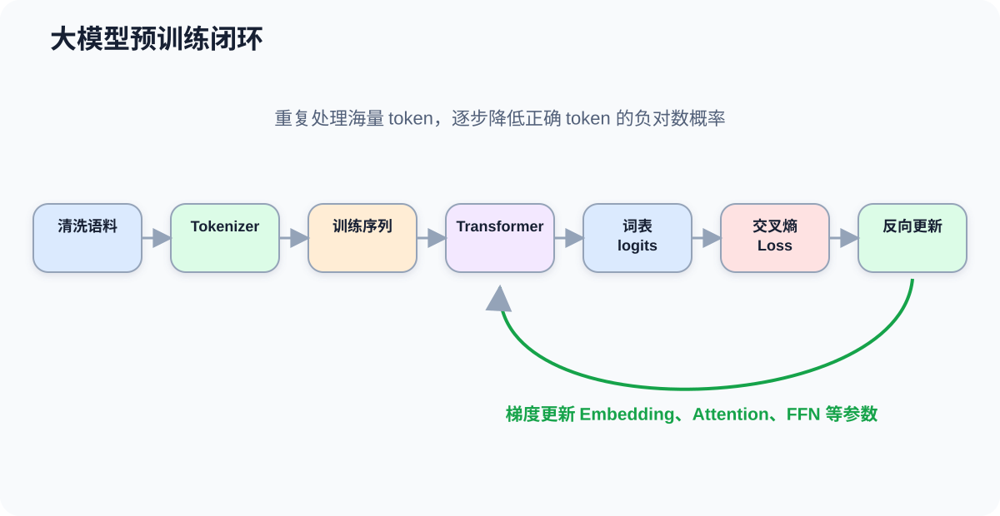
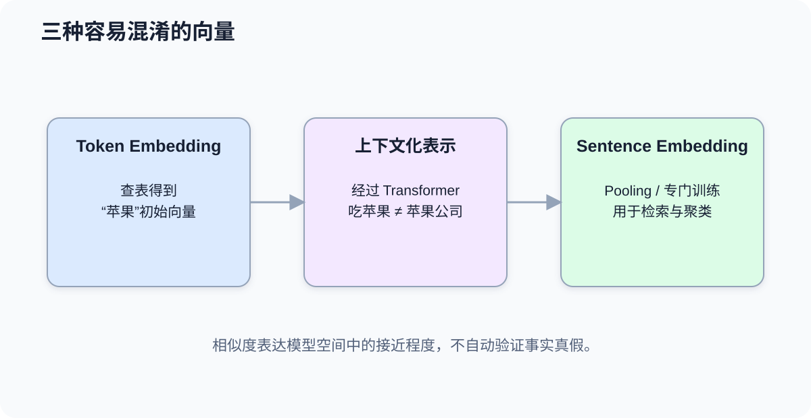
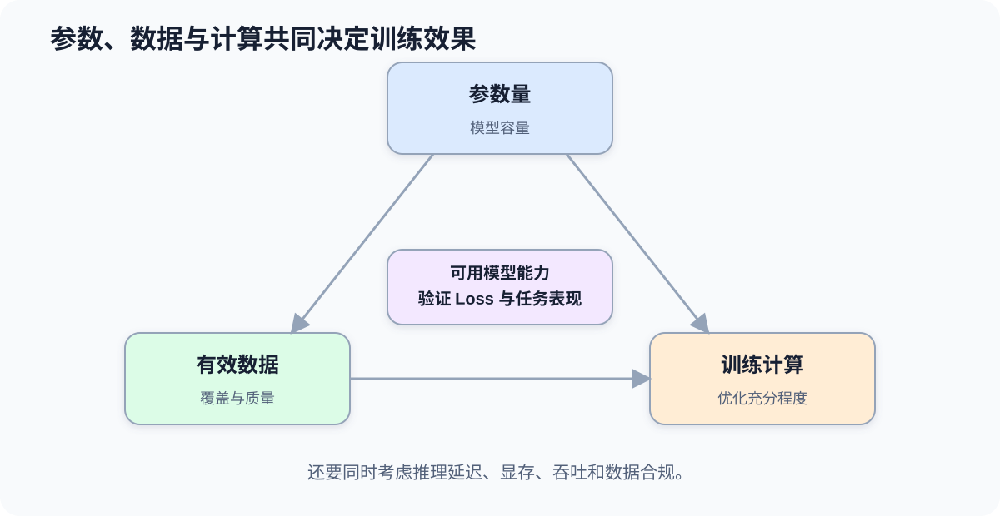

# 课时29-30：大模型预训练逻辑与核心能力

## 1. 课程定位

预训练（Pretraining）是让模型先从大规模数据中学习通用统计规律，而不是一开始就针对某个业务标签训练。对 Decoder 大语言模型来说，最常见目标看起来非常简单：根据已有 token 预测下一个 token。

简单目标不等于简单能力。要持续降低海量语料上的预测误差，模型必须逐渐学习词语搭配、句法结构、语义关系、常见事实、文体模式、任务格式以及一部分可复用的问题解决模式。

本课重点区分四件事：训练目标是什么、模型内部形成了什么表示、能力为何随规模和数据变化、这些能力为什么仍然伴随幻觉与不可靠性。

---

## 2. 学习目标

1. 能说清预训练数据进入模型并更新参数的完整流程。
2. 能解释因果语言建模与掩码语言建模的差异。
3. 能手算下一个 token 的交叉熵损失。
4. 能区分 Token Embedding、上下文化表示和句向量。
5. 能用余弦相似度比较向量，但不把相似度误当成事实判断。
6. 能解释零样本、少样本和上下文学习。
7. 能正确理解参数、数据、计算量之间的缩放关系。
8. 能以谨慎口径解释“涌现能力”。
9. 能分析幻觉的来源，并选择验证、检索、工具调用等缓解措施。

---

## 3. 贯穿例子：模型如何学会补全文本

语料中反复出现：

```text
北京是中国的首都。
法国的首都是巴黎。
日本的首都是东京。
```

训练样本会被转换成许多局部预测任务：

```text
输入：法国的首都是
目标：巴黎

输入：法国的首都是巴黎
目标：。
```

一开始模型几乎随机预测。每次预测后计算 Loss，反向传播更新 Embedding、Attention、FFN 等参数。大量样本反复训练后，模型逐渐捕捉到：

1. “某国的首都是某城市”是一种语言与知识模式。
2. 国家名、城市名在向量空间和上下文中的关系不同。
3. 问答、列表、解释、代码等文本有不同结构。



但模型优化的是“在当前上下文下，什么 token 更可能出现”，不是连接到一个永远正确、实时更新的事实数据库。这一差异正是能力与幻觉同时出现的根源之一。

---

## 4. 预训练数据流水线

### 4.1 从原始数据到训练 batch

典型流程：

```text
原始文本
→ 数据来源与许可证检查
→ 去重、过滤、质量清洗
→ 隐私与敏感信息处理
→ Tokenizer 编码
→ 拼接/截断为训练序列
→ 构造输入、标签与 Mask
→ 组成 batch
→ 前向、Loss、反向、更新
```

数据处理不是边角工作。重复、污染、低质量、错误语言比例、隐私信息和评测集泄漏都会直接影响模型表现与风险。

### 4.2 一个样本如何右移

对 Decoder 因果语言模型，假设 token 序列是：

```text
[BOS, 我, 喜欢, 机器, 学习, EOS]
```

训练关系可以理解成：

```text
模型输入：[BOS, 我, 喜欢, 机器, 学习]
监督标签：[我, 喜欢, 机器, 学习, EOS]
```

模型在每个位置预测下一个 token。实现中常把输入和标签一起交给模型，由模型内部完成位置对齐和忽略无效位置。

### 4.3 一个 Epoch 意味着什么

如果训练语料极大，完整遍历全部数据一次成本很高。大模型训练更常用 token 数、训练 step、计算预算和学习率调度描述进度。需要持续监控：

1. 训练 Loss 与验证 Loss。
2. 吞吐量与硬件利用率。
3. 梯度、权重和数值稳定性。
4. 数据分布与数据质量。
5. 各领域评测，而不是只看一个总分。

---

## 5. 语言建模目标

### 5.1 因果语言建模

因果语言建模（Causal Language Modeling, CLM）把序列概率分解为：

$$
p(x_1,\ldots,x_T)=\prod_{t=1}^{T}p(x_t\mid x_{<t})
$$

训练时最小化所有有效位置的负对数似然：

$$
L=-\frac{1}{T}\sum_{t=1}^{T}\log p(x_t\mid x_{<t})
$$

如果某位置正确 token 的预测概率为 0.8，该位置损失是：

$$
-\log(0.8)\approx0.223
$$

若正确 token 概率只有 0.01：

$$
-\log(0.01)\approx4.605
$$

模型对正确答案越不自信，惩罚越大。

### 5.2 从 logits 到词表概率

假设词表只有三个候选，模型输出 logits：

$$
z=[2.0,1.0,0.0]
$$

Softmax 后大约是：

$$
p=[0.665,0.245,0.090]
$$

如果正确 token 是第 2 个，Loss 为：

$$
-\log(0.245)\approx1.407
$$

反向传播会推动正确 token 的 logit 相对升高，并调整所有参与本次预测的参数。

### 5.3 掩码语言建模

掩码语言建模（Masked Language Modeling, MLM）把部分 token 替换或隐藏，让 Encoder 结合左右上下文恢复：

```text
输入：深度 [MASK] 是一种表示学习方法
目标：学习
```

| 目标 | 可见范围 | 天然用途 |
|---|---|---|
| CLM | 只能看左侧历史 | 自回归生成 |
| MLM | 可以看左右上下文 | 理解、分类、抽取表示 |
| Seq2Seq | 看完整输入，因果生成输出 | 翻译、摘要、条件生成 |

三种目标不是能力高低排名，而是让模型形成不同的信息使用方式。

---

## 6. Embedding 与分布式表征

### 6.1 分布式表征是什么

传统 one-hot 向量把每个词放在互不相关的独立坐标：

```text
猫：[1,0,0,0,...]
狗：[0,1,0,0,...]
```

Embedding 使用稠密向量：

```text
猫：[0.21,-0.73,0.15,...]
狗：[0.18,-0.69,0.22,...]
```

意义分散在多个维度的组合中，没有必要要求某一维明确等于“动物性”。相似使用环境会通过训练形成某些相近方向，这称为分布式表征（Distributed Representation）。

### 6.2 三种容易混淆的向量

| 名称 | 何时产生 | 是否依赖上下文 | 常见用途 |
|---|---|---|---|
| Token Embedding | 查嵌入表后 | 通常不依赖当前句子 | 模型初始输入 |
| Contextual Hidden State | 经过 Transformer 后 | 依赖整段上下文 | 分类、生成、抽取 |
| Sentence Embedding | 对整句专门池化或训练后 | 依赖句子 | 检索、聚类、相似度 |

不要直接把任意语言模型的第一个 token 向量当作高质量句向量。句向量质量取决于 pooling 方法和训练目标，语义检索通常使用专门训练的 Embedding 模型。

### 6.3 余弦相似度

两个向量 $a,b$ 的余弦相似度为：

$$
cos(a,b)=\frac{a\cdot b}{\|a\|\|b\|}
$$

它比较方向而不是绝对长度。接近 1 表示方向相近，接近 0 表示近似正交，接近 -1 表示方向相反。

业务例子：把用户问题与知识库段落转换成向量，先召回余弦相似度高的段落，再交给模型生成回答。

但“向量相似”只表示模型认为语义或使用模式相近，不保证两段话事实一致，也不能替代权限、时间和真实性校验。



---

## 7. 模型能力从哪里来

### 7.1 预测目标迫使模型压缩规律

要在不同领域持续预测得更准，模型需要在参数中形成可复用结构：

1. 词法与句法规律。
2. 概念之间的统计联系。
3. 常见文体与任务格式。
4. 代码和形式化文本中的局部规则。
5. 示例到答案之间可重复的映射模式。

可以把预训练看成一种有损压缩：模型不保存每篇训练文本的完整副本，而是用有限参数压缩大量统计规律。但模型也可能记忆部分高频或重复内容，因此数据泄漏和隐私风险仍需专门治理。

### 7.2 零样本、单样本、少样本

| 方式 | Prompt 中提供什么 | 示例 |
|---|---|---|
| Zero-shot | 只给任务说明 | “判断下面文本情绪” |
| One-shot | 给 1 个示例 | 先展示一组输入输出 |
| Few-shot | 给少量示例 | 展示多个类别和边界情况 |

模型根据上下文中的说明和示例调整当前输出行为，但通常不会在一次 Prompt 中永久修改权重。这称为上下文学习（In-Context Learning），它不同于梯度微调。

### 7.3 能力不是被一个模块单独存储

不能简单说“知识都在 Embedding”“推理都在 Attention”或“某个神经元保存某条事实”。模型能力分散在：

1. Embedding 和输出投影。
2. 多层 Attention 与 FFN 参数。
3. 层与层之间形成的动态激活。
4. 当前 Prompt 提供的上下文。
5. 解码和工具系统。

这也是分析大模型比分析一个线性模型困难得多的原因。

---

## 8. 缩放规律

### 8.1 三个核心规模

缩放讨论至少包含：

1. 参数量（Parameters）：模型可学习容量。
2. 数据量（Training Tokens）：模型看到的有效训练信息。
3. 计算量（Compute）：训练中实际完成的运算预算。

只增大参数、不增加足够数据和计算，模型可能训练不足；只堆数据而模型容量太小，也可能无法充分吸收。



### 8.2 Loss 的经验幂律

许多实验观察到，在一定范围和合理训练设置下，验证 Loss 会随模型、数据或计算规模增加而呈较平滑的幂律下降。直觉是：

```text
更多有效数据 + 合适容量 + 足够计算
→ 更好地拟合语言分布
→ 平均预测误差下降
```

但它不是“参数翻倍，所有能力都翻倍”的保证。收益通常递减，而且数据质量、架构、优化和评测会改变实际结果。

### 8.3 计算最优不是只追求最大模型

固定总计算预算下，需要在参数量和训练 token 数之间平衡。一个参数更多但训练数据不足的模型，可能不如稍小但训练更充分的模型。

因此工程决策要问：

1. 训练预算是多少？
2. 可获得多少高质量、合规、去重后的 token？
3. 目标是预训练、继续预训练还是后训练？
4. 最终推理成本能否接受？

训练最优与部署最优也可能不同：更大的模型训练指标更好，但上线延迟和单位请求成本可能不可接受。

---

## 9. “涌现能力”怎样理解

“涌现”（Emergence）常指某些任务在小规模模型上表现接近随机，规模达到一定区间后指标突然明显提升，例如多步任务、少样本任务或格式遵循。

需要避免神秘化：

1. 底层训练 Loss 可能平滑改善，但离散评分只有“全对/全错”，视觉上会出现跳变。
2. Prompt、解码策略和评价指标会改变阈值出现的位置。
3. 某个 benchmark 的跃升，不代表获得了稳定、通用、无边界的新能力。
4. 能力可能在分布内有效，换表达方式或加入干扰后迅速下降。

更稳妥的表述是：规模增长能带来新的可用行为和组合能力，但是否“突然出现”要结合连续指标、任务设计和重复实验判断。

---

## 10. 为什么会产生幻觉

幻觉（Hallucination）指模型生成表面流畅、语法合理，但事实错误、来源虚构、逻辑不成立或与输入冲突的内容。

### 10.1 训练目标不是事实验证

语言模型主要优化下一个 token 的概率。一个句子“像正确答案”与“经过外部证据验证”不是同一件事。模型可能生成高概率但错误的姓名、日期、论文或接口。

### 10.2 参数记忆不等于数据库

模型把规律压缩进参数：

1. 记忆可能不完整。
2. 相近事实可能互相干扰。
3. 知识有训练截止时间。
4. 低频事实学习不足。
5. 模型通常不能天然指出某条内容来自哪份可靠资料。

### 10.3 Prompt 信息不足

问题含糊、缺少时间范围、对象重名或前提错误时，模型可能猜测用户意图并补全细节。对话越要求“必须给答案”，越容易出现无依据填充。

### 10.4 解码具有随机性

采样温度、Top-p、长输出和多轮上下文都可能放大偏差。降低温度可以减少随机性，但不能把错误知识变成正确知识。

### 10.5 后训练的影响

指令对齐会让模型更愿意回答、更符合交流格式，但“有帮助”与“事实正确”仍是不同目标。如果训练与评估只奖励流畅、完整而缺少真实性约束，模型可能更自信地表达错误。不能简单断言“对齐必然加剧幻觉”，应检查具体数据、奖励和评测设计。

---

## 11. 幻觉缓解与验证

| 风险来源 | 优先措施 | 不能保证什么 |
|---|---|---|
| 缺少最新知识 | 联网检索或可信知识库 | 检索结果本身也可能错误 |
| 企业私有知识 | RAG、权限过滤、版本管理 | 不能保证模型忠实引用 |
| 精确计算 | 计算器、代码执行、数据库查询 | 工具参数仍可能被构造错 |
| 输出格式 | JSON Schema、约束解码、校验器 | 格式正确不等于事实正确 |
| 高风险决策 | 规则校验、人工复核、审计记录 | 不能完全消除人为失误 |
| 来源要求 | 引用原文并核验出处 | 模型仍可能错配引用 |

可靠系统通常使用：

```text
模型生成候选
→ 检索/工具提供证据
→ 规则和程序校验
→ 必要时二次模型审查
→ 高风险场景人工确认
```

Prompt 工程可以减少歧义、要求模型承认不确定性，但不能替代外部事实来源和系统性评测。

---

## 12. 能力评测

不能用几个“感觉不错”的对话判断模型能力。评测至少分为：

1. **任务效果**：准确率、F1、ROUGE、代码通过率等。
2. **稳健性**：改写、错别字、长上下文、对抗输入。
3. **真实性**：有证据回答率、引用正确率、矛盾率。
4. **安全性**：越权、隐私、危险内容、提示注入。
5. **工程指标**：首 token 延迟、总时延、吞吐、显存、成本。
6. **业务指标**：解决率、转人工率、投诉率、风险损失。

测试集必须控制训练污染。公开题分数高，可能来自能力，也可能来自数据见过或格式熟悉。

---

## 13. 代码实操

### 13.1 手算交叉熵

```python
import torch
import torch.nn.functional as F

# 4 个候选 token 的 logits
logits = torch.tensor([[2.0, 1.0, 0.0, -1.0]])
target = torch.tensor([1])  # 正确 token 是索引 1

prob = torch.softmax(logits, dim=-1)
loss = F.cross_entropy(logits, target)

print(prob)
print(loss)
print(-torch.log(prob[0, target.item()]))
```

最后两项应一致。交叉熵直接接 logits，通常不先手动 Softmax。

### 13.2 构造因果语言模型标签

```python
import torch

input_ids = torch.tensor([
    [101, 2057, 2293, 3322, 102],
    [101, 1921, 3698, 1962, 102],
])

# 直观演示右移关系
model_input = input_ids[:, :-1]
target = input_ids[:, 1:]

print(model_input.shape)
print(target.shape)
```

真实框架可能直接接收完整 `input_ids` 和 `labels`，并在模型内部完成 shift。必须以所用模型文档为准，避免重复右移。

### 13.3 提取上下文表示并做简单 pooling

```python
import torch
import torch.nn.functional as F
from transformers import AutoModel, AutoTokenizer

model_id = "google-bert/bert-base-uncased"
tokenizer = AutoTokenizer.from_pretrained(model_id)
model = AutoModel.from_pretrained(model_id)
model.eval()

texts = [
    "A model learns patterns from data.",
    "Machine learning discovers patterns in datasets.",
]

batch = tokenizer(texts, padding=True, truncation=True, return_tensors="pt")

with torch.no_grad():
    hidden = model(**batch).last_hidden_state

mask = batch["attention_mask"].unsqueeze(-1)
summed = (hidden * mask).sum(dim=1)
count = mask.sum(dim=1).clamp(min=1)
emb = summed / count
emb = F.normalize(emb, p=2, dim=-1)

similarity = emb @ emb.T
print(emb.shape)
print(similarity)
```

这段代码用于理解 Masked Mean Pooling，不代表它一定是最佳语义检索方案。正式检索应选择专门训练和评估过的 Embedding 模型。

### 13.4 设计一个幻觉测试表

```python
cases = [
    {
        "question": "询问可从权威资料核验的事实",
        "expected_source": "指定数据库或官方网站",
        "risk": "虚构日期或来源",
    },
    {
        "question": "包含错误前提的问题",
        "expected_source": "应先纠正前提",
        "risk": "顺着错误前提继续编造",
    },
]
```

记录时至少保存：Prompt、模型版本、解码参数、输出、证据、错误类型和人工判定。没有这些信息，结果难以复现。

---

## 14. 常见问题

1. **模型是不是把互联网全部背下来了？** 不是。它把训练数据中的统计规律压缩进参数，也可能记忆部分内容，但不是可精确查询的完整数据库。
2. **下一个 token 预测怎么会产生复杂能力？** 大规模、多领域预测要求模型形成可复用的语言、语义和任务结构，但能力仍受数据和目标限制。
3. **Embedding 越相似，事实越一致吗？** 不一定。相似度通常表达语义接近，不负责验证事实真假。
4. **Few-shot 会更新模型参数吗？** 普通 Prompt 不会永久更新权重；它主要改变当前上下文中的行为。
5. **参数越多一定越好吗？** 不一定，还取决于数据质量、训练 token、计算预算、架构和任务。
6. **涌现是不是模型突然产生意识？** 不是。它描述某些评测行为随规模变化的现象，不等于意识或可靠通用智能。
7. **温度设为 0 就不会幻觉吗？** 不会。它只减少采样随机性，错误的高概率答案仍可能被稳定输出。
8. **RAG 能彻底消除幻觉吗？** 不能。还要处理召回错误、权限、证据冲突、引用忠实度和答案校验。

---

## 15. 本课总结

1. 预训练通过海量 token 预测任务反复执行前向、Loss、反向和参数更新。
2. CLM 根据历史预测下一个 token，MLM 根据左右上下文恢复被遮 token。
3. 交叉熵惩罚模型给正确 token 的概率过低。
4. Token Embedding、上下文化表示和句向量处于不同阶段，不能混用概念。
5. 上下文学习通过 Prompt 示例改变当前行为，通常不修改模型权重。
6. 缩放必须共同考虑参数、数据和计算，收益不是无限线性增长。
7. “涌现”应结合评测尺度和连续指标谨慎理解。
8. 幻觉来自训练目标、参数化知识、输入歧义、解码和后训练等多方面。
9. 可靠应用需要检索、工具、规则、评测和人工复核共同组成系统。

---

## 16. 课后作业

1. 给定正确 token 概率 `0.9、0.5、0.1、0.01`，分别计算负对数损失并解释变化。
2. 用一段话区分 Token Embedding、上下文化表示、Sentence Embedding。
3. 设计三组 Zero-shot、One-shot、Few-shot Prompt，比较输出稳定性，不只记录最好结果。
4. 使用专用 Embedding 模型计算 10 句话的相似度，找出一个“语义相似但事实不同”的反例。
5. 建立至少 10 条幻觉测试集，覆盖错误前提、冷门事实、时效信息、计算和虚构来源。
6. 用表格说明参数量、训练 token、计算预算和推理成本之间的关系。

---

## 17. 知识延伸

预训练模型学会的是“语言与数据中什么更可能出现”，不等于天然会服从指令、符合人类偏好或在不确定时拒绝回答。SFT、奖励模型、RLHF 和直接偏好优化通过后训练进一步调整模型行为。
