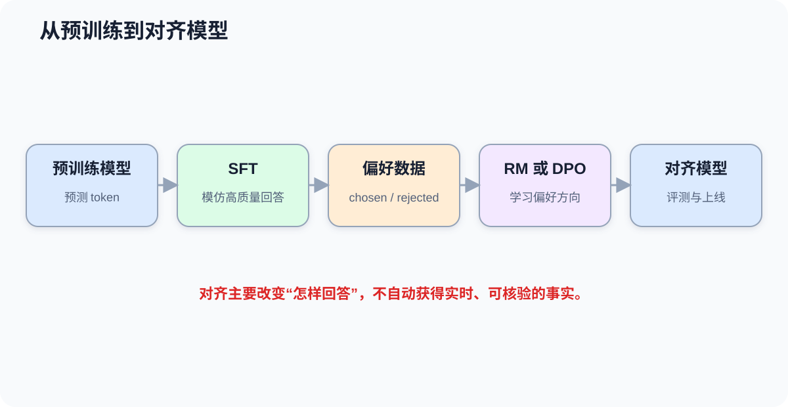
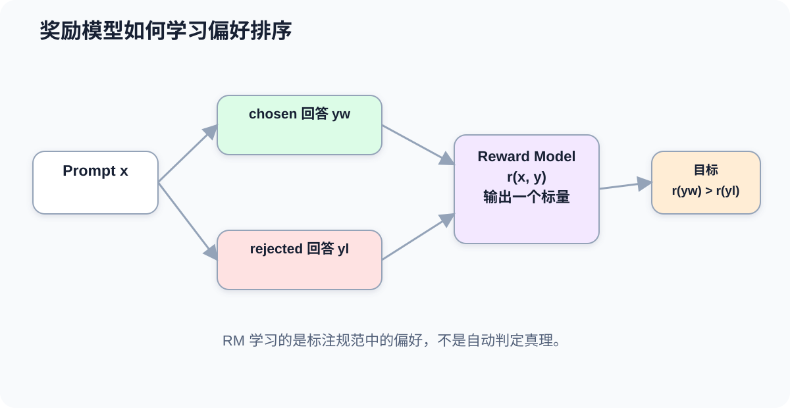
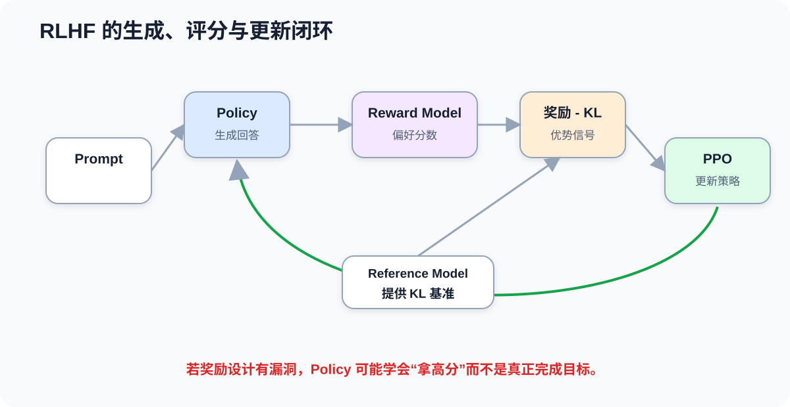

# 课时31-32：大模型对齐技术 SFT / RM / RLHF

## 1. 课程定位

预训练让模型学会续写语言，但用户需要的不是“继续出现最像训练语料的文字”，而是理解指令、遵守格式、表达有帮助、在高风险问题上保持谨慎。

后训练（Post-Training）把基础模型调整为更适合交互和业务使用的模型。经典流程包括：

```text
预训练模型
→ SFT：学习高质量示范
→ RM：学习人类偏好
→ RLHF：根据奖励进一步优化策略
```

这套流程解决“模型应该怎样回答”，但不会自动补齐所有事实知识，也不能一劳永逸地解决安全、偏见和幻觉。

---

## 2. 学习目标

1. 能区分预训练、继续预训练、SFT 和偏好对齐。
2. 能说明 SFT 数据中指令、上下文和回答的作用。
3. 能解释为什么通常只对回答 token 计算 SFT Loss。
4. 能说明偏好数据与普通分类标签的区别。
5. 能推导奖励模型的成对比较概率与 Loss。
6. 能解释 RLHF 中策略模型、奖励模型、参考模型和 KL 约束。
7. 能识别 Reward Hacking、过度拒绝、迎合和模式坍缩等风险。
8. 能说明 DPO 与经典 RLHF 的关系。
9. 能设计一套包含效果、安全、真实性和业务指标的对齐评测。

---

## 3. 贯穿例子：基础模型为什么不会天然听指令

用户输入：

```text
请把下面投诉总结成三个字段：问题、时间、诉求。
“我昨天下午被扣款两次，希望今天退回。”
```

基础预训练模型可能：

1. 继续生成更多类似投诉。
2. 模仿网页文章，而不是输出字段。
3. 输出格式不稳定。
4. 猜测没有提供的信息。

高质量 SFT 示例会明确展示：

```text
问题：重复扣款
时间：昨天下午
诉求：希望今天退款
```

偏好数据则进一步告诉模型：忠实提取优于自行补充，结构清晰优于冗长解释，有风险时承认不确定优于编造。



---

## 4. 先区分四种训练

| 阶段 | 主要数据 | 核心目标 | 典型结果 |
|---|---|---|---|
| 预训练 | 大规模通用 token | 学习语言分布、预测 token | 基础模型 |
| 继续预训练 | 某领域无标注语料 | 适应领域语言与知识分布 | 领域基础模型 |
| SFT | 指令—回答示范 | 模仿期望回答行为 | 指令模型 |
| 偏好对齐 | 多个回答的偏好比较 | 提高被偏好回答的概率 | 更符合偏好与安全要求 |

继续预训练和 SFT 最容易混淆：

```text
继续预训练：让模型更熟悉“金融文本怎样出现”
SFT：让模型学会“收到金融任务后怎样回答”
```

如果模型缺少领域知识，仅靠少量 SFT 不一定足够；如果模型知识够但不会按格式完成任务，SFT 更直接。

---

## 5. SFT：监督微调

### 5.1 数据格式

监督微调（Supervised Fine-Tuning, SFT）使用高质量输入输出示范。常见数据结构包括：

```json
{
  "instruction": "从文本中提取退款原因",
  "input": "商品破损，申请退款",
  "output": "商品破损"
}
```

对聊天模型，也可以保存角色序列：

```json
{
  "messages": [
    {"role": "system", "content": "你是客服工单助手。"},
    {"role": "user", "content": "商品破损，申请退款。"},
    {"role": "assistant", "content": "退款原因：商品破损"}
  ]
}
```

训练前必须通过该模型对应的 Chat Template 转成 token。不同模型的角色标记、起止 token 和模板可能不同，不能随意混用。

### 5.2 SFT 的 Loss

SFT 仍然常使用下一个 token 的交叉熵：

$$
L_{SFT}=-\sum_{t\in response}\log \pi_\theta(y_t\mid x,y_{<t})
$$

其中：

1. $x$ 是指令和上下文。
2. $y_t$ 是回答的第 $t$ 个 token。
3. $\pi_\theta$ 是当前策略模型。
4. 求和通常只覆盖需要模型学习生成的回答 token。

为什么经常把指令部分标签设为 `-100` 或其他忽略值？因为目标是让模型根据指令生成回答，而不是训练它复述用户输入。是否只训练回答区域取决于具体任务与框架，但必须明确 Mask 规则。

### 5.3 SFT 学到了什么

SFT 主要塑造：

1. 指令遵循。
2. 对话角色与输出格式。
3. 任务步骤和示范风格。
4. 拒绝边界与安全话术。
5. 特定业务流程。

SFT 数据量不是唯一指标。低质量、矛盾、模板单一或包含错误事实的数据，会直接教坏模型。

### 5.4 SFT 数据质量检查

| 维度 | 检查问题 |
|---|---|
| 正确性 | 回答是否事实正确、逻辑成立 |
| 忠实性 | 是否只依据给定资料，不擅自补充 |
| 指令匹配 | 回答是否真正完成要求 |
| 格式 | JSON、字段、语言、长度是否符合规范 |
| 多样性 | 是否覆盖不同表达和边界情况 |
| 安全性 | 是否包含隐私、越权或危险示范 |
| 一致性 | 相似输入是否遵循一致策略 |
| 可追溯 | 数据来源、版本和许可是否记录 |

---

## 6. 为什么 SFT 之后还需要偏好数据

同一个问题可能有多个“基本正确”的回答，但质量不同：

```text
回答 A：信息准确、简洁、承认不确定性。
回答 B：大体正确，但啰嗦且包含未经证实的推测。
```

SFT 需要一个目标答案；偏好学习允许标注者比较多个候选，表达“哪个更好”。它更适合捕捉难以写成硬标签的属性：

1. 有帮助程度。
2. 事实忠实度。
3. 清晰度与简洁度。
4. 安全边界。
5. 语气和风格。
6. 是否遵守特定业务策略。

偏好不是天然客观真理。不同标注者、文化、业务和场景可能有不同取舍，因此必须制定清晰规范并记录分歧。

---

## 7. RM：奖励模型

### 7.1 输入和输出

奖励模型（Reward Model, RM）接收 Prompt 与一个候选回答，输出标量分数：

$$
r_\phi(x,y)\in\mathbb{R}
$$

训练数据通常包含：

```text
Prompt x
更优回答 y_chosen
较差回答 y_rejected
```

RM 的目标不是生成回答，而是让更优回答得分更高。

### 7.2 成对偏好概率

常用 Bradley-Terry 形式：

$$
P(y_w\succ y_l\mid x)=\sigma\left(r_\phi(x,y_w)-r_\phi(x,y_l)\right)
$$

其中 $y_w$ 是偏好回答，$y_l$ 是较差回答。对应 Loss：

$$
L_{RM}=-\log\sigma\left(r_\phi(x,y_w)-r_\phi(x,y_l)\right)
$$

假设：

```text
chosen reward = 2.0
rejected reward = 0.5
```

分差为 1.5，模型判断 chosen 更优的概率：

$$
\sigma(1.5)\approx0.818
$$

如果两者分数反过来，Loss 会明显增大，推动 RM 调整参数。



### 7.3 RM 不是什么

1. RM 不是事实数据库。
2. 高奖励不等于答案绝对正确。
3. RM 学到的是标注数据和规范中的偏好。
4. 超出训练分布时，评分可能失真。
5. 策略模型可能发现 RM 的漏洞并钻空子。

因此 RM 本身也需要独立验证集、对抗测试和漂移监控。

---

## 8. RLHF：用人类反馈做强化学习

### 8.1 四个关键角色

经典 RLHF（Reinforcement Learning from Human Feedback）中常见：

| 角色 | 作用 |
|---|---|
| Policy / Actor | 当前要优化、负责生成回答的模型 |
| Reward Model | 给回答打偏好分数 |
| Reference Model | 约束策略不要偏离 SFT 模型太远 |
| Value Model / Critic | 在 PPO 中估计未来回报，降低更新方差 |

简化目标可以写成：

$$
\max_\theta\ \mathbb{E}_{y\sim\pi_\theta(\cdot|x)}
\left[r_\phi(x,y)-\beta D_{KL}(\pi_\theta\|\pi_{ref})\right]
$$

第一项鼓励高奖励回答，第二项惩罚策略过度偏离参考模型。

### 8.2 为什么需要 KL 约束

如果只追求 RM 分数，策略可能找到奇怪捷径：

1. 重复某些高分词语。
2. 输出异常长或异常固定的模板。
3. 利用 RM 未覆盖的漏洞。
4. 牺牲语言质量换取局部分数。

KL 散度约束让策略更新保持在 SFT 模型附近。$\beta$ 太小可能约束不足，太大又可能几乎学不到新的偏好。

### 8.3 PPO 更新的直觉

近端策略优化（Proximal Policy Optimization, PPO）不会一次把策略改得过猛。它根据采样回答的优势估计提高好动作概率、降低差动作概率，同时用裁剪和 KL 等机制限制更新幅度。

理解重点不是背全部公式，而是抓住闭环：

```text
Policy 生成回答
→ RM 打分
→ 计算奖励与 KL 惩罚
→ PPO 估计哪些 token 决策更值得增加概率
→ 小步更新 Policy
→ 重复采样和评估
```



### 8.4 RLHF 的工程难点

1. 同时维护多个大模型，显存和计算成本高。
2. 在线采样使训练吞吐更复杂。
3. 奖励尺度、KL 系数和训练稳定性敏感。
4. RM 偏差会被 Policy 放大。
5. 很难用单一奖励覆盖帮助性、真实性、安全和风格。

---

## 9. DPO：直接使用偏好对

直接偏好优化（Direct Preference Optimization, DPO）绕过显式 RM 训练和在线强化学习，把偏好数据直接转成策略优化目标。

直觉上，它比较当前策略相对于参考模型，对 chosen 和 rejected 分别提高或降低了多少概率。简化表达为：

$$
L_{DPO}=-\log\sigma\left(\beta\left[
\log\frac{\pi_\theta(y_w|x)}{\pi_{ref}(y_w|x)}
-
\log\frac{\pi_\theta(y_l|x)}{\pi_{ref}(y_l|x)}
\right]\right)
$$

DPO 的优势：

1. 不需要单独训练一个可供强化学习调用的 RM。
2. 不需要在线 rollout 和 PPO 训练闭环。
3. 实现通常更稳定、资源要求更低。

但它仍然依赖偏好数据质量、参考模型和超参数，并不自动消除偏好偏差。DPO 是偏好优化的重要方法，不表示经典 RLHF 概念已经失去价值；两者帮助理解“显式奖励优化”和“直接偏好优化”两条路线。

---

## 10. 对齐不等于真实

### 10.1 三个目标需要分开

| 目标 | 问题 | 可能冲突 |
|---|---|---|
| Helpfulness | 回答是否帮助用户完成任务 | 可能为了回答而猜测 |
| Honesty / Truthfulness | 是否真实、承认不确定 | 可能降低表面完整度 |
| Harmlessness / Safety | 是否避免造成伤害 | 可能出现过度拒绝 |

对齐训练必须在多个目标之间权衡，不能只优化“用户更喜欢哪个回答”。

### 10.2 常见副作用

1. **Reward Hacking**：利用奖励漏洞，而非真正完成目标。
2. **Sycophancy**：迎合用户观点，即使用户前提错误。
3. **Over-refusal**：对无害问题也拒绝回答。
4. **Verbosity Bias**：更长的回答更容易被标为“有帮助”。
5. **Style Collapse**：所有回答变成相似模板，缺少任务适配。
6. **Capability Regression**：过度微调导致某些基础能力下降。
7. **Catastrophic Forgetting**：窄领域训练破坏原有通用能力。

“对齐会加剧幻觉”不能作为无条件结论。更准确的说法是：如果奖励更重视流畅、完整和自信，而缺少证据与不确定性约束，可能放大自信错误；合理的真实性数据、拒答策略、检索和验证也可以降低幻觉。

---

## 11. 偏好标注怎样设计

### 11.1 标注规范

一条可执行规范要告诉标注者优先级：

```text
1. 先判断是否完成指令。
2. 再判断事实与输入是否一致。
3. 检查是否包含危险、隐私或越权内容。
4. 在都正确时，再比较清晰度、简洁度和风格。
```

如果“更长”“更像专家”“语气更坚定”总被偏好，RM 可能把表面风格误当作质量。

### 11.2 分歧和一致性

偏好标注应记录：

1. 多标注者一致率。
2. 无法判断或平局。
3. 分歧原因。
4. 领域专家与普通用户的差异。
5. 规范版本。
6. 高风险样本的升级流程。

强迫所有样本二选一，会把真实不确定性变成噪声标签。

### 11.3 数据切分

同一个 Prompt 的轻微改写、同一文档生成的多组答案，应避免分散到训练集和测试集，否则评测可能虚高。还要按业务时间切分，检测策略和数据分布变化。

---

## 12. 对齐评测

### 12.1 离线评测

| 维度 | 示例指标 |
|---|---|
| 指令遵循 | 格式通过率、任务完成率 |
| 偏好胜率 | 与 baseline 成对比较的胜率 |
| 真实性 | 可核验事实正确率、引用忠实度 |
| 安全性 | 越权率、危险回答率、过度拒绝率 |
| 稳健性 | 改写一致性、Prompt 注入抵抗 |
| 能力保持 | 通用 benchmark、领域任务回归 |
| 工程成本 | 延迟、吞吐、显存、token 成本 |

### 12.2 在线评测

上线后可观察：

1. 用户任务完成率。
2. 重新提问率与转人工率。
3. 用户纠错率和投诉率。
4. 格式校验失败率。
5. 高风险回答拦截率。
6. 单请求成本和延迟。

点击率、停留时长或点赞不能单独代表质量，因为吸引人的内容可能并不真实或安全。

### 12.3 红队测试

红队（Red Teaming）主动寻找失败边界：

1. 错误前提与诱导迎合。
2. 提示注入和越权读取。
3. 编码、拆分、角色扮演等绕过方式。
4. 长上下文中的指令冲突。
5. 多轮对话中的策略漂移。
6. 冷门事实和虚构来源。

测试失败样本应进入可追踪的问题库，而不是只挑成功案例展示。

---

## 13. 代码实操

### 13.1 构造 SFT 数据

完整脚本见：[构造 SFT 数据](../codes/lesson_31_32_alignment/00_create_sft_jsonl.py)。

```python
import json

samples = [
    {
        "messages": [
            {"role": "system", "content": "你是工单提取助手。"},
            {"role": "user", "content": "昨天重复扣款，希望退款。"},
            {
                "role": "assistant",
                "content": "问题：重复扣款\n时间：昨天\n诉求：退款",
            },
        ]
    }
]

with open("sft_demo.jsonl", "w", encoding="utf-8") as f:
    for sample in samples:
        f.write(json.dumps(sample, ensure_ascii=False) + "\n")
```

正式数据还应包含数据来源、版本、任务类型、质量状态和敏感信息检查结果。

### 13.2 奖励模型成对 Loss

完整脚本见：[奖励模型成对 Loss](../codes/lesson_31_32_alignment/01_pairwise_reward_loss.py)。

```python
import torch
import torch.nn.functional as F

reward_chosen = torch.tensor([2.0, 0.5, 1.2])
reward_rejected = torch.tensor([0.5, 0.8, -0.1])

# -log(sigmoid(chosen - rejected)) 的稳定实现
loss = -F.logsigmoid(reward_chosen - reward_rejected).mean()
accuracy = (reward_chosen > reward_rejected).float().mean()

print("pairwise loss:", loss.item())
print("ranking accuracy:", accuracy.item())
```

Ranking Accuracy 只能判断排序方向，不能说明奖励分数已经校准，也不能替代分领域评测。

### 13.3 简化的回答区域 Loss Mask

完整脚本见：[回答区域 Loss Mask](../codes/lesson_31_32_alignment/02_answer_loss_mask.py)。

```python
import torch
import torch.nn.functional as F

# logits: [B, N, V]
logits = torch.randn(2, 6, 100)
labels = torch.tensor([
    [-100, -100, -100, 12, 33, 9],
    [-100, -100, 18, 25, 7,  2],
])

loss = F.cross_entropy(
    logits.reshape(-1, logits.size(-1)),
    labels.reshape(-1),
    ignore_index=-100,
)
print(loss)
```

`-100` 位置不会参与 Loss。真实因果语言模型还需处理 logits 与 labels 的 shift，使用框架时应确认模型内部是否已经完成。

### 13.4 手工偏好标注表

完整脚本见：[手工偏好标注表](../codes/lesson_31_32_alignment/03_preference_record.py)。

```python
preference = {
    "prompt": "根据给定材料回答，不要补充材料外事实。",
    "chosen": "材料中没有说明具体日期，因此无法确定。",
    "rejected": "该事件发生在2023年5月。",
    "reasons": ["忠实于材料", "没有虚构日期"],
    "annotator_confidence": 0.95,
    "policy_version": "v1",
}
```

偏好数据不应只保存 `chosen/rejected`，最好保留理由、置信度、规范版本和审核信息，便于发现系统性偏差。

---

## 14. 常见问题

1. **SFT 是不是把所有知识重新训练一遍？** 不是。它主要用示范调整回答行为，也可能补充部分领域模式，但不等于完整知识注入。
2. **SFT 与 Prompt 示例有什么区别？** SFT 通过梯度更新参数；Prompt 示例只影响当前上下文。
3. **RM 分数越高，答案越真实吗？** 不一定。RM 反映训练偏好，真实性必须单独建模和评测。
4. **RLHF 会直接修改奖励模型吗？** 经典流程通常固定 RM，用它给 Policy 的采样结果打分，再更新 Policy。
5. **为什么不让 Policy 无限追求奖励？** 会出现 Reward Hacking 和语言退化，所以需要 KL、裁剪和独立评测。
6. **DPO 等于没有奖励思想吗？** 不是。它把偏好与参考策略关系直接写进优化目标，不显式运行 RM+PPO 闭环。
7. **对齐后模型就不会幻觉了吗？** 不会。对齐改善行为，不自动提供实时可靠事实。
8. **用户偏好就是正确标准吗？** 不是。用户可能偏好自信、冗长或迎合性回答，需要真实性、安全和业务规则共同约束。

---

## 15. 本课总结

1. 预训练学习通用语言分布，SFT 学习按示范完成指令，偏好优化进一步调整回答倾向。
2. SFT 常只对回答 token 计算交叉熵，数据模板和 Loss Mask 必须与模型实现一致。
3. RM 使用成对偏好数据，让 chosen 的奖励高于 rejected。
4. 经典 RLHF 用 RM 给 Policy 采样评分，并通过 PPO 等方法小步更新策略。
5. 参考模型和 KL 约束用于限制策略过度偏移，降低奖励漏洞被放大的风险。
6. DPO 直接用偏好对优化策略，是另一条常用偏好优化路线。
7. 对齐要平衡有帮助、真实和安全，不能把单一偏好分数当作全部质量。
8. 对齐可能出现迎合、过度拒绝、Reward Hacking 和能力退化，必须做离线、在线和红队评测。

---

## 16. 课后作业

1. 构造 20 条 SFT 数据，覆盖正常请求、格式约束、信息不足和应拒绝场景，并记录数据来源。
2. 为 10 个 Prompt 各写两个回答，标注 chosen/rejected、理由、置信度和是否允许平局。
3. 手算三组 RM 分数差对应的偏好概率与 Loss，并验证 PyTorch 代码。
4. 画出 `SFT Policy → 采样 → RM → KL/PPO → 新 Policy` 的完整数据流。
5. 用表格比较 SFT、RM+PPO、DPO 的数据、模型数量、训练复杂度和主要风险。
6. 设计一套客服模型对齐评测，至少覆盖任务完成、忠实度、幻觉、安全、过度拒绝、延迟与成本。

---

## 17. 知识延伸

对齐技术决定模型应当怎样回答，轻量化微调进一步解决“怎样以较低成本改变模型行为”。实际选型需要比较 Prompt、RAG、LoRA、继续预训练和全参数微调的能力边界与成本。
