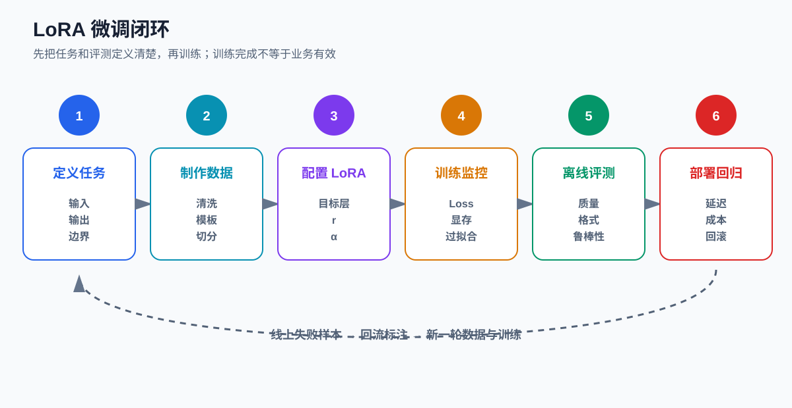
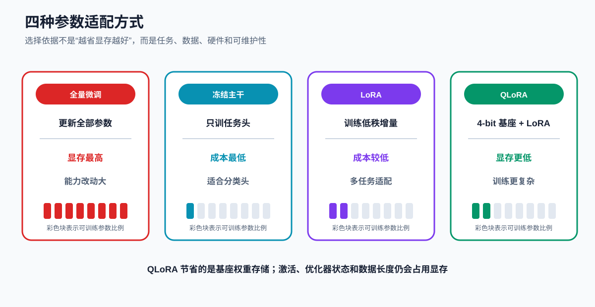
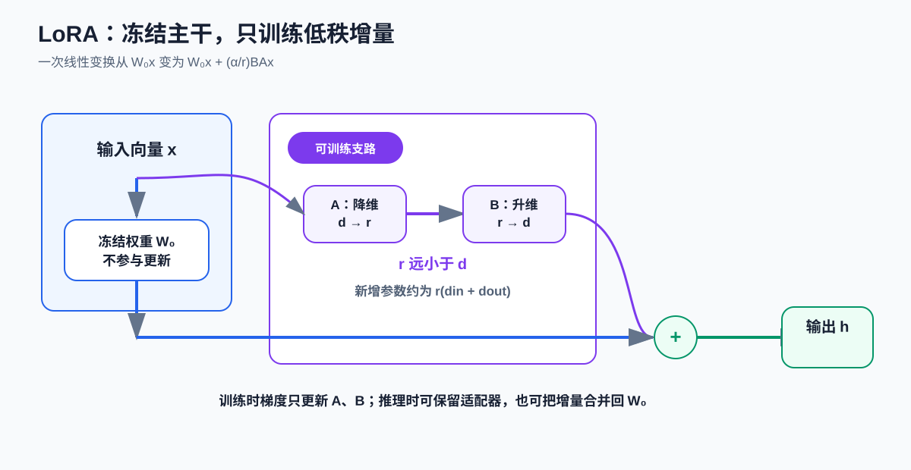
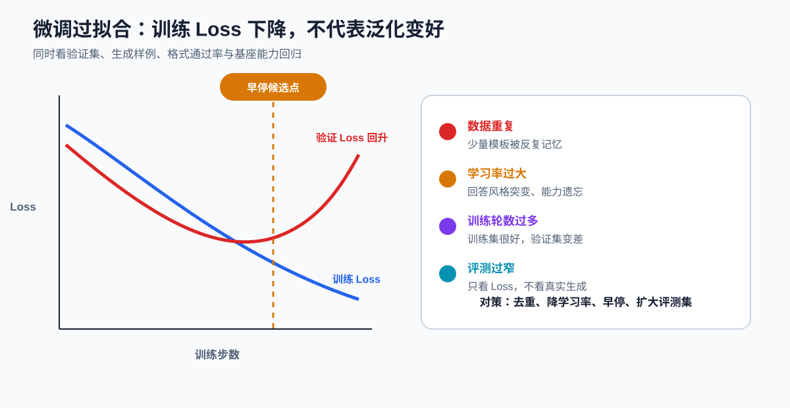

# 课时33-34：大模型轻量化微调实战 LoRA

## 1. 课程定位

预训练让模型获得通用语言能力，对齐训练让模型学会按指令回答，但企业仍会遇到三个问题：

1. 模型不了解企业特有的输出格式和处理规范。
2. 通用提示词很长，仍然难以稳定复现目标行为。
3. 全量更新几十亿甚至上百亿参数，显存、训练时间和版本管理成本过高。

参数高效微调（Parameter-Efficient Fine-Tuning，PEFT）的思路是：**保留基座模型的大部分参数，只训练少量新增参数，让模型适配特定任务。**

本课以低秩适配（Low-Rank Adaptation，LoRA）为主线，完成从任务定义、数据制作、参数配置、训练、评测到保存适配器的完整闭环。



## 2. 学习目标

完成本课后，应能：

1. 区分全量微调、冻结主干、LoRA 和 QLoRA。
2. 解释 LoRA 中低秩矩阵 $A$、$B$、秩 $r$ 和缩放系数 $\alpha$ 的作用。
3. 估算 LoRA 新增参数量，理解它为什么节省训练资源。
4. 把业务样本整理成指令微调数据，并正确划分训练集、验证集和测试集。
5. 使用 Transformers、PEFT 和 TRL 完成一个小模型 LoRA 微调实验。
6. 识别过拟合、灾难性遗忘、格式退化和数据泄漏。
7. 保存、加载、切换和合并 LoRA 适配器。
8. 用统一评测集比较微调前后模型，而不是只观察训练 Loss。

## 3. 贯穿任务：让模型稳定生成售后工单 JSON

假设客服系统收到一段用户描述：

> 我上周买的耳机今天左耳没有声音，已经重新配对过，订单号 A1024，希望尽快换货。

业务系统需要稳定输出：

```json
{
  "intent": "质量问题",
  "urgency": "中",
  "order_id": "A1024",
  "action": "创建换货工单"
}
```

通用模型可能出现：

- 输出一大段解释，JSON 无法解析；
- 把“质量问题”写成未定义标签；
- 漏掉订单号；
- 对相似表达给出不一致格式；
- 没有遵循企业自己的意图体系。

这个任务不一定需要让模型学习大量新知识，主要是让模型形成稳定的**任务行为**：

$$
\text{用户描述} \rightarrow \text{固定标签、固定字段、固定格式}
$$

LoRA 适合用于这种行为适配，但是否真的需要微调，仍应先比较提示词、结构化输出约束、少样本示例和 RAG 等更低成本方案。

## 4. 四种参数适配方式



| 方式 | 更新范围 | 训练成本 | 适合场景 | 主要限制 |
| --- | --- | ---: | --- | --- |
| 全量微调 | 基座模型全部参数 | 最高 | 数据充足、需要较大能力迁移 | 显存高、训练慢、版本体积大 |
| 冻结主干 | 只训练新任务头 | 最低 | 分类、回归等固定输出任务 | 难以改变深层生成行为 |
| LoRA | 训练插入的低秩矩阵 | 较低 | 指令适配、风格、格式、领域行为 | 目标层和超参数需要实验 |
| QLoRA | 量化基座权重并训练 LoRA | 更低 | 单卡低显存微调 | 数值、算子、设备兼容更复杂 |

### 4.1 全量微调为什么昂贵

训练一个参数 $w$，通常不仅要存储权重本身，还可能需要：

- 梯度；
- 优化器的一阶矩；
- 优化器的二阶矩；
- 混合精度训练中的主权重；
- 前向传播留下的激活值。

因此“模型权重文件能装进显存”不等于“模型能够全量训练”。训练显存还会受序列长度、batch size、优化器、激活检查点和并行策略影响。

### 4.2 LoRA 节省的是什么

LoRA 冻结基座权重，不再为全部基座参数保存可训练梯度和优化器状态，只为少量低秩参数保存训练状态。

它主要降低：

- 可训练参数量；
- 梯度存储；
- 优化器状态；
- 每个业务版本的权重存储。

它不会自动消除：

- 前向激活占用；
- 长序列带来的注意力计算；
- 数据加载和评测开销；
- 基座模型本身的推理显存。

## 5. LoRA 核心机制

### 5.1 从线性层开始

普通线性变换为：

$$
h = W_0x
$$

其中：

- $x \in \mathbb{R}^{d_{in}}$ 是输入向量；
- $W_0 \in \mathbb{R}^{d_{out}\times d_{in}}$ 是预训练权重；
- $h \in \mathbb{R}^{d_{out}}$ 是输出。

全量微调会直接更新 $W_0$。LoRA 冻结 $W_0$，额外学习一个权重增量 $\Delta W$：

$$
h = W_0x + \Delta Wx
$$

### 5.2 用两个低秩矩阵表示增量

LoRA 令：

$$
\Delta W = \frac{\alpha}{r}BA
$$

其中：

- $A \in \mathbb{R}^{r\times d_{in}}$：把输入从 $d_{in}$ 维压到 $r$ 维；
- $B \in \mathbb{R}^{d_{out}\times r}$：再把 $r$ 维映射回 $d_{out}$ 维；
- $r$：低秩维度，通常远小于 $d_{in}$ 和 $d_{out}$；
- $\alpha$：控制 LoRA 支路整体强度；
- $\alpha/r$：常见缩放方式。

因此前向计算变为：

$$
h = W_0x + \frac{\alpha}{r}BAx
$$



### 5.3 为什么低秩可能有效

LoRA 的假设不是“原权重本身低秩”，而是：**针对一个具体下游任务，模型需要发生的有效参数变化可能集中在较低维的方向上。**

可以把它理解为：

- 基座模型已经掌握大量通用能力；
- 下游任务不需要重新发明全部能力；
- 只需沿少量关键方向调整行为；
- $A$ 负责找到这些方向，$B$ 负责把调整映射回原空间。

这是工程上有效的归纳偏置，不保证所有任务都能用很小的 $r$ 获得最佳结果。

### 5.4 参数量怎么算

原线性层参数量为：

$$
N_{full}=d_{out}\times d_{in}
$$

LoRA 新增参数量为：

$$
N_{LoRA}=r\times d_{in}+d_{out}\times r
=r(d_{in}+d_{out})
$$

假设 $d_{in}=d_{out}=4096$，$r=8$：

$$
N_{full}=4096\times4096=16{,}777{,}216
$$

$$
N_{LoRA}=8\times(4096+4096)=65{,}536
$$

该线性层新增参数约为原参数的：

$$
\frac{65{,}536}{16{,}777{,}216}\approx0.39\%
$$

完整模型会在多个目标层插入 LoRA，因此总比例还取决于层数和 `target_modules`。

### 5.5 为什么常把一个矩阵初始化为零

常见初始化会让训练开始时 $\Delta W\approx0$，因此初始模型行为接近原基座模型：

$$
h \approx W_0x
$$

随后训练逐步学习增量，避免刚插入 LoRA 时随机扰乱原模型输出。

## 6. LoRA 应插在哪些层

Transformer 中常见候选包括：

- 注意力的 Query 投影：`q_proj`；
- Key 投影：`k_proj`；
- Value 投影：`v_proj`；
- 注意力输出投影：`o_proj`；
- FFN 的门控、上投影和下投影；
- 某些模型中的合并 QKV 层。

| 配置 | 参数量 | 常见特点 |
| --- | ---: | --- |
| 只适配 Q、V | 较少 | 常见起点，训练成本低 |
| 适配 Q、K、V、O | 中等 | 更充分调整注意力行为 |
| 再适配 FFN | 更多 | 适合需要较强行为变化的任务 |
| 所有线性层 | 最多 | 表达能力更强，也更易过拟合 |

不同模型的模块名并不统一。配置前应先查看：

完整脚本见：[查看 LoRA 可训练模块](../codes/lesson_33_34_lora/00_list_lora_target_modules.py)。

```python
for name, module in model.named_modules():
    if "proj" in name:
        print(name, type(module).__name__)
```

不能把另一个模型的 `target_modules` 直接复制过来而不检查。

## 7. 关键超参数

### 7.1 秩 `r`

`r` 越大：

- 可训练参数更多；
- 表达能力通常更强；
- 显存和训练时间增加；
- 小数据下过拟合风险可能增加。

可从 `8` 或 `16` 建立基线，再根据验证集做对比。不能仅凭训练 Loss 选择最大 `r`。

### 7.2 缩放系数 `lora_alpha`

常见有效强度与 $\alpha/r$ 有关。若改变 `r` 而保持 `alpha` 不变，增量的缩放也会改变。

实验记录中应同时保存：

- `r`；
- `lora_alpha`；
- `lora_dropout`；
- 目标模块；
- 学习率；
- 数据版本。

### 7.3 `lora_dropout`

训练阶段随机丢弃 LoRA 支路的部分输入，可降低对少量训练样本的依赖。数据很少、样本重复度高时，可尝试小幅 dropout；数据充足时不一定需要较大值。

### 7.4 学习率

LoRA 的学习率通常可以高于全量微调，但不存在适用于所有模型和数据的固定值。合理做法是：

1. 先用较小数据跑通流程；
2. 观察前几十到几百步 Loss 是否剧烈波动；
3. 比较至少两到三个学习率；
4. 以验证集和生成质量选择，而非训练集最低 Loss。

### 7.5 有效 batch size

显存装不下较大 batch 时，可使用梯度累积：

$$
B_{effective}=B_{device}\times N_{accumulation}\times N_{devices}
$$

例如单卡 batch size 为 2，累积 8 步：

$$
B_{effective}=2\times8\times1=16
$$

梯度累积减少单步显存，但不会让总计算量消失。

## 8. 指令数据制作

### 8.1 基本字段

最小样本可表示为：

```json
{
  "instruction": "根据用户描述抽取售后工单字段，只输出合法 JSON。",
  "input": "我上周买的耳机左耳没声音，订单号 A1024，希望换货。",
  "output": "{\"intent\":\"质量问题\",\"urgency\":\"中\",\"order_id\":\"A1024\",\"action\":\"创建换货工单\"}"
}
```

聊天模型通常还可整理为消息列表：

```json
{
  "messages": [
    {"role": "system", "content": "你是售后工单助手，只输出合法 JSON。"},
    {"role": "user", "content": "我上周买的耳机左耳没声音，订单号 A1024，希望换货。"},
    {"role": "assistant", "content": "{\"intent\":\"质量问题\",\"urgency\":\"中\",\"order_id\":\"A1024\",\"action\":\"创建换货工单\"}"}
  ]
}
```

### 8.2 数据质量优先级

| 检查项 | 典型问题 | 后果 |
| --- | --- | --- |
| 标签口径 | 同一意图被标成多个名称 | 模型输出不稳定 |
| 指令一致性 | 不同样本要求互相冲突 | 模型无法形成稳定行为 |
| JSON 合法性 | 引号、逗号、字段缺失 | 学会错误格式 |
| 样本去重 | 模板重复、近重复 | 验证分数虚高 |
| 边界样本 | 只有简单正例 | 线上复杂表达失效 |
| 敏感数据 | 姓名、电话、订单明文 | 合规和泄露风险 |

### 8.3 数据切分

不要先扩增再随机切分，否则同一原始样本的改写版本可能同时进入训练集和测试集。

更可靠的顺序是：

1. 按用户、订单或会话聚合，避免实体泄漏；
2. 按时间切分，模拟未来数据；
3. 先得到训练、验证、测试集合；
4. 只对训练集做扩增；
5. 测试集在最终评测前保持冻结。

### 8.4 Loss 应计算在哪些 token 上

聊天微调中，常见目标是只让助手回答区域参与监督：

- system 和 user token：标签设为 `-100`，不计算 Loss；
- assistant token：保留真实 token id，计算 Loss；
- padding token：通常也设为 `-100`。

这样模型学习“给定上下文后应该怎样回答”，而不是浪费大量 Loss 去复述用户输入。

具体 Trainer 是否自动完成回答区域 mask，取决于数据格式、chat template 和当前库版本，必须抽查编码后的 `input_ids` 与 `labels`。

## 9. QLoRA 的核心逻辑

QLoRA 通常把冻结的基座权重以低比特形式加载，再训练 LoRA 参数：

$$
\text{量化基座权重} + \text{可训练 LoRA 参数}
$$

它的关键点是：

1. 基座权重被量化，但通常不直接更新量化后的基座参数；
2. LoRA 参数仍使用适合训练的浮点精度；
3. 计算时会按算子需要进行反量化或混合精度计算；
4. 量化减少权重存储，不代表所有中间激活都变成 4-bit。

### 9.1 什么时候优先考虑 QLoRA

- 单卡显存无法容纳常规 LoRA 基座权重；
- 需要快速验证业务可行性；
- 模型和硬件支持相应量化算子；
- 能接受更复杂的环境兼容和数值验证。

### 9.2 常见误区

- 4-bit 不是“所有训练数据和计算都只有 4 位”；
- 量化模型能加载，不代表该设备支持高效训练；
- 量化越低并不保证效果和速度都更好；
- macOS、CUDA、不同 GPU 架构的 bitsandbytes 支持情况可能不同。

## 10. 完整微调实操

以下代码以小型指令模型和少量演示数据说明流程。正式训练前应根据本机显存、设备支持和已安装库版本调整模型、精度和 batch size。

### 10.1 安装依赖

```bash
pip install -U transformers datasets peft trl accelerate
```

使用支持的 NVIDIA CUDA 环境并需要低比特量化时，再安装：

```bash
pip install -U bitsandbytes
```

### 10.2 构造数据集

完整脚本见：[准备售后工单 SFT 数据集](../codes/lesson_33_34_lora/01_prepare_ticket_dataset.py)。

```python
from datasets import Dataset

samples = [
    {
        "messages": [
            {"role": "system", "content": "你是售后工单助手，只输出合法 JSON。"},
            {"role": "user", "content": "耳机左耳无声，订单号 A1024，希望换货。"},
            {"role": "assistant", "content": '{"intent":"质量问题","urgency":"中","order_id":"A1024","action":"创建换货工单"}'},
        ]
    },
    {
        "messages": [
            {"role": "system", "content": "你是售后工单助手，只输出合法 JSON。"},
            {"role": "user", "content": "包裹显示签收但没收到，订单号 B7788。"},
            {"role": "assistant", "content": '{"intent":"物流异常","urgency":"高","order_id":"B7788","action":"创建物流核查工单"}'},
        ]
    },
]

dataset = Dataset.from_list(samples)
split = dataset.train_test_split(test_size=0.5, seed=42)
train_dataset = split["train"]
eval_dataset = split["test"]
```

演示数据只能验证代码链路，不能证明模型已经获得可上线能力。

### 10.3 配置 LoRA

完整脚本见：[LoRA 配置与模型加载](../codes/lesson_33_34_lora/02_train_lora_ticket_adapter.py)。

```python
from peft import LoraConfig
from transformers import AutoModelForCausalLM, AutoTokenizer

model_id = "Qwen/Qwen2.5-0.5B-Instruct"

tokenizer = AutoTokenizer.from_pretrained(model_id)
model = AutoModelForCausalLM.from_pretrained(
    model_id,
    device_map="auto",
)

peft_config = LoraConfig(
    task_type="CAUSAL_LM",
    r=8,
    lora_alpha=16,
    lora_dropout=0.05,
    target_modules=["q_proj", "v_proj"],
    bias="none",
)
```

### 10.4 使用 SFTTrainer 训练

完整脚本见：[LoRA 微调训练入口](../codes/lesson_33_34_lora/02_train_lora_ticket_adapter.py)。

```python
from trl import SFTConfig, SFTTrainer

training_args = SFTConfig(
    output_dir="outputs/ticket-lora",
    learning_rate=2e-4,
    num_train_epochs=3,
    per_device_train_batch_size=1,
    per_device_eval_batch_size=1,
    gradient_accumulation_steps=8,
    eval_strategy="epoch",
    save_strategy="epoch",
    logging_steps=5,
    max_length=512,
    report_to="none",
)

trainer = SFTTrainer(
    model=model,
    args=training_args,
    train_dataset=train_dataset,
    eval_dataset=eval_dataset,
    processing_class=tokenizer,
    peft_config=peft_config,
)

trainer.train()
trainer.save_model("outputs/ticket-lora/final-adapter")
tokenizer.save_pretrained("outputs/ticket-lora/final-adapter")
```

不同 TRL 版本的参数名可能变化。运行前应核对本地版本文档，并用一个 batch 先验证：

- 文本是否应用了正确 chat template；
- `max_length` 是否截断答案；
- 监督区域是否符合预期；
- 模型模块名是否与 `target_modules` 匹配。

### 10.5 查看可训练参数

完整脚本见：[查看可训练参数](../codes/lesson_33_34_lora/02_train_lora_ticket_adapter.py)。

```python
model.print_trainable_parameters()
```

应重点记录：

- trainable params；
- all params；
- trainable percentage；
- 目标模块和层数。

若可训练比例异常高，应检查是否误解冻了基座参数。

### 10.6 加载适配器推理

完整脚本见：[加载适配器推理](../codes/lesson_33_34_lora/03_lora_inference.py)。

```python
from peft import PeftModel
from transformers import AutoModelForCausalLM, AutoTokenizer

base_id = "Qwen/Qwen2.5-0.5B-Instruct"
adapter_dir = "outputs/ticket-lora/final-adapter"

tokenizer = AutoTokenizer.from_pretrained(adapter_dir)
base_model = AutoModelForCausalLM.from_pretrained(base_id, device_map="auto")
model = PeftModel.from_pretrained(base_model, adapter_dir)
model.eval()

messages = [
    {"role": "system", "content": "你是售后工单助手，只输出合法 JSON。"},
    {"role": "user", "content": "充电器发热并有焦味，订单号 C9001。"},
]

text = tokenizer.apply_chat_template(
    messages,
    tokenize=False,
    add_generation_prompt=True,
)
inputs = tokenizer(text, return_tensors="pt").to(model.device)
outputs = model.generate(**inputs, max_new_tokens=128, do_sample=False)
answer_ids = outputs[0, inputs["input_ids"].shape[1]:]
print(tokenizer.decode(answer_ids, skip_special_tokens=True))
```

### 10.7 合并权重

需要导出单一权重版本时，可在确认精度和许可证允许后合并：

完整脚本见：[合并 LoRA 权重](../codes/lesson_33_34_lora/04_merge_lora_adapter.py)。

```python
merged_model = model.merge_and_unload()
merged_model.save_pretrained("outputs/ticket-lora/merged-model")
tokenizer.save_pretrained("outputs/ticket-lora/merged-model")
```

不合并的优点是多个业务适配器可共享同一基座；合并的优点是部分部署框架加载更直接。合并后文件体积接近完整基座模型，不再只有小型适配器。

## 11. 训练监控与过拟合



### 11.1 不能只看训练 Loss

至少同时观察：

- 训练 Loss；
- 验证 Loss；
- JSON 格式通过率；
- 字段级准确率；
- 关键意图召回率；
- 基座通用能力回归集；
- 人工抽检的真实生成结果。

### 11.2 常见过拟合信号

1. 训练 Loss 持续下降，验证 Loss 开始上升。
2. 模型对训练模板表现很好，换一种问法立即失败。
3. 输出频繁复制训练样本中的订单号、姓名或固定短语。
4. 为了适配领域任务，原有通用问答能力明显退化。
5. 输出越来越自信，但事实和标签并没有更准确。

### 11.3 常见处理方式

| 问题 | 优先处理 |
| --- | --- |
| 数据过少 | 补充真实边界样本，减少机械重复扩增 |
| 重复过多 | 文本和语义近重复去重 |
| 学习率过大 | 降低学习率，增加 warmup |
| 训练过久 | 早停，减少 epoch |
| LoRA 容量过大 | 减小 `r` 或目标层范围 |
| 输出格式不稳 | 增加严格格式样本与格式评测 |
| 通用能力退化 | 混入适量通用样本并做回归测试 |

正则化不是只调整 `weight_decay`。数据去重、合理切分、dropout、早停、减少训练轮数和降低 LoRA 容量都属于控制泛化风险的手段。

## 12. 微调前后怎样公平比较

### 12.1 固定条件

必须固定：

- 同一个测试集；
- 同一套 system prompt；
- 同样的解码参数；
- 同样的最大输出长度；
- 同样的 JSON 解析器；
- 同样的失败重试规则。

否则无法判断差异来自模型还是评测设置。

### 12.2 评测指标

| 维度 | 指标示例 |
| --- | --- |
| 任务效果 | intent accuracy、关键类别 recall |
| 字段质量 | order_id exact match、字段完整率 |
| 格式稳定 | JSON parse rate、schema pass rate |
| 鲁棒性 | 改写、错别字、长文本、无关信息 |
| 泛化 | 未见商品、未见表达、时间外测试集 |
| 工程性能 | P50/P95 延迟、显存、吞吐量 |
| 能力回归 | 通用问答、拒答、安全和语言能力 |

### 12.3 一个最小 JSON 评测器

完整脚本见：[最小 JSON 评测器](../codes/lesson_33_34_lora/05_json_evaluator.py)。

```python
import json

REQUIRED = {"intent", "urgency", "order_id", "action"}


def evaluate_json(text: str, expected: dict) -> dict:
    result = {
        "json_valid": False,
        "schema_valid": False,
        "field_correct": 0,
    }
    try:
        obj = json.loads(text)
    except json.JSONDecodeError:
        return result

    result["json_valid"] = True
    result["schema_valid"] = REQUIRED.issubset(obj)
    result["field_correct"] = sum(
        obj.get(key) == expected.get(key) for key in REQUIRED
    )
    return result
```

## 13. 常见失败与排查顺序

### 13.1 CUDA 显存不足

按顺序尝试：

1. 缩短 `max_length`；
2. 减小单卡 batch size；
3. 增加梯度累积；
4. 开启梯度检查点；
5. 使用支持的混合精度；
6. 缩小模型；
7. 再考虑 QLoRA 或多卡策略。

序列长度对激活和注意力开销影响明显，不应只盯着 LoRA 的参数比例。

### 13.2 Loss 不下降

检查：

- assistant 回答是否真的进入 `labels`；
- 是否把所有标签都设成了 `-100`；
- 学习率是否过低；
- LoRA 是否插入正确模块；
- 可训练参数是否为零；
- 数据文本是否被截断；
- 输出中是否只有特殊 token。

### 13.3 Loss 很低但生成很差

检查：

- 训练集是否重复；
- 测试是否使用同样 chat template；
- 推理时是否错误截取输入和回答；
- 解码参数是否随机性过高；
- 训练指标是否只统计了 padding 或固定模板；
- 任务本身是否更适合规则或分类模型。

## 14. 工程决策：微调不一定是第一步

| 业务问题 | 优先方案 |
| --- | --- |
| 模型缺少最新企业知识 | RAG 或工具查询 |
| 只需固定 JSON 格式 | 结构化输出约束、解析与重试 |
| 少量固定标签分类 | 传统分类器或 Encoder 模型 |
| 提示词很长且行为仍不稳定 | SFT / LoRA |
| 需要同时改变知识和行为 | RAG + LoRA，分别解决知识和行为 |
| 任务规则清楚且必须完全确定 | 规则系统 |

微调适合把稳定、重复、可监督的行为压入模型参数，但不应把动态数据库、实时库存、价格和政策版本硬记进权重。

## 15. 本课总结

1. LoRA 冻结基座权重，用低秩矩阵 $A$、$B$ 学习权重增量。
2. 新增参数量约为 $r(d_{in}+d_{out})$，远小于完整矩阵参数量。
3. `r`、`alpha`、目标模块和学习率共同决定容量与训练行为。
4. QLoRA 通过量化冻结基座进一步降低权重存储，但不会消除激活开销和兼容问题。
5. 数据口径、去重、切分和回答区域 Loss Mask 比盲目调参更重要。
6. 微调效果必须用冻结测试集、格式指标、业务指标和能力回归共同判断。
7. 适配器可以单独保存、按业务切换，也可以在需要时合并进基座权重。
8. 微调不是默认答案，知识更新、固定分类和确定性规则可能有更合适的方案。

## 16. 课后作业

### 16.1 数据制作

制作不少于 100 条中文工单指令数据，至少包含：

- 4 个意图类别；
- 3 个紧急等级；
- 缺失订单号样本；
- 多诉求样本；
- 错别字和口语化样本；
- 无法判断并需要人工处理的样本。

输出必须通过 JSON Schema 检查。

### 16.2 微调实验

完成至少两组 LoRA 对照实验，例如：

- `r=8` 与 `r=16`；
- 只适配 Q/V 与适配 Q/K/V/O；
- 学习率 `1e-4` 与 `2e-4`；
- dropout 为 `0` 与 `0.05`。

记录训练参数、可训练参数量、训练时间、最高显存和验证指标。

### 16.3 效果对比

对比基座模型与 LoRA 模型：

1. JSON 合法率；
2. 字段完整率；
3. 意图准确率；
4. 高紧急工单召回率；
5. P95 推理延迟；
6. 至少 20 条人工抽检结果。

### 16.4 过拟合修复

主动制造一次过拟合实验，再通过数据去重、降低学习率、早停、减小 `r` 或加入 dropout 进行修复，写明证据和结论。

## 17. 知识延伸

LoRA 解决低成本调整模型行为的问题。进入生产环境后，还要继续处理延迟、成本、稳定性、幻觉、安全、监控以及与传统模型协同等工程问题。
