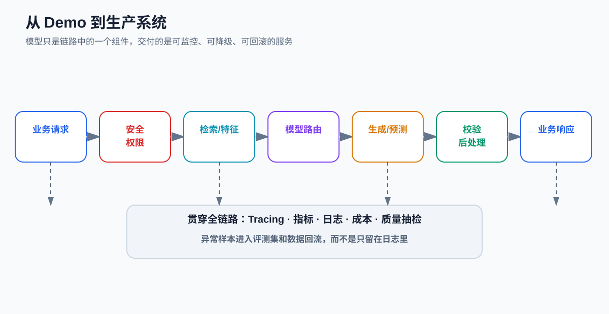
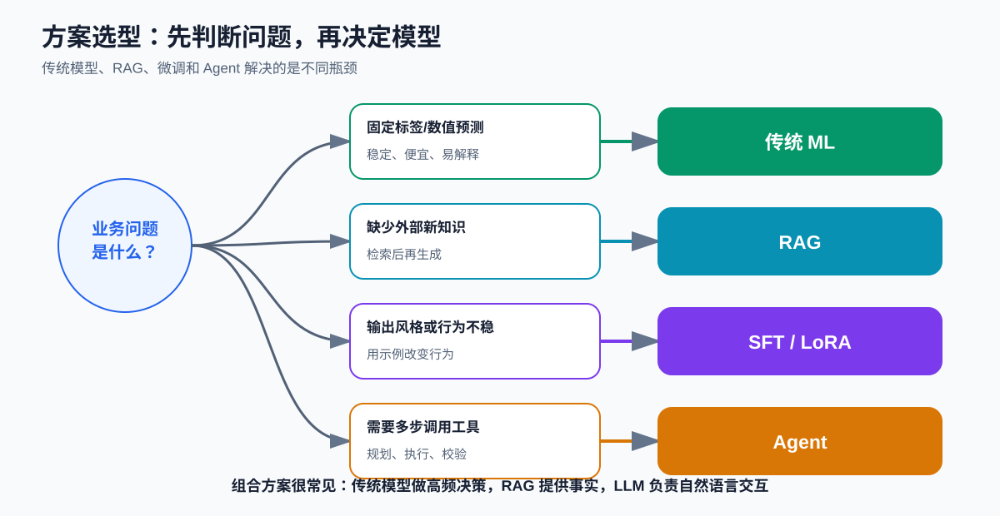
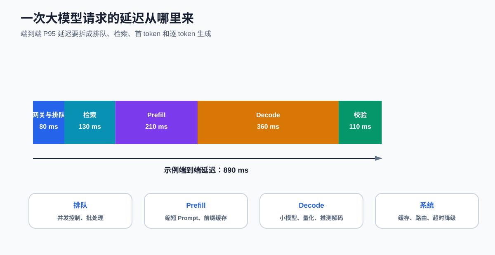
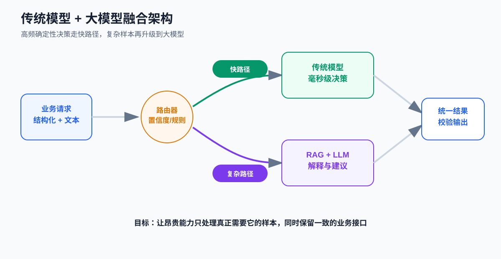

# 课时35-36：大模型工业落地痛点与优化方案

## 1. 课程定位

一个大模型 Demo 能回答问题，只说明链路可以运行；工业系统还必须回答：

- 高峰期能否承受并发？
- 慢请求是否会拖垮业务？
- 错误回答能否被发现和拦截？
- 数据是否越权、泄露或被提示词攻击？
- 成本是否低于业务收益？
- 模型升级后能否回滚？
- 线上失败样本能否进入评测与优化闭环？

工业落地的交付对象不是一个模型，而是一个**包含数据、检索、模型、规则、校验、监控和降级策略的完整系统**。



## 2. 学习目标

1. 用质量、延迟、成本、稳定性和风险五个维度定义上线要求。
2. 区分传统模型、Prompt、RAG、LoRA 和 Agent 分别解决什么问题。
3. 拆解排队、检索、Prefill、Decode 和后处理延迟。
4. 理解吞吐量、并发数、P50/P95/P99 和首 token 延迟。
5. 设计缓存、批处理、量化、路由、降级和重试策略。
6. 用 RAG、结构化输出、事实核验与拒答降低幻觉风险。
7. 建立日志、指标、Tracing、评测集和数据回流闭环。
8. 设计传统模型与大模型融合方案。

## 3. 贯穿案例：智能售后助手

系统需要完成：

1. 识别用户意图和紧急程度；
2. 查询订单、物流、退换货政策；
3. 生成回复建议；
4. 高风险投诉自动升级；
5. 所有关键决策可审计。

如果直接把用户问题发给大模型，可能产生：

- 编造订单状态；
- 引用过期政策；
- 高峰期延迟过高；
- 输出格式漂移；
- 把普通咨询误判为高风险；
- 暴露其他用户信息；
- 工具调用失败后继续编造结果。

因此应把任务拆成：

$$
\text{理解} + \text{取数} + \text{决策} + \text{生成} + \text{校验}
$$

不同环节可以由不同技术承担。

## 4. 先定义上线目标

### 4.1 服务级目标

| 维度 | 示例指标 | 说明 |
| --- | --- | --- |
| 业务质量 | 高风险投诉召回率 ≥ 95% | 直接对应漏判损失 |
| 格式稳定 | JSON Schema 通过率 ≥ 99.5% | 决定下游能否解析 |
| 时延 | P95 ≤ 2 秒 | 关注慢请求尾部 |
| 可用性 | 月可用性 ≥ 99.9% | 包含超时和依赖故障 |
| 成本 | 每千次请求 ≤ 预算 | 包含模型、检索和基础设施 |
| 安全 | 越权读取为 0 | 必须由权限系统保证 |
| 可审计 | 请求可追踪率 100% | 保存版本、依据和处理结果 |

指标值必须结合真实业务制定，表中数字只是格式示例。

### 4.2 平均值为什么不够

若 90% 请求耗时 500 ms，10% 请求耗时 8 秒，平均值可能尚可，但大量用户仍会明显卡顿。

常用分位数：

- P50：一半请求不超过该值；
- P95：95% 请求不超过该值；
- P99：观察极端慢请求；
- TTFT：Time To First Token，首 token 延迟；
- TPOT：Time Per Output Token，后续 token 平均耗时。

流式输出可以改善用户感受，但不会自动降低总计算量。

## 5. 方案选型：先判断瓶颈



| 主要问题 | 优先方案 | 原因 |
| --- | --- | --- |
| 固定标签、数值和排序 | 传统 ML / 小型 Encoder | 快、稳定、成本低 |
| 缺少企业私有或最新知识 | RAG / 数据库工具 | 知识可更新、可引用 |
| 输出风格、格式或行为不稳 | Prompt → SFT/LoRA | 用示例改变行为 |
| 需要确定性规则 | 规则引擎 | 易审计、无随机性 |
| 需要多步调用工具 | 工作流 / Agent | 管理状态、工具和步骤 |
| 需要复杂自然语言交互 | LLM | 泛化和生成能力强 |

### 5.1 RAG 和微调不能互相替代

- RAG 把外部资料放入当前上下文，主要解决知识来源和时效性。
- 微调改变模型参数，主要解决行为、格式、风格和领域模式。
- Agent 组织多步行动，主要解决工具调用和流程执行。

企业政策每天变化时，优先更新知识库，而不是每天重新微调模型。

### 5.2 Agent 不是默认升级项

如果流程固定为“查订单 → 查政策 → 生成回复”，显式工作流通常比开放式 Agent 更稳定。只有步骤需要根据状态动态选择时，Agent 的规划能力才更有价值。

## 6. 推理延迟拆解



一次请求的总延迟可近似拆为：

$$
T_{total}=T_{queue}+T_{retrieve}+T_{prefill}+T_{decode}+T_{post}
$$

### 6.1 排队

当请求到达速度超过系统处理速度时，请求会等待。优化方式包括：

- 限流与优先级队列；
- 动态批处理；
- 增加副本；
- 小模型分流；
- 缩短输出上限；
- 高峰期降级。

### 6.2 Prefill

Prefill 处理整个输入 Prompt，输入越长，计算和 KV Cache 占用通常越大。可通过：

- 删除重复系统说明；
- 压缩历史对话；
- 只召回相关文档片段；
- 使用前缀缓存；
- 限制无关超长输入。

### 6.3 Decode

Decode 按 token 自回归生成，天然存在串行依赖。可通过：

- 减少最大输出长度；
- 使用更小模型；
- 量化和高效推理引擎；
- Continuous Batching；
- 推测解码；
- 更快的硬件和并行策略。

KV Cache 避免重复计算历史 token 的 K/V，但不会让逐 token 生成变成完全并行。

## 7. 吞吐、并发与容量估算

若单副本平均每秒完成 $q$ 个请求，共有 $n$ 个副本，理论吞吐近似为：

$$
QPS_{theory}=nq
$$

实际容量还要预留：

- 流量突发；
- 长短请求差异；
- 故障副本；
- 后台评测和健康检查；
- 模型加载和扩容时间。

### 7.1 Little 定律的直觉

稳定系统中：

$$
L=\lambda W
$$

- $L$：系统中的平均请求数；
- $\lambda$：平均到达率；
- $W$：平均停留时间。

若 QPS 为 20，平均请求停留 2 秒，则系统平均约有 40 个在途请求。这个关系可用于粗估并发需求。

### 7.2 压测不能只发短 Prompt

压测样本应覆盖：

- 短输入短输出；
- 长输入短输出；
- 短输入长输出；
- 长输入长输出；
- 检索命中和未命中；
- 工具正常和超时；
- 不同并发梯度。

## 8. 成本模型

### 8.1 API 模式

单次请求成本可近似为：

$$
C_{request}=N_{in}P_{in}+N_{out}P_{out}+C_{retrieve}+C_{other}
$$

其中 token 数和单价必须使用同一计量单位。

### 8.2 自部署模式

单位请求基础设施成本可粗估为：

$$
C_{request}=\frac{C_{gpu}+C_{cpu}+C_{storage}+C_{network}+C_{ops}}{N_{requests}}
$$

若低峰期 GPU 长期空闲，单次成本可能高于按量 API。自部署还要计入工程维护、升级、安全和容灾成本。

### 8.3 降本顺序

1. 先确认是否真的需要大模型；
2. 缩短输入和输出；
3. 缓存重复请求和公共前缀；
4. 用传统模型或小模型路由简单任务；
5. 批处理和提高设备利用率；
6. 再评估量化、蒸馏和硬件升级。

## 9. 常见性能优化手段

| 手段 | 主要收益 | 风险或限制 |
| --- | --- | --- |
| 量化 | 降低权重显存，可能提升吞吐 | 精度和算子兼容需验证 |
| 动态批处理 | 提高设备利用率 | 可能增加单请求等待 |
| KV Cache | 减少历史 token 重算 | 占用显存，长上下文更明显 |
| Prefix Cache | 复用相同前缀计算 | 前缀必须高度重复 |
| Prompt 压缩 | 减少 Prefill 和输入成本 | 可能删掉关键信息 |
| 模型路由 | 简单请求使用小模型 | 路由错误会损失质量 |
| 结果缓存 | 重复请求近乎零模型成本 | 需处理时效、权限和失效 |
| 推测解码 | 加速生成 | 依赖草稿模型和接受率 |
| 蒸馏 | 用小模型学习大模型行为 | 需要数据、训练与回归测试 |

优化必须用端到端指标验证。单个算子更快，不一定让用户请求更快。

## 10. 幻觉治理

### 10.1 先区分幻觉类型

| 类型 | 示例 | 主要处理 |
| --- | --- | --- |
| 知识缺失 | 编造不存在的政策 | RAG、工具查询、拒答 |
| 检索错误 | 找到不相关文档 | 检索评测、重排、过滤 |
| 上下文冲突 | 两份政策版本互相矛盾 | 版本和有效期管理 |
| 推理错误 | 文档正确但结论错误 | 规则校验、模型复核 |
| 格式错误 | 非法 JSON | Schema、约束解码、重试 |
| 工具结果误用 | 查询失败仍继续回答 | 状态机和失败分支 |

### 10.2 RAG 的基本链路

$$
\text{Query} \rightarrow \text{检索} \rightarrow \text{重排} \rightarrow \text{上下文} \rightarrow \text{生成} \rightarrow \text{引用校验}
$$

RAG 不是把文档放进向量库就结束。至少要分别评测：

- 检索是否找到了正确证据；
- 生成是否忠于证据；
- 引用是否对应原文；
- 没有证据时是否拒答。

### 10.3 让系统敢于“不知道”

可靠系统应定义：

- 最低检索相关度；
- 必需字段是否存在；
- 证据是否来自有效版本；
- 哪些问题必须转人工；
- 哪些操作必须二次确认。

拒答和升级不是失败，而是风险控制能力。

## 11. 稳定性与故障处理

### 11.1 超时

为每个依赖设置独立超时：

- 检索超时；
- 模型首 token 超时；
- 总生成超时；
- 工具调用超时。

总超时不能简单等于各子步骤超时之和，否则串行重试会放大尾延迟。

### 11.2 重试

只对可能恢复的错误重试，例如临时网络失败和限流。格式错误可用更严格提示重试一次，但不应无限循环。

带副作用的工具调用必须使用幂等键，避免重试造成重复退款、重复建单或重复发消息。

### 11.3 降级与熔断

可选降级：

- 大模型不可用时返回模板答案；
- RAG 超时时只提供查询入口；
- 复杂模型过载时切换小模型；
- Agent 失败时回到固定工作流；
- 低置信度或冲突结果转人工。

## 12. 安全与隐私

### 12.1 Prompt Injection

外部文档或用户输入可能包含“忽略系统规则、泄露秘密”等恶意指令。防护不能只靠一句系统提示，应组合：

- 数据与指令分离；
- 工具白名单；
- 最小权限；
- 参数校验；
- 高风险操作确认；
- 输出过滤；
- 攻击测试集。

### 12.2 权限控制

模型不能决定用户有权查看什么。应在检索或工具层按用户身份过滤数据，再把授权后的最小结果交给模型。

### 12.3 敏感数据

- 训练前脱敏；
- 日志避免保存完整敏感正文；
- 缓存键包含权限边界；
- 明确第三方 API 数据处理协议；
- 设置数据保留和删除策略。

## 13. 可观测性

一次请求至少应能追踪：

- request id 和用户权限上下文；
- Prompt 模板版本；
- 模型与适配器版本；
- 检索 query、文档 id、版本和分数；
- 工具调用参数摘要和状态；
- 输入/输出 token 数；
- 各步骤耗时；
- 重试、降级和最终状态；
- 用户反馈和人工修正。

### 13.1 指标分层

| 层级 | 代表指标 |
| --- | --- |
| 系统 | QPS、错误率、GPU 利用率、队列长度 |
| 模型 | token/s、TTFT、格式通过率、拒答率 |
| 检索 | Recall@K、命中率、重排效果 |
| 业务 | 转人工率、解决率、投诉漏判率 |
| 成本 | 每请求 token、每千次请求成本 |

日志用于查单次问题，指标用于看总体趋势，Tracing 用于定位跨组件延迟和错误。

## 14. 传统模型与大模型融合



一个常见方案：

1. 规则过滤明显非法请求；
2. XGBoost 或小型分类器处理高频固定标签；
3. 低置信度、长文本和多诉求请求进入 LLM；
4. LLM 通过 RAG 查询政策并生成解释；
5. 规则再次校验金额、订单状态和操作权限；
6. 高风险结果转人工。

这种架构的价值是：

- 传统模型提供低延迟和稳定基线；
- LLM 处理复杂语言和长尾表达；
- RAG 提供可更新知识；
- 规则保证不可违反的业务边界。

## 15. 性能测试代码

### 15.1 统计分位数

```python
import time
import numpy as np


def benchmark(call_model, samples, concurrency_label="single"):
    records = []
    for sample in samples:
        start = time.perf_counter()
        result = call_model(sample)
        elapsed_ms = (time.perf_counter() - start) * 1000
        records.append({
            "elapsed_ms": elapsed_ms,
            "ok": result.get("ok", False),
            "input_tokens": result.get("input_tokens", 0),
            "output_tokens": result.get("output_tokens", 0),
        })

    latencies = np.array([r["elapsed_ms"] for r in records])
    return {
        "mode": concurrency_label,
        "count": len(records),
        "success_rate": np.mean([r["ok"] for r in records]),
        "p50_ms": np.percentile(latencies, 50),
        "p95_ms": np.percentile(latencies, 95),
        "p99_ms": np.percentile(latencies, 99),
        "total_tokens": sum(r["input_tokens"] + r["output_tokens"] for r in records),
    }
```

正式压测应使用并发客户端、预热、固定数据分布，并记录服务端指标。

### 15.2 简单路由器

```python
def route(ticket, small_model):
    pred = small_model.predict(ticket)

    if ticket["has_safety_risk"]:
        return "human_review"

    if pred["confidence"] >= 0.90 and not ticket["is_long_text"]:
        return "traditional_model"

    if ticket["needs_policy_lookup"]:
        return "rag_llm"

    return "llm"
```

阈值应由验证集、容量和业务损失共同确定。

## 16. 上线流程

1. 离线测试：冻结评测集、攻击集、格式集和回归集。
2. 影子流量：复制线上请求，不影响真实结果。
3. 小流量灰度：限制用户和请求比例。
4. 对照实验：比较业务指标，而非只比较点赞率。
5. 扩大流量：同时监控质量、延迟、成本和异常。
6. 保留回滚：模型、Prompt、知识库和代码都要可回退。
7. 数据回流：经脱敏、去重和审核后进入评测或训练。

## 17. 常见误区

1. **只优化模型，不优化链路**：实际瓶颈可能是排队、检索或数据库。
2. **只看平均延迟**：P95/P99 才能暴露尾部问题。
3. **把 RAG 当成绝对真实**：错误检索仍会生成错误答案。
4. **无限增加 Prompt**：上下文更长可能更慢，也可能引入冲突。
5. **所有请求都用最大模型**：成本高且没有必要。
6. **缓存不考虑权限**：可能造成跨用户数据泄露。
7. **重试没有幂等性**：可能重复执行有副作用操作。
8. **线上失败只留日志**：没有进入评测集，就不会形成改进闭环。
9. **模型升级直接全量发布**：缺乏灰度和回滚会放大风险。
10. **把模型置信语气当作置信度**：表达自信不代表答案正确。

## 18. 本课总结

1. 工业系统优化需要同时考虑质量、延迟、成本、稳定性和风险。
2. 传统模型、RAG、微调和 Agent 解决不同瓶颈，常以组合方式出现。
3. 总延迟应拆为排队、检索、Prefill、Decode 和后处理。
4. 量化、批处理、缓存、路由和缩短上下文都必须做端到端验证。
5. 幻觉治理需要证据、校验、拒答和人工升级，而不只是修改 Prompt。
6. 权限必须在数据与工具层执行，不能交给模型自行判断。
7. 日志、指标、Tracing、冻结评测集和失败样本回流构成生产闭环。
8. 大模型与传统模型共生通常比“全部替换”更符合成本和稳定性要求。

## 19. 课后作业

### 19.1 压测报告

对一个本地模型或 API 完成不少于 100 次请求测试，覆盖至少三种输入长度和三档并发，记录：

- TTFT；
- 总延迟 P50/P95/P99；
- 输出 token/s；
- 成功率；
- token 数或 GPU 利用率；
- 单次成本估算。

### 19.2 优化实验

选择两项进行前后对比：

- 缩短 Prompt；
- 限制输出长度；
- 缓存；
- 小模型路由；
- 量化；
- 批处理；
- 减少检索片段。

必须说明优化是否牺牲质量。

### 19.3 方案选型

针对同一售后任务，分别设计：

1. 纯规则或传统模型方案；
2. RAG + LLM 方案；
3. 传统模型 + LLM 融合方案。

从效果、延迟、成本、稳定性、维护和安全六个维度做判断。

### 19.4 故障演练

至少模拟四种故障：检索超时、模型超时、非法 JSON、工具返回空值。为每种故障定义重试、降级、告警和人工处理策略。

## 20. 知识延伸

完整项目可以在同一份工单数据上同时建立 XGBoost 传统方案和大模型方案，统一比较效果、速度、成本与稳定性，并设计融合部署架构。
