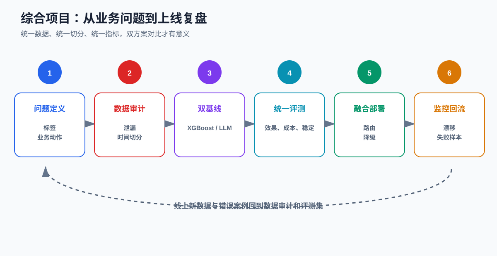
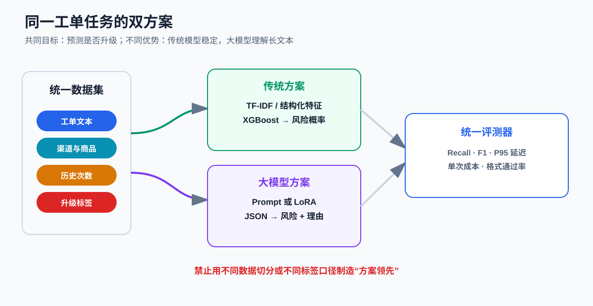
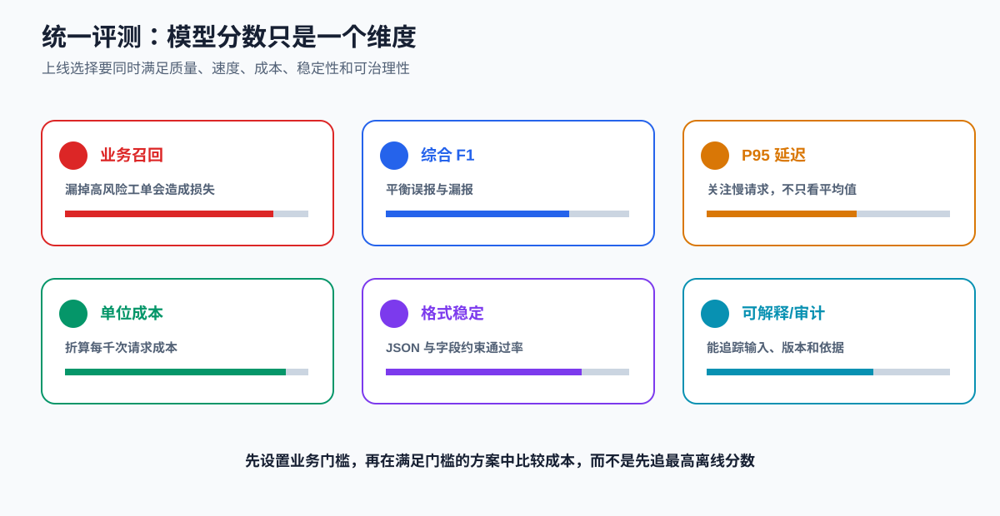
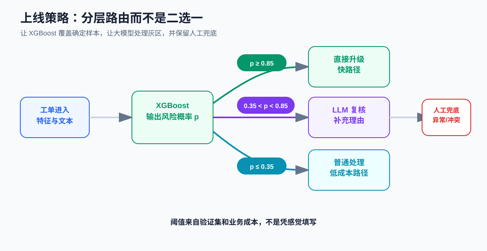

# 课时37-38：完整综合项目实战

## 1. 课程定位

本项目把传统机器学习、文本特征、大模型 Prompt、LoRA、统一评测、服务路由和工业复盘串成一个闭环。

核心要求不是堆两个模型，而是让两套方案面对：

- 同一个业务问题；
- 同一份数据；
- 同一套切分；
- 同一组业务指标；
- 同样的线上约束。

只有这样，传统模型与大模型的对比才有意义。



## 2. 学习目标

1. 把模糊业务诉求转成可训练、可评测的任务。
2. 设计防止数据泄漏的时间切分和实体隔离。
3. 用文本与结构化特征训练 XGBoost 基线。
4. 为大模型设计零样本、少样本和 LoRA 三档方案。
5. 统一比较 Recall、F1、延迟、成本、格式和稳定性。
6. 根据置信度和业务风险设计双模型路由。
7. 建立部署、监控、回滚和错误样本回流方案。
8. 把实验整理成可复现项目和可信简历材料。

## 3. 项目场景：售后工单升级风险

### 3.1 业务问题

客服每天收到大量工单。部分普通问题可以自动处理，部分涉及安全、舆情、重复投诉或高价值客户，需要尽快升级给高级客服。

项目目标：根据工单文本和结构化字段，预测：

$$
y=\begin{cases}
1,&\text{需要升级}\\
0,&\text{普通处理}
\end{cases}
$$

同时，大模型方案还输出：

```json
{
  "need_escalation": true,
  "risk_type": "安全风险",
  "reason": "用户描述充电器出现焦味",
  "suggested_action": "停止使用并转安全专席"
}
```

### 3.2 业务动作必须明确

预测结果对应真实动作：

| 结果 | 动作 |
| --- | --- |
| 高风险 | 立即升级并告警 |
| 中间灰区 | 大模型复核或人工复核 |
| 低风险 | 普通自动分流 |
| 模型异常 | 回退规则或人工队列 |

如果模型分数没有对应动作，项目仍停留在离线实验。

### 3.3 错误成本

- 假阴性：高风险工单被当作普通问题，可能导致安全、舆情和客户流失。
- 假阳性：普通工单被升级，增加高级客服成本。

因此本项目优先保证高风险召回率，再在满足召回门槛后优化精确率和成本。

## 4. 验收标准

以下是项目示例门槛，不代表通用行业标准：

| 指标 | 示例要求 |
| --- | ---: |
| 高风险 Recall | ≥ 95% |
| F1 | ≥ 85% |
| JSON Schema 通过率 | ≥ 99% |
| 传统模型 P95 | ≤ 100 ms |
| 大模型路径 P95 | ≤ 2.5 s |
| 决策可追踪率 | 100% |
| 严重安全规则漏拦截 | 0 |

## 5. 数据设计

### 5.1 数据字段

| 字段 | 类型 | 示例 |
| --- | --- | --- |
| `ticket_id` | 标识 | T20260801001 |
| `created_at` | 时间 | 2026-08-01 09:30 |
| `customer_id` | 实体 | C1881 |
| `text` | 文本 | 充电器发热且有焦味 |
| `channel` | 类别 | App / 电话 / 门店 |
| `product_type` | 类别 | 手机配件 |
| `customer_level` | 类别 | 普通 / VIP |
| `complaint_count_30d` | 数值 | 3 |
| `order_amount` | 数值 | 899.00 |
| `need_escalation` | 标签 | 0 / 1 |
| `risk_type` | 标签 | 安全 / 舆情 / 重复投诉 |

### 5.2 标签来源

标签可来自：

- 历史人工升级记录；
- 投诉处理结果；
- 安全规则命中；
- 资深客服复核；
- 后续是否发生重大投诉。

历史动作不一定等于真实标签。过去没有升级，可能是漏处理，而不是确实低风险。

### 5.3 数据泄漏

典型泄漏字段：

- 工单关闭后的处理结果；
- 升级后才生成的专席编号；
- 人工填写的最终风险类型；
- 未来 7 天投诉次数；
- 直接包含“已升级”的状态文本。

判断原则：**预测时刻尚不可获得的信息不能进入特征。**

### 5.4 切分策略

推荐先按时间切分：

- 较早时间：训练集；
- 中间时间：验证集；
- 最新时间：测试集。

同一客户或同一事件的多条近重复工单应放在同一个集合中，避免模型记住实体和模板。

## 6. 数据审计

训练前输出数据报告：

1. 样本数和时间范围；
2. 正负样本比例；
3. 各风险类型分布；
4. 文本长度分布；
5. 空值和异常值；
6. 客户、文本和语义近重复；
7. 训练、验证、测试字段漂移；
8. 敏感信息和脱敏结果。

### 6.1 类别不平衡

若高风险样本只占 3%，准确率 97% 的“全部预测普通”模型没有业务价值。

优先使用：

- Recall、Precision、F1；
- PR-AUC；
- 混淆矩阵；
- 不同阈值下的业务成本；
- 按风险类型分组指标。

## 7. 双方案总体结构



### 7.1 传统方案

$$
\text{文本 TF-IDF} + \text{结构化特征} \rightarrow \text{XGBoost} \rightarrow p(y=1)
$$

优势：

- 训练和推理快；
- 概率阈值易调；
- 成本低；
- 版本和特征可审计。

限制：

- 对复杂语义、隐含风险和长文本理解有限；
- 需要较稳定的标签和特征工程。

### 7.2 大模型方案

$$
\text{工单上下文} \rightarrow \text{Prompt 或 LoRA} \rightarrow \text{结构化 JSON}
$$

优势：

- 能利用长文本和自然语言上下文；
- 可同时输出分类、理由和建议；
- 少样本阶段能快速建立基线。

限制：

- 延迟和成本更高；
- 格式、幻觉和版本漂移需要治理；
- 生成的理由不等于真实决策因果解释。

## 8. 传统方案实现

### 8.1 建立最低基线

先建立两个简单基线：

1. 全部预测多数类；
2. 仅使用关键词规则，如“冒烟”“焦味”“起火”。

复杂模型必须显著优于简单基线，才值得增加维护成本。

### 8.2 XGBoost Pipeline

```python
import pandas as pd
from sklearn.compose import ColumnTransformer
from sklearn.feature_extraction.text import TfidfVectorizer
from sklearn.impute import SimpleImputer
from sklearn.metrics import classification_report, precision_recall_curve
from sklearn.pipeline import Pipeline
from sklearn.preprocessing import OneHotEncoder, StandardScaler
from xgboost import XGBClassifier

text_col = "text"
cat_cols = ["channel", "product_type", "customer_level"]
num_cols = ["complaint_count_30d", "order_amount"]

preprocess = ColumnTransformer(
    transformers=[
        ("text", TfidfVectorizer(
            max_features=20000,
            ngram_range=(1, 2),
            min_df=2,
        ), text_col),
        ("cat", OneHotEncoder(handle_unknown="ignore"), cat_cols),
        ("num", Pipeline([
            ("imputer", SimpleImputer(strategy="median")),
            ("scale", StandardScaler()),
        ]), num_cols),
    ]
)

model = XGBClassifier(
    n_estimators=500,
    max_depth=6,
    learning_rate=0.05,
    subsample=0.8,
    colsample_bytree=0.8,
    eval_metric="logloss",
    random_state=42,
)

pipeline = Pipeline([
    ("features", preprocess),
    ("model", model),
])

pipeline.fit(train_df, train_df["need_escalation"])
proba = pipeline.predict_proba(valid_df)[:, 1]
```

### 8.3 阈值不是固定 0.5

```python
import numpy as np
from sklearn.metrics import precision_score, recall_score, f1_score


def choose_threshold(y_true, proba, min_recall=0.95):
    candidates = []
    for threshold in np.linspace(0.01, 0.99, 99):
        pred = (proba >= threshold).astype(int)
        recall = recall_score(y_true, pred)
        precision = precision_score(y_true, pred, zero_division=0)
        if recall >= min_recall:
            candidates.append((f1_score(y_true, pred), threshold, precision, recall))
    if not candidates:
        raise ValueError("没有阈值满足最低召回要求")
    return max(candidates)
```

阈值只能用验证集选择，最终测试集只用于一次冻结评测。

### 8.4 误差分析

分别抽查：

- 高置信度假阴性；
- 高置信度假阳性；
- 低置信度灰区；
- 新商品和新渠道；
- 错别字和口语表达；
- 文本与结构化字段冲突；
- 每种风险类型。

误差分析应转化为行动：修标签、补样本、增加特征、改规则或调整阈值。

## 9. 大模型方案实现

### 9.1 零样本基线

```text
你是售后风险分类器。根据工单信息判断是否需要升级。
只输出符合给定字段的 JSON，不要输出额外文字。

升级条件包括：安全风险、舆情风险、重复投诉、重大金额争议。
若证据不足，risk_type 填 unknown，并说明需要人工复核。

工单：
{text}
渠道：{channel}
客户等级：{customer_level}
近30天投诉次数：{complaint_count_30d}
订单金额：{order_amount}
```

### 9.2 少样本基线

加入少量边界示例，而不是只加明显正例：

- 有“发热”但属于正常温升；
- 用户情绪激烈但没有明确高风险；
- 金额很高但已明确接受普通退款；
- 表达平静但包含“冒烟”“漏电”；
- 同时出现多个风险类型。

### 9.3 JSON 解析与校验

```python
import json

ALLOWED_RISKS = {"safety", "reputation", "repeat", "amount", "unknown"}


def parse_llm_output(text):
    obj = json.loads(text)
    required = {"need_escalation", "risk_type", "reason", "suggested_action"}
    if not required.issubset(obj):
        raise ValueError("missing fields")
    if obj["risk_type"] not in ALLOWED_RISKS:
        raise ValueError("invalid risk_type")
    if not isinstance(obj["need_escalation"], bool):
        raise TypeError("need_escalation must be boolean")
    return obj
```

### 9.4 LoRA 数据

将每条训练记录转为：

```json
{
  "messages": [
    {"role": "system", "content": "你是售后风险分类器，只输出合法 JSON。"},
    {"role": "user", "content": "工单及结构化字段……"},
    {"role": "assistant", "content": "{\"need_escalation\":true,\"risk_type\":\"safety\",\"reason\":\"出现焦味\",\"suggested_action\":\"立即升级\"}"}
  ]
}
```

LoRA 训练集只能来自训练切分，验证和测试样本不得进入示例选择或数据扩增。

### 9.5 大模型分类分数

生成式模型输出的“是/否”不能直接当作校准概率。可选策略：

- 使用固定类别 token 的 logits 构造分数；
- 多次采样估计一致性，但成本较高；
- 单独训练分类头或奖励模型；
- 把 LLM 作为复核器，而不是要求它提供精确概率。

## 10. 统一评测



### 10.1 效果指标

- 高风险 Recall；
- Precision、F1、PR-AUC；
- 各风险类型 Recall；
- 时间外测试集表现；
- 混淆矩阵；
- 置信度分桶表现。

### 10.2 工程指标

- P50/P95/P99 延迟；
- QPS 和最大稳定并发；
- 峰值显存；
- 每千次请求成本；
- JSON 解析成功率；
- 超时率和重试率；
- 冷启动时间。

### 10.3 稳定性指标

对同一语义进行：

- 同义改写；
- 错别字；
- 调换句序；
- 插入无关信息；
- 长文本扩展；
- 中英文混写。

判断结果是否发生不可接受变化。

### 10.4 示例结果表

以下数字只用于展示报告结构，不能作为真实实验结论：

| 方案 | Recall | F1 | P95 | JSON 通过率 | 每千次成本 |
| --- | ---: | ---: | ---: | ---: | ---: |
| 关键词规则 | 0.72 | 0.61 | 5 ms | 100% | 极低 |
| XGBoost | 0.95 | 0.87 | 45 ms | 100% | 低 |
| LLM 少样本 | 0.96 | 0.89 | 1800 ms | 97.8% | 高 |
| LoRA LLM | 0.97 | 0.91 | 1750 ms | 99.2% | 高 |
| 融合路由 | 0.97 | 0.90 | 180 ms | 99.8% | 中 |

## 11. 融合部署



一个可行策略：

- $p\ge0.85$：XGBoost 直接升级；
- $p\le0.35$：进入普通流程，但安全关键词仍有强规则拦截；
- $0.35<p<0.85$：交给 LLM 复核；
- 规则与模型冲突：人工复核；
- 模型超时或 JSON 非法：回退 XGBoost 和规则。

阈值必须通过验证集和业务成本分析确定。

### 11.1 预期成本

若传统路径成本为 $C_t$，LLM 路径成本为 $C_l$，进入 LLM 的比例为 $p_l$：

$$
C_{avg}=(1-p_l)C_t+p_lC_l
$$

例如只有 15% 样本进入 LLM，可显著降低平均成本，但仍需验证灰区路由是否覆盖了 LLM 真正有优势的样本。

## 12. 部署接口

统一服务接口避免业务方感知内部模型差异：

```json
{
  "ticket_id": "T1001",
  "need_escalation": true,
  "risk_type": "safety",
  "score": 0.93,
  "reason": "检测到焦味与异常发热",
  "route": "xgboost_fast_path",
  "model_version": "risk-xgb-20260828",
  "trace_id": "trace-abc"
}
```

`reason` 的来源必须标识清楚：规则依据、特征贡献、检索证据或 LLM 生成，不能混为同一种解释。

## 13. 监控与漂移

### 13.1 数据漂移

监控：

- 渠道、商品、客户等级分布；
- 文本长度和关键词变化；
- 高风险比例；
- 缺失率；
- 新类别和未知值。

### 13.2 效果漂移

线上标签通常延迟到达，应建立：

- 每日代理指标；
- 每周人工抽检；
- 标签到达后的真实 Recall/F1；
- 按模型版本和时间窗口对比。

### 13.3 回流规则

失败样本不能直接自动加入训练集。先经过：

1. 脱敏；
2. 去重；
3. 人工确认标签；
4. 原因分类；
5. 数据版本登记；
6. 加入评测集或下一轮训练候选。

## 14. 项目目录

```text
customer-risk-project/
├── README.md
├── configs/
│   ├── xgb.yaml
│   └── lora.yaml
├── data/
│   ├── README.md
│   └── schema.json
├── src/
│   ├── data_check.py
│   ├── train_xgb.py
│   ├── train_lora.py
│   ├── evaluate.py
│   ├── router.py
│   └── service.py
├── tests/
│   ├── test_schema.py
│   ├── test_router.py
│   └── test_regression.py
├── reports/
│   ├── data_audit.md
│   ├── experiment_table.csv
│   └── error_analysis.md
└── model_cards/
    ├── xgb_model_card.md
    └── lora_model_card.md
```

## 15. 实验记录

每次实验至少记录：

- 代码提交或版本；
- 数据版本和切分日期；
- 特征版本或 Prompt 版本；
- 模型和超参数；
- 随机种子；
- 训练环境；
- 离线指标；
- 延迟和成本；
- 失败样本摘要；
- 是否进入候选发布。

只保存“最佳结果截图”无法复现，也无法解释为什么改动有效。

## 16. 简历表达

较弱表达：

> 使用 XGBoost 和大模型完成客服分类，准确率较高。

更可信的表达结构：

> 面向售后工单升级风险识别，构建时间切分数据集与统一评测框架；以 TF-IDF、结构化特征和 XGBoost 建立低延迟基线，并使用 LoRA 适配小型指令模型处理长尾语义；通过置信度路由使大模型仅处理灰区样本，在满足高风险召回门槛的同时降低平均推理成本，并补充格式校验、回退和漂移监控。

数字必须来自自己的实验记录，不能编造。

## 17. 常见项目问题

1. 先选模型，后找业务问题。
2. 传统方案和大模型方案使用不同测试集。
3. 随机切分导致同一客户和模板泄漏。
4. 只报告准确率，不报告高风险 Recall。
5. 用大模型生成训练标签，又用同一模型评测。
6. 把生成理由当作真实可解释性。
7. 没有统计非法 JSON、超时和重试。
8. 没有简单规则基线。
9. 只做 Notebook，没有配置、测试和报告。
10. 简历写了无法追问和复现的提升数字。

## 18. 本课总结

1. 双方案项目必须统一任务、数据、切分、指标和线上约束。
2. 业务错误成本决定指标优先级，本项目优先高风险 Recall。
3. XGBoost 方案强调低延迟、概率阈值和稳定性。
4. 大模型方案强调复杂语义、结构化输出和长尾能力。
5. 评测必须同时覆盖效果、延迟、成本、格式、鲁棒性和可治理性。
6. 融合路由让传统模型处理确定样本，大模型处理灰区，人工处理异常。
7. 数据漂移、标签延迟、回滚和错误回流决定项目能否持续运行。
8. 可复现的项目证据比堆叠技术名词更有求职价值。

## 19. 课后作业

### 19.1 完成双方案

在同一数据集上完成：

- 关键词规则基线；
- XGBoost 方案；
- 大模型零样本或少样本方案；
- 可选 LoRA 方案；
- 融合路由方案。

### 19.2 统一报告

提交：

1. 数据审计；
2. 防泄漏切分说明；
3. 实验配置；
4. 统一指标表；
5. 至少 30 条错误分析；
6. 延迟和成本测试；
7. 部署架构；
8. 风险与回滚方案。

### 19.3 项目工程化

把 Notebook 拆为可执行脚本，加入配置文件、日志、随机种子、Schema 校验和最少三个自动化测试。

### 19.4 简历材料

准备：

- 30 秒项目介绍；
- 3 分钟完整介绍；
- 一张架构图；
- 一张实验对比表；
- 三个失败案例和修复过程；
- 一条不夸大、可验证的简历描述。

## 20. 知识延伸

完整项目经验还需要压缩成可复用的技术地图，并转化为岗位交付物、项目说明、简历表达、面试答案和持续学习路线。
