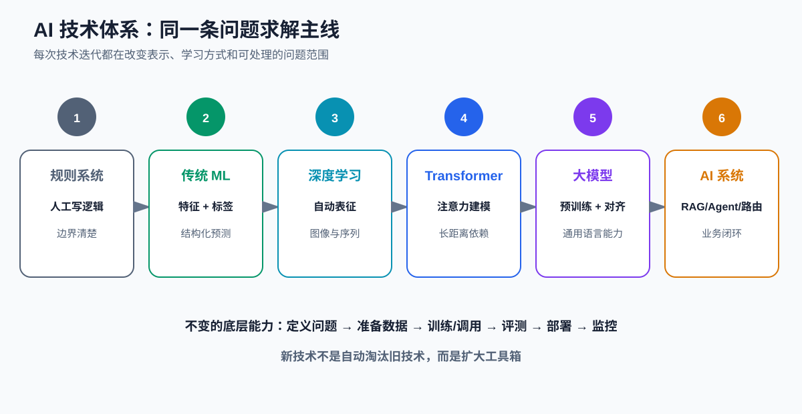
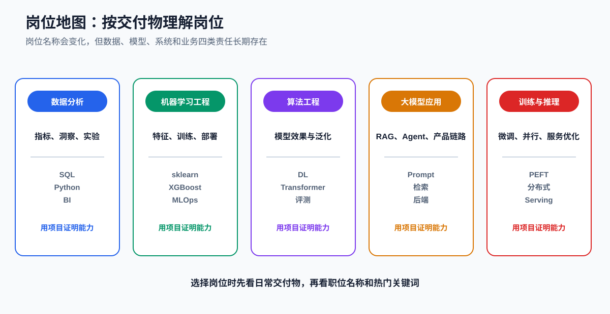
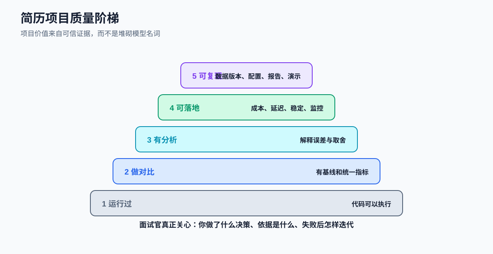
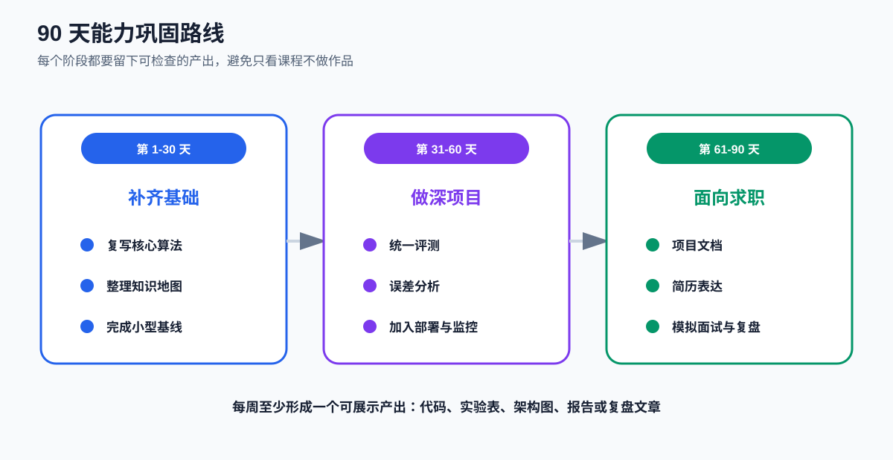

# 课时39-40：课程总结、技术体系复盘与就业指导

## 1. 课程定位

技术体系复盘聚焦三件事：

1. 把数学、传统机器学习、深度学习、Transformer 和大模型串成一条问题求解主线。
2. 把“会调用模型”升级为“能定义问题、做评测、完成工程闭环”。
3. 把课程实验整理成可复现项目、简历证据和后续学习计划。

技术变化很快，但完整工作链条长期稳定：

$$
\text{定义问题} \rightarrow \text{准备数据} \rightarrow \text{建立基线} \rightarrow \text{训练或调用} \rightarrow \text{评测} \rightarrow \text{部署} \rightarrow \text{监控}
$$

## 2. 学习目标

1. 解释 AI 技术从人工规则到大模型系统的演进逻辑。
2. 根据数据形式、目标、成本和风险选择合适技术。
3. 识别数据泄漏、指标误用、过拟合、幻觉和部署断层。
4. 区分数据分析、机器学习、算法、大模型应用和训练推理岗位。
5. 用可信实验和工程证据打磨项目。
6. 准备简历、项目介绍、技术面试和行为面试。
7. 在就业、读研和科研之间做基于目标的选择。
8. 制定可执行的 30、60、90 天成长路线。

## 3. AI 技术演进总图



| 阶段 | 核心表示 | 学习方式 | 典型优势 | 典型限制 |
| --- | --- | --- | --- | --- |
| 规则系统 | 人工条件 | 人工编写 | 确定、可审计 | 长尾规则爆炸 |
| 传统 ML | 人工特征向量 | 监督/无监督学习 | 小数据、结构化任务强 | 表征依赖特征工程 |
| 深度学习 | 多层神经表示 | 反向传播 | 自动学习图像和序列特征 | 数据与算力要求高 |
| Transformer | 上下文 token 表示 | 注意力 + 预训练 | 并行训练、长距离建模 | 推理成本和上下文限制 |
| 大模型 | 通用语言表示 | 预训练 + 对齐 | 零样本、少样本、生成 | 幻觉、成本、不可确定性 |
| AI 系统 | 模型 + 数据 + 工具 | RAG、微调、路由、监控 | 面向业务闭环 | 系统复杂度高 |

演进不是简单替换：规则、XGBoost、CNN、RNN、Transformer 和 LLM 仍会在不同场景共存。

## 4. 全课程知识主线

### 4.1 数学与优化

需要真正掌握的不是公式数量，而是变量之间的关系：

- 向量和矩阵表示样本、特征和参数；
- 导数表示局部变化方向；
- 梯度下降根据 Loss 更新参数；
- 概率描述不确定性；
- 正则化约束模型复杂度；
- 训练集、验证集和测试集承担不同职责。

### 4.2 传统机器学习

核心问题：

- 线性模型怎样建立可解释基线；
- 聚类和 PCA 怎样发现结构与压缩维度；
- 决策树怎样切分特征空间；
- GBDT、XGBoost、LightGBM 怎样逐步修正误差；
- 特征、标签、切分、指标和调参怎样形成工程闭环。

### 4.3 深度学习

核心变化是从人工特征走向自动表征：

- 全连接层完成带权线性组合；
- 激活函数提供非线性；
- Loss 从输出端产生训练信号；
- 反向传播把梯度逐层传回所有可训练参数；
- CNN 利用局部连接和权重共享；
- RNN/LSTM/GRU 通过状态处理序列。

### 4.4 Transformer 与大模型

- Self-Attention 让每个 token 根据上下文聚合信息；
- Q/K/V 分别承担查询、匹配和内容传递；
- Encoder、Decoder 和 Encoder-Decoder 具有不同信息流；
- 预训练通过 token 预测压缩语言和世界规律；
- SFT、RM、RLHF/DPO 改善指令遵循和偏好；
- LoRA 以少量低秩参数适配具体任务；
- RAG、工具、路由和监控把模型能力变成业务系统。

## 5. 统一的问题求解框架

面对新任务，依次回答：

### 5.1 业务目标

- 预测结果将触发什么动作？
- 错误的业务代价是什么？
- 是否真的需要模型？
- 结果需要多快返回？
- 谁对最终决策负责？

### 5.2 数据

- 输入和标签在预测时刻是否可获得？
- 标签是否代表真实目标，还是历史流程偏差？
- 是否存在时间、用户、模板和目标泄漏？
- 样本是否覆盖边界情况？
- 数据能否合法使用、保存和回流？

### 5.3 基线

至少建立：

- 规则或多数类基线；
- 简单线性/树模型基线；
- 大模型任务中的零样本或少样本基线。

没有基线，就无法判断复杂方案是否真的创造价值。

### 5.4 评测

- 离线指标是否对应业务损失？
- 测试集是否冻结？
- 是否评测速度、成本、稳定性和安全？
- 是否按人群、类别、时间和长度分组？
- 是否检查失败样本而不只看平均分？

### 5.5 落地

- 服务是否有超时、重试、降级和回滚？
- 模型、Prompt、数据和知识库是否有版本？
- 线上是否可观测？
- 新样本怎样脱敏、标注和回流？
- 业务收益是否高于总拥有成本？

## 6. 技术选型速查

| 场景 | 优先起点 | 升级条件 |
| --- | --- | --- |
| 表格分类/回归 | 线性模型、树模型、XGBoost | 数据量、非线性和精度需要 |
| 图像分类 | CNN 或视觉预训练模型 | 数据和算力允许迁移学习 |
| 固定序列任务 | RNN/GRU 或 Transformer | 长依赖和并行需求增加 |
| 文本分类/抽取 | Encoder、小型 LLM、传统文本模型 | 长尾语义或多任务需要 |
| 开放式文本生成 | Decoder-only LLM | 需要更强知识或行为适配 |
| 私有知识问答 | RAG | 检索质量达标后再优化生成 |
| 固定格式和风格 | Prompt、约束输出、LoRA | Prompt 无法稳定满足时 |
| 多步工具任务 | 显式工作流 | 步骤动态变化时再考虑 Agent |
| 高频关键决策 | 规则/传统模型 + 人工 | LLM 作为复核或解释层 |

## 7. 学习中的典型盲点

### 7.1 把名词记忆当成理解

真正理解至少包含：

1. 输入是什么；
2. 参数是什么；
3. 前向怎样计算；
4. Loss 怎样定义；
5. 梯度更新什么；
6. 输出怎样服务业务；
7. 失败时怎样验证原因。

### 7.2 把训练成功当成项目成功

Loss 下降只说明优化器在训练数据上找到了更低目标值，不保证：

- 测试集更好；
- 业务指标更好；
- 延迟和成本可接受；
- 没有数据泄漏；
- 线上分布不变化。

### 7.3 把模型当成产品

模型前后还需要权限、数据、检索、规则、校验、接口、监控、降级和人工流程。

### 7.4 把复杂模型当成先进方案

技术先进与方案合适是两回事。能用规则稳定解决的问题，不需要为了简历使用大模型。

### 7.5 把生成解释当成真实因果

大模型可以生成听起来合理的理由，但理由可能是事后组织的语言。高风险决策需要可追踪证据和业务规则。

### 7.6 只会调库，不会验证

调用 API 是能力的一部分，更重要的是能检查张量形状、数据切分、指标口径、异常样本和系统瓶颈。

## 8. 岗位地图



### 8.1 数据分析

主要交付：指标体系、SQL 分析、实验评估、业务洞察和数据看板。

重点能力：

- SQL、Python/pandas；
- 统计、A/B 测试；
- 指标和业务理解；
- 清晰表达结论。

### 8.2 机器学习工程

主要交付：数据流水线、特征、模型训练、服务部署和监控。

重点能力：

- sklearn、XGBoost/LightGBM；
- 特征工程和评测；
- Python 工程、API、Docker；
- 模型版本和 MLOps。

### 8.3 算法工程

主要交付：模型效果、训练方案、误差分析和能力优化。

重点能力：

- 数学、深度学习、Transformer；
- PyTorch、实验设计；
- 论文复现；
- 数据与模型联合优化。

### 8.4 大模型应用工程

主要交付：RAG、Agent、Prompt、业务接口、评测和生产链路。

重点能力：

- LLM API 与本地模型；
- 检索、向量库、重排；
- 后端、工具调用、状态管理；
- 安全、成本和可观测性。

### 8.5 训练与推理工程

主要交付：预训练/微调流水线、分布式训练和高性能 Serving。

重点能力：

- PEFT、混合精度、并行训练；
- GPU、显存和通信；
- 量化、批处理、KV Cache；
- 性能分析和系统优化。

岗位名称可能重叠，判断时应看招聘描述中的日常交付物。

## 9. 项目质量标准



### 9.1 最低完整性

一个可展示项目至少包含：

- 清晰业务问题；
- 数据来源和字段说明；
- 防泄漏切分；
- 简单基线；
- 可重复训练或调用脚本；
- 统一评测；
- 错误分析；
- 工程约束；
- README 和运行说明。

### 9.2 进阶证据

更有区分度的证据包括：

- 多方案对比；
- 消融实验；
- 阈值和成本分析；
- P95 延迟与吞吐；
- 监控和回滚；
- 真实失败案例；
- 可运行演示；
- 模型卡和数据卡。

## 10. 课程项目整理

建议最终保留三类项目：

1. **传统机器学习项目**：结构化数据、特征工程、XGBoost、阈值和误差分析。
2. **深度学习项目**：CNN 或 RNN，体现张量、训练、正则化和泛化。
3. **大模型项目**：LoRA/RAG/融合路由，体现评测、成本、稳定和安全。

每个项目准备：

- 一句话业务价值；
- 一张架构图；
- 一张实验表；
- 三个关键技术决策；
- 三个失败案例；
- 一个可复现入口。

## 11. 简历写法

### 11.1 可信结构

使用“问题—行动—证据—结果—取舍”：

> 面向什么业务问题，使用什么数据和基线，做了哪些关键设计，用什么指标验证，结果如何，同时付出了什么成本或做了什么取舍。

### 11.2 避免空洞表达

较弱：

> 熟悉机器学习和大模型，使用多种先进算法提升效果。

更具体：

> 构建售后工单升级风险双方案，在时间切分数据上以 TF-IDF + XGBoost 建立低延迟基线，并使用 LoRA 适配指令模型处理灰区文本；统一评测 Recall、F1、P95 延迟、JSON 通过率和成本，设计置信度路由与失败回退。

真实指标可补入，不能使用无法复现的数字。

### 11.3 技能栏

技能应能被追问。可按层次写：

- 熟练：能独立完成项目和排错；
- 掌握：做过完整实验，理解核心原理；
- 了解：阅读或尝试过，但尚未完成完整项目。

## 12. 项目介绍

### 12.1 30 秒版本

包含：

1. 业务目标；
2. 数据规模与形式；
3. 核心方案；
4. 关键指标；
5. 个人贡献。

### 12.2 3 分钟版本

增加：

- 为什么这样切分数据；
- 为什么选择该基线；
- 最关键的失败案例；
- 怎样做工程优化；
- 如果再做一次会改什么。

### 12.3 深挖问题

应准备回答：

- 标签如何产生，是否有噪声？
- 为什么不是另一个模型？
- 如何证明没有数据泄漏？
- 阈值为什么这样选？
- 指标提升是否稳定？
- 线上延迟和成本是多少？
- 模型失败时怎样处理？
- 你的个人贡献是什么？

## 13. 技术面试准备

### 13.1 基础题

- 过拟合与欠拟合；
- L1/L2 正则；
- 交叉验证与时间切分；
- Precision、Recall、F1、ROC-AUC、PR-AUC；
- 梯度下降和学习率；
- 树模型与 GBDT；
- 反向传播；
- CNN、RNN、Transformer 差异；
- Self-Attention 与 Mask；
- SFT、LoRA、RAG、RLHF。

### 13.2 工程题

- 显存不足如何排查；
- P95 延迟过高如何定位；
- JSON 输出不稳如何处理；
- RAG 检索不到正确文档怎么办；
- 如何设计灰度、回滚和监控；
- 如何处理 Prompt Injection；
- 线上数据漂移怎样发现。

### 13.3 编程题

持续练习：

- Python 数据结构和函数；
- NumPy、pandas；
- SQL 聚合、窗口函数和连接；
- 常见算法与复杂度；
- 简单模型训练与指标实现；
- API、日志、测试和异常处理。

只背题目不够，应能现场解释边界条件和复杂度。

## 14. 行为面试

使用 STAR：

- Situation：背景；
- Task：责任；
- Action：具体行动；
- Result：结果和证据。

重点准备：

- 最困难的问题；
- 与他人意见不一致；
- 项目失败或延期；
- 主动发现风险；
- 快速学习新技术；
- 如何复盘并改变做法。

不要把团队成果全部写成个人成果，也不要只描述“我们做了什么”而说不清自己的责任。

## 15. 就业、读研与科研选择

| 方向 | 更看重 | 适合倾向 |
| --- | --- | --- |
| 直接就业 | 工程交付、项目证据、面试能力 | 希望尽快进入真实业务 |
| 读研 | 系统学习、研究训练、学历平台 | 愿意投入更长周期 |
| 科研 | 问题创新、实验严谨、论文写作 | 喜欢不确定问题和长期探索 |
| 工程深耕 | 系统、性能、可靠性 | 喜欢把方案做稳做快 |
| 算法深耕 | 模型、数据、训练和评测 | 喜欢实验与模型优化 |

选择时考虑：

- 目标岗位的真实门槛；
- 当前基础差距；
- 时间与经济成本；
- 是否享受该方向日常工作；
- 是否有可获得的导师、团队和项目环境。

不要只根据热门名词做长期选择。

## 16. 90 天路线



### 16.1 第 1-30 天：补齐基础

- 重写全课程知识地图；
- 手写关键公式和最小代码；
- 补 SQL、Python 和数据处理；
- 让一个传统 ML 项目完整可复现；
- 每周输出一次复盘。

### 16.2 第 31-60 天：做深项目

- 完成传统模型 + 大模型综合项目；
- 加入统一评测、误差分析和消融；
- 测试延迟、成本和稳定性；
- 加入 API、日志、配置和测试；
- 准备架构图与演示。

### 16.3 第 61-90 天：面向求职

- 根据目标岗位重写简历；
- 准备项目 30 秒和 3 分钟版本；
- 每周模拟技术面试；
- 记录不会的问题并回到项目验证；
- 定向投递并根据反馈迭代。

## 17. 个人技术手册

建议目录：

```text
个人技术手册/
├── 01_数学与优化.md
├── 02_数据切分与指标.md
├── 03_传统机器学习.md
├── 04_深度学习.md
├── 05_Transformer与大模型.md
├── 06_LoRA_RAG_Agent.md
├── 07_部署性能与监控.md
├── 08_常见报错与排查.md
├── 09_项目实验记录.md
└── 10_面试问题复盘.md
```

每条知识尽量记录：结论、原理、最小例子、失败条件和工程用途。

## 18. 最终自测

不看资料回答：

1. 神经网络的“网络”具体指什么？
2. 为什么线性层后需要激活函数？
3. Loss 在哪里计算，梯度怎样传回前层？
4. CNN 为什么叫卷积网络？
5. RNN、LSTM、GRU 解决了什么问题？
6. Self-Attention 中 Q/K/V 各是什么？
7. Encoder-only 和 Decoder-only 如何选？
8. 预训练、SFT、LoRA、RLHF 分别改变什么？
9. RAG 与微调为什么不能互相替代？
10. 一个模型怎样才算真正可上线？
11. 如何证明指标提升不是数据泄漏？
12. 为什么传统模型仍有工业价值？

不能回答的题目，就是后续复习优先级。

## 19. 本课总结

1. AI 技术演进改变了表示和学习方式，但问题定义、数据、评测和落地主线不变。
2. 新模型扩大工具箱，不意味着旧模型失去价值。
3. 完整能力包括原理、实现、验证、排错和工程取舍。
4. 训练 Loss、离线分数和生成效果都不等于业务成功。
5. 岗位选择应基于日常交付物，而不是岗位名称。
6. 项目价值来自统一评测、错误分析、工程闭环和可复现证据。
7. 简历数字必须真实，项目决策必须能被深入追问。
8. 后续学习应围绕目标岗位和项目短板，而不是无止境收集课程。

## 20. 课后作业

### 20.1 技术体系图

绘制自己的 AI 技术地图，连接：数学、传统 ML、深度学习、Transformer、预训练、对齐、LoRA、RAG、Agent 和工业部署。

### 20.2 项目归档

选择三个项目完成统一整理：

- README；
- 环境和运行命令；
- 数据说明；
- 配置和随机种子；
- 实验表；
- 错误分析；
- 架构图；
- 演示或接口；
- 风险和改进项。

### 20.3 求职材料

完成：

1. 一页目标岗位简历；
2. 三个项目的 30 秒介绍；
3. 一个项目的 3 分钟介绍；
4. 50 道技术题清单；
5. 5 个 STAR 行为案例；
6. 一次模拟面试复盘。

### 20.4 90 天计划

把路线拆成每周可检查任务。每项必须有产出物、截止日期和验收条件，避免使用“继续学习”“深入掌握”等无法检查的描述。

## 21. 结课后的持续主线

后续遇到任何新算法或框架，先把它放回统一框架中：

1. 它接收什么输入？
2. 它学习或调用什么参数？
3. 它优化什么目标？
4. 它比已有方案解决了什么瓶颈？
5. 它需要什么数据和算力？
6. 它会怎样失败？
7. 它怎样被评测、部署和监控？

能够回答这七个问题，就能把新技术纳入已有体系，而不是重新从名词开始学习。
