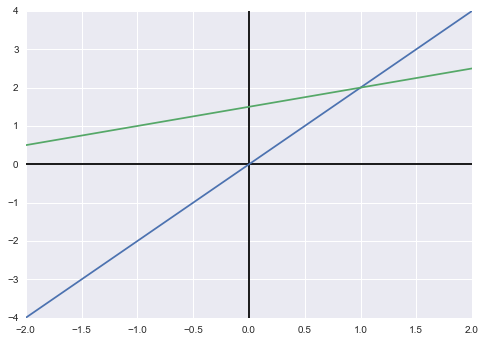
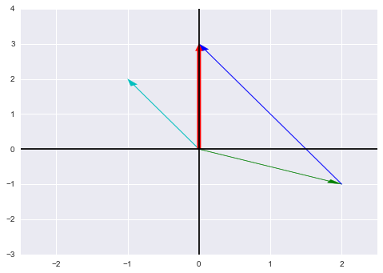
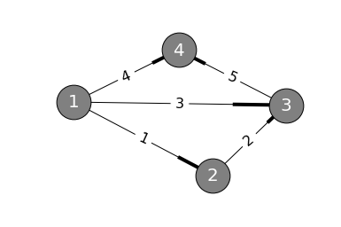
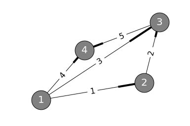
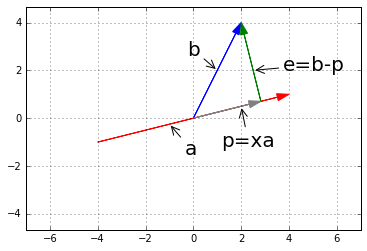
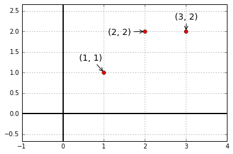
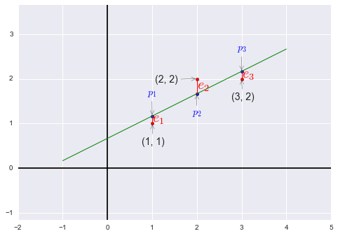
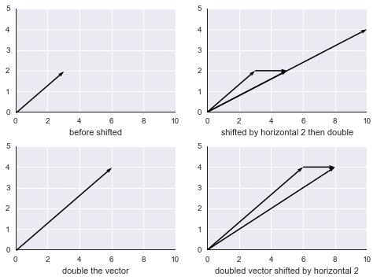
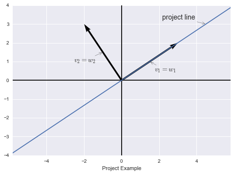
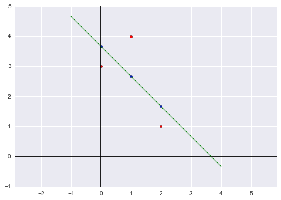

# MIT 18.06 线性代数中文笔记：第 01—35 讲

> **来源与许可说明**
>
> - 原始内容：ApacheCN《MIT 18.06 线性代数笔记》，原笔记作者为子实。
> - 源代码仓库：https://github.com/apachecn/ailearning
> - 在线页面：https://ailearning.apachecn.org/linalg/chapter01/
> - 本地整理日期：2026-08-31。
> - 对应源仓库提交：`26f415083e2354335a3fa9e8ba9d39d8d3ef9a7f`。
> - 许可协议：CC BY-NC-SA 4.0（署名—非商业性使用—相同方式共享）。完整许可文本见 `assets/ApacheCN_MIT18.06线性代数/LICENSE-CC-BY-NC-SA-4.0.txt`。
> - 本文件将第 01—35 讲合并为一个 Markdown 文件，并把图片改为本地相对路径；第四至第六讲补充了逆矩阵、$LU$ 分解、向量空间、列空间和零空间的解释与示例，其余章节保留原文。
> - **注意：该资料不可直接套用本项目根目录的 “All rights reserved” 声明，也不应未经许可用于商业培训、付费出版或其他商业用途。**

## 目录

- [第一讲：方程组的几何解释](#chapter01)
- [第二讲：矩阵消元](#chapter02)
- [第三讲：乘法和逆矩阵](#chapter03)
- [第四讲：$A$ 的 $LU$ 分解](#chapter04)
- [第五讲：转置、置换与向量空间 $\mathbb{R}^n$](#chapter05)
- [第六讲：列空间和零空间](#chapter06)
- [第七讲：求解$Ax=0$，主变量，特解](#chapter07)
- [第八讲：求解$Ax=b$：可解性和解的结构](#chapter08)
- [第九讲：线性相关性、基、维数](#chapter09)
- [第十讲 四个基本子空间](#chapter10)
- [第十一讲：矩阵空间、秩1矩阵和小世界图](#chapter11)
- [第十二讲：图和网络](#chapter12)
- [第十三讲：复习一](#chapter13)
- [第十四讲：正交向量与子空间](#chapter14)
- [第十五讲：子空间投影](#chapter15)
- [第十六讲：投影矩阵和最小二乘](#chapter16)
- [第十七讲：正交矩阵和Gram-Schmidt正交化法](#chapter17)
- [第十八讲：行列式及其性质](#chapter18)
- [第十九讲：行列式公式和代数余子式](#chapter19)
- [第二十讲：克拉默法则、逆矩阵、体积](#chapter20)
- [第二十一讲：特征值和特征向量](#chapter21)
- [第二十二讲：对角化和$A$的幂](#chapter22)
- [第二十三讲：微分方程和$e^{At}$](#chapter23)
- [第二十四讲：马尔科夫矩阵、傅里叶级数](#chapter24)
- [第二十五讲：复习二](#chapter25)
- [第二十六讲：对称矩阵及正定性](#chapter26)
- [第二十七讲：复数矩阵和快速傅里叶变换](#chapter27)
- [第二十八讲：正定矩阵和最小值](#chapter28)
- [第二十九讲：相似矩阵和若尔当形](#chapter29)
- [第三十讲：奇异值分解](#chapter30)
- [第三十一讲：线性变换及对应矩阵](#chapter31)
- [第三十二讲：基变换和图像压缩](#chapter32)
- [第三十三讲：单元检测3复习](#chapter33)
- [第三十四讲：左右逆和伪逆](#chapter34)
- [第三十五讲：期末复习](#chapter35)

---

<a id="chapter01"></a>

## 第一讲：方程组的几何解释

我们从求解线性方程组来开始这门课，从一个普通的例子讲起：方程组有$2$个未知数，一共有$2$个方程，分别来看方程组的“行图像”和“列图像”。

有方程组$\begin{cases}2x&-y&=0\\-x&+2y&=3\end{cases}$，写作矩阵形式有$\begin{bmatrix}2&-1\\-1&2\end{bmatrix}\begin{bmatrix}x\\y\end{bmatrix}=\begin{bmatrix}0\\3\end{bmatrix}$，通常我们把第一个矩阵称为系数矩阵$A$，将第二个矩阵称为向量$x$，将第三个矩阵称为向量$b$，于是线性方程组可以表示为$Ax=b$。

我们来看行图像，即直角坐标系中的图像：


```python
%matplotlib inline
import matplotlib.pyplot as plt
import numpy as np
import pandas as pd
import seaborn as sns

x = [-2, 2, -2, 2]
y = [-4, 4, 0.5, 2.5]

fig = plt.figure()
plt.axhline(y=0, c='black')
plt.axvline(x=0, c='black')

plt.plot(x[:2], y[:2], x[2:], y[2:])

plt.draw()
```





```python
plt.close(fig)
```

上图是我们都很熟悉的直角坐标系中两直线相交的情况，接下来我们按列观察方程组$x\begin{bmatrix}2\\-1\end{bmatrix}+y\begin{bmatrix}-1\\2\end{bmatrix}=\begin{bmatrix}0\\3\end{bmatrix}$（我们把第一个向量称作$col_1$，第二个向量称作$col_2$，以表示第一列向量和第二列向量），要使得式子成立，需要第一个向量加上两倍的第二个向量，即$1\begin{bmatrix}2\\-1\end{bmatrix}+2\begin{bmatrix}-1\\2\end{bmatrix}=\begin{bmatrix}0\\3\end{bmatrix}$。

现在来看列图像，在二维平面上画出上面的列向量：


```python
from functools import partial

fig = plt.figure()
plt.axhline(y=0, c='black')
plt.axvline(x=0, c='black')
ax = plt.gca()
ax.set_xlim(-2.5, 2.5)
ax.set_ylim(-3, 4)

arrow_vector = partial(plt.arrow, width=0.01, head_width=0.1, head_length=0.2, length_includes_head=True)

arrow_vector(0, 0, 2, -1, color='g')
arrow_vector(0, 0, -1, 2, color='c')
arrow_vector(2, -1, -2, 4, color='b')
arrow_vector(0, 0, 0, 3, width=0.05, color='r')

plt.draw()
```





```python
plt.close(fig)
```

如图，绿向量$col_1$与蓝向量（两倍的蓝绿向量$col_2$）合成红向量$b$。

接着，我们继续观察$x\begin{bmatrix}2\\-1\end{bmatrix}+y\begin{bmatrix}-1\\2\end{bmatrix}=\begin{bmatrix}0\\3\end{bmatrix}$，$col_1,col_2$的某种线性组合得到了向量$b$，那么$col_1,col_2$的所有线性组合能够得到什么结果？它们将铺满整个平面。

下面进入三个未知数的方程组：$\begin{cases}2x&-y&&=0\\-x&+2y&-z&=-1\\&-3y&+4z&=4\end{cases}$，写作矩阵形式$A=\begin{bmatrix}2&-1&0\\-1&2&-1\\0&-3&4\end{bmatrix},\ b=\begin{bmatrix}0\\-1\\4\end{bmatrix}$。

在三维直角坐标系中，每一个方程将确定一个平面，而例子中的三个平面会相交于一点，这个点就是方程组的解。

同样的，将方程组写成列向量的线性组合，观察列图像：$x\begin{bmatrix}2\\-1\\0\end{bmatrix}+y\begin{bmatrix}-1\\2\\-3\end{bmatrix}+z\begin{bmatrix}0\\-1\\4\end{bmatrix}=\begin{bmatrix}0\\-1\\4\end{bmatrix}$。易知教授特意安排的例子中最后一个列向量恰巧等于等式右边的$b$向量，所以我们需要的线性组合为$x=0,y=0,z=1$。假设我们令$b=\begin{bmatrix}1\\1\\-3\end{bmatrix}$，则需要的线性组合为$x=1,y=1,z=0$。

我们并不能总是这么轻易的求出正确的线性组合，所以下一讲将介绍消元法——一种线性方程组的系统性解法。

现在，我们需要考虑，对于任意的$b$，是否都能求解$Ax=b$？用列向量线性组合的观点阐述就是，列向量的线性组合能否覆盖整个三维向量空间？对上面这个例子，答案是肯定的，这个例子中的$A$是我们喜欢的矩阵类型，但是对另一些矩阵，答案是否定的。那么在什么情况下，三个向量的线性组合得不到$b$？

——如果三个向量在同一个平面上，问题就出现了——那么他们的线性组合也一定都在这个平面上。举个例子，比如$col_3=col_1+col_2$，那么不管怎么组合，这三个向量的结果都逃不出这个平面，因此当$b$在平面内，方程组有解，而当$b$不在平面内，这三个列向量就无法构造出$b$。在后面的课程中，我们会了解到这种情形称为**奇异**、**矩阵不可逆**。

下面我们推广到九维空间，每个方程有九个未知数，共九个方程，此时已经无法从坐标图像中描述问题了，但是我们依然可以从求九维列向量线性组合的角度解决问题，仍然是上面的问题，是否总能得到$b$？当然这仍取决于这九个向量，如果我们取一些并不相互独立的向量，则答案是否定的，比如取了九列但其实只相当于八列，有一列毫无贡献（这一列是前面列的某种线性组合），则会有一部分$b$无法求得。

接下来介绍方程的矩阵形式$Ax=b$，这是一种乘法运算，举个例子，取$A=\begin{bmatrix}2&5\\1&3\end{bmatrix},\ x=\begin{bmatrix}1\\2\end{bmatrix}$，来看如何计算矩阵乘以向量：

* 我们依然使用列向量线性组合的方式，一次计算一列，$\begin{bmatrix}2&5\\1&3\end{bmatrix}\begin{bmatrix}1\\2\end{bmatrix}=1\begin{bmatrix}2\\1\end{bmatrix}+2\begin{bmatrix}5\\3\end{bmatrix}=\begin{bmatrix}12\\7\end{bmatrix}$
* 另一种方法，使用向量内积，矩阵第一行向量点乘$x$向量$\begin{bmatrix}2&5\end{bmatrix}\cdot\begin{bmatrix}1&2\end{bmatrix}^T=12,\ \begin{bmatrix}1&3\end{bmatrix}\cdot\begin{bmatrix}1&2\end{bmatrix}^T=7$。

教授建议使用第一种方法，将$Ax$看做$A$列向量的线性组合。

---

<a id="chapter02"></a>

## 第二讲：矩阵消元

这个方法最早由高斯提出，我们以前解方程组的时候都会使用，现在来看如何使用矩阵实现消元法。

### 消元法

有三元方程组$\begin{cases}x&+2y&+z&=2\\3x&+8y&+z&=12\\&4y&+z&=2\end{cases}$，对应的矩阵形式$Ax=b$为$\begin{bmatrix}1&2&1\\3&8&1\\0&4&1\end{bmatrix}\begin{bmatrix}x\\y\\z\end{bmatrix}=\begin{bmatrix}2\\12\\2\end{bmatrix}$。

按照我们以前做消元法的思路：

* 第一步，我们希望在第二个方程中消去$x$项，来操作系数矩阵$A=\begin{bmatrix}\underline{1}&2&1\\3&8&1\\0&4&1\end{bmatrix}$，下划线的元素为第一步的主元（pivot）：$\begin{bmatrix}\underline{1}&2&1\\3&8&1\\0&4&1\end{bmatrix}\xrightarrow{row_2-3row_1}\begin{bmatrix}\underline{1}&2&1\\0&2&-2\\0&4&1\end{bmatrix}$

    这里我们先不管$b$向量，等做完$A$的消元可以再做$b$的消元。（这是MATLAB等工具经常使用的算法。）
* 第二步，我们希望在第三个方程中消去$y$项，现在第二行第一个非零元素成为了第二个主元：$\begin{bmatrix}\underline{1}&2&1\\0&\underline{2}&-2\\0&4&1\end{bmatrix}\xrightarrow{row_3-2row_2}\begin{bmatrix}\underline{1}&2&1\\0&\underline{2}&-2\\0&0&\underline{5}\end{bmatrix}$
    
    注意到第三行消元过后仅剩一个非零元素，所以它就成为第三个主元。做到这里就算消元完成了。

再来讨论一下消元失效的情形：首先，主元不能为零；其次，如果在消元时遇到主元位置为零，则需要交换行，使主元不为零；最后提一下，如果我们把第三个方程$z$前的系数改成$-4$，会导致第二步消元时最后一行全部为零，则第三个主元就不存在了，至此消元不能继续进行了，这就是下一讲中涉及的不可逆情况。

* 接下来就该回代（back substitution）了，这时我们在$A$矩阵后面加上$b$向量写成增广矩阵（augmented matrix）的形式：$\left[\begin{array}{c|c}A&b\end{array}\right]=\left[\begin{array}{ccc|c}1&2&1&2\\3&8&1&12\\0&4&1&2\end{array}\right]\to\left[\begin{array}{ccc|c}1&2&1&2\\0&2&-2&6\\0&4&1&2\end{array}\right]\to\left[\begin{array}{ccc|c}1&2&1&2\\0&2&-2&6\\0&0&5&-10\end{array}\right]$

    不难看出，$z$的解已经出现了，此时方程组变为$\begin{cases}x&+2y&+z&=2\\&2y&-2z&=6\\&&5z&=-10\end{cases}$，从第三个方程求出$z=-2$，代入第二个方程求出$y=1$，再代入第一个方程求出$x=2$。

### 消元矩阵

上一讲我们学习了矩阵乘以向量的方法，有三个列向量的矩阵乘以另一个向量，按列的线性组合可以写作$\Bigg[v_1\ v_2\ v_3\Bigg]\begin{bmatrix}3\\4\\5\end{bmatrix}=3v_1+4v_2+5v_3$。

但现在我们希望用矩阵乘法表示行操作，则有$\begin{bmatrix}1&2&7\end{bmatrix}\begin{bmatrix}&row_1&\\&row_2&\\&row_3&\end{bmatrix}=1row_1+2row_2+7row_3$。易看出这里是一个行向量从左边乘以矩阵，这个行向量按行操作矩阵的行向量，并将其合成为一个矩阵行向量的线性组合。

介绍到这里，我们就可以将消元法所做的行操作写成向量乘以矩阵的形式了。

* 消元法第一步操作为将第二行改成$row_2-3row_1$，其余两行不变，则有$\begin{bmatrix}1&0&0\\-3&1&0\\0&0&1\end{bmatrix}\begin{bmatrix}1&2&1\\3&8&1\\0&4&1\end{bmatrix}=\begin{bmatrix}1&2&1\\0&2&-2\\0&4&1\end{bmatrix}$（另外，如果三行都不变，消元矩阵就是单位矩阵$I=\begin{bmatrix}1&0&0\\0&1&0\\0&0&1\end{bmatrix}$，$I$之于矩阵运算相当于$1$之于四则运算。）这个消元矩阵我们记作$E_{21}$，即将第二行第一个元素变为零。

* 接下来就是求$E_{32}$消元矩阵了，即将第三行第二个元素变为零，则$\begin{bmatrix}1&0&0\\0&1&0\\0&-2&1\end{bmatrix}\begin{bmatrix}1&2&1\\0&2&-2\\0&4&1\end{bmatrix}=\begin{bmatrix}1&2&1\\0&2&-2\\0&0&5\end{bmatrix}$。这就是消元所用的两个初等矩阵（elementary matrix）。

* 最后，我们将这两步综合起来，即$E_{32}(E_{21}A)=U$，也就是说如果我们想从$A$矩阵直接得到$U$矩阵的话，只需要$(E_{32}E_{21})A$即可。注意，矩阵乘法虽然不能随意变动相乘次序，但是可以变动括号位置，也就是满足结合律（associative law），而结合律在矩阵运算中非常重要，很多定理的证明都需要巧妙的使用结合律。

既然提到了消元用的初等矩阵，那我们再介绍一种用于置换两行的矩阵：置换矩阵（permutation matrix）：例如$\begin{bmatrix}0&1\\1&0\end{bmatrix}\begin{bmatrix}a&b\\c&d\end{bmatrix}=\begin{bmatrix}c&d\\a&b\end{bmatrix}$，置换矩阵将原矩阵的两行做了互换。顺便提一下，如果我们希望交换两列，则有$\begin{bmatrix}a&b\\c&d\end{bmatrix}\begin{bmatrix}0&1\\1&0\end{bmatrix}=\begin{bmatrix}b&a\\d&c\end{bmatrix}$。

我们现在能够将$A$通过行变换写成$U$，那么如何从$U$再变回$A$，也就是求消元的逆运算。对某些“坏”矩阵，并没有逆，而本讲的例子都是“好”矩阵。

### 逆

现在，我们以$E_{21}$为例，$\Bigg[\quad ?\quad \Bigg]\begin{bmatrix}1&0&0\\-3&1&0\\0&0&1\end{bmatrix}=\begin{bmatrix}1&0&0\\0&1&0\\0&0&1\end{bmatrix}$，什么矩阵可以取消这次行变换？这次变换是从第二行中减去三倍的第一行，那么其逆变换就是给第二行加上三倍的第一行，所以逆矩阵就是$\begin{bmatrix}1&0&0\\3&1&0\\0&0&1\end{bmatrix}$。

我们把矩阵$E$的逆记作$E^{-1}$，所以有$E^{-1}E=I$。

---

<a id="chapter03"></a>

## 第三讲：乘法和逆矩阵

上一讲大概介绍了矩阵乘法和逆矩阵，本讲就来做进一步说明。

### 矩阵乘法

* 行列内积：有$m\times n$矩阵$A$和$n\times p$矩阵$B$（$A$的总列数必须与$B$的总行数相等），两矩阵相乘有$AB=C$，$C$是一个$m\times p$矩阵，对于$C$矩阵中的第$i$行第$j$列元素$c_{ij}$，有：

    $$c_{ij}=row_i\cdot column_j=\sum_{k=i}^na_{ik}b_{kj}$$

    其中$a_{ik}$是$A$矩阵的第$i$行第$k$列元素，$b_{kj}$是$B$矩阵的第$k$行第$j$列元素。

    可以看出$c_{ij}$其实是$A$矩阵第$i$行点乘$B$矩阵第$j$列 $\begin{bmatrix}&\vdots&\\&row_i&\\&\vdots&\end{bmatrix}\begin{bmatrix}&&\\\cdots&column_j&\cdots\\&&\end{bmatrix}=\begin{bmatrix}&\vdots&\\\cdots&c_{ij}&\cdots\\&\vdots&\end{bmatrix}$

* 整列相乘：上一讲我们知道了如何计算矩阵乘以向量，而整列相乘就是使用这种线性组合的思想：

    $\begin{bmatrix}&&\\A_{col1}&A_{col2}&\cdots&A_{coln}\\&&\end{bmatrix}\begin{bmatrix}\cdots&b_{1j}&\cdots\\\cdots&b_{2j}&\cdots\\\cdots&\vdots&\cdots\\\cdots&b_{nj}&\cdots\\\end{bmatrix}=\begin{bmatrix}&&\\\cdots&\left(b_{1j}A_{col1}+b_{2j}A_{col2}+\cdots+b_{nj}A_{coln}\right)&\cdots\\&&\end{bmatrix}$
    
    上面的运算为$B$的第$j$个列向量右乘矩阵$A$，求得的结果就是$C$矩阵的第$j$列，即$C$的第$j$列是$A$的列向量以$B$的第$j$列作为系数所求得的线性组合，$C_j=b_{1j}A_{col1}+b_{2j}A_{col2}+\cdots+b_{nj}A_{coln}$。

* 整行相乘：同样的，也是利用行向量线性组合的思想：
    
    $\begin{bmatrix}\vdots&\vdots&\vdots&\vdots\\a_{i1}&a_{i2}&\cdots&a_{in}\\\vdots&\vdots&\vdots&\vdots\end{bmatrix}\begin{bmatrix}&B_{row1}&\\&B_{row2}&\\&\vdots&\\&B_{rown}&\end{bmatrix}=\begin{bmatrix}\vdots\\\left(a_{i1}B_{row1}+a_{i2}B_{row2}+\cdots+a_{in}B_{rown}\right)\\\vdots\end{bmatrix}$
    
    上面的运算为$A$的第$i$个行向量左乘矩阵$B$，求得的结果就是$C$矩阵的第$i$行，即$C$的第$i$行是$B$的行向量以$A$的第$i$行作为系数所求的的线性组合，$C_i=a_{i1}B_{row1}+a_{i2}B_{row2}+\cdots+a_{in}B_{rown}$。

* 列乘以行：用$A$矩阵的列乘以$B$矩阵的行，得到的矩阵相加即可：
    
    $\begin{bmatrix}&&\\A_{col1}&A_{col2}&\cdots&A_{coln}\\&&\end{bmatrix}\begin{bmatrix}&B_{row1}&\\&B_{row2}&\\&\vdots&\\&B_{rown}&\end{bmatrix}=A_{col1}B_{row1}+A_{col2}B_{row2}+\cdots+A_{coln}B_{rown}$
    
    注意，$A_{coli}B_{rowi}$是一个$m\times 1$向量乘以一个$1\times p$向量，其结果是一个$m\times p$矩阵，而所有的$m\times p$矩阵之和就是计算结果。

* 分块乘法：$\left[\begin{array}{c|c}A_1&A_2\\\hline A_3&A_4\end{array}\right]\left[\begin{array}{c|c}B_1&B_2\\\hline B_3&B_4\end{array}\right]=\left[\begin{array}{c|c}A_1B_1+A_2B_3&A_1B_2+A_2B_4\\\hline A_3B_1+A_4B_3&A_3B_2+A_4B_4\end{array}\right]$

    在分块合适的情况下，可以简化运算。

### 逆（方阵）

首先，并不是所有的方阵都有逆；而如果逆存在，则有$A^{-1}A=I=AA^{-1}$。教授这里提前剧透，对于方阵，左逆和右逆是相等的，但是对于非方阵（长方形矩阵），其左逆不等于右逆。

对于这些有逆的矩阵，我们称其为可逆的或非奇异的。我们先来看看奇异矩阵（不可逆的）：$A=\begin{bmatrix}1&2\\3&6\end{bmatrix}$，在后面将要学习的行列式中，会发现这个矩阵的行列式为$0$。

观察这个方阵，我们如果用另一个矩阵乘$A$，则得到的结果矩阵中的每一列应该都是$\begin{bmatrix}1\\2\end{bmatrix}$的倍数，所以我们不可能从$AB$的乘积中得到单位矩阵$I$。

另一种判定方法，如果存在非零向量$x$，使得$Ax=0$，则矩阵$A$不可逆。我们来用上面的矩阵为例：$\begin{bmatrix}1&2\\3&6\end{bmatrix}\begin{bmatrix}3\\-1\end{bmatrix}=\begin{bmatrix}0\\0\end{bmatrix}$。

证明：如果对于非零的$x$仍有$Ax=0$，而$A$有逆$A^{-1}$，则$A^{-1}Ax=0$，即$x=0$，与题设矛盾，得证。

现在来看看什么矩阵有逆，设$A=\begin{bmatrix}1&3\\2&7\end{bmatrix}$，我们来求$A^{-1}$。$\begin{bmatrix}1&3\\2&7\end{bmatrix}\begin{bmatrix}a&b\\c&d\end{bmatrix}=\begin{bmatrix}1&0\\0&1\end{bmatrix}$，使用列向量线性组合的思想，我们可以说$A$乘以$A^{-1}$的第$j$列，能够得到$I$的第$j$列，这时我会得到一个关于列的方程组。

接下来介绍高斯-若尔当（Gauss-Jordan）方法，该方法可以一次处理所有的方程：

* 这个方程组为$\begin{cases}\begin{bmatrix}1&3\\2&7\end{bmatrix}\begin{bmatrix}a\\b\end{bmatrix}=\begin{bmatrix}1\\0\end{bmatrix}\\\begin{bmatrix}1&3\\2&7\end{bmatrix}\begin{bmatrix}c\\d\end{bmatrix}=\begin{bmatrix}0\\1\end{bmatrix}\end{cases}$，我们想要同时解这两个方程；

* 构造这样一个矩阵$\left[\begin{array}{cc|cc}1&3&1&0\\2&7&0&1\end{array}\right]$，接下来用消元法将左侧变为单位矩阵；
* $\left[\begin{array}{cc|cc}1&3&1&0\\2&7&0&1\end{array}\right]\xrightarrow{row_2-2row_1}\left[\begin{array}{cc|cc}1&3&1&0\\0&1&-2&1\end{array}\right]\xrightarrow{row_1-3row_2}\left[\begin{array}{cc|cc}1&0&7&-3\\0&1&-2&1\end{array}\right]$
* 于是，我们就将矩阵从$\left[\begin{array}{c|c}A&I\end{array}\right]$变为$\left[\begin{array}{c|c}I&A^{-1}\end{array}\right]$

而高斯-若尔当法的本质是使用消元矩阵$E$，对$A$进行操作，$E\left[\begin{array}{c|c}A&I\end{array}\right]$，利用一步步消元有$EA=I$，进而得到$\left[\begin{array}{c|c}I&E\end{array}\right]$，其实这个消元矩阵$E$就是$A^{-1}$，而高斯-若尔当法中的$I$只是负责记录消元的每一步操作，待消元完成，逆矩阵就自然出现了。

---

<a id="chapter04"></a>

## 第四讲：$A$ 的 $LU$ 分解

### 逆矩阵表示“撤销变换”

如果方阵 $A$ 可逆，那么存在 $A^{-1}$，使得：

$$
AA^{-1}=A^{-1}A=I
$$

其中 $I$ 是单位矩阵。可以把 $A^{-1}$ 理解为撤销 $A$ 所完成的变换：

```text
x  --经过 A-->  Ax  --经过 A⁻¹-->  x
```

例如 $Ax=b$，在等式两边左乘 $A^{-1}$：

$$
A^{-1}Ax=A^{-1}b
$$

得到：

$$
x=A^{-1}b
$$

### $AB$ 的逆矩阵为什么要反过来写

设：

$$
y=ABx
$$

矩阵乘法从右向左执行，所以 $ABx$ 表示先用 $B$ 变换 $x$，再用 $A$ 变换结果：

```text
x  --先经过 B-->  Bx  --再经过 A-->  ABx=y
```

要从 $y$ 恢复 $x$，必须按照相反顺序撤销：先用 $A^{-1}$ 撤销 $A$，再用 $B^{-1}$ 撤销 $B$。

```text
y  --先经过 A⁻¹-->  Bx  --再经过 B⁻¹-->  x
```

因此：

$$
\boxed{(AB)^{-1}=B^{-1}A^{-1}}
$$

可以直接验证：

$$
\begin{aligned}
(AB)(B^{-1}A^{-1})
&=A(BB^{-1})A^{-1}\\
&=AIA^{-1}\\
&=I
\end{aligned}
$$

顺序不能随意写成 $A^{-1}B^{-1}$，因为矩阵乘法通常不满足交换律：

$$
AB\ne BA
$$

#### 一个具体例子

设：

$$
A=
\begin{bmatrix}
1&1\\
0&1
\end{bmatrix},
\qquad
B=
\begin{bmatrix}
2&0\\
0&1
\end{bmatrix}
$$

则：

$$
A^{-1}=
\begin{bmatrix}
1&-1\\
0&1
\end{bmatrix},
\qquad
B^{-1}=
\begin{bmatrix}
\frac12&0\\
0&1
\end{bmatrix}
$$

先计算：

$$
AB=
\begin{bmatrix}
2&1\\
0&1
\end{bmatrix}
$$

再按照相反顺序计算：

$$
B^{-1}A^{-1}
=
\begin{bmatrix}
\frac12&-\frac12\\
0&1
\end{bmatrix}
$$

验证可得：

$$
(AB)(B^{-1}A^{-1})=I
$$

### $A^T$ 的逆矩阵

下面两个式子的计算顺序不同：

- $(A^T)^{-1}$：先将 $A$ 转置，再求逆矩阵；
- $(A^{-1})^T$：先求 $A$ 的逆矩阵，再进行转置。

但二者的结果相同：

$$
\boxed{(A^T)^{-1}=(A^{-1})^T}
$$

推导时需要使用乘积转置公式：

$$
(AB)^T=B^TA^T
$$

从逆矩阵的定义出发：

$$
AA^{-1}=I
$$

等式两边同时转置：

$$
(AA^{-1})^T=I^T
$$

乘积转置需要反转顺序，并且 $I^T=I$，所以：

$$
(A^{-1})^TA^T=I
$$

同样，从 $A^{-1}A=I$ 可以得到：

$$
A^T(A^{-1})^T=I
$$

因此，$(A^{-1})^T$ 正是 $A^T$ 的逆矩阵：

$$
(A^T)^{-1}=(A^{-1})^T
$$

### 什么是 $LU$ 分解

$LU$ 分解是把一个矩阵 $A$ 写成两个三角矩阵的乘积：

$$
\boxed{A=LU}
$$

其中：

- $L$ 来自 Lower Triangular Matrix，表示**下三角矩阵**；
- $U$ 来自 Upper Triangular Matrix，表示**上三角矩阵**。

三阶矩阵通常写成：

$$
L=
\begin{bmatrix}
1&0&0\\
\ell_{21}&1&0\\
\ell_{31}&\ell_{32}&1
\end{bmatrix},
\qquad
U=
\begin{bmatrix}
u_{11}&u_{12}&u_{13}\\
0&u_{22}&u_{23}\\
0&0&u_{33}
\end{bmatrix}
$$

这里采用对角线为 $1$ 的 $L$。不同教材或软件也可能采用其他约定，但矩阵必须明确哪些数放入 $L$、哪些数放入 $U$。

#### $U$ 是消元后的结果

高斯消元不断把主元下面的元素消成 $0$。消元完成后得到的上三角矩阵，就是 $U$。

```text
一般矩阵 A  --高斯消元-->  上三角矩阵 U
```

#### $L$ 记录消元时使用的乘数

假设为了消去第 $j$ 列的 $a_{ij}$，进行行变换：

$$
R_i\leftarrow R_i-m_{ij}R_j
$$

其中：

$$
m_{ij}=\frac{a_{ij}}{a_{jj}}
$$

这个 $m_{ij}$ 就是消元乘数。$L$ 把这些消元乘数按位置记录在主对角线下方：

$$
L=
\begin{bmatrix}
1&0&0\\
m_{21}&1&0\\
m_{31}&m_{32}&1
\end{bmatrix}
$$

需要注意：行变换中使用的是“减去 $m_{ij}$ 倍”，但 $L$ 中记录的是 $m_{ij}$ 本身，而不是 $-m_{ij}$。

### 一个完整的 $LU$ 分解例子

设：

$$
A=
\begin{bmatrix}
2&1&1\\
4&-6&0\\
-2&7&2
\end{bmatrix}
$$

#### 第一步：消去第一列主元下面的元素

第一行的主元是 $2$。

消去第二行的 $4$：

$$
m_{21}=\frac{4}{2}=2
$$

执行：

$$
R_2\leftarrow R_2-2R_1
$$

得到：

$$
R_2=[0,-8,-2]
$$

消去第三行的 $-2$：

$$
m_{31}=\frac{-2}{2}=-1
$$

执行：

$$
R_3\leftarrow R_3-(-1)R_1=R_3+R_1
$$

得到：

$$
R_3=[0,8,3]
$$

此时矩阵变成：

$$
\begin{bmatrix}
2&1&1\\
0&-8&-2\\
0&8&3
\end{bmatrix}
$$

#### 第二步：消去第二列主元下面的元素

第二个主元是 $-8$：

$$
m_{32}=\frac{8}{-8}=-1
$$

执行：

$$
R_3\leftarrow R_3-(-1)R_2=R_3+R_2
$$

得到：

$$
R_3=[0,0,1]
$$

最终的上三角矩阵为：

$$
U=
\begin{bmatrix}
2&1&1\\
0&-8&-2\\
0&0&1
\end{bmatrix}
$$

把三个消元乘数 $m_{21}=2$、$m_{31}=-1$、$m_{32}=-1$ 放入 $L$：

$$
L=
\begin{bmatrix}
1&0&0\\
2&1&0\\
-1&-1&1
\end{bmatrix}
$$

因此：

$$
\boxed{
A=LU=
\begin{bmatrix}
1&0&0\\
2&1&0\\
-1&-1&1
\end{bmatrix}
\begin{bmatrix}
2&1&1\\
0&-8&-2\\
0&0&1
\end{bmatrix}}
$$

将 $L$ 与 $U$ 相乘，就会重新得到原矩阵 $A$。

### 从消元矩阵理解 $A=LU$

每一次行消元都可以写成左乘一个消元矩阵。假设三次消元分别使用 $E_{21}$、$E_{31}$、$E_{32}$，那么：

$$
E_{32}E_{31}E_{21}A=U
$$

要还原 $A$，需要撤销这些消元操作：

$$
A=(E_{32}E_{31}E_{21})^{-1}U
$$

利用乘积求逆时顺序相反：

$$
(E_{32}E_{31}E_{21})^{-1}
=E_{21}^{-1}E_{31}^{-1}E_{32}^{-1}
$$

把撤销消元的矩阵乘积定义为 $L$：

$$
L=E_{21}^{-1}E_{31}^{-1}E_{32}^{-1}
$$

于是：

$$
\boxed{A=LU}
$$

这也说明了本讲为什么先介绍 $(AB)^{-1}=B^{-1}A^{-1}$：从消元结果 $U$ 恢复 $A$ 时，必须按照相反顺序撤销消元操作。

### $LU$ 分解有什么用

要求解：

$$
Ax=b
$$

如果已经得到 $A=LU$，则：

$$
LUx=b
$$

可以引入中间变量：

$$
y=Ux
$$

原方程分成两步：

1. 先用前向代入求解下三角方程 $Ly=b$；
2. 再用回代求解上三角方程 $Ux=y$。

```text
Ax=b
 ↓  A=LU
LUx=b
 ↓  令 Ux=y
Ly=b  --前向代入-->  y
Ux=y  --回代------>  x
```

当同一个 $A$ 对应很多个不同的 $b$ 时，只需要分解一次 $A$，之后重复进行前向代入和回代，比每次重新执行完整消元更高效。

### $LU$ 分解的计算量

将一个 $n$ 阶方阵 $A$ 消元为 $U$：

1. 第一步将 $a_{11}$ 作为主元，更新其右下方矩阵，运算量约为 $n^2$；
2. 后续各步的运算量依次约为 $(n-1)^2,(n-2)^2,\ldots,2^2,1^2$；
3. 总运算量约为：

$$
1^2+2^2+\cdots+n^2
=\frac{n(n+1)(2n+1)}{6}
$$

因此最高阶约为：

$$
\boxed{\frac{n^3}{3}}
$$

通常记为：

$$
O(n^3)
$$

完成分解后，每次使用前向代入和回代求解的计算量约为 $O(n^2)$。

### 什么时候需要置换矩阵 $P$

并不是所有矩阵都能在完全不换行的情况下直接完成 $A=LU$。如果某一步主元是 $0$，或者主元的绝对值太小，通常需要交换矩阵的行。

置换矩阵 $P$ 是由单位矩阵交换行得到的矩阵。左乘 $P$ 相当于交换 $A$ 的行：

$$
PA=LU
$$

例如：

$$
P=
\begin{bmatrix}
0&1\\
1&0
\end{bmatrix}
$$

左乘这个 $P$ 会交换矩阵的第一行和第二行。

三阶方阵共有：

$$
3!=6
$$

个置换矩阵；一般地，$n$ 阶方阵共有：

$$
\boxed{n!}
$$

个置换矩阵。

在实际数值计算中，更常见的形式是带有选主元的：

$$
\boxed{PA=LU}
$$

其中 $P$ 记录换行，$L$ 记录消元乘数，$U$ 是消元后得到的上三角矩阵。

---


<a id="chapter05"></a>

## 第五讲：转置、置换与向量空间 $\mathbb{R}^n$

上一讲把高斯消元写成了 $A=LU$。如果消元过程中需要交换行，就要使用置换矩阵 $P$；研究矩阵的行和列如何互换，则需要转置矩阵；而矩阵的列、输入 $x$ 和输出 $Ax$ 都是向量，因此还需要进一步研究“哪些向量的集合能够稳定地进行线性运算”。这些概念共同引出向量空间。

### 置换矩阵：用矩阵表示换行

置换矩阵是由单位矩阵交换行得到的矩阵。例如：

$$
P=
\begin{bmatrix}
0&1&0\\
1&0&0\\
0&0&1
\end{bmatrix}
$$

它由三阶单位矩阵交换第一行和第二行得到。

如果左乘矩阵 $A$：

$$
PA
$$

结果就是交换 $A$ 的第一行和第二行。一般规律是：

- $PA$：按照 $P$ 的方式重新排列 $A$ 的行；
- $AP$：按照 $P$ 的方式重新排列 $A$ 的列。

左乘影响行，右乘影响列。

#### 置换矩阵的逆矩阵

置换操作一定可以撤销。例如，交换第一行和第二行之后，再交换一次，就会回到原矩阵。

置换矩阵的每一行、每一列都恰好有一个 $1$，其余元素都是 $0$。它的列向量是按照某种顺序排列的标准基向量，因此：

$$
P^TP=I
$$

所以：

$$
\boxed{P^{-1}=P^T}
$$

这里不能理解为所有矩阵的逆都等于转置。$P^{-1}=P^T$ 是置换矩阵所具有的特殊性质。

$n$ 个位置可以按照 $n!$ 种顺序重新排列，因此 $n$ 阶置换矩阵共有：

$$
\boxed{n!}
$$

个。

#### 置换矩阵与 $LU$ 分解

如果消元过程不需要交换行，可以写成：

$$
A=LU
$$

如果消元过程中需要交换行，通常写成：

$$
\boxed{PA=LU}
$$

其中：

- $P$ 记录行交换；
- $L$ 记录消元乘数；
- $U$ 是消元得到的上三角矩阵。

### 转置矩阵：交换行和列

设 $A$ 是一个 $m\times n$ 矩阵。把 $A$ 的行变成列、列变成行，就得到转置矩阵 $A^T$。因此 $A^T$ 的形状是 $n\times m$。

如果：

$$
A=
\begin{bmatrix}
1&2&3\\
4&5&6
\end{bmatrix}
$$

那么：

$$
A^T=
\begin{bmatrix}
1&4\\
2&5\\
3&6
\end{bmatrix}
$$

按照元素位置表示：

$$
(A^T)_{ij}=A_{ji}
$$

也就是原矩阵第 $j$ 行、第 $i$ 列的元素，变成转置矩阵第 $i$ 行、第 $j$ 列的元素。

#### 转置的常用性质

$$
(A^T)^T=A
$$

$$
(A+B)^T=A^T+B^T
$$

$$
(cA)^T=cA^T
$$

乘积的转置需要反转顺序：

$$
\boxed{(AB)^T=B^TA^T}
$$

如果 $A$ 可逆，则上一讲已经得到：

$$
\boxed{(A^T)^{-1}=(A^{-1})^T}
$$

### 对称矩阵

如果一个方阵满足：

$$
A^T=A
$$

就称 $A$ 为对称矩阵。例如：

$$
A=
\begin{bmatrix}
2&3\\
3&5
\end{bmatrix}
$$

主对角线两侧对应位置的元素相等，因此转置后矩阵不变。

对任意实矩阵 $R$，$R^TR$ 一定是对称矩阵：

$$
\begin{aligned}
(R^TR)^T
&=R^T(R^T)^T\\
&=R^TR
\end{aligned}
$$

同理，$RR^T$ 也是对称矩阵。

$R^TR$ 还满足：

$$
x^TR^TRx=(Rx)^T(Rx)=\|Rx\|^2\ge 0
$$

这个性质将在最小二乘、协方差矩阵和机器学习优化中反复出现。

### 从向量到向量空间

此前使用过许多向量，例如：

$$
\begin{bmatrix}x_1\\x_2\end{bmatrix},
\qquad
\begin{bmatrix}x_1\\x_2\\x_3\end{bmatrix}
$$

但线性代数不仅研究单个向量，还研究一整组向量能否在加法和数乘之下保持稳定。

例如，二维平面中所有位于直线 $y=2x$ 上的向量可以写成：

$$
\begin{bmatrix}x\\2x\end{bmatrix}
=x
\begin{bmatrix}1\\2\end{bmatrix}
$$

任取这条直线上的两个向量，把它们相加，结果仍在这条直线上；把其中一个向量乘任意实数，结果也仍在这条直线上。这种对线性运算保持封闭的集合，就是向量空间或向量子空间。

### 什么是 $\mathbb{R}^n$

$\mathbb{R}$ 表示全体实数，$\mathbb{R}^n$ 表示由 $n$ 个实数组成的所有列向量：

$$
\mathbb{R}^n=
\left\{
\begin{bmatrix}
x_1\\x_2\\\vdots\\x_n
\end{bmatrix}
:x_1,x_2,\ldots,x_n\in\mathbb{R}
\right\}
$$

例如：

- $\mathbb{R}^1$：数轴上的所有实数；
- $\mathbb{R}^2$：二维平面中的所有向量；
- $\mathbb{R}^3$：三维空间中的所有向量；
- $\mathbb{R}^4$：由四个实数组成的所有向量，虽然难以画出来，但运算规则与 $\mathbb{R}^2$、$\mathbb{R}^3$ 完全一致。

### 向量子空间需要满足什么条件

设 $S$ 是 $\mathbb{R}^n$ 的一个子集。如果 $S$ 要成为向量子空间，需要满足：

1. 包含零向量；
2. 对向量加法封闭；
3. 对实数数乘封闭。

也可以合并成一个判断条件：如果对任意 $u,v\in S$ 和任意实数 $c,d$，都有：

$$
cu+dv\in S
$$

那么 $S$ 是一个向量子空间。

#### 为什么一定要包含零向量

只要 $S$ 中有向量 $v$，根据数乘封闭性：

$$
0v=0
$$

所以零向量必须属于 $S$。几何上，这意味着作为子空间的直线和平面必须经过原点。

### 子空间与非子空间的例子

#### 经过原点的直线是子空间

$$
S=
\left\{
\begin{bmatrix}x\\2x\end{bmatrix}:x\in\mathbb{R}
\right\}
$$

它包含零向量，并且对加法、数乘封闭，因此是 $\mathbb{R}^2$ 的子空间。

#### 不经过原点的直线不是子空间

$$
T=
\left\{
\begin{bmatrix}x\\y\end{bmatrix}:y=2x+1
\right\}
$$

零向量 $(0,0)$ 不满足 $0=2\times0+1$，所以 $T$ 不是子空间。

#### 第一象限不是子空间

第一象限中的向量坐标都非负。虽然两个第一象限向量相加后仍在第一象限，但乘以 $-1$ 后会进入第三象限，因此它对数乘不封闭，不是子空间。

### 张成空间：从几个向量生成一个子空间

给定向量 $v_1,v_2,\ldots,v_k$，它们所有线性组合组成的集合称为这些向量的张成空间：

$$
\operatorname{span}(v_1,v_2,\ldots,v_k)
=
\left\{
c_1v_1+c_2v_2+\cdots+c_kv_k
\right\}
$$

其中 $c_1,c_2,\ldots,c_k$ 可以取任意实数。

张成空间天然满足加法封闭和数乘封闭，所以一定是向量子空间。

下一讲中的列空间，就是由矩阵全部列向量张成的空间；零空间，则是所有被矩阵映射为零向量的输入组成的空间。

---


<a id="chapter06"></a>

## 第六讲：列空间和零空间

设 $A$ 是一个 $m\times n$ 矩阵：

$$
A=
\begin{bmatrix}
|&|&&|\\
a_1&a_2&\cdots&a_n\\
|&|&&|
\end{bmatrix}
$$

其中每个列向量 $a_j$ 都包含 $m$ 个元素，因此：

$$
a_1,a_2,\ldots,a_n\in\mathbb{R}^m
$$

如果：

$$
x=
\begin{bmatrix}
x_1\\x_2\\\vdots\\x_n
\end{bmatrix}
\in\mathbb{R}^n
$$

那么矩阵乘法 $Ax$ 可以写成矩阵各列的线性组合：

$$
\boxed{Ax=x_1a_1+x_2a_2+\cdots+x_na_n}
$$

这一个等式把矩阵乘法、线性组合、列空间以及方程 $Ax=b$ 联系在了一起。

### 矩阵是从一个向量空间到另一个向量空间的映射

$m\times n$ 矩阵 $A$ 接收一个 $n$ 维输入向量，产生一个 $m$ 维输出向量：

$$
A:\mathbb{R}^n\longrightarrow\mathbb{R}^m
$$

```text
输入 x∈Rⁿ  --经过矩阵 A-->  输出 Ax∈Rᵐ
```

因此：

- 输入向量 $x$ 属于 $\mathbb{R}^n$；
- $A$ 的每个列向量属于 $\mathbb{R}^m$；
- 输出向量 $Ax$ 和方程右侧的 $b$ 属于 $\mathbb{R}^m$。

区分 $\mathbb{R}^n$ 和 $\mathbb{R}^m$，是理解列空间和零空间的关键。

### 列空间 $C(A)$

矩阵 $A$ 的所有列向量能够产生的全部线性组合，组成 $A$ 的列空间：

$$
\boxed{C(A)=\operatorname{span}(a_1,a_2,\ldots,a_n)}
$$

因为每个列向量都属于 $\mathbb{R}^m$，所以：

$$
\boxed{C(A)\subseteq\mathbb{R}^m}
$$

列空间回答的问题是：

> 经过矩阵 $A$ 的变换，能够得到哪些输出向量？

#### 为什么列空间一定是子空间

如果 $u,v\in C(A)$，那么存在系数向量 $x,y$，使得：

$$
u=Ax,\qquad v=Ay
$$

对任意实数 $c,d$：

$$
cu+dv=cAx+dAy=A(cx+dy)
$$

它仍然是 $A$ 的列向量的线性组合，所以仍属于 $C(A)$。因此列空间对线性组合封闭，是 $\mathbb{R}^m$ 的子空间。

### $Ax=b$ 什么时候有解

因为：

$$
Ax=x_1a_1+x_2a_2+\cdots+x_na_n
$$

所以方程：

$$
Ax=b
$$

实际上是在询问：是否能够选择一组系数 $x_1,x_2,\ldots,x_n$，把 $A$ 的列向量组合成 $b$？

因此：

$$
\boxed{Ax=b\text{ 有解}\iff b\in C(A)}
$$

这里说的是“至少存在一个解”，不能写成“存在非零解”。例如 $Ax=0$ 永远存在零解 $x=0$，但不一定存在非零解。

### 列空间的具体例子

设：

$$
A=
\begin{bmatrix}
1&2\\
2&4\\
3&6
\end{bmatrix}
$$

它的两列分别是：

$$
a_1=
\begin{bmatrix}1\\2\\3\end{bmatrix},
\qquad
a_2=
\begin{bmatrix}2\\4\\6\end{bmatrix}=2a_1
$$

第二列没有提供新的方向，所以：

$$
C(A)=
\operatorname{span}
\left(
\begin{bmatrix}1\\2\\3\end{bmatrix}
\right)
$$

这是 $\mathbb{R}^3$ 中一条经过原点的直线，而不是整个 $\mathbb{R}^3$。

取：

$$
b=
\begin{bmatrix}3\\6\\9\end{bmatrix}
=3
\begin{bmatrix}1\\2\\3\end{bmatrix}
$$

因为 $b\in C(A)$，所以 $Ax=b$ 有解。

但如果：

$$
b=
\begin{bmatrix}1\\0\\0\end{bmatrix}
$$

它不在这条直线上，也就不属于 $C(A)$，所以 $Ax=b$ 无解。

### 零空间 $N(A)$

矩阵 $A$ 的零空间，是所有满足 $Ax=0$ 的输入向量组成的集合：

$$
\boxed{N(A)=\{x\in\mathbb{R}^n:Ax=0\}}
$$

因为 $x$ 有 $n$ 个分量，所以：

$$
\boxed{N(A)\subseteq\mathbb{R}^n}
$$

零空间回答的问题是：

> 哪些输入经过矩阵 $A$ 之后，会变成零向量？

这些向量所包含的方向信息被矩阵 $A$ 消去了。

#### 为什么零空间一定是子空间

首先：

$$
A0=0
$$

所以零向量属于 $N(A)$。

如果 $u,v\in N(A)$，那么：

$$
Au=0,\qquad Av=0
$$

对任意实数 $c,d$：

$$
A(cu+dv)=cAu+dAv=0
$$

所以 $cu+dv$ 仍然属于 $N(A)$。因此零空间是 $\mathbb{R}^n$ 的子空间。

### 零空间的具体例子

继续使用：

$$
A=
\begin{bmatrix}
1&2\\
2&4\\
3&6
\end{bmatrix}
$$

求解：

$$
Ax=0
$$

即：

$$
\begin{bmatrix}
1&2\\
2&4\\
3&6
\end{bmatrix}
\begin{bmatrix}x_1\\x_2\end{bmatrix}
=
\begin{bmatrix}0\\0\\0\end{bmatrix}
$$

三个方程实际上都等价于：

$$
x_1+2x_2=0
$$

令 $x_2=t$，则：

$$
x_1=-2t
$$

所以：

$$
x=
\begin{bmatrix}-2t\\t\end{bmatrix}
=t
\begin{bmatrix}-2\\1\end{bmatrix}
$$

因此：

$$
N(A)=
\operatorname{span}
\left(
\begin{bmatrix}-2\\1\end{bmatrix}
\right)
$$

这个零空间是 $\mathbb{R}^2$ 中的一条直线。

注意，同一个 $3\times2$ 矩阵：

- 列空间 $C(A)$ 位于输出空间 $\mathbb{R}^3$；
- 零空间 $N(A)$ 位于输入空间 $\mathbb{R}^2$。

它们通常不在同一个空间中，不能直接把二者画在同一组坐标轴上比较。

### 零空间与解是否唯一

假设 $x_1$ 和 $x_2$ 都是 $Ax=b$ 的解：

$$
Ax_1=b,\qquad Ax_2=b
$$

两式相减：

$$
A(x_1-x_2)=0
$$

因此：

$$
x_1-x_2\in N(A)
$$

这说明同一个方程的两个解之间，相差一个零空间向量。

如果 $x_p$ 是 $Ax=b$ 的一个特解，$x_n\in N(A)$，那么：

$$
A(x_p+x_n)=Ax_p+Ax_n=b+0=b
$$

所以全部解可以写成：

$$
\boxed{x=x_p+x_n,\qquad x_n\in N(A)}
$$

由此可以得到：

- 如果 $N(A)=\{0\}$，那么 $Ax=b$ 在有解时只能有唯一解；
- 如果 $N(A)$ 包含非零向量，那么 $Ax=b$ 一旦有解，通常就会有多个解。

对齐次方程 $Ax=0$：

- 它永远有零解 $x=0$；
- 它存在非零解，当且仅当 $N(A)$ 中包含非零向量；
- 这也等价于 $A$ 的列向量线性相关。

### 一个例子中同时观察列空间和零空间

仍令：

$$
A=
\begin{bmatrix}
1&2\\
2&4\\
3&6
\end{bmatrix},
\qquad
b=
\begin{bmatrix}3\\6\\9\end{bmatrix}
$$

因为 $b\in C(A)$，方程有解。一个特解是：

$$
x_p=
\begin{bmatrix}3\\0\end{bmatrix}
$$

零空间中的任意向量是：

$$
x_n=t
\begin{bmatrix}-2\\1\end{bmatrix}
$$

所以全部解为：

$$
\boxed{
x=
\begin{bmatrix}3\\0\end{bmatrix}
+t
\begin{bmatrix}-2\\1\end{bmatrix}
}
$$

也就是：

$$
x_1=3-2t,\qquad x_2=t
$$

列空间决定 $b$ 是否能够到达，零空间决定到达同一个 $b$ 的输入是否唯一。

### 子空间的交集与并集

如果 $S$ 和 $T$ 是同一个 $\mathbb{R}^n$ 中的两个子空间，那么它们的交集：

$$
S\cap T
$$

仍然是子空间。因为零向量同时属于 $S$ 和 $T$；如果 $u,v$ 同时属于 $S$ 和 $T$，那么它们的任意线性组合也会同时属于 $S$ 和 $T$。

但两个子空间的并集：

$$
S\cup T
$$

通常不是子空间。例如，$x$ 轴与 $y$ 轴分别是 $\mathbb{R}^2$ 的子空间，但：

$$
\begin{bmatrix}1\\0\end{bmatrix}
+
\begin{bmatrix}0\\1\end{bmatrix}
=
\begin{bmatrix}1\\1\end{bmatrix}
$$

结果既不在 $x$ 轴上，也不在 $y$ 轴上，所以两个坐标轴的并集对加法不封闭。

### 列空间和零空间的区别

| 对象 | 定义 | 所在空间 | 回答的问题 |
| --- | --- | --- | --- |
| 列空间 $C(A)$ | $A$ 的列向量的所有线性组合 | $\mathbb{R}^m$ | 哪些输出 $b$ 可以由 $Ax$ 得到？ |
| 零空间 $N(A)$ | 所有满足 $Ax=0$ 的输入 $x$ | $\mathbb{R}^n$ | 哪些输入方向会被 $A$ 消去？ |

可以概括为：

```text
C(A)：研究 A 能够到达哪里
N(A)：研究 A 会丢失哪些输入信息
```

---


<a id="chapter07"></a>

## 第七讲：求解$Ax=0$，主变量，特解

举例：$3 \times 4$矩阵
$
A=
\begin{bmatrix}
1 & 2 & 2 & 2\\
2 & 4 & 6 & 8\\
3 & 6 & 8 & 10\\
\end{bmatrix}
$，求$Ax=0$的特解：

找出主变量（pivot variable）：
$$
A=
\begin{bmatrix}
1 & 2 & 2 & 2\\
2 & 4 & 6 & 8\\
3 & 6 & 8 & 10\\
\end{bmatrix}
\underrightarrow{消元}
\begin{bmatrix}
\underline{1} & 2 & 2 & 2\\
0 & 0 & \underline{2} & 4\\
0 & 0 & 0 & 0\\
\end{bmatrix}
=U
$$

主变量（pivot variable，下划线元素）的个数为2，即矩阵$A$的秩（rank）为2，即$r=2$。

主变量所在的列为主列（pivot column），其余列为自由列（free column）。

自由列中的变量为自由变量（free variable），自由变量的个数为$n-r=4-2=2$。

通常，给自由列变量赋值，去求主列变量的值。如，令$x_2=1, x_4=0$求得特解
$x=c_1\begin{bmatrix}-2\\1\\0\\0\\\end{bmatrix}$；
再令$x_2=0, x_4=1$求得特解
$x=c_2\begin{bmatrix}2\\0\\-2\\1\\\end{bmatrix}$。

该例还能进一步简化，即将$U$矩阵化简为$R$矩阵（Reduced row echelon form），即简化行阶梯形式。

在简化行阶梯形式中，主元上下的元素都是$0$：
$$
U=
\begin{bmatrix}
\underline{1} & 2 & 2 & 2\\
0 & 0 & \underline{2} & 4\\
0 & 0 & 0 & 0\\
\end{bmatrix}
\underrightarrow{化简}
\begin{bmatrix}
\underline{1} & 2 & 0 & -2\\
0 & 0 & \underline{1} & 2\\
0 & 0 & 0 & 0\\
\end{bmatrix}
=R
$$

将$R$矩阵中的主变量放在一起，自由变量放在一起（列交换），得到

$$
R=
\begin{bmatrix}
\underline{1} & 2 & 0 & -2\\
0 & 0 & \underline{1} & 2\\
0 & 0 & 0 & 0\\
\end{bmatrix}
\underrightarrow{列交换}
\left[
\begin{array}{c c | c c}
1 & 0 & 2 & -2\\
0 & 1 & 0 & 2\\
\hline
0 & 0 & 0 & 0\\
\end{array}
\right]
=
\begin{bmatrix}
I & F \\
0 & 0 \\
\end{bmatrix}
\textrm{，其中}I\textrm{为单位矩阵，}F\textrm{为自由变量组成的矩阵}
$$

计算零空间矩阵$N$（nullspace matrix），其列为特解，有$RN=0$。

$$
x_{pivot}=-Fx_{free} \\
\begin{bmatrix}
I & F \\
\end{bmatrix}
\begin{bmatrix}
x_{pivot} \\
x_{free} \\
\end{bmatrix}=0 \\
N=\begin{bmatrix}
-F \\
I \\
\end{bmatrix}
$$

在本例中
$
N=
\begin{bmatrix}
-2 & 2 \\
0 & -2 \\
1 & 0 \\
0 & 1 \\
\end{bmatrix}
$，与上面求得的两个$x$特解一致。

另一个例子，矩阵
$
A=
\begin{bmatrix}
1 & 2 & 3 \\
2 & 4 & 6 \\
2 & 6 & 8 \\
2 & 8 & 10 \\
\end{bmatrix}
\underrightarrow{消元}
\begin{bmatrix}
1 & 2 & 3 \\
0 & 2 & 2 \\
0 & 0 & 0 \\
0 & 0 & 0 \\
\end{bmatrix}
\underrightarrow{化简}
\begin{bmatrix}
1 & 0 & 1 \\
0 & 1 & 1 \\
0 & 0 & 0 \\
0 & 0 & 0 \\
\end{bmatrix}
=R
$

矩阵的秩仍为$r=2$，有$2$个主变量，$1$个自由变量。

同上一例，取自由变量为$x_3=1$，求得特解
$
x=c
\begin{bmatrix}
-1 \\
-1 \\
1 \\
\end{bmatrix}
$

---

<a id="chapter08"></a>

## 第八讲：求解$Ax=b$：可解性和解的结构

举例，同上一讲：$3 \times 4$矩阵
$
A=
\begin{bmatrix}
1 & 2 & 2 & 2\\
2 & 4 & 6 & 8\\
3 & 6 & 8 & 10\\
\end{bmatrix}
$，求$Ax=b$的特解：

写出其增广矩阵（augmented matrix）$\left[\begin{array}{c|c}A & b\end{array}\right]$：

$$
\left[
\begin{array}{c c c c|c}
1 & 2 & 2 & 2 & b_1 \\
2 & 4 & 6 & 8 & b_2 \\
3 & 6 & 8 & 10 & b_3 \\
\end{array}
\right]
\underrightarrow{消元}
\left[
\begin{array}{c c c c|c}
1 & 2 & 2 & 2 & b_1 \\
0 & 0 & 2 & 4 & b_2-2b_1 \\
0 & 0 & 0 & 0 & b_3-b_2-b_1 \\
\end{array}
\right]
$$

显然，有解的必要条件为$b_3-b_2-b_1=0$。

讨论$b$满足什么条件才能让方程$Ax=b$有解（solvability condition on b）：当且仅当$b$属于$A$的列空间时。另一种描述：如果$A$的各行线性组合得到$0$行，则$b$端分量做同样的线性组合，结果也为$0$时，方程才有解。

解法：令所有自由变量取$0$，则有$
\begin{cases}
x_1 & + & 2x_3 & = & 1 \\
    &   & 2x_3 & = & 3 \\
\end{cases}
$
，解得$
\begin{cases}
x_1 & = & -2 \\
x_3 & = & \frac{3}{2} \\
\end{cases}
$
，代入$Ax=b$求得特解
$
x_p=
\begin{bmatrix}
-2 \\ 0 \\ \frac{3}{2} \\ 0
\end{bmatrix}
$。

令$Ax=b$成立的所有解：
$$
\begin{cases}
A & x_p & = & b \\
A & x_n & = & 0 \\
\end{cases}
\quad
\underrightarrow{两式相加}
\quad
A(x_p+x_n)=b
$$

即$Ax=b$的解集为其特解加上零空间，对本例有：
$
x_{complete}=
\begin{bmatrix}
-2 \\ 0 \\ \frac{3}{2} \\ 0
\end{bmatrix}
+
c_1\begin{bmatrix}-2\\1\\0\\0\\\end{bmatrix}
+
c_2\begin{bmatrix}2\\0\\-2\\1\\\end{bmatrix}
$

对于$m \times n$矩阵$A$，有矩阵$A$的秩$r \leq min(m, n)$

列满秩$r=n$情况：
$
A=
\begin{bmatrix}
1 & 3 \\
2 & 1 \\
6 & 1 \\
5 & 1 \\
\end{bmatrix}
$
，$rank(A)=2$，要使$Ax=b, b \neq 0$有非零解，$b$必须取$A$中各列的线性组合，此时A的零空间中只有$0$向量。

行满秩$r=m$情况：
$
A=
\begin{bmatrix}
1 & 2 & 6 & 5 \\
3 & 1 & 1 & 1 \\
\end{bmatrix}
$
，$rank(A)=2$，$\forall b \in R^m都有x \neq 0的解$，因为此时$A$的列空间为$R^m$，$b \in R^m$恒成立，组成$A$的零空间的自由变量有n-r个。

行列满秩情况：$r=m=n$，如
$
A=
\begin{bmatrix}
1 & 2 \\
3 & 4 \\
\end{bmatrix}
$
，则$A$最终可以化简为$R=I$，其零空间只包含$0$向量。

总结：

$$\begin{array}{c|c|c|c}r=m=n&r=n\lt m&r=m\lt n&r\lt m,r\lt n\\R=I&R=\begin{bmatrix}I\\0\end{bmatrix}&R=\begin{bmatrix}I&F\end{bmatrix}&R=\begin{bmatrix}I&F\\0&0\end{bmatrix}\\1\ solution&0\ or\ 1\ solution&\infty\ solution&0\ or\ \infty\ solution\end{array}$$

---

<a id="chapter09"></a>

## 第九讲：线性相关性、基、维数

$v_1,\ v_2,\ \cdots,\ v_n$是$m\times n$矩阵$A$的列向量：

如果$A$零空间中有且仅有$0$向量，则各向量线性无关，$rank(A)=n$。

如果存在非零向量$c$使得$Ac=0$，则存在线性相关向量，$rank(A)\lt n$。

向量空间$S$中的一组基（basis），具有两个性质：

1. 他们线性无关；
2. 他们可以生成$S$。

对于向量空间$\mathbb{R}^n$，如果$n$个向量组成的矩阵为可逆矩阵，则这$n$个向量为该空间的一组基，而数字$n$就是该空间的维数（dimension）。

举例：
$
A=
\begin{bmatrix}
1 & 2 & 3 & 1 \\
1 & 1 & 2 & 1 \\
1 & 2 & 3 & 1 \\
\end{bmatrix}
$
，A的列向量线性相关，其零空间中有非零向量，所以$rank(A)=2=主元存在的列数=列空间维数$。

可以很容易的求得$Ax=0$的两个解，如
$
x_1=
\begin{bmatrix}
-1 \\
-1 \\
1 \\
0 \\
\end{bmatrix}, 
x_2=
\begin{bmatrix}
-1 \\
0 \\
0 \\
1 \\
\end{bmatrix}
$，根据前几讲，我们知道特解的个数就是自由变量的个数，所以$n-rank(A)=2=自由变量存在的列数=零空间维数$

我们得到：列空间维数$dim C(A)=rank(A)$，零空间维数$dim N(A)=n-rank(A)$

---

<a id="chapter10"></a>

## 第十讲 四个基本子空间

对于$m \times n$矩阵$A$，$rank(A)=r$有：

* 行空间$C(A^T) \in \mathbb{R}^n, dim C(A^T)=r$，基见例1。

* 零空间$N(A) \in \mathbb{R}^n, dim N(A)=n-r$，自由元所在的列即可组成零空间的一组基。

* 列空间$C(A) \in \mathbb{R}^m, dim C(A)=r$，主元所在的列即可组成列空间的一组基。

* 左零空间$N(A^T) \in \mathbb{R}^m, dim N(A^T)=m-r$，基见例2。

例1，对于行空间
$
A=
\begin{bmatrix}
1 & 2 & 3 & 1 \\
1 & 1 & 2 & 1 \\
1 & 2 & 3 & 1 \\
\end{bmatrix}
\underrightarrow{消元、化简}
\begin{bmatrix}
1 & 0 & 1 & 1 \\
0 & 1 & 1 & 0 \\
0 & 0 & 0 & 0 \\
\end{bmatrix}
=R
$

由于我们做了行变换，所以A的列空间受到影响，$C(R) \neq C(A)$，而行变换并不影响行空间，所以可以在$R$中看出前两行就是行空间的一组基。

所以，可以得出无论对于矩阵$A$还是$R$，其行空间的一组基，可以由$R$矩阵的前$r$行向量组成（这里的$R$就是第七讲提到的简化行阶梯形式）。

例2，对于左零空间，有$A^Ty=0 \rightarrow (A^Ty)^T=0^T\rightarrow y^TA=0^T$，因此得名。

采用Gauss-Jordan消元，将增广矩阵$\left[\begin{array}{c|c}A_{m \times n} & I_{m \times m}\end{array}\right]$中$A$的部分划为简化行阶梯形式$\left[\begin{array}{c|c}R_{m \times n} & E_{m \times m}\end{array}\right]$，此时矩阵$E$会将所有的行变换记录下来。

则$EA=R$，而在前几讲中，有当$A'$是$m$阶可逆方阵时，$R'$即是$I$，所以$E$就是$A^{-1}$。

本例中

$$
\left[\begin{array}{c|c}A_{m \times n} & I_{m \times m}\end{array}\right]=
\left[
\begin{array}
{c c c c|c c c}
1 & 2 & 3 & 1 & 1 & 0 & 0 \\
1 & 1 & 2 & 1 & 0 & 1 & 0 \\
1 & 2 & 3 & 1 & 0 & 0 & 1 \\
\end{array}
\right]
\underrightarrow{消元、化简}
\left[
\begin{array}
{c c c c|c c c}
1 & 0 & 1 & 1 & -1 & 2 & 0 \\
0 & 1 & 1 & 0 & 1 & -1 & 0 \\
0 & 0 & 0 & 0 & -1 & 0 & 1 \\
\end{array}
\right]
=\left[\begin{array}{c|c}R_{m \times n} & E_{m \times m}\end{array}\right]
$$

则

$$
EA=
\begin{bmatrix}
-1 & 2  & 0 \\
1  & -1 & 0 \\
-1 & 0  & 1 \\
\end{bmatrix}
\cdot
\begin{bmatrix}
1 & 2 & 3 & 1 \\
1 & 1 & 2 & 1 \\
1 & 2 & 3 & 1 \\
\end{bmatrix}
=
\begin{bmatrix}
1 & 0 & 1 & 1 \\
0 & 1 & 1 & 0 \\
0 & 0 & 0 & 0 \\
\end{bmatrix}
=R
$$


很明显，式中$E$的最后一行对$A$的行做线性组合后，得到$R$的最后一行，即$0$向量，也就是$y^TA=0^T$。

最后，引入矩阵空间的概念，矩阵可以同向量一样，做求和、数乘。

举例，设所有$3 \times 3$矩阵组成的矩阵空间为$M$。则上三角矩阵、对称矩阵、对角矩阵（前两者的交集）。

观察一下对角矩阵，如果取
$
\begin{bmatrix}
1 & 0 & 0 \\
0 & 0 & 0 \\
0 & 0 & 0 \\
\end{bmatrix} \quad
\begin{bmatrix}
1 & 0 & 0 \\
0 & 3 & 0 \\
0 & 0 & 0 \\
\end{bmatrix} \quad
\begin{bmatrix}
0 & 0 & 0 \\
0 & 0 & 0 \\
0 & 0 & 7 \\
\end{bmatrix}
$
，可以发现，任何三阶对角矩阵均可用这三个矩阵的线性组合生成，因此，他们生成了三阶对角矩阵空间，即这三个矩阵是三阶对角矩阵空间的一组基。

---

<a id="chapter11"></a>

## 第十一讲：矩阵空间、秩1矩阵和小世界图

### 矩阵空间

接上一讲，使用$3 \times 3$矩阵举例，其矩阵空间记为$M$。

则$M$的一组基为：
$
\begin{bmatrix}
1 & 0 & 0 \\
0 & 0 & 0 \\
0 & 0 & 0 \\
\end{bmatrix}
\begin{bmatrix}
0 & 1 & 0 \\
0 & 0 & 0 \\
0 & 0 & 0 \\
\end{bmatrix}
\begin{bmatrix}
0 & 0 & 1 \\
0 & 0 & 0 \\
0 & 0 & 0 \\
\end{bmatrix} \\
\begin{bmatrix}
0 & 0 & 0 \\
1 & 0 & 0 \\
0 & 0 & 0 \\
\end{bmatrix}
\begin{bmatrix}
0 & 0 & 0 \\
0 & 1 & 0 \\
0 & 0 & 0 \\
\end{bmatrix}
\begin{bmatrix}
0 & 0 & 0 \\
0 & 0 & 1 \\
0 & 0 & 0 \\
\end{bmatrix} \\
\begin{bmatrix}
0 & 0 & 0 \\
0 & 0 & 0 \\
1 & 0 & 0 \\
\end{bmatrix}
\begin{bmatrix}
0 & 0 & 0 \\
0 & 0 & 0 \\
0 & 1 & 0 \\
\end{bmatrix}
\begin{bmatrix}
0 & 0 & 0 \\
0 & 0 & 0 \\
0 & 0 & 1 \\
\end{bmatrix} \\
$

易得，$dim M=9$。

所以可以得出，对上讲中的三阶对称矩阵空间有$dim S=6$、上三角矩阵空间有$dim U=6$、对角矩阵空间有$dim D=3$

求并（intersect）：$S \cup U=D, dim(S \cup U)=9$；

求交（sum）：$S \cap U=M, dim(S \cap U)=3$；

可以看出：$dim S + dim U=12=dim(S \cup U) + dim(S \cap U)$。

另一个例子来自微分方程：

$\frac{d^2y}{dx^2}+y=0$，即$y''+y=0$

方程的解有：$y=\cos{x}, \quad y=\sin{x}, \quad y=e^{ix}, \quad y=e^{-ix}$等等（$e^{ix}=\cos{x}+i\sin{x}, \quad e^{-ix}=\cos{x}-i\sin{x}$）

而该方程的所有解：$y=c_1 \cos{x} + c_2 \sin{x}$。

所以，该方程的零空间的一组基为$\cos{x}, \sin{x}$，零空间的维数为$2$。同理$e^{ix}, e^{-ix}$可以作为另一组基。

### 秩一矩阵

$2 \times 3$矩阵$A=\begin{bmatrix}1&4&5\\2&8&10\end{bmatrix}=\begin{bmatrix}1\\2\end{bmatrix}\begin{bmatrix}1&4&5\end{bmatrix}$。

且$dimC(A)=1=dimC(A^T)$，所有的秩一矩阵都可以划为$A=UV^T$的形式，这里的$U, V$均为列向量。

秩一矩阵类似“积木”，可以搭建任何矩阵，如对于一个$5 \times 17$秩为$4$的矩阵，只需要$4$个秩一矩阵就可以组合出来。

令$M$代表所有$5 \times 17$，$M$中所有秩$4$矩阵组成的集合并不是一个子空间，通常两个秩四矩阵相加，其结果并不是秩四矩阵。

现在，在$\mathbb{R}^4$空间中有向量$v=\begin{bmatrix}v_1\\v_2\\v_3\\v_4\end{bmatrix}$，取$\mathbb{R}^4$中满足$v_1+v_2+v_3+v_4=0$的所有向量组成一个向量空间$S$，则$S$是一个向量子空间。

易看出，不论是使用系数乘以该向量，或是用两个满足条件的向量相加，其结果仍然落在分量和为零的向量空间中。

求$S$的维数：

从另一个角度看，$v_1+v_2+v_3+v_4=0$等价于$\begin{bmatrix}1&1&1&1\end{bmatrix}\begin{bmatrix}v_1\\v_2\\v_3\\v_4\end{bmatrix}=0$，则$S$就是$A=\begin{bmatrix}1&1&1&1\end{bmatrix}$的零空间。

$rank(A)=1$，则对其零空间有$rank(N(A))=n-r=3=dim N(A)$，则$S$的维数是$3$。

顺便看一下$1 \times 4$矩阵$A$的四个基本子空间：

行空间：$dim C(A^T)=1$，其中的一组基是$\begin{bmatrix}1\\1\\1\\1\end{bmatrix}$；

零空间：$dim N(A)=3$，其中的一组基是$\begin{bmatrix}-1\\1\\0\\0\end{bmatrix}\begin{bmatrix}-1\\0\\1\\0\end{bmatrix}\begin{bmatrix}-1\\0\\0\\1\end{bmatrix}$

列空间：$dim C(A)=1$，其中一组基是$\begin{bmatrix}1\end{bmatrix}$，可以看出列空间就是整个$\mathbb{R}^1$空间。

左零空间：$dim N(A^T)=0$，因为$A$转置后没有非零的$v$可以使$Av=0$成立，就是$\begin{bmatrix}0\end{bmatrix}$。

综上，$dim C(A^T)+dim N(A)=4=n, dim C(A)+dim N(A^T)=1=m$

### 小世界图

图（graph）由节点（node）与边（edge）组成。

假设，每个人是图中的一个节点，如果两个人为朋友关系，则在这两个人的节点间添加一条边，通常来说，从一个节点到另一个节点只需要不超过$6$步（即六条边）即可到达。

---

<a id="chapter12"></a>

## 第十二讲：图和网络

### 图和网络


```python
import networkx as nx
import matplotlib.pyplot as plt
%matplotlib inline

dg = nx.DiGraph()
dg.add_edges_from([(1,2), (2,3), (1,3), (1,4), (3,4)])
edge_labels = {(1, 2): 1, (1, 3): 3, (1, 4): 4, (2, 3): 2, (3, 4): 5}

pos = nx.spring_layout(dg)
nx.draw_networkx_edge_labels(dg,pos,edge_labels=edge_labels, font_size=16)
nx.draw_networkx_labels(dg, pos, font_size=20, font_color='w')
nx.draw(dg, pos, node_size=1500, node_color="gray")
```





该图由4个节点与5条边组成，

$$
\begin{array}{c | c c c c}
       & node_1 & node_2 & node_3 & node_4 \\
\hline
edge_1 & -1     & 1      & 0      & 0      \\
edge_2 & 0      & -1     & 1      & 0      \\
edge_3 & -1     & 0      & 1      & 0      \\
edge_4 & -1     & 0      & 0      & 1      \\
edge_5 & 0      & 0      & -1     & 1      \\
\end{array}
$$

我们可以建立$5 \times 4$矩阵
$
A=
\begin{bmatrix}
-1 & 1 & 0 & 0 \\
0 & -1 & 1 & 0 \\
-1 & 0 & 1 & 0 \\
-1 & 0 & 0 & 1 \\
0 & 0 & -1 & 1 \\
\end{bmatrix}
$

观察前三行，易看出这三个行向量线性相关，也就是这三个向量可以形成回路（loop）。

现在，解$Ax=0$：
$
Ax=
\begin{bmatrix}
-1 & 1 & 0 & 0 \\
0 & -1 & 1 & 0 \\
-1 & 0 & 1 & 0 \\
-1 & 0 & 0 & 1 \\
0 & 0 & -1 & 1 \\
\end{bmatrix}
\begin{bmatrix}
x_1\\x_2\\x_3\\x_4\\
\end{bmatrix}
$。

展开得到：
$\begin{bmatrix}x_2-x_1 \\x_3-x_2 \\x_3-x_1 \\x_4-x_1 \\x_4-x_3 \\ \end{bmatrix}=\begin{bmatrix}0\\0\\0\\0\\0\\ \end{bmatrix}$

引入矩阵的实际意义：将$x=\begin{bmatrix}x_1 & x_2 & x_3 & x_4\end{bmatrix}$设为各节点电势（Potential at the Nodes）。

则式子中的诸如$x_2-x_1$的元素，可以看做该边上的电势差（Potential Differences）。

容易看出其中一个解$x=\begin{bmatrix}1\\1\\1\\1\end{bmatrix}$，即等电势情况，此时电势差为$0$。

化简$A$易得$rank(A)=3$，所以其零空间维数应为$n-r=4-3=1$，即$\begin{bmatrix}1\\1\\1\\1\end{bmatrix}$就是其零空间的一组基。

其零空间的物理意义为，当电位相等时，不存在电势差，图中无电流。

当我们把图中节点$4$接地后，节点$4$上的电势为$0$，此时的
$
A=
\begin{bmatrix}
-1 & 1 & 0 \\
0 & -1 & 1 \\
-1 & 0 & 1 \\
-1 & 0 & 0 \\
0 & 0 & -1 \\
\end{bmatrix}
$，各列线性无关，$rank(A)=3$。

现在看看$A^Ty=0$（这是应用数学里最常用的式子）：

$A^Ty=0=\begin{bmatrix}-1 & 0 & -1 & -1 & 0 \\1 & -1 & 0 & 0 & 0 \\0 & 1 & 1 & 0 & -1 \\0 & 0 & 0 & 1 & 1 \\ \end{bmatrix}\begin{bmatrix}y_1\\y_2\\y_3\\y_4\\y_5\end{bmatrix}=\begin{bmatrix}0\\0\\0\\0\end{bmatrix}$，对于转置矩阵有$dim N(A^T)=m-r=5-3=2$。

接着说上文提到的的电势差，矩阵$C$将电势差与电流联系起来，电流与电势差的关系服从欧姆定律：边上的电流值是电势差的倍数，这个倍数就是边的电导（conductance）即电阻（resistance）的倒数。

$
电势差
\xrightarrow[欧姆定律]{矩阵C}
各边上的电流y_1, y_2, y_3, y_4, y_5
$，而$A^Ty=0$的另一个名字叫做“基尔霍夫电流定律”（Kirchoff's Law, 简称KCL）。

再把图拿下来观察：


```python
import networkx as nx
import matplotlib.pyplot as plt
%matplotlib inline

dg = nx.DiGraph()
dg.add_edges_from([(1,2), (2,3), (1,3), (1,4), (3,4)])
edge_labels = {(1, 2): 1, (1, 3): 3, (1, 4): 4, (2, 3): 2, (3, 4): 5}

pos = nx.spring_layout(dg)
nx.draw_networkx_edge_labels(dg,pos,edge_labels=edge_labels, font_size=16)
nx.draw_networkx_labels(dg, pos, font_size=20, font_color='w')
nx.draw(dg, pos, node_size=1500, node_color="gray")
```





将$A^Ty=0$中的方程列出来：
$
\left\{
\begin{aligned}
y_1 + y_3 + y_4 &= 0 \\
y_1 - y_2 &= 0 \\
y_2 + y_3 - y_5 &= 0 \\
y_4 - y_5 &= 0 \\
\end{aligned}
\right.
$

对比看$A^Ty=0$的第一个方程，$-y_1-y_3-y_4=0$，可以看出这个方程是关于节点$1$上的电流的，方程指出节点$1$上的电流和为零，基尔霍夫定律是一个平衡方程、守恒定律，它说明了流入等于流出，电荷不会在节点上累积。

对于$A^T$，有上文得出其零空间的维数是$2$，则零空间的基应该有两个向量。

* 现在假设$y_1=1$，也就是令$1$安培的电流在边$1$上流动；
* 由图看出$y_2$也应该为$1$；
* 再令$y_3=-1$，也就是让$1$安培的电流流回节点$1$；
* 令$y_4=y_5=0$；

得到一个符合KCL的向量$\begin{bmatrix}1\\1\\-1\\0\\0\end{bmatrix}$，代回方程组发现此向量即为一个解，这个解发生在节点$1,2,3$组成的回路中，该解即为零空间的一个基。

根据上一个基的经验，可以利用$1,3,4$组成的节点求另一个基：

* 令$y_1=y_2=0$；
* 令$y_3=1$；
* 由图得$y_5=1$；
* 令$y_4=-1$；

得到令一个符合KCL的向量$\begin{bmatrix}0\\0\\1\\-1\\1\end{bmatrix}$，代回方程可知此为另一个解。

则$N(A^T)$的一组基为$\begin{bmatrix}1\\1\\-1\\0\\0\end{bmatrix}\quad\begin{bmatrix}0\\0\\1\\-1\\1\end{bmatrix}$。

看图，利用节点$1,2,3,4$组成的大回路（即边$1,2,5,4$）：

* 令$y_3=0$；
* 令$y_1=1$；
* 则由图得$y_2=1, y_5=1, y_4=-1$；

得到符合KCL的向量$\begin{bmatrix}1\\1\\0\\-1\\1\end{bmatrix}$，易看出此向量为求得的两个基之和。

接下来观察$A$的行空间，即$A^T$的列空间，方便起见我们直接计算
$
A^T=
\begin{bmatrix}
-1 & 0 & -1 & -1 & 0 \\
1 & -1 & 0 & 0 & 0 \\
0 & 1 & 1 & 0 & -1 \\
0 & 0 & 0 & 1 & 1 \\
\end{bmatrix}
$
的列空间。

易从基的第一个向量看出前三列$A^T$的线性相关，则$A^T$的主列为第$1,2,4$列，对应在图中就是边$1,2,4$，可以发现这三条边没有组成回路，则在这里可以说**线性无关等价于没有回路**。由$4$个节点与$3$条边组成的图没有回路，就表明$A^T$的对应列向量线性无关，也就是节点数减一（$rank=nodes-1$）条边线性无关。另外，没有回路的图也叫作树（Tree）。

再看左零空间的维数公式：$dim N(A^T)=m-r$，左零空间的维数就是相互无关的回路的数量，于是得到$loops=edges-(nodes-1)$，整理得：

$$
nodes-edges+loops=1
$$

此等式对任何图均有效，任何图都有此拓扑性质，这就是著名的欧拉公式（Euler's Formula）。$零维（节点）-一维（边）+二维（回路）=1$便于记忆。

总结：

* 将电势记为$e$，则在引入电势的第一步中，有$e=Ax$；
* 电势差导致电流产生，$y=Ce$；
* 电流满足基尔霍夫定律方程，$A^Ty=0$；

这些是在无电源情况下的方程。

电源可以通过：在边上加电池（电压源），或在节点上加外部电流 两种方式接入。

如果在边上加电池，会体现在$e=Ax$中；如果在节点上加电流，会体现在$A^Ty=f$中，$f$向量就是外部电流。

将以上三个等式连起来得到$A^TCAx=f$。另外，最后一个方程是一个平衡方程，还需要注意的是，方程仅描述平衡状态，方程并不考虑时间。最后，$A^TA$是一个对称矩阵。

---

<a id="chapter13"></a>

## 第十三讲：复习一

1. 令$u, v, w$是$\mathbb{R}^7$空间内的非零向量：则$u, v, w$生成的向量空间可能是$1, 2, 3$维的。

2. 有一个$5 \times 3$矩阵$U$，该矩阵为阶梯矩阵（echelon form），有$3$个主元：则能够得到该矩阵的秩为$3$，即三列向量线性无关，不存在非零向量使得三列的线性组合为零向量，所以该矩阵的零空间应为$\begin{bmatrix}0\\0\\0\\ \end{bmatrix}$。

3. 接上一问，有一个$10 \times 3$矩阵$B=\begin{bmatrix}U\\2U \end{bmatrix}$，则化为最简形式（阶梯矩阵）应为$\begin{bmatrix}U\\0 \end{bmatrix}$，$rank(B)=3$。

4. 接上一问，有一个矩阵型为$C=\begin{bmatrix}U & U \\ U & 0 \end{bmatrix}$，则化为最简形式应为$\begin{bmatrix}U & 0 \\ 0 & U \end{bmatrix}$，$rank(C)=6$。矩阵$C$为$10 \times 6$矩阵，$dim N(C^T)=m-r=4$。

5. 有$Ax=\begin{bmatrix}2\\4\\2\\ \end{bmatrix}$，并且$x=\begin{bmatrix}2\\0\\0\\ \end{bmatrix}+c\begin{bmatrix}1\\1\\0\\ \end{bmatrix}+d\begin{bmatrix}0\\0\\1 \end{bmatrix}$，则等号右侧$b$向量的列数应为$A$的行数，且解的列数应为$A$的列数，所以$A$是一个$3 \times 3$矩阵。从解的结构可知自由元有两个，则$rank(A)=1, dim N(A)=2$。从解的第一个向量得出，矩阵$A$的第一列是$\begin{bmatrix}1\\2\\1 \end{bmatrix}$；解的第二个向量在零空间中，说明第二列与第一列符号相反，所以矩阵第二列是$\begin{bmatrix}-1\\-2\\-1 \end{bmatrix}$；解的第三个向量在零空间中，说明第三列为零向量；综上，$A=\begin{bmatrix}1 & -1 & 0\\ 2 & -2 & 0\\ 1 & -1 & 0\\ \end{bmatrix}$。

6. 接上一问，如何使得$Ax=b$有解？即使$b$在矩阵$A$的列空间中。易知$A$的列空间型为$c\begin{bmatrix}1\\2\\1\\ \end{bmatrix}$，所以使$b$为向量$\begin{bmatrix}1\\2\\1\\ \end{bmatrix}$的倍数即可。

7. 有一方阵的零空间中只有零向量，则其左零空间也只有零向量。

8. 由$5 \times 5$矩阵组成的矩阵空间，其中的可逆矩阵能否构成子空间？两个可逆矩阵相加的结果并不一定可逆，况且零矩阵本身并不包含在可逆矩阵中。其中的奇异矩阵（singular matrix，非可逆矩阵）也不能组成子空间，因为其相加的结果并不一定能够保持不可逆。

9. 如果$B^2=0$，并不能得出$B=0$，反例：$\begin{bmatrix}0 & 1\\ 0 & 0\\ \end{bmatrix}$，**这个矩阵经常会被用作反例**。

10. $n \times n$矩阵的列向量线性无关，则是否$\forall b, Ax=b$有解？是的，因为方阵各列线性无关，所以方阵满秩，它是可逆矩阵，肯定有解。

11. 有
$
B=
\begin{bmatrix}
1 & 1 & 0 \\
0 & 1 & 0 \\
1 & 0 & 1 \\
\end{bmatrix}
\begin{bmatrix}
1 & 0 & -1 & 2 \\
0 & 1 & 1 & -1 \\
0 & 0 & 0 & 0 \\
\end{bmatrix}
$，在不解出$B$的情况下，求$B$的零空间。可以观察得出前一个矩阵是可逆矩阵，设$B=CD$，则求零空间$Bx=0, CDx=0$，而$C$是可逆矩阵，则等式两侧同时乘以$C^{-1}$有$C^{-1}CDx=Dx=0$，所以当$C$为可逆矩阵时，有$N(CD)=N(D)$，即左乘逆矩阵不会改变零空间。本题转化为求$D$的零空间，$N(B)$的基为
$\begin{bmatrix}-F\\I\\ \end{bmatrix}$，也就是$\begin{bmatrix}1\\-1\\1\\0 \end{bmatrix}\quad\begin{bmatrix}-2\\1\\0\\1\end{bmatrix}$

12. 接上题，求$Bx=\begin{bmatrix}1\\0\\1\\ \end{bmatrix}$的通解。观察$B=CD$，易得$B$矩阵的第一列为$\begin{bmatrix}1\\0\\1\\ \end{bmatrix}$，恰好与等式右边一样，所以$\begin{bmatrix}1\\0\\0\\0\\ \end{bmatrix}$可以作为通解中的特解部分，再利用上一问中求得的零空间的基，得到通解
$
x=
\begin{bmatrix}1\\0\\0\\0\\ \end{bmatrix}+
c_1\begin{bmatrix}1\\-1\\1\\0 \end{bmatrix}+c_2\begin{bmatrix}-2\\1\\0\\1\end{bmatrix}
$

13. 对于任意方阵，其行空间等于列空间？不成立，可以使用$\begin{bmatrix}0 & 1\\ 0 & 0\\ \end{bmatrix}$作为反例，其行空间是向量$\begin{bmatrix}0 & 1\\ \end{bmatrix}$的任意倍数，而列空间是向量$\begin{bmatrix}1 & 0\\ \end{bmatrix}$的任意倍数。但是如果该方阵是对称矩阵，则成立。

14. $A$与$-A$的四个基本子空间相同。

15. 如果$A, B$的四个基本子空间相同，则$A, B$互为倍数关系。不成立，如任意两个$n$阶可逆矩阵，他们的列空间、行空间均为$\mathbb{R}^n$，他们的零空间、左零空间都只有零向量，所以他们的四个基本子空间相同，但是并不一定具有倍数关系。

16. 如果交换矩阵的某两行，则其行空间与零空间保持不变，而列空间与左零空间均已改变。

17. 为什么向量$v=\begin{bmatrix}1\\2\\3 \end{bmatrix}$不能同时出现在矩阵的行空间与零空间中？令$A\begin{bmatrix}1\\2\\3 \end{bmatrix}=\begin{bmatrix}0\\0\\0 \end{bmatrix}$，很明显矩阵$A$中不能出现值为$\begin{bmatrix}1 & 2 & 3 \end{bmatrix}$的行向量，否则无法形成等式右侧的零向量。这里引入正交（perpendicular）的概念，矩阵的行空间与零空间正交，它们仅共享零向量。

---

<a id="chapter14"></a>

## 第十四讲：正交向量与子空间

在四个基本子空间中，提到对于秩为r的$m \times n$矩阵，其行空间（$dim C(A^T)=r$）与零空间（$dim N(A)=n-r$）同属于$\mathbb{R}^n$空间，其列空间（$dim C(A)=r$）与左零空间（$dim N(A^T)$=m-r）同属于$\mathbb{R}^m$空间。

对于向量$x, y$，当$x^T \cdot y=0$即$x_1y_1+x_2y_x+\cdots+x_ny_n=0$时，有向量$x, y$正交（vector orthogonal）。

毕达哥拉斯定理（Pythagorean theorem）中提到，直角三角形的三条边满足：

$$
\begin{aligned}
\left\|\overrightarrow{x}\right\|^2+\left\|\overrightarrow{y}\right\|^2 &= \left\|\overrightarrow{x+y}\right\|^2 \\
x^Tx+y^Ty &= (x+y)^T(x+y) \\ 
x^Tx+y^Ty &= x^Tx+y^Ty+x^Ty+y^Tx \\
0 &= x^Ty+y^Tx \qquad 对于向量点乘，x^Ty=y^Tx \\
0 &= 2x^Ty \\
x^Ty &=0
\end{aligned}
$$

由此得出，两正交向量的点积为$0$。另外，$x, y$可以为$0$向量，由于$0$向量与任意向量的点积均为零，所以$0$向量与任意向量正交。

举个例子：
$x=\begin{bmatrix}1\\2\\3\end{bmatrix}, y=\begin{bmatrix}2\\-1\\0\end{bmatrix}, x+y=\begin{bmatrix}3\\1\\3\end{bmatrix}$，有$\left\| \overrightarrow{x} \right\|^2=14, \left\| \overrightarrow{y} \right\|^2=5, \left\| \overrightarrow{x+y} \right\|^2=19$，而$x^Ty=1\times2+2\times (-1)+3\times0=0$。

向量$S$与向量$T$正交，则意味着$S$中的每一个向量都与$T$中的每一个向量正交。若两个子空间正交，则它们一定不会相交于某个非零向量。

现在观察行空间与零空间，零空间是$Ax=0$的解，即$x$若在零空间，则$Ax$为零向量；

而对于行空间，有 $
\begin{bmatrix}row_1\\row_2\\ \vdots \\row_m\end{bmatrix}
\Bigg[x\Bigg]=
\begin{bmatrix}0\\0\\ \vdots\\ 0\end{bmatrix}
$，可以看出：
$$
\begin{bmatrix}row_1\end{bmatrix}\Bigg[x\Bigg]=0 \\
\begin{bmatrix}row_2\end{bmatrix}\Bigg[x\Bigg]=0 \\
\vdots \\
\begin{bmatrix}row_m\end{bmatrix}\Bigg[x\Bigg]=0 \\
$$

所以这个等式告诉我们，$x$同$A$中的所有行正交；

接下来还验证$x$是否与$A$中各行的线性组合正交，
$
\begin{cases}
c_1(row_1)^Tx=0 \\
c_2(row_2)^Tx=0 \\
\vdots \\
c_n(row_m)^Tx=0 \\
\end{cases}
$，各式相加得$(c_1row_1+c_2row_2+\cdots+c_nrow_m)^Tx=0$，得证。

我们可以说，行空间与零空间将$\mathbb{R}^n$分割为两个正交的子空间，同样的，列空间与左零空间将$\mathbb{R}^m$分割为两个正交的子空间。

举例，$A=\begin{bmatrix}1&2&5\\2&4&10\end{bmatrix}$，则可知$m=2, n=3, rank(A)=1, dim N(A)=2$。

有$Ax=\begin{bmatrix}1&2&5\\2&4&10\end{bmatrix}\begin{bmatrix}x_1\\x_2\\x_3\end{bmatrix}=\begin{bmatrix}0\\0\end{bmatrix}$，解得零空间的一组基$x_1=\begin{bmatrix}-2\\1\\0\end{bmatrix}\quad x_2=\begin{bmatrix}-5\\0\\1\end{bmatrix}$。

而行空间的一组基为$r=\begin{bmatrix}1\\2\\5\end{bmatrix}$，零空间与行空间正交，在本例中行空间也是零空间的法向量。

补充一点，我们把行空间与零空间称为$n$维空间里的正交补（orthogonal complement），即零空间包含了所有与行空间正交的向量；同理列空间与左零空间为$m$维空间里的正交补，即左零空间包含了所有与零空间正交的向量。

接下来看长方矩阵，$m>n$。对于这种矩阵，$Ax=b$中经常混入一些包含“坏数据”的方程，虽然可以通过筛选的方法去掉一些我们不希望看到的方程，但是这并不是一个稳妥的方法。

于是，我们引入一个重要的矩阵：$A^TA$。这是一个$n \times m$矩阵点乘$m \times n$矩阵，其结果是一个$n \times n$矩阵，应该注意的是，这也是一个对称矩阵，证明如下：

$$
(A^TA)^T=A^T(A^T)^T=A^TA
$$

这一章节的核心就是$A^TAx=A^Tb$，这个变换可以将“坏方程组”变为“好方程组”。

举例，有$\begin{bmatrix}1&1\\1&2\\1&5\end{bmatrix}\begin{bmatrix}x_1\\x_2\end{bmatrix}=\begin{bmatrix}b_1\\b_2\\b_3\end{bmatrix}$，只有当$\begin{bmatrix}b_1\\b_2\\b_3\end{bmatrix}$在矩阵的列空间时，方程才有解。

现在来看$\begin{bmatrix}1&1&1\\1&2&5\end{bmatrix}\begin{bmatrix}1&1\\1&2\\1&5\end{bmatrix}=\begin{bmatrix}3&8\\8&30\end{bmatrix}$，可以看出此例中$A^TA$是可逆的。然而并非所有$A^TA$都是可逆的，如$\begin{bmatrix}1&1&1\\3&3&3\end{bmatrix}\begin{bmatrix}1&3\\1&3\\1&3\end{bmatrix}=\begin{bmatrix}3&9\\9&27\end{bmatrix}$（注意到这是两个秩一矩阵相乘，其结果秩不会大于一）

先给出结论：

$$
N(A^TA)=N(A)\\
rank(A^TA)=rank(A)\\
A^TA可逆当且仅当N(A)为零向量，即A的列线性无关\\
$$

下一讲涉及投影，很重要。

---

<a id="chapter15"></a>

## 第十五讲：子空间投影

从$\mathbb{R}^2$空间讲起，有向量$a, b$，做$b$在$a$上的投影$p$，如图：


```python
%matplotlib inline
import matplotlib.pyplot as plt
import numpy as np
import pandas as pd

plt.style.use("seaborn-dark-palette")

fig = plt.figure()
plt.axis('equal')
plt.axis([-7, 7, -6, 6])
plt.arrow(-4, -1, 8, 2, head_width=0.3, head_length=0.5, color='r', length_includes_head=True)
plt.arrow(0, 0, 2, 4, head_width=0.3, head_length=0.5, color='b', length_includes_head=True)
plt.arrow(0, 0, 48/17, 12/17, head_width=0.3, head_length=0.5, color='gray', length_includes_head=True)
plt.arrow(48/17, 12/17, 2-48/17, 4-12/17, head_width=0.3, head_length=0.5, color='g', length_includes_head=True)
# plt.plot([48/17], [12/17], 'o')
# y=1/4x
# y=-4x+12
# x=48/17
# y=12/17
plt.annotate('b', xy=(1, 2), xytext=(-30, 15), textcoords='offset points', size=20, arrowprops=dict(arrowstyle="->"))
plt.annotate('a', xy=(-1, -0.25), xytext=(15, -30), textcoords='offset points', size=20, arrowprops=dict(arrowstyle="->"))
plt.annotate('e=b-p', xy=(2.5, 2), xytext=(30, 0), textcoords='offset points', size=20, arrowprops=dict(arrowstyle="->"))
plt.annotate('p=xa', xy=(2, 0.5), xytext=(-20, -40), textcoords='offset points', size=20, arrowprops=dict(arrowstyle="->"))
plt.grid()

```





```python
plt.close(fig)
```

从图中我们知道，向量$e$就像是向量$b, p$之间的误差，$e=b-p, e \bot p$。$p$在$a$上，有$\underline{p=ax}$。

所以有$a^Te=a^T(b-p)=a^T(b-ax)=0$。关于正交的最重要的方程：

$$
a^T(b-xa)=0 \\
\underline{xa^Ta=a^Tb} \\
\underline{x=\frac{a^Tb}{a^Ta}} \\
p=a\frac{a^Tb}{a^Ta}
$$

从上面的式子可以看出，如果将$b$变为$2b$则$p$也会翻倍，如果将$a$变为$2a$则$p$不变。

设投影矩阵为$P$，则可以说投影矩阵作用与某个向量后，得到其投影向量，$projection_p=Pb$。

易看出$\underline{P=\frac{aa^T}{a^Ta}}$，若$a$是$n$维列向量，则$P$是一个$n \times n$矩阵。

观察投影矩阵$P$的列空间，$C(P)$是一条通过$a$的直线，而$rank(P)=1$（一列乘以一行：$aa^T$，而这一列向量$a$是该矩阵的基）。

投影矩阵的性质：

* $\underline{P=P^T}$，投影矩阵是一个对称矩阵。
* 如果对一个向量做两次投影，即$PPb$，则其结果仍然与$Pb$相同，也就是$\underline{P^2=P}$。

为什么我们需要投影？因为就像上一讲中提到的，有些时候$Ax=b$无解，我们只能求出最接近的那个解。

$Ax$总是在$A$的列空间中，而$b$却不一定，这是问题所在，所以我们可以将$b$变为$A$的列空间中最接近的那个向量，即将无解的$Ax=b$变为求有解的$A\hat{x}=p$（$p$是$b$在$A$的列空间中的投影，$\hat{x}$不再是那个不存在的$x$，而是最接近的解）。

现在来看$\mathbb{R}^3$中的情形，将向量$b$投影在平面$A$上。同样的，$p$是向量$b$在平面$A$上的投影，$e$是垂直于平面$A$的向量，即$b$在平面$A$法方向的分量。
设平面$A$的一组基为$a_1, a_2$，则投影向量$p=\hat{x_1}a_1+\hat{x_2}a_2$，我们更倾向于写作$p=A\hat{x}$，这里如果我们求出$\hat{x}$，则该解就是无解方程组最近似的解。

现在问题的关键在于找$e=b-A\hat{x}$，使它垂直于平面，因此我们得到两个方程
$
\begin{cases}a_1^T(b-A\hat{x})=0\\
a_2^T(b-A\hat{x})=0\end{cases}
$，将方程组写成矩阵形式
$
\begin{bmatrix}a_1^T\\a_2^T\end{bmatrix}
(b-A\hat{x})=
\begin{bmatrix}0\\0\end{bmatrix}
$，即$A^T(b-A\hat{x})=0$。

比较该方程与$\mathbb{R}^2$中的投影方程，发现只是向量$a$变为矩阵$A$而已，本质上就是$A^Te=0$。所以，$e$在$A^T$的零空间中（$e\in N(A^T)$），从前面几讲我们知道，左零空间$\bot$列空间，则有$e\bot C(A)$，与我们设想的一致。

再化简方程得$A^TAx=A^Tb$，比较在$\mathbb{R}^2$中的情形，$a^Ta$是一个数字而$A^TA$是一个$n$阶方阵，而解出的$x$可以看做两个数字的比值。现在在$\mathbb{R}^3$中，我们需要再次考虑：什么是$\hat{x}$？投影是什么？投影矩阵又是什么？

* 第一个问题：$\hat x=(A^TA)^{-1}A^Tb$；
* 第二个问题：$p=A\hat x=\underline{A(A^TA)^{-1}A^T}b$，回忆在$\mathbb{R}^2$中的情形，下划线部分就是原来的$\frac{aa^T}{a^Ta}$；
* 第三个问题：易看出投影矩阵就是下划线部分$P=A(A^TA)^{-1}A^T$。

这里还需要注意一个问题，$P=A(A^TA)^{-1}A^T$是不能继续化简为$P=AA^{-1}(A^T)^{-1}A^T=I$的，因为这里的$A$并不是一个可逆方阵。
也可以换一种思路，如果$A$是一个$n$阶可逆方阵，则$A$的列空间是整个$\mathbb{R}^n$空间，于是$b$在$\mathbb{R}^n$上的投影矩阵确实变为了$I$，因为$b$已经在空间中了，其投影不再改变。

再来看投影矩阵$P$的性质：
* $P=P^T$：有
$
\left[A(A^TA)^{-1}A^T\right]^T=A\left[(A^TA)^{-1}\right]^TA^T
$，而$(A^TA)$是对称的，所以其逆也是对称的，所以有$A((A^TA)^{-1})^TA^T=A(A^TA)^{-1}A^T$，得证。
* $P^2=P$：有
$
\left[A(A^TA)^{-1}A^T\right]\left[A(A^TA)^{-1}A^T\right]=A(A^TA)^{-1}\left[(A^TA)(A^TA)^{-1}\right]A^T=A(A^TA)^{-1}A^T
$，得证。

### 最小二乘法

接下看看投影的经典应用案例：最小二乘法拟合直线（least squares fitting by a line）。

我们需要找到使三个点 $(1, 1), (2, 2), (3, 2)$ 的残差平方和最小的直线：$b=C+Dt$。


```python
plt.style.use("seaborn-dark-palette")

fig = plt.figure()
plt.axis('equal')
plt.axis([-1, 4, -1, 3])
plt.axhline(y=0, c='black', lw='2')
plt.axvline(x=0, c='black', lw='2')

plt.plot(1, 1, 'o', c='r')
plt.plot(2, 2, 'o', c='r')
plt.plot(3, 2, 'o', c='r')

plt.annotate('(1, 1)', xy=(1, 1), xytext=(-40, 20), textcoords='offset points', size=14, arrowprops=dict(arrowstyle="->"))
plt.annotate('(2, 2)', xy=(2, 2), xytext=(-60, -5), textcoords='offset points', size=14, arrowprops=dict(arrowstyle="->"))
plt.annotate('(3, 2)', xy=(3, 2), xytext=(-18, 20), textcoords='offset points', size=14, arrowprops=dict(arrowstyle="->"))

plt.grid()
```





```python
plt.close(fig)
```

根据条件可以得到方程组 
$
\begin{cases}
C+D&=1 \\
C+2D&=2 \\
C+3D&=2 \\
\end{cases}
$，写作矩阵形式
$\begin{bmatrix}1&1 \\1&2 \\1&3\\\end{bmatrix}\begin{bmatrix}C\\D\\\end{bmatrix}=\begin{bmatrix}1\\2\\2\\\end{bmatrix}$，也就是我们的$Ax=b$，很明显方程组无解。但是$A^TA\hat x=A^Tb$有解，于是我们将原是两边同时乘以$A^T$后得到的新方程组是有解的，$A^TA\hat x=A^Tb$也是最小二乘法的核心方程。

下一讲将进行最小二乘法的验算。

---

<a id="chapter16"></a>

## 第十六讲：投影矩阵和最小二乘

上一讲中，我们知道了投影矩阵$P=A(A^TA)^{-1}A^T$，$Pb$将会把向量投影在$A$的列空间中。

举两个极端的例子： 
* 如果$b\in C(A)$，则$Pb=b$；
* 如果$b\bot C(A)$，则$Pb=0$。

一般情况下，$b$将会有一个垂直于$A$的分量，有一个在$A$列空间中的分量，投影的作用就是去掉垂直分量而保留列空间中的分量。

在第一个极端情况中，如果$b\in C(A)$则有$b=Ax$。带入投影矩阵$p=Pb=A(A^TA)^{-1}A^TAx=Ax$，得证。

在第二个极端情况中，如果$b\bot C(A)$则有$b\in N(A^T)$，即$A^Tb=0$。则$p=Pb=A(A^TA)^{-1}A^Tb=0$，得证。

向量$b$投影后，有$b=e+p, p=Pb, e=(I-P)b$，这里的$p$是$b$在$C(A)$中的分量，而$e$是$b$在$N(A^T)$中的分量。

回到上一讲最后提到的例题：

我们需要找到使三个点 $(1, 1), (2, 2), (3, 2)$ 的残差平方和最小的直线：$y=C+Dt$。


```python
%matplotlib inline
import matplotlib.pyplot as plt
from sklearn import linear_model
import numpy as np
import pandas as pd
import seaborn as sns

x = np.array([1, 2, 3]).reshape((-1,1))
y = np.array([1, 2, 2]).reshape((-1,1))
predict_line = np.array([-1, 4]).reshape((-1,1))

regr = linear_model.LinearRegression()
regr.fit(x, y)
ey = regr.predict(x)

fig = plt.figure()
plt.axis('equal')
plt.axhline(y=0, c='black')
plt.axvline(x=0, c='black')

plt.scatter(x, y, c='r')
plt.scatter(x, regr.predict(x), s=20, c='b')
plt.plot(predict_line, regr.predict(predict_line), c='g', lw='1')
[ plt.plot([x[i], x[i]], [y[i], ey[i]], 'r', lw='1') for i in range(len(x))]

plt.annotate('(1, 1)', xy=(1, 1), xytext=(-15, -30), textcoords='offset points', size=14, arrowprops=dict(arrowstyle="->"))
plt.annotate('(2, 2)', xy=(2, 2), xytext=(-60, -5), textcoords='offset points', size=14, arrowprops=dict(arrowstyle="->"))
plt.annotate('(3, 2)', xy=(3, 2), xytext=(-15, -30), textcoords='offset points', size=14, arrowprops=dict(arrowstyle="->"))

plt.annotate('$e_1$', color='r', xy=(1, 1), xytext=(0, 2), textcoords='offset points', size=20)
plt.annotate('$e_2$', color='r', xy=(2, 2), xytext=(0, -15), textcoords='offset points', size=20)
plt.annotate('$e_3$', color='r', xy=(3, 2), xytext=(0, 1), textcoords='offset points', size=20)

plt.annotate('$p_1$', xy=(1, 7/6), color='b', xytext=(-7, 30), textcoords='offset points', size=14, arrowprops=dict(arrowstyle="->"))
plt.annotate('$p_2$', xy=(2, 5/3), color='b', xytext=(-7, -30), textcoords='offset points', size=14, arrowprops=dict(arrowstyle="->"))
plt.annotate('$p_3$', xy=(3, 13/6), color='b', xytext=(-7, 30), textcoords='offset points', size=14, arrowprops=dict(arrowstyle="->"))
plt.draw()
```





```python
plt.close(fig)
```

根据条件可以得到方程组 
$
\begin{cases}
C+D&=1 \\
C+2D&=2 \\
C+3D&=2 \\
\end{cases}
$，写作矩阵形式
$\begin{bmatrix}1&1 \\1&2 \\1&3\\\end{bmatrix}\begin{bmatrix}C\\D\\\end{bmatrix}=\begin{bmatrix}1\\2\\2\\\end{bmatrix}$，也就是我们的$Ax=b$，很明显方程组无解。

我们需要在$b$的三个分量上都增加某个误差$e$，使得三点能够共线，同时使得$e_1^2+e_2^2+e_3^2$最小，找到拥有最小平方和的解（即最小二乘），即$\left\|Ax-b\right\|^2=\left\|e\right\|^2$最小。此时向量$b$变为向量$p=\begin{bmatrix}p_1\\p_2\\p_3\end{bmatrix}\\$（在方程组有解的情况下，$Ax-b=0$，即$b$在$A$的列空间中，误差$e$为零。）我们现在做的运算也称作线性回归（linear regression），使用误差的平方和作为测量总误差的标准。

注：如果有另一个点，如$(0, 100)$，在本例中该点明显距离别的点很远，最小二乘将很容易被离群的点影响，通常使用最小二乘时会去掉明显离群的点。

现在我们尝试解出$\hat x=\begin{bmatrix}\hat C\\ \hat D\end{bmatrix}$与$p=\begin{bmatrix}p_1\\p_2\\p_3\end{bmatrix}$。

$$
A^TA\hat x=A^Tb\\
A^TA=
\begin{bmatrix}3&6\\6&14\end{bmatrix}\qquad
A^Tb=
\begin{bmatrix}5\\11\end{bmatrix}\\
\begin{bmatrix}3&6\\6&14\end{bmatrix}
\begin{bmatrix}\hat C\\\hat D\end{bmatrix}=
\begin{bmatrix}5\\11\end{bmatrix}\\
$$

写作方程形式为$\begin{cases}3\hat C+16\hat D&=5\\6\hat C+14\hat D&=11\\\end{cases}$，也称作正规方程组（normal equations）。

回顾前面提到的“使得误差最小”的条件，$e_1^2+e_2^2+e_3^2=(C+D-1)^2+(C+2D-2)^2+(C+3D-2)^2$，使该式取最小值，如果使用微积分方法，则需要对该式的两个变量$C, D$分别求偏导数，再令求得的偏导式为零即可，正是我们刚才求得的正规方程组。（正规方程组中的第一个方程是对$C$求偏导的结果，第二个方程式对$D$求偏导的结果，无论使用哪一种方法都会得到这个方程组。）

解方程得$\hat C=\frac{2}{3}, \hat D=\frac{1}{2}$，则“最佳直线”为$y=\frac{2}{3}+\frac{1}{2}t$，带回原方程组解得$p_1=\frac{7}{6}, p_2=\frac{5}{3}, p_3=\frac{13}{6}$，即$e_1=-\frac{1}{6}, e_2=\frac{1}{3}, e_3=-\frac{1}{6}$

于是我们得到$p=\begin{bmatrix}\frac{7}{6}\\\frac{5}{3}\\\frac{13}{6}\end{bmatrix}, e=\begin{bmatrix}-\frac{1}{6}\\\frac{1}{3}\\-\frac{1}{6}\end{bmatrix}$，易看出$b=p+e$，同时我们发现$p\cdot e=0$即$p\bot e$。

误差向量$e$不仅垂直于投影向量$p$，它同时垂直于列空间，如 $\begin{bmatrix}1\\1\\1\end{bmatrix}, \begin{bmatrix}1\\2\\3\end{bmatrix}$。

接下来我们观察$A^TA$，如果$A$的各列线性无关，求证$A^TA$是可逆矩阵。

先假设$A^TAx=0$，两边同时乘以$x^T$有$x^TA^TAx=0$，即$(Ax)^T(Ax)=0$。一个矩阵乘其转置结果为零，则这个矩阵也必须为零（$(Ax)^T(Ax)$相当于$Ax$长度的平方）。则$Ax=0$，结合题设中的“$A$的各列线性无关”，可知$x=0$，也就是$A^TA$的零空间中有且只有零向量，得证。

我们再来看一种线性无关的特殊情况：互相垂直的单位向量一定是线性无关的。

* 比如$\begin{bmatrix}1\\0\\0\end{bmatrix}\begin{bmatrix}0\\1\\0\end{bmatrix}\begin{bmatrix}0\\0\\1\end{bmatrix}$，这三个正交单位向量也称作标准正交向量组（orthonormal vectors）。
* 另一个例子$\begin{bmatrix}\cos\theta\\\sin\theta\end{bmatrix}\begin{bmatrix}-\sin\theta\\\cos\theta\end{bmatrix}$

下一讲研究标准正交向量组。

---

<a id="chapter17"></a>

## 第十七讲：正交矩阵和Gram-Schmidt正交化法

### 标准正交矩阵

定义标准正交向量（orthonormal）：$q_i^Tq_j=\begin{cases}0\quad i\neq j\\1\quad i=j\end{cases}$

我们将标准正交向量放入矩阵中，有$Q=\Bigg[q_1 q_2 \cdots q_n\Bigg]$。

上一讲我们研究了$A^A$的特性，现在来观察$Q^TQ=\begin{bmatrix} & q_1^T & \\ & q_2^T & \\ & \vdots & \\ & q_n^T & \end{bmatrix}\Bigg[q_1 q_2 \cdots q_n\Bigg]$

根据标准正交向量的定义，计算$Q^TQ=\begin{bmatrix}1&0&\cdots&0\\0&1&\cdots&0\\\vdots&\vdots&\ddots&\vdots\\0&0&\cdots&1\end{bmatrix}=I$，我们也把$Q$成为标准正交矩阵（orthonormal matrix）。

特别的，当$Q$恰好是方阵时，由于正交性，易得$Q$是可逆的，又$Q^TQ=I$，所以$Q^T=Q^{-1}$。

* 举个置换矩阵的例子：$Q=\begin{bmatrix}0&1&0\\1&0&0\\0&0&1\end{bmatrix}$，则$Q^T=\begin{bmatrix}0&1&0\\0&0&1\\1&0&0\end{bmatrix}$，易得$Q^TQ=I$。
* 使用上一讲的例子$Q=\begin{bmatrix}\cos\theta&-\sin\theta\\\sin\theta&\cos\theta\end{bmatrix}$，列向量长度为$1$，且列向量相互正交。
* 其他例子$Q=\frac{1}{\sqrt 2}\begin{bmatrix}1&1\\1&-1\end{bmatrix}$，列向量长度为$1$，且列向量相互正交。
* 使用上一个例子的矩阵，令$Q'=c\begin{bmatrix}Q&Q\\Q&-Q\end{bmatrix}$，取合适的$c$另列向量长度为$1$也可以构造标准正交矩阵：$Q=\frac{1}{2}\begin{bmatrix}1&1&1&1\\1&-1&1&-1\\1&1&-1&-1\\1&-1&-1&1\end{bmatrix}$，这种构造方法以阿德玛（Adhemar）命名，对$2, 4, 16, 64, \cdots$阶矩阵有效。
* 再来看一个例子，$Q=\frac{1}{3}\begin{bmatrix}1&-2&2\\2&-1&-2\\2&2&1\end{bmatrix}$，列向量长度为$1$，且列向量相互正交。格拉姆-施密特正交化法的缺点在于，由于要求得单位向量，所以我们总是除以向量的长度，这导致标准正交矩阵中总是带有根号，而上面几个例子很少有根号。

再来看标准正交化有什么好处，假设要做投影，将向量$b$投影在标准正交矩阵$Q$的列空间中，根据上一讲的公式得$P=Q(Q^TQ)^{-1}Q^T$，易得$P=QQ^T$。我们断言，当列向量为标准正交基时，$QQ^T$是投影矩阵。极端情况，假设矩阵是方阵，而其列向量是标准正交的，则其列空间就是整个向量空间，而投影整个空间的投影矩阵就是单位矩阵，此时$QQ^T=I$。可以验证一下投影矩阵的两个性质：$(QQ^T)^T=(Q^T)^TQ^T=QQ^T$，得证；$(QQ^T)^2=QQ^TQQ^T=Q(Q^TQ)Q^T=QQ^T$，得证。

我们计算的$A^TA\hat x=A^Tb$，现在变为$Q^TQ\hat x=Q^Tb$，也就是$\hat x=Q^Tb$，分解开来看就是 $\underline{\hat x_i=q_i^Tb}$，这个式子在很多数学领域都有重要作用。当我们知道标准正交基，则解向量第$i$个分量为基的第$i$个分量乘以$b$，在第$i$个基方向上的投影就等于$q_i^Tb$。

### Gram-Schmidt正交化法

我们有两个线性无关的向量$a, b$，先把它们化为正交向量$A, B$，再将它们单位化，变为单位正交向量$q_1=\frac{A}{\left\|A\right\|}, q_2=\frac{B}{\left\|B\right\|}$：

* 我们取定$a$向量的方向，$a=A$；
* 接下来将$b$投影在$A$的法方向上得到$B$，也就是求子空间投影一讲中，我们提到的误差向量$e=b-p$，即$B=b-\frac{A^Tb}{A^TA}A$。检验一下$A\bot B$，$A^TB=A^Tb-A^T\frac{A^Tb}{A^TA}A=A^Tb-\frac{A^TA}{A^TA}A^Tb=0$。（$\frac{A^Tb}{A^TA}A$就是$A\hat x=p$。）

如果我们有三个线性无关的向量$a, b, c$，则我们现需要求它们的正交向量$A, B, C$，再将它们单位化，变为单位正交向量$q_1=\frac{A}{\left\|A\right\|}, q_2=\frac{B}{\left\|B\right\|}, q_3=\frac{C}{\left\|C\right\|}$：

* 前两个向量我们已经得到了，我们现在需要求第三个向量同时正交于$A, B$；
* 我们依然沿用上面的方法，从$c$中减去其在$A, B$上的分量，得到正交与$A, B$的$C$：$C=c-\frac{A^Tc}{A^TA}A-\frac{B^Tc}{B^TB}B$。

现在我们试验一下推导出来的公式，$a=\begin{bmatrix}1\\1\\1\end{bmatrix}, b=\begin{bmatrix}1\\0\\2\end{bmatrix}$：

* 则$A=a=\begin{bmatrix}1\\1\\1\end{bmatrix}$；
* 根据公式有$B=a-hA$，$h$是比值$\frac{A^Tb}{A^TA}=\frac{3}{3}$，则$B=\begin{bmatrix}1\\1\\1\end{bmatrix}-\frac{3}{3}\begin{bmatrix}1\\0\\2\end{bmatrix}=\begin{bmatrix}0\\-1\\1\end{bmatrix}$。验证一下正交性有$A\cdot B=0$。
* 单位化，$q_1=\frac{1}{\sqrt 3}\begin{bmatrix}1\\1\\1\end{bmatrix},\quad q_2=\frac{1}{\sqrt 2}\begin{bmatrix}1\\0\\2\end{bmatrix}$，则标准正交矩阵为$Q=\begin{bmatrix}\frac{1}{\sqrt 3}&0\\\frac{1}{\sqrt 3}&-\frac{1}{\sqrt 2}\\\frac{1}{\sqrt 3}&\frac{1}{\sqrt 2}\end{bmatrix}$，对比原来的矩阵$D=\begin{bmatrix}1&1\\1&0\\1&2\end{bmatrix}$，有$D, Q$的列空间是相同的，我们只是将原来的基标准正交化了。

我们曾经用矩阵的眼光审视消元法，有$A=LU$。同样的，我们也用矩阵表达标准正交化，$A=QR$。设矩阵$A$有两个列向量$\Bigg[a_1 a_2\Bigg]$，则标准正交化后有$\Bigg[a_1 a_2\Bigg]=\Bigg[q_1 q_2\Bigg]\begin{bmatrix}a_1^Tq_1&a_2^Tq_1\\a_1^Tq_2&a_2^Tq_2\end{bmatrix}$，而左下角的$a_1^Tq_2$始终为$0$，因为Gram-Schmidt正交化总是使得$a_1\bot q_2$，后来构造的向量总是正交于先前的向量。所以这个$R$矩阵是一个上三角矩阵。

---

<a id="chapter18"></a>

## 第十八讲：行列式及其性质

本讲我们讨论出行列式（determinant）的性质：

1. $\det{I}=1$，单位矩阵行列式值为一。
2. 交换行行列式变号。

    在给出第三个性质之前，先由前两个性质可知，对置换矩阵有$\det P=\begin{cases}1\quad &even\\-1\quad &odd\end{cases}$。

    举例：$\begin{vmatrix}1&0\\0&1\end{vmatrix}=1,\quad\begin{vmatrix}0&1\\1&0\end{vmatrix}=-1$，于是我们猜想，对于二阶方阵，行列式的计算公式为$\begin{vmatrix}a&b\\c&d\end{vmatrix}=ad-bc$。

3. a. $\begin{vmatrix}ta&tb\\tc&td\end{vmatrix}=t\begin{vmatrix}a&b\\c&d\end{vmatrix}$。

    b. $\begin{vmatrix}a+a'&b+b'\\c&d\end{vmatrix}=\begin{vmatrix}a&b\\c&d\end{vmatrix}+\begin{vmatrix}a'&b'\\c&d\end{vmatrix}$。
    
    **注意**：~~这里并不是指$\det (A+B)=\det A+\det B$，方阵相加会使每一行相加，这里仅是针对某一行的线性变换。~~

4. 如果两行相等，则行列式为零。使用性质2交换两行易证。
5. 从第$k$行中减去第$i$行的$l$倍，行列式不变。这条性质是针对消元的，我们可以先消元，将方阵变为上三角形式后再计算行列式。

    举例：$\begin{vmatrix}a&b\\c-la&d-lb\end{vmatrix}\stackrel{3.b}{=}\begin{vmatrix}a&b\\c&d\end{vmatrix}+\begin{vmatrix}a&b\\-la&-lb\end{vmatrix}\stackrel{3.a}{=}\begin{vmatrix}a&b\\c&d\end{vmatrix}-l\begin{vmatrix}a&b\\a&b\end{vmatrix}\stackrel{4}{=}\begin{vmatrix}a&b\\c&d\end{vmatrix}$

6. 如果方阵的某一行为零，则其行列式值为零。使用性质3.a对为零行乘以不为零系数$l$，使$l\det A=\det A$即可证明；或使用性质5将某行加到为零行，使存在两行相等后使用性质4即可证明。

7. 有上三角行列式$U=\begin{vmatrix}d_{1}&*&\cdots&*\\0&d_{2}&\cdots&*\\\vdots&\vdots&\ddots&\vdots\\0&0&\cdots&d_{n}\end{vmatrix}$，则$\det U=d_1d_2\cdots d_n$。使用性质5，从最后一行开始，将对角元素上方的$*$元素依次变为零，可以得到型为$D=\begin{vmatrix}d_{1}&0&\cdots&0\\0&d_{2}&\cdots&0\\\vdots&\vdots&\ddots&\vdots\\0&0&\cdots&d_{n}\end{vmatrix}$的对角行列式，再使用性质3将对角元素提出得到$d_nd_{n-1}\cdots d_1\begin{vmatrix}1&0&\cdots&0\\0&1&\cdots&0\\\vdots&\vdots&\ddots&\vdots\\0&0&\cdots&1\end{vmatrix}$，得证。

8. 当矩阵$A$为奇异矩阵时，$\det A=0$；当且仅当$A$可逆时，有$\det A\neq0$。如果矩阵可逆，则化简为上三角形式后各行都含有主元，行列式即为主元乘积；如果矩阵奇异，则化简为上三角形式时会出现全零行，行列式为零。

    再回顾二阶情况：$\begin{vmatrix}a&b\\c&d\end{vmatrix}\xrightarrow{消元}\begin{vmatrix}a&b\\0&d-\frac{c}{a}b\end{vmatrix}=ad-bc$，前面的猜想得到证实。

9. $\det AB=(\det A)(\det B)$。使用这一性质，$\det I=\det{A^{-1}A}=\det A^{-1}\det A$，所以$\det A^{-1}=\frac{1}{\det A}$。

    同时还可以得到：$\det A^2=(\det A)^2$，以及$\det 2A=2^n\det A$，这个式子就像是求体积，对三维物体有每边翻倍则体积变为原来的八倍。

10. $\det A^T=\det A$，前面一直在关注行的属性给行列式带来的变化，有了这条性质，行的属性同样适用于列，比如对性质2就有“交换列行列式变号”。
    
    证明：$\left|A^T\right|=\left|A\right|\rightarrow\left|U^TL^T\right|=\left|LU\right|\rightarrow\left|U^T\right|\left|L^T\right|=\left|L\right|\left|U\right|$，值得注意的是，$L, U$的行列式并不因为转置而改变，得证。

---

<a id="chapter19"></a>

## 第十九讲：行列式公式和代数余子式

上一讲中，我们从三个简单的性质扩展出了一些很好的推论，本讲将继续使用这三条基本性质：

1. $\det I=1$；
2. 交换行行列式变号；
3. 对行列式的每一行都可以单独使用线性运算，其值不变；

我们使用这三条性质推导二阶方阵行列式：

$$\begin{vmatrix}a&b\\c&d\end{vmatrix}=\begin{vmatrix}a&0\\c&d\end{vmatrix}+\begin{vmatrix}0&b\\c&d\end{vmatrix}=\begin{vmatrix}a&0\\c&0\end{vmatrix}+\begin{vmatrix}a&0\\0&d\end{vmatrix}+\begin{vmatrix}0&b\\c&0\end{vmatrix}+\begin{vmatrix}0&b\\0&d\end{vmatrix}=ad-bc$$

按照这个方法，我们继续计算三阶方阵的行列式，可以想到，我们保持第二、三行不变，将第一行拆分为个行列式之和，再将每一部分的第二行拆分为三部分，这样就得到九个行列式，再接着拆分这九个行列式的第三行，最终得到二十七个行列式。可以想象到，这些矩阵中有很多值为零的行列式，我们只需要找到不为零的行列式，求和即可。

$$\begin{vmatrix}a_{11}&a_{12}&a_{13}\\a_{21}&a_{22}&a_{23}\\a_{31}&a_{32}&a_{33}\end{vmatrix}=\begin{vmatrix}a_{11}&0&0\\0&a_{22}&0\\0&0&a_{33}\end{vmatrix}+\begin{vmatrix}a_{11}&0&0\\0&0&a_{23}\\0&a_{32}&0\end{vmatrix}+\begin{vmatrix}0&a_{12}&0\\a_{21}&0&0\\0&0&a_{33}\end{vmatrix}+\begin{vmatrix}0&a_{12}&0\\0&0&a_{23}\\a_{31}&0&0\end{vmatrix}+\begin{vmatrix}0&0&a_{13}\\a_{21}&0&0\\0&a_{32}&0\end{vmatrix}+\begin{vmatrix}0&0&a_{13}\\0&a_{22}&0\\a_{31}&0&0\end{vmatrix}$$

$$原式=a_{11}a_{22}a_{33}-a_{11}a_{23}a_{32}-a_{12}a_{21}a_{33}+a_{12}a_{23}a_{31}+a_{13}a_{21}a_{32}-a_{13}a_{22}a_{31}\tag{1}$$

同理，我们想继续推导出阶数更高的式子，按照上面的式子可知$n$阶行列式应该可以分解成$n!$个非零行列式（占据第一行的元素有$n$种选择，占据第二行的元素有$n-1$种选择，以此类推得$n!$）：

$$\det A=\sum_{n!} \pm a_{1\alpha}a_{2\beta}a_{3\gamma}\cdots a_{n\omega}, (\alpha, \beta, \gamma, \omega)=P_n^n\tag{2}$$

这个公式还不完全，接下来需要考虑如何确定符号：

$$\begin{vmatrix}0&0&\overline 1&\underline 1\\0&\overline 1&\underline 1&0\\\overline 1&\underline 1&0&0\\\underline 1&0&0&\overline 1\end{vmatrix}$$
* 观察带有下划线的元素，它们的排列是$(4,3,2,1)$，变为$(1,2,3,4)$需要两步操作，所以应取$+$；
* 观察带有上划线的元素，它们的排列是$(3,2,1,4)$，变为$(1,2,3,4)$需要一步操作，所以应取$-$。
* 观察其他元素，我们无法找出除了上面两种以外的排列方式，于是该行列式值为零，这是一个奇异矩阵。

此处引入代数余子式（cofactor）的概念，它的作用是把$n$阶行列式化简为$n-1$阶行列式。

于是我们把$(1)$式改写为：

$$a_{11}(a_{22}a_{33}-a_{23}a_{32})+a_{12}(a_{21}a_{33}-a_{23}a_{31})+a_{13}(a_{21}a_{32}-a_{22}a_{31})$$

$$\begin{vmatrix}a_{11}&0&0\\0&a_{22}&a_{23}\\0&a_{32}&a_{33}\end{vmatrix}+\begin{vmatrix}0&a_{12}&0\\a_{21}&0&a_{23}\\a_{31}&0&a_{33}\end{vmatrix}+\begin{vmatrix}0&0&a_{13}\\a_{21}&a_{22}&0\\a_{31}&a_{32}&0\end{vmatrix}$$

于是，我们可以定义$a_{ij}$的代数余子式：将原行列式的第$i$行与第$j$列抹去后得到的$n-1$阶行列式记为$C_{ij}$，$i+j$为偶时时取$+$，$i+j$为奇时取$-$。

现在再来完善式子$(2)$：将行列式$A$沿第一行展开：

$$\det A=a_{11}C_{11}+a_{12}C_{12}+\cdots+a_{1n}C_{1n}$$

到现在为止，我们了解了三种求行列式的方法：

1. 消元，$\det A$就是主元的乘积；
2. 使用$(2)$式展开，求$n!$项之积；
3. 使用代数余子式。

计算例题：
$A_4=\begin{vmatrix}1&1&0&0\\1&1&1&0\\0&1&1&1\\0&0&1&1\end{vmatrix}\stackrel{沿第一行展开}{=}\begin{vmatrix}1&1&0\\1&1&1\\0&1&1\end{vmatrix}-\begin{vmatrix}1&1&0\\0&1&1\\0&1&1\end{vmatrix}=-1-0=-1$

---

<a id="chapter20"></a>

## 第二十讲：克拉默法则、逆矩阵、体积

本讲主要介绍逆矩阵的应用。

### 求逆矩阵

我们从逆矩阵开始，对于二阶矩阵有$\begin{bmatrix}a&b\\c&d\end{bmatrix}^{-1}=\frac{1}{ad-bc}\begin{bmatrix}d&-b\\-c&a\end{bmatrix}$。观察易得，系数项就是行列式的倒数，而矩阵则是由一系列代数余子式组成的。先给出公式：

$$
A^{-1}=\frac{1}{\det A}C^T
\tag{1}
$$

观察这个公式是如何运作的，化简公式得$AC^T=(\det A)I$，写成矩阵形式有$\begin{bmatrix}a_{11}&a_{12}&\cdots&a_{1n}\\\vdots&\vdots&\ddots&\vdots\\a_{n1}&a_{n2}&\cdots&a_{nn}\end{bmatrix}\begin{bmatrix}C_{11}&\cdots&C_{n1}\\C_{12}&\cdots&C_{n2}\\\vdots&\ddots&\vdots\\C_{1n}&\cdots&C_{nn}\end{bmatrix}=Res$

对于这两个矩阵的乘积，观察其结果的元素$Res_{11}=a_{11}C_{11}+a_{12}C_{12}+\cdots+a_{1n}C_{1n}$，这正是上一讲提到的将行列式按第一行展开的结果。同理，对$Res_{22}, \cdots, Res_{nn}$都有$Res_{ii}=\det A$，即对角线元素均为$\det A$。

再来看非对角线元素：回顾二阶的情况，如果用第一行乘以第二行的代数余子式$a_{11}C_{21}+a_{12}C_{22}$，得到$a(-b)+ab=0$。换一种角度看问题，$a(-b)+ab=0$也是一个矩阵的行列式值，即$A_{s}=\begin{bmatrix}a&b\\a&b\end{bmatrix}$。将$\det A_{s}$按第二行展开，也会得到$\det A_{s}=a(-b)+ab$，因为行列式有两行相等所以行列式值为零。

推广到$n$阶，我们来看元素$Res_{1n}=a_{11}C_{n1}+a_{12}C_{n2}+\cdots+a_{1n}C_{nn}$，该元素是第一行与最后一行的代数余子式相乘之积。这个式子也可以写成一个特殊矩阵的行列式，即矩阵$A_{s}=\begin{bmatrix}a_{11}&a_{12}&\cdots&a_{1n}\\a_{21}&a_{22}&\cdots&a_{2n}\\\vdots&\vdots&\ddots&\vdots\\a_{n-a1}&a_{n-12}&\cdots&a_{n-1n}\\a_{11}&a_{12}&\cdots&a_{1n}\end{bmatrix}$。计算此矩阵的行列式，将$\det A_{s}$按最后一行展开，也得到$\det A_{s}=a_{11}C_{n1}+a_{12}C_{n2}+\cdots+a_{1n}C_{nn}$。同理，行列式$A_{s}$有两行相等，其值为零。

结合对角线元素与非对角线元素的结果，我们得到$Res=\begin{bmatrix}\det A&0&\cdots&0\\0&\det A&\cdots&0\\\vdots&\vdots&\ddots&\vdots\\0&0&\cdots&\det A\end{bmatrix}$，也就是$(1)$等式右边的$(\det A)I$，得证。

### 求解$Ax=b$

因为我们现在有了逆矩阵的计算公式，所以对$Ax=b$有$x=A^{-1}b=\frac{1}{\det A}C^Tb$，这就是计算$x$的公式，即克莱默法则（Cramer's rule）。

现在来观察$x=\frac{1}{\det A}C^Tb$，我们将得到的解拆分开来，对$x$的第一个分量有$x_1=\frac{y_1}{\det A}$，这里$y_1$是一个数字，其值为$y_1=b_1C_{11}+b_2C_{21}+\cdots+b_nC_{n1}$，每当我们看到数字与代数余子式乘之积求和时，都应该联想到求行列式，也就是说$y_1$可以看做是一个矩阵的行列式，我们设这个矩阵为$B_1$。所以有$x_i=\frac{\det B_1}{\det A}$，同理有$x_2=\frac{\det B_2}{\det A}$，$x_2=\frac{\det B_2}{\det A}$。

而$B_1$是一个型为$\Bigg[b a_2 a_3 \cdots a_n\Bigg]$的矩阵，即将矩阵$A$的第一列变为$b$向量而得到的新矩阵。其实很容易看出，$\det B_1$可以沿第一列展开得到$y_1=b_1C_{11}+b_2C_{21}+\cdots+b_nC_{n1}$。

一般的，有$B_j=\Bigg[a_1 a_2 \cdots a_{j-1} b a_{j+1} \cdots a_n\Bigg]$，即将矩阵$A$的第$j$列变为$b$向量而得到的新矩阵。所以，对于解的分量有$x_j=\frac{\det B_j}{\det A}$。

这个公式虽然很漂亮，但是并不方便计算。

### 关于体积（Volume）

先提出命题：行列式的绝对值等于一个箱子的体积。

来看三维空间中的情形，对于$3$阶方阵$A$，取第一行$(a_1,a_2,a_3)$，令其为三维空间中点$A_1$的坐标，同理有点$A_2, A_3$。连接这三个点与原点可以得到三条边，使用这三条边展开得到一个平行六面体，$\left\|\det A\right\|$就是该平行六面体的体积。

对于三阶单位矩阵，其体积为$\det I=1$，此时这个箱子是一个单位立方体。这其实也证明了前面学过的行列式性质1。于是我们想，如果能接着证明性质2、3即可证明体积与行列式的关系。

对于行列式性质2，我们交换两行并不会改变箱子的大小，同时行列式的绝对值也没有改变，得证。

现在我们取矩阵$A=Q$，而$Q$是一个标准正交矩阵，此时这个箱子是一个立方体，可以看出其实这个箱子就是刚才的单位立方体经过旋转得到的。对于标准正交矩阵，有$Q^TQ=I$，等式两边取行列式得$\det(Q^TQ)=1=\left|Q^T\right|\left|Q\right|$，而根据行列式性质10有$\left|Q^T\right|=\left|Q\right|$，所以$原式=\left|Q\right|^2=1, \left|Q\right|=\pm 1$。

接下来在考虑不再是“单位”的立方体，即长方体。 假设$Q$矩阵的第一行翻倍得到新矩阵$Q_2$，此时箱子变为在第一行方向上增加一倍的长方体箱子，也就是两个“标准正交箱子”在第一行方向上的堆叠。易知这个长方体箱子是原来体积的两倍，而根据行列式性质3.a有$\det Q_2=\det Q$，于是体积也符合行列式的数乘性质。

我们来看二阶方阵的情形，$\begin{vmatrix}a+a'&b+b'\\c&d\end{vmatrix}=\begin{vmatrix}a&b\\c&d\end{vmatrix}+\begin{vmatrix}a'&b'\\c&d\end{vmatrix}$。在二阶情况中，行列式就是一个求平行四边形面积的公式，原来我们求由四个点$(0,0), (a,b), (c,d), (a+c,b+d)$围成的四边形的面积，需要先求四边形的底边长，再做高求解，现在只需要计算$\det A=ad-bc$即可（更加常用的是求由$(0,0), (a,b), (c,d)$围成的三角形的面积，即$\frac{1}{2}ad-bc$）。也就是说，如果知道了歪箱子的顶点坐标，求面积（二阶情形）或体积（三阶情形）时，我们不再需要开方、求角度，只需要计算行列式的值就行了。

再多说两句我们通过好几讲得到的这个公式，在一般情形下，由点$(x_1,y_1), (x_2,y_2), (x_3,y_3)$围成的三角形面积等于$\frac{1}{2}\begin{vmatrix}x_1&y_1&1\\x_2&y_2&1\\x_3&y_3&1\end{vmatrix}$，计算时分别用第二行、第三行减去第一行化简到第三列只有一个$1$（这个操作实际作用是将三角形移动到原点），得到$\frac{1}{2}\begin{vmatrix}x_1&y_1&1\\x_2-x_1&y_2-y_1&0\\x_3-x_1&y_3-y_1&0\end{vmatrix}$，再按照第三列展开，得到三角形面积等于$\frac{(x_2-x_1)(y_3-y_1)-(x_3-x_1)(y_2-y_1)}{2}$。

---

<a id="chapter21"></a>

## 第二十一讲：特征值和特征向量

### 特征值、特征向量的由来

给定矩阵$A$，矩阵$A$乘以向量$x$，就像是使用矩阵$A$作用在向量$x$上，最后得到新的向量$Ax$。在这里，矩阵$A$就像是一个函数，接受一个向量$x$作为输入，给出向量$Ax$作为输出。

在这一过程中，我们对一些特殊的向量很感兴趣，他们在输入($x$)输出($Ax$)的过程中始终保持同一个方向，这是比较特殊的，因为在大多情况下，$Ax$与$x$指向不同的方向。在这种特殊的情况下，$Ax$平行于$x$，我们把满足这个条件的$x$成为特征向量（Eigen vector）。这个平行条件用方程表示就是：

$$Ax=\lambda x\tag{1}$$

* 对这个式子，我们试着计算特征值为$0$的特征向量，此时有$Ax=0$，也就是特征值为$0$的特征向量应该位于$A$的零空间中。
    
    也就是说，如果矩阵是奇异的，那么它将有一个特征值为$\lambda = 0$。

* 我们再来看投影矩阵$P=A(A^TA)^{-1}A^T$的特征值和特征向量。用向量$b$乘以投影矩阵$P$得到投影向量$Pb$，在这个过程中，只有当$b$已经处于投影平面（即$A$的列空间）中时，$Pb$与$b$才是同向的，此时$b$投影前后不变（$Pb=1\cdot b$）。
    
    即在投影平面中的所有向量都是投影矩阵的特征向量，而他们的特征值均为$1$。
    
    再来观察投影平面的法向量，也就是投影一讲中的$e$向量。我们知道对于投影，因为$e\bot C(A)$，所以$Pe=0e$，即特征向量$e$的特征值为$0$。
    
    于是，投影矩阵的特征值为$\lambda=1, 0$。

* 再多讲一个例子，二阶置换矩阵$A=\begin{bmatrix}0&1\\1&0\end{bmatrix}$，经过这个矩阵处理的向量，其元素会互相交换。
    
    那么特征值为$1$的特征向量（即经过矩阵交换元素前后仍然不变）应该型为$\begin{bmatrix}1\\1\end{bmatrix}$。
    
    特征值为$-1$的特征向量（即经过矩阵交换元素前后方向相反）应该型为$\begin{bmatrix}1\\-1\end{bmatrix}$。

再提前透露一个特征值的性质：对于一个$n\times n$的矩阵，将会有$n$个特征值，而这些特征值的和与该矩阵对角线元素的和相同，因此我们把矩阵对角线元素称为矩阵的迹（trace）。$$\sum_{i=1}^n \lambda_i=\sum_{i=1}^n a_{ii}$$

在上面二阶转置矩阵的例子中，如果我们求得了一个特征值$1$，那么利用迹的性质，我们就可以直接推出另一个特征值是$-1$。

### 求解$Ax=\lambda x$

对于方程$Ax=\lambda x$，有两个未知数，我们需要利用一些技巧从这一个方程中一次解出两个未知数，先移项得$(A-\lambda I)x=0$。

观察$(A-\lambda I)x=0$，右边的矩阵相当于将$A$矩阵平移了$\lambda$个单位，而如果方程有解，则这个平移后的矩阵$(A-\lambda I)$一定是奇异矩阵。根据前面学到的行列式的性质，则有$$\det{(A-\lambda{I})}=0\tag{2}$$

这样一来，方程中就没有$x$了，这个方程也叫作特征方程（characteristic equation）。有了特征值，代回$(A-\lambda I)x=0$，继续求$(A-\lambda I)$的零空间即可。

* 现在计算一个简单的例子，$A=\begin{bmatrix}3&1\\1&3\end{bmatrix}$，再来说一点题外话，这是一个对称矩阵，我们将得到实特征值，前面还有置换矩阵、投影矩阵，矩阵越特殊，则我们得到的特征值与特征向量也越特殊。看置换矩阵中的特征值，两个实数$1, -1$，而且它们的特征向量是正交的。

    回到例题，计算$\det{(A-\lambda{I})}=\begin{vmatrix}3-\lambda&1\\1&3-\lambda\end{vmatrix}$，也就是对角矩阵平移再取行列式。原式继续化简得$(3-\lambda)^2-1=\lambda^2-6\lambda+8=0, \lambda_1=4,\lambda_2=2$。可以看到一次项系数$-6$与矩阵的迹有关，常数项与矩阵的行列式有关。

    继续计算特征向量，$A-4I=\begin{bmatrix}-1&1\\1&-1\end{bmatrix}$，显然矩阵是奇异的（如果是非奇异说明特征值计算有误），解出矩阵的零空间$x_1=\begin{bmatrix}1\\1\end{bmatrix}$；同理计算另一个特征向量，$A-2I=\begin{bmatrix}1&1\\1&1\end{bmatrix}$，解出矩阵的零空间$x_2=\begin{bmatrix}1\\-1\end{bmatrix}$。

    回顾前面转置矩阵的例子，对矩阵$A'=\begin{bmatrix}0&1\\1&0\end{bmatrix}$有$\lambda_1=1, x_1=\begin{bmatrix}1\\1\end{bmatrix}, \lambda_2=-1, x_2=\begin{bmatrix}-1\\1\end{bmatrix}$。看转置矩阵$A'$与本例中的对称矩阵$A$有什么联系。

    易得$A=A'+3I$，两个矩阵特征值相同，而其特征值刚好相差$3$。也就是如果给一个矩阵加上$3I$，则它的特征值会加$3$，而特征向量不变。这也很容易证明，如果$Ax=\lambda x$，则$(A+3I)x=\lambda x+3x=(\lambda+3)x$，所以$x$还是原来的$x$，而$\lambda$变为$\lambda+3$。

接下来，看一个关于特征向量认识的误区：已知$Ax=\lambda x, Bx=\alpha x$，则有$(A+B)x=(\lambda+\alpha)x$，当$B=3I$时，在上例中我们看到，确实成立，但是如果$B$为任意矩阵，则推论**不成立**，因为这两个式子中的特征向量$x$并不一定相同，所以两个式子的通常情况是$Ax=\lambda x, By=\alpha y$，它们也就无从相加了。

* 再来看旋转矩阵的例子，旋转$90^\circ$的矩阵$Q=\begin{bmatrix}\cos 90&-\sin 90\\\sin 90&\cos 90\end{bmatrix}=\begin{bmatrix}0&-1\\1&0\end{bmatrix}$（将每个向量旋转$90^\circ$，用$Q$表示因为旋转矩阵是正交矩阵中很重要的例子）。

    上面提到特征值的一个性质：特征值之和等于矩阵的迹；现在有另一个性质：特征值之积等于矩阵的行列式。$$\prod_{i=1}^n\lambda_i=\det A$$
    
    对于$Q$矩阵，有$\begin{cases}\lambda_1+\lambda_2&=0\\\lambda_1\cdot\lambda_2&=1\end{cases}$，再来思考特征值与特征向量的由来，哪些向量旋转$90^\circ$后与自己平行，于是遇到了麻烦，并没有这种向量，也没有这样的特征值来满足前面的方程组。
    
    我们来按部就班的计算，$\det(Q-\lambda I)=\begin{vmatrix}\lambda&-1\\1&\lambda\end{vmatrix}=\lambda^2+1=0$，于是特征值为$\lambda_1=i, \lambda_2=-i$，我们看到这两个值满足迹与行列式的方程组，即使矩阵全是实数，其特征值也可能不是实数。本例中即出现了一对共轭负数，我们可以说，如果矩阵越接近对称，那么特征值就是实数。如果矩阵越不对称，就像本例，$Q^T=-Q$，这是一个反对称的矩阵，于是我得到了纯虚的特征值，这是极端情况，通常我们见到的矩阵是介于对称与反对称之间的。
    
    于是我们看到，对于好的矩阵（置换矩阵）有实特征值及正交的特征向量，对于不好的矩阵（$90^\circ$旋转矩阵）有纯虚的特征值。
    
* 再来看一个更糟的情况，$A=\begin{bmatrix}3&1\\0&3\end{bmatrix}$，这是一个三角矩阵，我们可以直接得出其特征值，即对角线元素。来看如何得到这一结论的：$\det(A-\lambda I)=\begin{vmatrix}3-\lambda&1\\0&3-\lambda\end{vmatrix}=(3-\lambda)^2=0$，于是$\lambda_1=3, \lambda_2=3$。而我们说这是一个糟糕的状况，在于它的特征向量。

    带入特征值计算特征向量，带入$\lambda_1=3$得$(A-\lambda I)x=\begin{bmatrix}0&1\\0&0\end{bmatrix}\begin{bmatrix}x_1\\x_2\end{bmatrix}=\begin{bmatrix}0\\0\end{bmatrix}$，算出一个特征值$x_1=\begin{bmatrix}1\\0\end{bmatrix}$，当我们带入第二个特征值$\lambda_1=3$时，我们无法得到另一个与$x_1$线性无关的特征向量了。
    
    而本例中的矩阵$A$是一个退化矩阵（degenerate matrix），重复的特征值在特殊情况下可能导致特征向量的短缺。
    
这一讲我们看到了足够多的“不好”的矩阵，下一讲会介绍一般情况下的特征值与特征向量。

---

<a id="chapter22"></a>

## 第二十二讲：对角化和$A$的幂

### 对角化矩阵

上一讲我们提到关键方程$Ax=\lambda x$，通过$\det(A-\lambda I)=0$得到特征向量$\lambda$，再带回关键方程算出特征向量$x$。

在得到特征值与特征向量后，该如何使用它们？我们可以利用特征向量来对角化给定矩阵。

有矩阵$A$，它的特征向量为$x_1, x_2, \cdots, x_n$，使用特征向量作为列向量组成一个矩阵$S=\Bigg[x_1x_2\cdots x_n\Bigg]$，即特征向量矩阵， 再使用公式$$S^{-1}AS=\Lambda\tag{1}$$将$A$对角化。注意到公式中有$S^{-1}$，也就是说特征向量矩阵$S$必须是可逆的，于是我们需要$n$个线性无关的特征向量。

现在，假设$A$有$n$个线性无关的特征向量，将它们按列组成特征向量矩阵$S$，则$AS=A\Bigg[x_1x_2\cdots x_n\Bigg]$，当我们分开做矩阵与每一列相乘的运算时，易看出$Ax_1$就是矩阵与自己的特征向量相乘，其结果应该等于$\lambda_1x_1$。那么$AS=\Bigg[(\lambda_1x_1)(\lambda_2x_2)\cdots(\lambda_nx_n)\Bigg]$。可以进一步化简原式，使用右乘向量按列操作矩阵的方法，将特征值从矩阵中提出来，得到$\Bigg[x_1x_2\cdots x_n\Bigg]\begin{bmatrix}\lambda_1&0&\cdots&0\\0&\lambda_2&\cdots&0\\\vdots&\vdots&\ddots&\vdots\\0&0&\cdots&\lambda_n\end{bmatrix}=S\Lambda$。

于是我们看到，从$AS$出发，得到了$S\Lambda$，特征向量矩阵又一次出现了，后面接着的是一个对角矩阵，即特征值矩阵。这样，再继续左乘$S^{-1}$就得到了公式$(1)$。当然，所以运算的前提条件是特征向量矩阵$S$可逆，即矩阵$A$有$n$个线性无关的特征向量。这个式子还要另一种写法，$A=S\Lambda S^{-1}$。

我们来看如何应用这个公式，比如说要计算$A^2$。

* 先从$Ax=\lambda x$开始，如果两边同乘以$A$，有$A^2x=\lambda Ax=\lambda^2x$，于是得出结论，对于矩阵$A^2$，其特征值也会取平方，而特征向量不变。
* 再从$A=S\Lambda S^{-1}$开始推导，则有$A^2=S\Lambda S^{-1}S\Lambda S^{-1}=S\Lambda^2S^{-1}$。同样得到特征值取平方，特征向量不变。

两种方法描述的是同一个现象，即对于矩阵幂运算$A^2$，其特征向量不变，而特征值做同样的幂运算。对角矩阵$\Lambda^2=\begin{bmatrix}\lambda_1^2&0&\cdots&0\\0&\lambda_2^2&\cdots&0\\\vdots&\vdots&\ddots&\vdots\\0&0&\cdots&\lambda_n^2\end{bmatrix}$。

特征值和特征向量给我们了一个深入理解矩阵幂运算的方法，$A^k=S\Lambda^kS^{-1}$。

再来看一个矩阵幂运算的应用：如果$k\to\infty$，则$A^k\to 0$（趋于稳定）的条件是什么？从$S\Lambda^kS^{-1}$易得，$|\lambda_i|<1$。再次强调，所有运算的前提是矩阵$A$存在$n$个线性无关的特征向量。如果没有$n$个线性无关的特征向量，则矩阵就不能对角化。

关于矩阵可对角化的条件：

* 如果一个矩阵有$n$个互不相同的特征值（即没有重复的特征值），则该矩阵具有$n$个线性无关的特征向量，因此该矩阵可对角化。
* 如果一个矩阵的特征值存在重复值，则该矩阵可能具有$n$个线性无关的特征向量。比如取$10$阶单位矩阵，$I_{10}$具有$10$个相同的特征值$1$，但是单位矩阵的特征向量并不短缺，每个向量都可以作为单位矩阵的特征向量，我们很容易得到$10$个线性无关的特征向量。当然这里例子中的$I_{10}$的本来就是对角矩阵，它的特征值直接写在矩阵中，即对角线元素。
    
    同样的，如果是三角矩阵，特征值也写在对角线上，但是这种情况我们可能会遇到麻烦。矩阵$A=\begin{bmatrix}2&1\\0&2\end{bmatrix}$，计算行列式值$\det(A-\lambda I)=\begin{vmatrix}2-\lambda&1\\0&2-\lambda\end{vmatrix}=(2-\lambda)^2=0$，所以特征值为$\lambda_1=\lambda_2=2$，带回$Ax=\lambda x$得到计算$\begin{bmatrix}0&1\\0&0\end{bmatrix}$的零空间，我们发现$x_1=x_2=\begin{bmatrix}1\\0\end{bmatrix}$，代数重度（algebraic multiplicity，计算特征值重复次数时，就用代数重度，就是它作为多项式根的次数，这里的多项式就是$(2-\lambda)^2$）为$2$，这个矩阵无法对角化。这就是上一讲的退化矩阵。
    
我们不打算深入研究有重复特征值的情形。

### 求$u_{k+1}=Au_k$

从$u_1=Au_0$开始，$u_2=A^2u_0$，所有$u_k=A^ku_0$。下一讲涉及微分方程（differential equation），会有求导的内容，本讲先引入简单的差分方程（difference equation）。本例是一个一阶差分方程组（first order system）。

要解此方程，需要将$u_0$展开为矩阵$A$特征向量的线性组合，即$u_0=c_1x_1+c_2x_2+\cdots+c_nx_n=\Bigg[x_1x_2\cdots x_n\Bigg]\begin{bmatrix}c_1\\c_2\\\vdots\\c_n\end{bmatrix}=Sc$。于是$Au_0=c_1Ax_1+c_2Ax_2+\cdots+c_nAx_n=c_1\lambda_1x_1+c_2\lambda_2x_2+\cdots+c_n\lambda_nx_n$。继续化简原式，$Au_0=\Bigg[x_1x_2\cdots x_n\Bigg]\begin{bmatrix}\lambda_1&0&\cdots&0\\0&\lambda_2&\cdots&0\\\vdots&\vdots&\ddots&\vdots\\0&0&\cdots&\lambda_n\end{bmatrix}\begin{bmatrix}c_1\\c_2\\\vdots\\c_n\end{bmatrix}=S\Lambda c$。用矩阵的方式同样可以得到该式：$Au_0=S\Lambda S^{-1}u_0=S\Lambda S^{-1}Sc=S\Lambda c$。

那么如果我们要求$A^{100}u_0$，则只需要将$\lambda$变为$\lambda^{100}$，而系数$c$与特征向量$x$均不变。

当我们真的要计算$A^{100}u_0$时，就可以使用$S\Lambda^{100}c=c_1\lambda_1^{100}x_1+c_2\lambda_2^{100}x_2+\cdots+c_n\lambda_n^{100}x_n$。

接下来看一个斐波那契数列（Fibonacci sequence）的例子：

$0,1,1,2,3,5,8,13,\cdots,F_{100}=?$，我们要求第一百项的公式，并观察这个数列是如何增长的。可以想象这个数列并不是稳定数列，因此无论如何该矩阵的特征值并不都小于一，这样才能保持增长。而他的增长速度，则有特征值来决定。

已知$F_{k+2}=F_{k_1}+F_{k}$，但这不是$u_{k+1}=Au_{k}$的形式，而且我们只要一个方程，而不是方程组，同时这是一个二阶差分方程（就像含有二阶导数的微分方程，希望能够化简为一阶倒数，也就是一阶差分）。

使用一个**小技巧**，令$u_{k}=\begin{bmatrix}F_{k+1}\\F_{k}\end{bmatrix}$，再追加一个方程组成方程组：$\begin{cases}F_{k+2}&=F_{k+1}+F_{k}\\F_{k+1}&=F_{k+1}\end{cases}$，再把方程组用矩阵表达得到$\begin{bmatrix}F_{k+2}\\F_{k+1}\end{bmatrix}=\begin{bmatrix}1&1\\1&0\end{bmatrix}\begin{bmatrix}F_{k+1}\\F_{k}\end{bmatrix}$，于是我们得到了$u_{k+1}=Au_{k}, A=\begin{bmatrix}1&1\\1&0\end{bmatrix}$。我们把二阶标量方程（second-order scalar problem）转化为一阶向量方程组（first-order system）。

我们的矩阵$A=\begin{bmatrix}1&1\\1&0\end{bmatrix}$是一个对称矩阵，所以它的特征值将会是实数，且他的特征向量将会互相正交。因为是二阶，我们可以直接利用迹与行列式解方程组$\begin{cases}\lambda_1+\lambda_2&=1\\\lambda_1\cdot\lambda_2&=-1\end{cases}$。在求解之前，我们先写出一般解法并观察$\left|A-\lambda I\right|=\begin{vmatrix}1-\lambda&1\\1&-\lambda\end{vmatrix}=\lambda^2-\lambda-1=0$，与前面斐波那契数列的递归式$F_{k+2}=F_{k+1}+F_{k}\rightarrow F_{k+2}-F_{k+1}-F_{k}=0$比较，我们发现这两个式子在项数与幂次上非常相近。

* 用求根公式解特征值得$\begin{cases}\lambda_1=\frac{1}{2}\left(1+\sqrt{5}\right)\approx{1.618}\\\lambda_2=\frac{1}{2}\left(1-\sqrt{5}\right)\approx{-0.618}\end{cases}$，得到两个不同的特征值，一定会有两个线性无关的特征向量，则该矩阵可以被对角化。

我们先来观察这个数列是如何增长的，数列增长由什么来控制？——特征值。哪一个特征值起决定性作用？——较大的一个。

$F_{100}=c_1\left(\frac{1+\sqrt{5}}{2}\right)^{100}+c_2\left(\frac{1-\sqrt{5}}{2}\right)^{100}\approx c_1\left(\frac{1+\sqrt{5}}{2}\right)^{100}$，由于$-0.618$在幂增长中趋近于$0$，所以近似的忽略该项，剩下较大的项，我们可以说数量增长的速度大约是$1.618$。可以看出，这种问题与求解$Ax=b$不同，这是一个动态的问题，$A$的幂在不停的增长，而问题的关键就是这些特征值。

* 继续求解特征向量，$A-\lambda I=\begin{bmatrix}1-\lambda&1\\1&1-\lambda\end{bmatrix}$，因为有根式且矩阵只有二阶，我们直接观察$\begin{bmatrix}1-\lambda&1\\1&1-\lambda\end{bmatrix}\begin{bmatrix}?\\?\end{bmatrix}=0$，由于$\lambda^2-\lambda-1=0$，则其特征向量为$\begin{bmatrix}\lambda\\1\end{bmatrix}$，即$x_1=\begin{bmatrix}\lambda_1\\1\end{bmatrix}, x_2=\begin{bmatrix}\lambda_2\\1\end{bmatrix}$。

最后，计算初始项$u_0=\begin{bmatrix}F_1\\F_0\end{bmatrix}=\begin{bmatrix}1\\0\end{bmatrix}$，现在将初始项用特征向量表示出来$\begin{bmatrix}1\\0\end{bmatrix}=c_1x_1+c_2x_2$，计算系数得$c_1=\frac{\sqrt{5}}{5}, c_2=-\frac{\sqrt{5}}{5}$。

来回顾整个问题，对于动态增长的一阶方程组，初始向量是$u_0$，关键在于确定$A$的特征值及特征向量。特征值将决定增长的趋势，发散至无穷还是收敛于某个值。接下来需要找到一个展开式，把$u_0$展开成特征向量的线性组合。

* 再下来就是套用公式，即$A$的$k$次方表达式$A^k=S\Lambda^kS^{-1}$，则有$u_{99}=Au_{98}=\cdots=A^{99}u_{0}=S\Lambda^{99}S^{-1}Sc=S\Lambda^{99}c$，代入特征值、特征向量得$u_{99}=\begin{bmatrix}F_{100}\\F_{99}\end{bmatrix}=\begin{bmatrix}\frac{1+\sqrt{5}}{2}&\frac{1-\sqrt{5}}{2}\\1&1\end{bmatrix}\begin{bmatrix}\left(\frac{1+\sqrt{5}}{2}\right)^{99}&0\\0&\left(\frac{1-\sqrt{5}}{2}\right)^{99}\end{bmatrix}\begin{bmatrix}\frac{\sqrt{5}}{5}\\-\frac{\sqrt{5}}{5}\end{bmatrix}=\begin{bmatrix}c_1\lambda_1^{100}+c_2\lambda_2^{100}\\c_1\lambda_1^{99}+c_2\lambda_2^{99}\end{bmatrix}$，最终结果为$F_{100}=c_1\lambda_1^{100}+c_2\lambda_2^{100}$。

* 原式的通解为$u_k=c_1\lambda^kx_1+c_2\lambda^kx_2$。

下一讲将介绍求解微分方程。

---

<a id="chapter23"></a>

## 第二十三讲：微分方程和$e^{At}$

### 微分方程$\frac{\mathrm{d}u}{\mathrm{d}t}=Au$

本讲主要讲解解一阶方程（first-order system）一阶倒数（first derivative）常系数（constant coefficient）线性方程，上一讲介绍了如何计算矩阵的幂，本讲将进一步涉及矩阵的指数形式。我们通过解一个例子来详细介绍计算方法。

有方程组$\begin{cases}\frac{\mathrm{d}u_1}{\mathrm{d}t}&=-u_1+2u_2\\\frac{\mathrm{d}u_2}{\mathrm{d}t}&=u_1-2u_2\end{cases}$，则系数矩阵是$A=\begin{bmatrix}-1&2\\1&-2\end{bmatrix}$，设初始条件为在$0$时刻$u(0)=\begin{bmatrix}u_1\\u_2\end{bmatrix}=\begin{bmatrix}1\\0\end{bmatrix}$。

* 这个初始条件的意义可以看做在开始时一切都在$u_1$中，但随着时间的推移，将有$\frac{\mathrm{d}u_2}{\mathrm{d}t}>0$，因为$u_1$项初始为正，$u_1$中的事物会流向$u_2$。随着时间的发展我们可以追踪流动的变化。

* 根据上一讲所学的知识，我们知道第一步需要找到特征值与特征向量。$A=\begin{bmatrix}-1&2\\1&-2\end{bmatrix}$，很明显这是一个奇异矩阵，所以第一个特征值是$\lambda_1=0$，另一个特征向量可以从迹得到$tr(A)=-3$。当然我们也可以用一般方法计算$\left|A-\lambda I\right|=\begin{vmatrix}-1-\lambda&2\\1&-2-\lambda\end{vmatrix}=\lambda^2+3\lambda=0$。

    （教授提前剧透，特征值$\lambda_2=-3$将会逐渐消失，因为答案中将会有一项为$e^{-3t}$，该项会随着时间的推移趋近于$0$。答案的另一部分将有一项为$e^{0t}$，该项是一个常数，其值为$1$，并不随时间而改变。通常含有$0$特征值的矩阵会随着时间的推移达到稳态。）

* 求特征向量，$\lambda_1=0$时，即求$A$的零空间，很明显$x_1=\begin{bmatrix}2\\1\end{bmatrix}$；$\lambda_2=-3$时，求$A+3I$的零空间，$\begin{bmatrix}2&2\\1&1\end{bmatrix}$的零空间为$x_2=\begin{bmatrix}1\\-1\end{bmatrix}$。

* 则方程组的通解为：$u(t)=c_1e^{\lambda_1t}x_1+c_2e^{\lambda_2t}x_2$，通解的前后两部分都是该方程组的纯解，即方程组的通解就是两个与特征值、特征向量相关的纯解的线性组合。我们来验证一下，比如取$u=e^{\lambda_1t}x_1$带入$\frac{\mathrm{d}u}{\mathrm{d}t}=Au$，对时间求导得到$\lambda_1e^{\lambda_1t}x_1=Ae^{\lambda_1t}x_1$，化简得$\lambda_1x_1=Ax_1$。

    对比上一讲，解$u_{k+1}=Au_k$时得到$u_k=c_1\lambda^kx_1+c_2\lambda^kx_2$，而解$\frac{\mathrm{d}u}{\mathrm{d}t}=Au$我们得到$u(t)=c_1e^{\lambda_1t}x_1+c_2e^{\lambda_2t}x_2$。
    
* 继续求$c_1,c_2$，$u(t)=c_1\cdot 1\cdot\begin{bmatrix}2\\1\end{bmatrix}+c_2\cdot e^{-3t}\cdot\begin{bmatrix}1\\-1\end{bmatrix}$，已知$t=0$时，$\begin{bmatrix}1\\0\end{bmatrix}=c_1\begin{bmatrix}2\\1\end{bmatrix}+c_2\begin{bmatrix}1\\-1\end{bmatrix}$（$Sc=u(0)$），所以$c_1=\frac{1}{3}, c_2=\frac{1}{3}$。

* 于是我们写出最终结果，$u(t)=\frac{1}{3}\begin{bmatrix}2\\1\end{bmatrix}+\frac{1}{3}e^{-3t}\begin{bmatrix}1\\-1\end{bmatrix}$。

稳定性：这个流动过程从$u(0)=\begin{bmatrix}1\\0\end{bmatrix}$开始，初始值$1$的一部分流入初始值$0$中，经过无限的时间最终达到稳态$u(\infty)=\begin{bmatrix}\frac{2}{3}\\\frac{1}{3}\end{bmatrix}$。所以，要使得$u(t)\to 0$，则需要负的特征值。但如果特征值为复数呢？如$\lambda=-3+6i$，我们来计算$\left|e^{(-3+6i)t}\right|$，其中的$\left|e^{6it}\right|$部分为$\left|\cos 6t+i\sin 6t\right|=1$，因为这部分的模为$\cos^2\alpha+\sin^2\alpha=1$，这个虚部就在单位圆上转悠。所以只有实数部分才是重要的。所以我们可以把前面的结论改为**需要实部为负数的特征值**。实部会决定最终结果趋近于$0$或$\infty$，虚部不过是一些小杂音。

收敛态：需要其中一个特征值实部为$0$，而其他特征值的实部皆小于$0$。

发散态：如果某个特征值实部大于$0$。上面的例子中，如果将$A$变为$-A$，特征值也会变号，结果发散。

再进一步，我们想知道如何从直接判断任意二阶矩阵的特征值是否均小于零。对于二阶矩阵$A=\begin{bmatrix}a&b\\c&d\end{bmatrix}$，矩阵的迹为$a+d=\lambda_1+\lambda_2$，如果矩阵稳定，则迹应为负数。但是这个条件还不够，有反例迹小于$0$依然发散：$\begin{bmatrix}-2&0\\0&1\end{bmatrix}$，迹为$-1$但是仍然发散。还需要加上一个条件，因为$\det A=\lambda_1\cdot\lambda_2$，所以还需要行列式为正数。

总结：原方程组有两个相互耦合的未知函数，$u_1, u_2$相互耦合，而特征值和特征向量的作则就是解耦，也就是对角化（diagonalize）。回到原方程组$\frac{\mathrm{d}u}{\mathrm{d}t}=Au$，将$u$表示为特征向量的线性组合$u=Sv$，代入原方程有$S\frac{\mathrm{d}v}{\mathrm{d}t}=ASv$，两边同乘以$S^{-1}$得$\frac{\mathrm{d}v}{\mathrm{d}t}=S^{-1}ASv=\Lambda v$。以特征向量为基，将$u$表示为$Sv$，得到关于$v$的对角化方程组，新方程组不存在耦合，此时$\begin{cases}\frac{\mathrm{d}v_1}{\mathrm{d}t}&=\lambda_1v_1\\\frac{\mathrm{d}v_2}{\mathrm{d}t}&=\lambda_2v_2\\\vdots&\vdots\\\frac{\mathrm{d}v_n}{\mathrm{d}t}&=\lambda_nv_n\end{cases}$，这是一个各未知函数间没有联系的方程组，它们的解的一般形式为$v(t)=e^{\Lambda t}v(0)$，则原方程组的解的一般形式为$u(t)=e^{At}u(0)=Se^{\Lambda t}S^{-1}u(0)$。这里引入了指数部分为矩阵的形式。

### 指数矩阵$e^{At}$

在上面的结论中，我们见到了$e^{At}$。这种指数部分带有矩阵的情况称为指数矩阵（exponential matrix）。

理解指数矩阵的关键在于，将指数形式展开称为幂基数形式，就像$e^x=1+\frac{x^2}{2}+\frac{x^3}{6}+\cdots$一样，将$e^{At}$展开成幂级数的形式为：

$$e^{At}=I+At+\frac{(At)^2}{2}+\frac{(At)^3}{6}+\cdots+\frac{(At)^n}{n!}+\cdots$$

再说些题外话，有两个极具美感的泰勒级数：$e^x=\sum \frac{x^n}{n!}$与$\frac{1}{1-x}=\sum x^n$，如果把第二个泰勒级数写成指数矩阵形式，有$(I-At)^{-1}=I+At+(At)^2+(At)^3+\cdots$，这个式子在$t$非常小的时候，后面的高次项近似等于零，所以可以用来近似$I-At$的逆矩阵，通常近似为$I+At$，当然也可以再加几项。第一个级数对我们而言比第二个级数好，因为第一个级数总会收敛于某个值，所以$e^x$总会有意义，而第二个级数需要$A$特征值的绝对值小于$1$（因为涉及矩阵的幂运算）。我们看到这些泰勒级数的公式对矩阵同样适用。

回到正题，我们需要证明$Se^{\Lambda t}S^{-1}=e^{At}$，继续使用泰勒级数：

$$
e^{At}=I+At+\frac{(At)^2}{2}+\frac{(At)^3}{6}+\cdots+\frac{(At)^n}{n!}+\cdots\\
e^{At}=SS^{-1}+S\Lambda S^{-1}t+\frac{S\Lambda^2S^{-1}}{2}t^2+\frac{S\Lambda^3S^{-1}}{6}t^3+\cdots+\frac{S\Lambda^nS^{-1}}{n!}t^n+\cdots\\
e^{At}=S\left(I+\Lambda t+\frac{\Lambda^2t^2}{2}+\frac{\Lambda^3t^3}{3}+\cdots+\frac{\Lambda^nt^n}{n}+\cdots\right)S^{-1}\\
e^{At}=Se^{\Lambda t}S^{-1}
$$

需要注意的是，$e^{At}$的泰勒级数展开是恒成立的，但我们推出的版本却需要**矩阵可对角化**这个前提条件。

最后，我们来看看什么是$e^{\Lambda t}$，我们将$e^{At}$变为对角矩阵就是因为对角矩阵简单、没有耦合，$e^{\Lambda t}=\begin{bmatrix}e^{\lambda_1t}&0&\cdots&0\\0&e^{\lambda_2t}&\cdots&0\\\vdots&\vdots&\ddots&\vdots\\0&0&\cdots&e^{\lambda_nt}\end{bmatrix}$。

有了$u(t)=Se^{\Lambda t}S^{-1}u(0)$，再来看矩阵的稳定性可知，所有特征值的实部均为负数时矩阵收敛，此时对角线上的指数收敛为$0$。如果我们画出复平面，则要使微分方程存在稳定解，则特征值存在于复平面的左侧（即实部为负）；要使矩阵的幂收敛于$0$，则特征值存在于单位圆内部（即模小于$1$），这是幂稳定区域。（上一讲的差分方程需要计算矩阵的幂。）

同差分方程一样，我们来看二阶情况如何计算，有$y''+by'+k=0$。我们也模仿差分方程的情形，构造方程组$\begin{cases}y''&=-by'-ky\\y'&=y'\end{cases}$，写成矩阵形式有$\begin{bmatrix}y''\\y'\end{bmatrix}=\begin{bmatrix}-b&-k\\1&0\end{bmatrix}\begin{bmatrix}y'\\y\end{bmatrix}$，令$u'=\begin{bmatrix}y''\\y'\end{bmatrix}, \ u=\begin{bmatrix}y'\\y\end{bmatrix}$。

继续推广，对于$5$阶微分方程$y'''''+by''''+cy'''+dy''+ey'+f=0$，则可以写作$\begin{bmatrix}y'''''\\y''''\\y'''\\y''\\y'\end{bmatrix}=\begin{bmatrix}-b&-c&-d&-e&-f\\1&0&0&0&0\\0&1&0&0&0\\0&0&1&0&0\\0&0&0&1&0\end{bmatrix}\begin{bmatrix}y''''\\y'''\\y''\\y'\\y\end{bmatrix}$，这样我们就把一个五阶微分方程化为$5\times 5$一阶方程组了，然后就是求特征值、特征向量了步骤了。

---

<a id="chapter24"></a>

## 第二十四讲：马尔科夫矩阵、傅里叶级数

### 马尔科夫矩阵

马尔科夫矩阵（Markov matrix）是指具有以下两个特性的矩阵：

1. 矩阵中的所有元素**大于等于**$0$；（因为马尔科夫矩阵与概率有关，而概率是非负的。）
2. 每一列的元素之和为$1$

对于马尔科夫矩阵，我们关心幂运算过程中的稳态（steady state）。与上一讲不同，指数矩阵关系特征值是否为$0$，而幂运算要达到稳态需要特征值为$1$。

根据上面两条性质，我们可以得出两个推论：

1. 马尔科夫矩阵必有特征值为$1$；
2. 其他的特征值的绝对值皆小于$1$。

使用第二十二讲中得到的公式进行幂运算$u_k=A^ku_0=S\Lambda^kS^{-1}u_0=S\Lambda^kS^{-1}Sc=S\Lambda^kc=c_1\lambda_1^kx_1+c_2\lambda_2^kx_2+\cdots+c_n\lambda_n^kx_n$，从这个公式很容易看出幂运算的稳态。比如我们取$\lambda_1=1$，其他的特征值绝对值均小于$1$，于是在经过$k$次迭代，随着时间的推移，其他项都趋近于$0$，于是在$k\to\infty$时，有稳态$u_k=c_1x_1$，这也就是初始条件$u_0$的第$1$个分量。

我们来证明第一个推论，取$A=\begin{bmatrix}0.1&0.01&0.3\\0.2&0.99&0.3\\0.7&0&0.4\end{bmatrix}$，则$A-I=\begin{bmatrix}-0.9&0.01&0.3\\0.2&-0.01&0.3\\0.7&0&-0.6\end{bmatrix}$。观察$A-I$易知其列向量中元素之和均为$0$，因为马尔科夫矩阵的性质就是各列向量元素之和为$1$，现在我们从每一列中减去了$1$，所以这是很自然的结果。而如果列向量中元素和为$0$，则矩阵的任意行都可以用“零减去其他行之和”表示出来，即该矩阵的行向量线性相关。

用以前学过的子空间的知识描述，当$n$阶方阵各列向量元素之和皆为$1$时，则有$\begin{bmatrix}1\\1\\\vdots\\1\end{bmatrix}$在矩阵$A-I$左零空间中，即$(A-I)^T$行向量线性相关。而$A$特征值$1$所对应的特征向量将在$A-I$的零空间中，因为$Ax=x\rightarrow(A-I)x=0$。

另外，特征值具有这样一个性质：矩阵与其转置的特征值相同。因为我们在行列式一讲了解了性质10，矩阵与其转置的行列式相同，那么如果$\det(A-\lambda I)=0$，则有$\det(A-\lambda I)^T=0$，根据矩阵转置的性质有$\det(A^T-\lambda I^T)=0$，即$\det(A^T-\lambda I)=0$。这正是$A^T$特征值的计算式。

然后计算特征值$\lambda_1=1$所对应的特征向量，$(A-I)x_1=0$，得出$x_1=\begin{bmatrix}0.6\\33\\0.7\end{bmatrix}$，特征向量中的元素皆为正。

接下来介绍马尔科夫矩阵的应用，我们用麻省和加州这两个州的人口迁移为例：

$\begin{bmatrix}u_{cal}\\u_{mass}\end{bmatrix}_{k+1}\begin{bmatrix}0.9&0.2\\0.1&0.8\end{bmatrix}\begin{bmatrix}u_{cal}\\u_{mass}\end{bmatrix}_k$，元素非负，列和为一。这个式子表示每年有$10%$的人口从加州迁往麻省，同时有$20%$的人口从麻省迁往加州。注意使用马尔科夫矩阵的前提条件是随着时间的推移，矩阵始终不变。

设初始情况$\begin{bmatrix}u_{cal}\\u_{mass}\end{bmatrix}_0=\begin{bmatrix}0\\1000\end{bmatrix}$，我们先来看第一次迁徙后人口的变化情况：$\begin{bmatrix}u_{cal}\\u_{mass}\end{bmatrix}_1=\begin{bmatrix}0.9&0.2\\0.1&0.8\end{bmatrix}\begin{bmatrix}0\\1000\end{bmatrix}=\begin{bmatrix}200\\800\end{bmatrix}$，随着时间的推移，会有越来越多的麻省人迁往加州，而同时又会有部分加州人迁往麻省。

计算特征值：我们知道马尔科夫矩阵的一个特征值为$\lambda_1=1$，则另一个特征值可以直接从迹算出$\lambda_2=0.7$。

计算特征向量：带入$\lambda_1=1$求$A-I$的零空间有$\begin{bmatrix}-0.1&0.2\\0.1&-0.2\end{bmatrix}$，则$x_1=\begin{bmatrix}2\\1\end{bmatrix}$，此时我们已经可以得出无穷步后稳态下的结果了。$u_{\infty}=c_1\begin{bmatrix}2\\1\end{bmatrix}$且人口总数始终为$1000$，则$c_1=\frac{1000}{3}$，稳态时$\begin{bmatrix}u_{cal}\\u_{mass}\end{bmatrix}_{\infty}=\begin{bmatrix}\frac{2000}{3}\\\frac{1000}{3}\end{bmatrix}$。注意到特征值为$1$的特征向量元素皆为正。

为了求每一步的结果，我们必须解出所有特征向量。带入$\lambda_2=0.7$求$A-0.7I$的零空间有$\begin{bmatrix}0.2&0.2\\0.1&0.1\end{bmatrix}$，则$x_2=\begin{bmatrix}-1\\1\end{bmatrix}$。

通过$u_0$解出$c_1, c_2$，$u_k=c_11^k\begin{bmatrix}2\\1\end{bmatrix}+c_20.7^k\begin{bmatrix}-1\\1\end{bmatrix}$，带入$k=0$得$u_0=\begin{bmatrix}0\\1000\end{bmatrix}=c_1\begin{bmatrix}2\\1\end{bmatrix}+c_2\begin{bmatrix}-1\\1\end{bmatrix}$，解出$c_1=\frac{1000}{3}, c_2=\frac{2000}{3}$。

另外，有时人们更喜欢用行向量，此时将要使用行向量乘以矩阵，其行向量各分量之和为$1$。

### 傅里叶级数

在介绍傅里叶级数（Fourier series）之前，先来回顾一下投影。

设$q_1,q_2,\cdots q_n$为一组标准正交基，则向量$v$在该标准正交基上的展开为$v=x_1q_1+x_2q_2+\cdots+x_nq_n$，此时我们想要得到各系数$x_i$的值。比如求$x_1$的值，我们自然想要消掉除$x_1q_1$外的其他项，这时只需要等式两边同乘以$q_1^T$，因为的$q_i$向量相互正交且长度为$1$，则$q_i^Tq_j=0, q_i^2=1$所以原式变为$q_1^Tv=x_1$。

写为矩阵形式有$\Bigg[q_1\ q_2\ \cdots\ q_n\Bigg]\begin{bmatrix}x_1\\x_2\\\vdots\\x_n\end{bmatrix}=v$，即$Qx=v$。所以有$x=Q^{-1}v$，而在第十七讲我们了解到标准正交基有$Q^T=Q^{-1}$，所以我们不需要计算逆矩阵可直接得出$x=Q^Tv$。此时对于$x$的每一个分量有$x_i=q_i^Tv$。

接下来介绍傅里叶级数。先写出傅里叶级数的展开式：

$$
f(x)=a_0+a_1\cos x+b_1\sin x+a_2\cos 2x+b_2\sin 2x+\cdots
$$

傅里叶发现，如同将向量$v$展开（投影）到向量空间的一组标准正交基中，在函数空间中，我们也可以做类似的展开。将函数$f(x)$投影在一系列相互正交的函数中。函数空间中的$f(x)$就是向量空间中的$v$；函数空间中的$1,\cos x,\sin x,\cos 2x,\sin 2x,\cdots$就是向量空间中的$q_1,q_2,\cdots,q_n$；不同的是，函数空间是无限维的而我们以前接触到的向量空间通常是有限维的。

再来介绍何为“函数正交”。对于向量正交我们通常使用两向量内积（点乘）为零判断。我们知道对于向量$v,w$的内积为$v^Tw=v_1w_1+v_2w_2+\cdots+v_nw_n=0$，也就是向量的每个分量之积再求和。而对于函数$f(x)\cdot g(x)$内积，同样的，我们需要计算两个函数的每个值之积而后求和，由于函数取值是连续的，所以函数内积为：

$$f^Tg=\int f(x)g(x)\mathrm{d}x$$

在本例中，由于傅里叶级数使用正余弦函数，它们的周期都可以算作$2\pi$，所以本例的函数点积可以写作$f^Tg=\int_0^{2\pi}f(x)g(x)\mathrm{d}x$。我来检验一个内积$\int_0^{2\pi}\sin{x}\cos{x}\mathrm{d}x=\left.\frac{1}{2}\sin^2x\right|_0^{2\pi}=0$，其余的三角函数族正交性结果可以参考[傅里叶级数](https://zh.wikipedia.org/wiki/%E5%82%85%E9%87%8C%E5%8F%B6%E7%BA%A7%E6%95%B0)的“希尔伯特空间的解读”一节。

最后我们来看$\cos x$项的系数是多少（$a_0$是$f(x)$的平均值）。同向量空间中的情形一样，我们在等式两边同时做$\cos x$的内积，原式变为$\int_0^{2\pi}f(x)\cos x\mathrm{d}x=a_1\int_0^{2\pi}\cos^2x\mathrm{d}x$，因为正交性等式右边仅有$\cos x$项不为零。进一步化简得$a_1\pi=\int_0^{2\pi}f(x)\cos x\mathrm{d}x\rightarrow a_1=\frac{1}{\pi}\int_0^{2\pi}f(x)\cos x\mathrm{d}x$。

于是，我们把函数$f(x)$展开到了函数空间的一组标准正交基上。

---

<a id="chapter25"></a>

## 第二十五讲：复习二

* 我们学习了正交性，有矩阵$Q=\Bigg[q_1\ q_2\ \cdots\ q_n\Bigg]$，若其列向量相互正交，则该矩阵满足$Q^TQ=I$。
* 进一步研究投影，我们了解了Gram-Schmidt正交化法，核心思想是求法向量，即从原向量中减去投影向量$E=b-P, P=Ax=\frac{A^Tb}{A^TA}\cdot A$。
* 接着学习了行列式，根据行列式的前三条性质，我们拓展出了性质4-10。
* 我们继续推导出了一个利用代数余子式求行列式的公式。
* 又利用代数余子式推导出了一个求逆矩阵的公式。
* 接下来我们学习了特征值与特征向量的意义：$Ax=\lambda x$，进而了解了通过$\det(A-\lambda I)=0$求特征值、特征向量的方法。
* 有了特征值与特征向量，我们掌握了通过公式$AS=\Lambda S$对角化矩阵，同时掌握了求矩阵的幂$A^k=S\Lambda^kS^{-1}$。

微分方程不在本讲的范围内。下面通过往年例题复习上面的知识。

1. *求$a=\begin{bmatrix}2\\1\\2\end{bmatrix}$的投影矩阵$P$*：$\Bigg($由$a\bot(b-p)\rightarrow A^T(b-A\hat x)=0$得到$\hat x=\left(A^TA\right)^{-1}A^Tb$，求得$p=A\hat x=A\left(A^TA\right)^{-1}A^Tb=Pb$最终得到$P\Bigg)$$\underline{P=A\left(A^TA\right)^{-1}A^T}\stackrel{a}=\frac{aa^T}{a^Ta}=\frac{1}{9}\begin{bmatrix}4&2&4\\2&1&2\\4&2&4\end{bmatrix}$。
    
    *求$P$矩阵的特征值*：观察矩阵易知矩阵奇异，且为秩一矩阵，则其零空间为$2$维，所以由$Px=0x$得出矩阵的两个特征向量为$\lambda_1=\lambda_2=0$；而从矩阵的迹得知$trace(P)=1=\lambda_1+\lambda_2+\lambda_3=0+0+1$，则第三个特征向量为$\lambda_3=1$。
    
    *求$\lambda_3=1$的特征向量*：由$Px=x$我们知道经其意义为，$x$过矩阵$P$变换后不变，又有$P$是向量$a$的投影矩阵，所以任何向量经过$P$变换都会落在$a$的列空间中，则只有已经在$a$的列空间中的向量经过$P$的变换后保持不变，即其特征向量为$x=a=\begin{bmatrix}2\\1\\2\end{bmatrix}$，也就是$Pa=a$。
    
    *有差分方程$u_{k+1}=Pu_k,\ u_0=\begin{bmatrix}9\\9\\0\end{bmatrix}$，求解$u_k$*：我们先不急于解出特征值、特征向量，因为矩阵很特殊（投影矩阵）。首先观察$u_1=Pu_0$，式子相当于将$u_0$投影在了$a$的列空间中，计算得$u_1=a\frac{a^Tu_0}{a^Ta}=3a=\begin{bmatrix}6\\3\\6\end{bmatrix}$（这里的$3$相当于做投影时的系数$\hat x$），其意义为$u_1$在$a$上且距离$u_0$最近。再来看看$u_2=Pu_1$，这个式子将$u_1$再次投影到$a$的列空间中，但是此时的$u_1$已经在该列空间中了，再次投影仍不变，所以有$u_k=P^ku_0=Pu_0=\begin{bmatrix}6\\3\\6\end{bmatrix}$。
    
    上面的解法利用了投影矩阵的特殊性质，如果在一般情况下，我们需要使用$AS=S\Lambda\rightarrow A=S\Lambda S^{-1} \rightarrow u_{k+1}=Au_k=A^{k+1}u_0, u_0=Sc\rightarrow u_{k+1}=S\Lambda^{k+1}S^{-1}Sc=S\Lambda^{k+1}c$，最终得到公式$A^ku_0=c_1\lambda_1^kx_1+c_2\lambda_2^kx_2+\cdots+c_n\lambda_n^kx_n$。题中$P$的特殊性在于它的两个“零特征值”及一个“一特征值”使得式子变为$A^ku_0=c_3x_3$，所以得到了上面结构特殊的解。
    
2. *将点$(1,4),\ (2,5),\ (3,8)$拟合到一条过零点的直线上*：设直线为$y=Dt$，写成矩阵形式为$\begin{bmatrix}1\\2\\3\end{bmatrix}D=\begin{bmatrix}4\\5\\8\end{bmatrix}$，即$AD=b$，很明显$D$不存在。利用公式$A^TA\hat D=A^Tb$得到$14D=38,\ \hat D=\frac{38}{14}$，即最佳直线为$y=\frac{38}{14}t$。这个近似的意义是将$b$投影在了$A$的列空间中。

3. *求$a_1=\begin{bmatrix}1\\2\\3\end{bmatrix}\ a_2=\begin{bmatrix}1\\1\\1\end{bmatrix}$的正交向量*：找到平面$A=\Bigg[a_1,a_2\Bigg]$的正交基，使用Gram-Schmidt法，以$a_1$为基准，正交化$a_2$，也就是将$a_2$中平行于$a_1$的分量去除，即$a_2-xa_1=a_2-\frac{a_1^Ta_2}{a_1^Ta_1}a_1=\begin{bmatrix}1\\1\\1\end{bmatrix}-\frac{6}{14}\begin{bmatrix}1\\2\\3\end{bmatrix}$。

4. *有$4\times 4$矩阵$A$，其特征值为$\lambda_1,\lambda_2,\lambda_3,\lambda_4$，则矩阵可逆的条件是什么*：矩阵可逆，则零空间中只有零向量，即$Ax=0x$没有非零解，则零不是矩阵的特征值。

    *$\det A^{-1}$是什么*：$\det A^{-1}=\frac{1}{\det A}$，而$\det A=\lambda_1\lambda_2\lambda_3\lambda_4$，所以有$\det A^{-1}=\frac{1}{\lambda_1\lambda_2\lambda_3\lambda_4}$。
    
    *$trace(A+I)$的迹是什么*：我们知道$trace(A)=a_{11}+a_{22}+a_{33}+a_{44}=\lambda_1+\lambda_2+\lambda_3+\lambda_4$，所以有$trace(A+I)=a_{11}+1+a_{22}+1+a_{33}+1+a_{44}+1=\lambda_1+\lambda_2+\lambda_3+\lambda_4+4$。
    
5. *有矩阵$A_4=\begin{bmatrix}1&1&0&0\\1&1&1&0\\0&1&1&1\\0&0&1&1\end{bmatrix}$，求$D_n=?D_{n-1}+?D_{n-2}$*：求递归式的系数，使用代数余子式将矩阵安第一行展开得$\det A_4=1\cdot\begin{vmatrix}1&1&0\\1&1&1\\0&1&1\end{vmatrix}-1\cdot\begin{vmatrix}1&1&0\\0&1&1\\0&1&1\end{vmatrix}=1\cdot\begin{vmatrix}1&1&0\\1&1&1\\0&1&1\end{vmatrix}-1\cdot\begin{vmatrix}1&1\\1&1\end{vmatrix}=\det A_3-\det A_2$。则可以看出有规律$D_n=D_{n-1}-D_{n-2}, D_1=1, D_2=0$。

    使用我们在差分方程中的知识构建方程组$\begin{cases}D_n&=D_{n-1}-D_{n-2}\\D_{n-1}&=D_{n-1}\end{cases}$，用矩阵表达有$\begin{bmatrix}D_n\\D_{n-1}\end{bmatrix}=\begin{bmatrix}1&-1\\1&0\end{bmatrix}\begin{bmatrix}D_{n-1}\\D_{n-2}\end{bmatrix}$。计算系数矩阵$A_c$的特征值，$\begin{vmatrix}1-\lambda&1\\1&-\lambda\end{vmatrix}=\lambda^2-\lambda+1=0$，解得$\lambda_1=\frac{1+\sqrt{3}i}{2},\lambda_2=\frac{1-\sqrt{3}i}{2}$，特征值为一对共轭复数。
    
    要判断递归式是否收敛，需要计算特征值的模，即实部平方与虚部平方之和$\frac{1}{4}+\frac{3}{4}=1$。它们是位于单位圆$e^{i\theta}$上的点，即$\cos\theta+i\sin\theta$，从本例中可以计算出$\theta=60^\circ$，也就是可以将特征值写作$\lambda_1=e^{i\pi/3},\lambda_2=e^{-i\pi/3}$。注意，从复平面单位圆上可以看出，这些特征值的六次方将等于一：$e^{2\pi i}=e^{2\pi i}=1$。继续深入观察这一特性对矩阵的影响，$\lambda_1^6=\lambda^6=1$，则对系数矩阵有$A_c^6=I$。则系数矩阵$A_c$服从周期变化，既不发散也不收敛。 

6. *有这样一类矩阵$A_4=\begin{bmatrix}0&1&0&0\\1&0&2&0\\0&2&0&3\\0&0&3&0\end{bmatrix}$，求投影到$A_3$列空间的投影矩阵*：有$A_3=\begin{bmatrix}0&1&0\\1&0&2\\0&2&0\end{bmatrix}$，按照通常的方法求$P=A\left(A^TA\right)A^T$即可，但是这样很麻烦。我们可以考察这个矩阵是否可逆，因为如果可逆的话，$\mathbb{R}^4$空间中的任何向量都会位于$A_4$的列空间，其投影不变，则投影矩阵为单位矩阵$I$。所以按行展开求行列式$\det A_4=-1\cdot-1\cdot-3\cdot-3=9$，所以矩阵可逆，则$P=I$。

    *求$A_3$的特征值及特征向量*：$\left|A_3-\lambda I\right|=\begin{vmatrix}-\lambda&1&0\\1&-\lambda&2\\0&2&-\lambda\end{vmatrix}=-\lambda^3+5\lambda=0$，解得$\lambda_1=0,\lambda_2=\sqrt 5,\lambda_3=-\sqrt 5$。
    
    我们可以猜测这一类矩阵的规律：奇数阶奇异，偶数阶可逆。

---

<a id="chapter26"></a>

## 第二十六讲：对称矩阵及正定性

### 对称矩阵

前面我们学习了矩阵的特征值与特征向量，也了解了一些特殊的矩阵及其特征值、特征向量，特殊矩阵的特殊性应该会反映在其特征值、特征向量中。如马尔科夫矩阵，有一特征值为$1$，本讲介绍（实）对称矩阵。

先提前介绍两个对称矩阵的特性：

1. 特征值为实数；（对比第二十一讲介绍的旋转矩阵，其特征值为纯虚数。）
2. 特征向量相互正交。（当特征值重复时，特征向量也可以从子空间中选出相互正交正交的向量。）

典型的状况是，特征值不重复，特征向量相互正交。

* 那么在通常（可对角化）情况下，一个矩阵可以化为：$A=S\varLambda S^{-1}$；
* 在矩阵对称的情况下，通过性质2可知，由特征向量组成的矩阵$S$中的列向量是相互正交的，此时如果我们把特征向量的长度统一化为$1$，就可以得到一组标准正交的特征向量。则对于对称矩阵有$A=Q\varLambda Q^{-1}$，而对于标准正交矩阵，有$Q=Q^T$，所以对称矩阵可以写为$$A=Q\varLambda Q^T\tag{1}$$

观察$(1)$式，我们发现这个分解本身就代表着对称，$\left(Q\varLambda Q^T\right)^T=\left(Q^T\right)^T\varLambda^TQ^T=Q\varLambda Q^T$。$(1)$式在数学上叫做谱定理（spectral theorem），谱就是指矩阵特征值的集合。（该名称来自光谱，指一些纯事物的集合，就像将特征值分解成为特征值与特征向量。）在力学上称之为主轴定理（principle axis theorem），从几何上看，它意味着如果给定某种材料，在合适的轴上来看，它就变成对角化的，方向就不会重复。

* 现在我们来证明性质1。对于矩阵$\underline{Ax=\lambda x}$，对于其共轭部分总有$\bar A\bar x=\bar\lambda \bar x$，根据前提条件我们只讨论实矩阵，则有$A\bar x=\bar\lambda \bar x$，将等式两边取转置有$\overline{\bar{x}^TA=\bar{x}^T\bar\lambda}$。将“下划线”式两边左乘$\bar{x}^T$有$\bar{x}^TAx=\bar{x}^T\lambda x$，“上划线”式两边右乘$x$有$\bar{x}^TAx=\bar{x}^T\bar\lambda x$，观察发现这两个式子左边是一样的，所以$\bar{x}^T\lambda x=\bar{x}^T\bar\lambda x$，则有$\lambda=\bar{\lambda}$（这里有个条件，$\bar{x}^Tx\neq 0$），证毕。

    观察这个前提条件，$\bar{x}^Tx=\begin{bmatrix}\bar x_1&\bar x_2&\cdots&\bar x_n\end{bmatrix}\begin{bmatrix}x_1\\x_2\\\vdots\\x_n\end{bmatrix}=\bar x_1x_1+\bar x_2x_2+\cdots+\bar x_nx_n$，设$x_1=a+ib, \bar x_1=a-ib$则$\bar x_1x_1=a^2+b^2$，所以有$\bar{x}^Tx>0$。而$\bar{x}^Tx$就是$x$长度的平方。

    拓展这个性质，当$A$为复矩阵，根据上面的推导，则矩阵必须满足$A=\bar{A}^T$时，才有性质1、性质2成立（教授称具有这种特征值为实数、特征向量相互正交的矩阵为“好矩阵”）。

继续研究$A=Q\varLambda Q^T=\Bigg[q_1\ q_2\ \cdots\ q_n\Bigg]\begin{bmatrix}\lambda_1& &\cdots& \\&\lambda_2&\cdots&\\\vdots&\vdots&\ddots&\vdots\\& &\cdots&\lambda_n\end{bmatrix}\begin{bmatrix}\quad q_1^T\quad\\\quad q_1^T\quad\\\quad \vdots \quad\\\quad q_1^T\quad\end{bmatrix}=\lambda_1q_1q_1^T+\lambda_2q_2q_2^T+\cdots+\lambda_nq_nq_n^T$，注意这个展开式中的$qq^T$，$q$是单位列向量所以$q^Tq=1$，结合我们在第十五讲所学的投影矩阵的知识有$\frac{qq^T}{q^Tq}=qq^T$是一个投影矩阵，很容易验证其性质，比如平方它会得到$qq^Tqq^T=qq^T$于是多次投影不变等。

**每一个对称矩阵都可以分解为一系列相互正交的投影矩阵。**

在知道对称矩阵的特征值皆为实数后，我们再来讨论这些实数的符号，因为特征值的正负号会影响微分方程的收敛情况（第二十三讲，需要实部为负的特征值保证收敛）。用消元法取得矩阵的主元，观察主元的符号，**主元符号的正负数量与特征向量的正负数量相同**。

### 正定性

如果对称矩阵是“好矩阵”，则正定矩阵（positive definite）是其一个更好的子类。正定矩阵指特征值均为正数的矩阵（根据上面的性质有矩阵的主元均为正）。

举个例子，$\begin{bmatrix}5&2\\2&3\end{bmatrix}$，由行列式消元知其主元为$5,\frac{11}{5}$，按一般的方法求特征值有$\begin{vmatrix}5-\lambda&2\\2&3-lambda\end{vmatrix}=\lambda^2-8\lambda+11=0, \lambda=4\pm\sqrt 5$。

正定矩阵的另一个性质是，所有子行列式为正。对上面的例子有$\begin{vmatrix}5\end{vmatrix}=5, \begin{vmatrix}5&2\\2&3\end{vmatrix}=11$。

我们看到正定矩阵将早期学习的的消元主元、中期学习的的行列式、后期学习的特征值结合在了一起。

---

<a id="chapter27"></a>

## 第二十七讲：复数矩阵和快速傅里叶变换

本讲主要介绍复数向量、复数矩阵的相关知识（包括如何做复数向量的点积运算、什么是复数对称矩阵等），以及傅里叶矩阵（最重要的复数矩阵）和快速傅里叶变换。

### 复数矩阵运算

先介绍复数向量，我们不妨换一个字母符号来表示：$z=\begin{bmatrix}z_1\\z_2\\\vdots\\z_n\end{bmatrix}$，向量的每一个分量都是复数。此时$z$不再属于$\mathbb{R}^n$实向量空间，它现在处于$\mathbb{C}^n$复向量空间。

#### 计算复向量的模

对比实向量，我们计算模只需要计算$\left|v\right|=\sqrt{v^Tv}$即可，而如果对复向量使用$z^Tz$则有$z^Tz=\begin{bmatrix}z_1&z_2&\cdots&z_n\end{bmatrix}\begin{bmatrix}z_1\\z_2\\\vdots\\z_n\end{bmatrix}=z_1^2+z_2^2+\cdots+z_n^2$，这里$z_i$是复数，平方后虚部为负，求模时本应相加的运算变成了减法。（如向量$\begin{bmatrix}1&i\end{bmatrix}$，右乘其转置后结果为$0$，但此向量的长度显然不是零。）

根据上一讲我们知道，应使用$\left|z\right|=\sqrt{\bar{z}^Tz}$，即$\begin{bmatrix}\bar z_1&\bar z_2&\cdots&\bar z_n\end{bmatrix}\begin{bmatrix}z_1\\z_2\\\vdots\\z_n\end{bmatrix}$，即使用向量共轭的转置乘以原向量即可。（如向量$\begin{bmatrix}1&i\end{bmatrix}$，右乘其共轭转置后结果为$\begin{bmatrix}1&-i\end{bmatrix}\begin{bmatrix}1\\i\end{bmatrix}=2$。）

我们把共轭转置乘以原向量记为$z^Hz$，$H$读作埃尔米特（人名为Hermite，形容词为Hermitian）

#### 计算向量的内积

有了复向量模的计算公式，同理可得，对于复向量，内积不再是实向量的$y^Tx$形式，复向量内积应为$y^Hx$。

#### 对称性

对于实矩阵，$A^T=A$即可表达矩阵的对称性。而对于复矩阵，我们同样需要求一次共轭$\bar{A}^T=A$。举个例子$\begin{bmatrix}2&3+i\\3-i&5\end{bmatrix}$是一个复数情况下的对称矩阵。这叫做埃尔米特矩阵，有性质$A^H=A$。

#### 正交性

在第十七讲中，我们这样定义标准正交向量：$q_i^Tq_j=\begin{cases}0\quad i\neq j\\1\quad i=j\end{cases}$。现在，对于复向量我们需要求共轭：$\bar{q}_i^Tq_j=q_i^Hq_j=\begin{cases}0\quad i\neq j\\1\quad i=j\end{cases}$。

第十七讲中的标准正交矩阵：$Q=\Bigg[q_1\ q_2\ \cdots\ q_n\Bigg]$有$Q^TQ=I$。现在对于复矩阵则有$Q^HQ=I$。

就像人们给共轭转置起了个“埃尔米特”这个名字一样，正交性（orthogonal）在复数情况下也有了新名字，酉（unitary），酉矩阵（unitary matrix）与正交矩阵类似，满足$Q^HQ=I$的性质。而前面提到的傅里叶矩阵就是一个酉矩阵。

### 傅里叶矩阵

$n$阶傅里叶矩阵$F_n=\begin{bmatrix}1&1&1&\cdots&1\\1&w&w^2&\cdots&w^{n-1}\\1&w^2&w^4&\cdots&w^{2(n-1)}\\\vdots&\vdots&\vdots&\ddots&\vdots\\1&w^{n-1}&w^{2(n-1)}&\cdots&w^{(n-1)^2}\end{bmatrix}$，对于每一个元素有$(F_n)_{ij}=w^{ij}\quad i,j=0,1,2,\cdots,n-1$。矩阵中的$w$是一个非常特殊的值，满足$w^n=1$，其公式为$w=e^{i2\pi/n}$。易知$w$在复平面的单位圆上，$w=\cos\frac{2\pi}{n}+i\sin\frac{2\pi}{n}$。

在傅里叶矩阵中，当我们计算$w$的幂时，$w$在单位圆上的角度翻倍。比如在$6$阶情形下，$w=e^{2\pi/6}$，即位于单位圆上$60^\circ$角处，其平方位于单位圆上$120^\circ$角处，而$w^6$位于$1$处。从开方的角度看，它们是$1$的$6$个六次方根，而一次的$w$称为原根。

* 我们现在来看$4$阶傅里叶矩阵，先计算$w$有$w=i,\ w^2=-1,\ w^3=-i,\ w^4=1$，$F_4=\begin{bmatrix}1&1&1&1\\1&i&i^2&i^3\\1&i^2&i^4&i^6\\1&i^3&i^6&i^9\end{bmatrix}=\begin{bmatrix}1&1&1&1\\1&i&-1&-i\\1&-1&1&-1\\1&-i&-1&i\end{bmatrix}$。

    矩阵的四个列向量正交，我们验证一下第二列和第四列，$\bar{c_2}^Tc_4=1-0+1-0=0$，正交。不过我们应该注意到，$F_4$的列向量并不是标准的，我们可以给矩阵乘上系数$\frac{1}{2}$（除以列向量的长度）得到标准正交矩阵$F_4=\frac{1}{2}\begin{bmatrix}1&1&1&1\\1&i&-1&-i\\1&-1&1&-1\\1&-i&-1&i\end{bmatrix}$。此时有$F_4^HF_4=I$，于是该矩阵的逆矩阵也就是其共轭转置$F_4^H$。
    
### 快速傅里叶变换（Fast Fourier transform/FFT）

对于傅里叶矩阵，$F_6,\ F_3$、$F_8,\ F_4$、$F_{64},\ F_{32}$之间有着特殊的关系。

举例，有傅里叶矩阵$F_64$，一般情况下，用一个列向量右乘$F_{64}$需要约$64^2$次计算，显然这个计算量是比较大的。我们想要减少计算量，于是想要分解$F_{64}$，联系到$F_{32}$，有$\Bigg[F_{64}\Bigg]=\begin{bmatrix}I&D\\I&-D\end{bmatrix}\begin{bmatrix}F_{32}&0\\0&F_{32}\end{bmatrix}\begin{bmatrix}1&&\cdots&&&0&&\cdots&&\\0&&\cdots&&&1&&\cdots&&\\&1&\cdots&&&&0&\cdots&&\\&0&\cdots&&&&1&\cdots&&\\&&&\ddots&&&&&\ddots&&\\&&&\ddots&&&&&\ddots&&\\&&&\cdots&1&&&&\cdots&0\\&&&\cdots&0&&&&\cdots&1\end{bmatrix}$。

我们分开来看等式右侧的这三个矩阵：

* 第一个矩阵由单位矩阵$I$和对角矩阵$D=\begin{bmatrix}1&&&&\\&w&&&\\&&w^2&&\\&&&\ddots&\\&&&&w^{31}\end{bmatrix}$组成，我们称这个矩阵为修正矩阵，显然其计算量来自$D$矩阵，对角矩阵的计算量约为$32$即这个修正矩阵的计算量约为$32$，单位矩阵的计算量忽略不计。

* 第二个矩阵是两个$F_{32}$与零矩阵组成的，计算量约为$2\times 32^2$。

* 第三个矩阵通常记为$P$矩阵，这是一个置换矩阵，其作用是讲前一个矩阵中的奇数列提到偶数列之前，将前一个矩阵从$\Bigg[x_0\ x_1\ \cdots\Bigg]$变为$\Bigg[x_0\ x_2\ \cdots\ x_1\ x_3\ \cdots\Bigg]$，这个置换矩阵的计算量也可以忽略不计。（这里教授似乎在黑板上写错了矩阵，可以参考[FFT](https://math.berkeley.edu/~berlek/classes/CLASS.110/LECTURES/FFT)、[How the FFT is computed](http://vmm.math.uci.edu/ODEandCM/PDF_Files/FFT_Appendix_K.pdf)做进一步讨论。）

所以我们把$64^2$复杂度的计算化简为$2\times 32^2+32$复杂度的计算，我们可以进一步化简$F_{32}$得到与$F_{16}$有关的式子$\begin{bmatrix}I_{32}&D_{32}\\I_{32}&-D_{32}\end{bmatrix}\begin{bmatrix}I_{16}&D_{16}&&\\I_{16}&-D_{16}&&\\&&I_{16}&D_{16}\\&&I_{16}&-D_{16}\end{bmatrix}\begin{bmatrix}F_{16}&&&\\&F_{16}&&\\&&F_{16}&\\&&&F_{16}\end{bmatrix}\begin{bmatrix}P_{16}&\\&P_{16}\end{bmatrix}\Bigg[\ P_{32}\ \Bigg]$。而$32^2$的计算量进一步分解为$2\times 16^2+16$的计算量，如此递归下去我们最终得到含有一阶傅里叶矩阵的式子。

来看化简后计算量，$2\left(2\left(2\left(2\left(2\left(2\left(1\right)^2+1\right)+2\right)+4\right)+8\right)+16\right)+32$，约为$6\times 32=\log_264\times \frac{64}{2}$，算法复杂度为$\frac{n}{2}\log_2n$。

于是原来需要$n^2$的运算现在只需要$\frac{n}{2}\log_2n$就可以实现了。不妨看看$n=10$的情况，不使用FFT时需要$n^2=1024\times 1024$次运算，使用FFT时只需要$\frac{n}{2}\log_2n=5\times 1024$次运算，运算量大约是原来的$\frac{1}{200}$。

下一讲将继续介绍特征值、特征向量及正定矩阵。

---

<a id="chapter28"></a>

## 第二十八讲：正定矩阵和最小值

本讲我们会了解如何完整的测试一个矩阵是否正定，测试$x^TAx$是否具有最小值，最后了解正定的几何意义——椭圆（ellipse）和正定性有关，双曲线（hyperbola）与正定无关。另外，本讲涉及的矩阵均为实对称矩阵。

### 正定性的判断

我们仍然从二阶说起，有矩阵$A=\begin{bmatrix}a&b\\b&d\end{bmatrix}$，判断其正定性有以下方法：

1. 矩阵的所有特征值大于零则矩阵正定：$\lambda_1>0,\ \lambda_2>0$；
2. 矩阵的所有顺序主子阵（leading principal submatrix）的行列式（即顺序主子式，leading principal minor）大于零则矩阵正定：$a>0,\ ac-b^2>0$；
3. 矩阵消元后主元均大于零：$a>0,\ \frac{ac-b^2}{a}>0$；
4. $x^TAx>0$；

大多数情况下使用4来定义正定性，而用前三条来验证正定性。

来计算一个例子：$A=\begin{bmatrix}2&6\\6&?\end{bmatrix}$，在$?$处填入多少才能使矩阵正定？

* 来试试$18$，此时矩阵为$A=\begin{bmatrix}2&6\\6&18\end{bmatrix}$，$\det A=0$，此时的矩阵成为半正定矩阵（positive semi-definite）。矩阵奇异，其中一个特征值必为$0$，从迹得知另一个特征值为$20$。矩阵的主元只有一个，为$2$。

    计算$x^TAx$，得$\begin{bmatrix}x_1&x_2\end{bmatrix}\begin{bmatrix}2&6\\6&18\end{bmatrix}\begin{bmatrix}x_1\\x_2\end{bmatrix}=2x_1^2+12x_1x_2+18x_2^2$这样我们得到了一个关于$x_1,x_2$的函数$f(x_1,x_2)=2x_1^2+12x_1x_2+18x_2^2$，这个函数不再是线性的，在本例中这是一个纯二次型（quadratic）函数，它没有线性部分、一次部分或更高次部分（$Ax$是线性的，但引入$x^T$后就成为了二次型）。

    当$?$取$18$时，判定1、2、3都是“刚好不及格”。
    
* 我们可以先看“一定不及格”的样子，令$?=7$，矩阵为$A=\begin{bmatrix}2&6\\6&7\end{bmatrix}$，二阶顺序主子式变为$-22$，显然矩阵不是正定的，此时的函数为$f(x_1,x_2)=2x_1^2+12x_1x_2+7x_2^2$，如果取$x_1=1,x_2=-1$则有$f(1,-1)=2-12+7<0$。

    如果我们把$z=2x^2+12xy+7y^2$放在直角坐标系中，图像过原点$z(0,0)=0$，当$y=0$或$x=0$或$x=y$时函数为开口向上的抛物线，所以函数图像在某些方向上是正值；而在某些方向上是负值，比如$x=-y$，所以函数图像是一个马鞍面（saddle），$(0,0,0)$点称为鞍点（saddle point），它在某些方向上是极大值点，而在另一些方向上是极小值点。（实际上函数图像的最佳观测方向是沿着特征向量的方向。）

* 再来看一下“一定及格”的情形，令$?=20$，矩阵为$A=\begin{bmatrix}2&6\\6&20\end{bmatrix}$，行列式为$\det A=4$，迹为$trace(A)=22$，特征向量均大于零，矩阵可以通过测试。此时的函数为$f(x_1,x_2)=2x_1^2+12x_1x_2+20x_2^2$，函数在除$(0,0)$外处处为正。我们来看看$z=2x^2+12xy+20y^2$的图像，式子的平方项均非负，所以需要两个平方项之和大于中间项即可，该函数的图像为抛物面（paraboloid）。在$(0,0)$点函数的一阶偏导数均为零，二阶偏导数均为正（马鞍面的一阶偏导数也为零，但二阶偏导数并不均为正，所以），函数在改点取极小值。

    在微积分中，一元函数取极小值需要一阶导数为零且二阶导数为正$\frac{\mathrm{d}u}{\mathrm{d}x}=0, \frac{\mathrm{d}^2u}{\mathrm{d}x^2}>0$。在线性代数中我们遇到了了多元函数$f(x_1,x_2,\cdots,x_n)$，要取极小值需要二阶偏导数矩阵为正定矩阵。
    
    在本例中（即二阶情形），如果能用平方和的形式来表示函数，则很容易看出函数是否恒为正，$f(x,y)=2x^2+12xy+20y^2=2\left(x+3y\right)^2+2y^2$。另外，如果是上面的$?=7$的情形，则有$f(x,y)=2(x+3y)^2-11y^2$，如果是$?=18$的情形，则有$f(x,y)=2(x+3y)^2$。
    
    如果令$z=1$，相当于使用$z=1$平面截取该函数图像，将得到一个椭圆曲线。另外，如果在$?=7$的马鞍面上截取曲线将得到一对双曲线。
    
    再来看这个矩阵的消元，$\begin{bmatrix}2&6\\6&20\end{bmatrix}=\begin{bmatrix}1&0\\-3&1\end{bmatrix}\begin{bmatrix}2&6\\0&2\end{bmatrix}$，这就是$A=LU$，可以发现矩阵$L$中的项与配平方中未知数的系数有关，而主元则与两个平方项外的系数有关，这也就是为什么正数主元得到正定矩阵。
    
    上面又提到二阶导数矩阵，这个矩阵型为$\begin{bmatrix}f_{xx}&f_{xy}\\f_{yx}&f_{yy}\end{bmatrix}$，显然，矩阵中的主对角线元素（纯二阶导数）必须为正，并且主对角线元素必须足够大来抵消混合导数的影响。同时还可以看出，因为二阶导数的求导次序并不影响结果，所以矩阵必须是对称的。现在我们就可以计算$n\times n$阶矩阵了。
    
接下来计算一个三阶矩阵，$A=\begin{bmatrix}2&-1&0\\-1&2&-1\\0&-1&2\end{bmatrix}$，它是正定的吗？函数$x^TAx$是多少？函数在原点去最小值吗？图像是什么样的？

* 先来计算矩阵的顺序主子式，分别为$2,3,4$；再来计算主元，分别为$2,\frac{3}{2},\frac{4}{3}$；计算特征值，$\lambda_1=2-\sqrt 2,\lambda_2=2,\lambda_3=2+\sqrt 2$。
* 计算$x^TAx=2x_1^2+2x_2^2+2x_3^2-2x_1x_2-2x_2x_3$。
* 图像是四维的抛物面，当我们在$f(x_1,x_2,x_3)=1$处截取该面，将得到一个椭圆体。一般椭圆体有三条轴，特征值的大小决定了三条轴的长度，而特征向量的方向与三条轴的方向相同。

现在我们将矩阵$A$分解为$A=Q\Lambda Q^T$，可以发现上面说到的各种元素都可以表示在这个分解的矩阵中，我们称之为主轴定理（principal axis theorem），即特征向量说明主轴的方向、特征值说明主轴的长度。

$A=Q\Lambda Q^T$是特征值相关章节中最重要的公式。

---

<a id="chapter29"></a>

## 第二十九讲：相似矩阵和若尔当形

在本讲的开始，先接着上一讲来继续说一说正定矩阵。

* 正定矩阵的逆矩阵有什么性质？我们将正定矩阵分解为$A=S\Lambda S^{-1}$，引入其逆矩阵$A^{-1}=S\Lambda^{-1}S^{-1}$，我们知道正定矩阵的特征值均为正值，所以其逆矩阵的特征值也必为正值（即原矩阵特征值的倒数）所以，正定矩阵的逆矩阵也是正定的。

* 如果$A,\ B$均为正定矩阵，那么$A+B$呢？我们可以从判定$x^T(A+B)x$入手，根据条件有$x^TAx>0,\ x^TBx>0$，将两式相加即得到$x^T(A+B)x>0$。所以正定矩阵之和也是正定矩阵。

* 再来看有$m\times n$矩阵$A$，则$A^TA$具有什么性质？我们在投影部分经常使用$A^TA$，这个运算会得到一个对称矩阵，这个形式的运算用数字打比方就像是一个平方，用向量打比方就像是向量的长度平方，而对于矩阵，有$A^TA$正定：在式子两边分别乘向量及其转置得到$x^TA^TAx$，分组得到$(Ax)^T(Ax)$，相当于得到了向量$Ax$的长度平方，则$|Ax|^2\geq0$。要保证模不为零，则需要$Ax$的零空间中仅有零向量，即$A$的各列线性无关（$rank(A)=n$）即可保证$|Ax|^2>0$，$A^TA$正定。

* 另外，在矩阵数值计算中，正定矩阵消元不需要进行“行交换”操作，也不必担心主元过小或为零，正定矩阵具有良好的计算性质。

接下来进入本讲的正题。

### 相似矩阵

先列出定义：矩阵$A,\ B$对于某矩阵$M$满足$B=M^{-1}AM$时，成$A,\ B$互为相似矩阵。

对于在对角化一讲（第二十二讲）中学过的式子$S^{-1}AS=\Lambda$，则有$A$相似于$\Lambda$。

* 举个例子，$A=\begin{bmatrix}2&1\\1&2\end{bmatrix}$，容易通过其特征值得到相应的对角矩阵$\Lambda=\begin{bmatrix}3&0\\0&1\end{bmatrix}$，取$M=\begin{bmatrix}1&4\\0&1\end{bmatrix}$，则$B=M^{-1}AM=\begin{bmatrix}1&-4\\0&1\end{bmatrix}\begin{bmatrix}2&1\\1&2\end{bmatrix}\begin{bmatrix}1&4\\0&1\end{bmatrix}=\begin{bmatrix}-2&-15\\1&6\end{bmatrix}$。

    我们来计算这几个矩阵的的特征值（利用迹与行列式的性质），$\lambda_{\Lambda}=3,\ 1$、$\lambda_A=3,\ 1$、$\lambda_B=3,\ 1$。

所以，相似矩阵有相同的特征值。

* 继续上面的例子，特征值为$3,\ 1$的这一族矩阵都是相似矩阵，如$\begin{bmatrix}3&7\\0&1\end{bmatrix}$、$\begin{bmatrix}1&7\\0&3\end{bmatrix}$，其中最特殊的就是$\Lambda$。

现在我们来证明这个性质，有$Ax=\lambda x,\ B=M^{-1}AM$，第一个式子化为$AMM^{-1}x=\lambda x$，接着两边同时左乘$M^{-1}$得$M^{-1}AMM^{-1}x=\lambda M^{-1}x$，进行适当的分组得$\left(M^{-1}AM\right)M^{-1}x=\lambda M^{-1}x$即$BM^{-1}x=\lambda M^{-1}x$。

$BM^{-1}=\lambda M^{-1}x$可以解读成矩阵$B$与向量$M^{-1}x$之积等于$\lambda$与向量$M^{-1}x$之积，也就是$B$的仍为$\lambda$，而特征向量变为$M^{-1}x$。

以上就是我们得到的一族特征值为$3,\ 1$的矩阵，它们具有相同的特征值。接下来看特征值重复时的情形。

* 特征值重复可能会导致特征向量短缺，来看一个例子，设$\lambda_1=\lambda_2=4$，写出具有这种特征值的矩阵中的两个$\begin{bmatrix}4&0\\0&4\end{bmatrix}$，$\begin{bmatrix}4&1\\0&4\end{bmatrix}$。其实，具有这种特征值的矩阵可以分为两族，第一族仅有一个矩阵$\begin{bmatrix}4&0\\0&4\end{bmatrix}$，它只与自己相似（因为$M^{-1}\begin{bmatrix}4&0\\0&4\end{bmatrix}M=4M^{-1}IM=4I=\begin{bmatrix}4&0\\0&4\end{bmatrix}$，所以无论$M$如何取值该对角矩阵都只与自己相似）；另一族就是剩下的诸如$\begin{bmatrix}4&1\\0&4\end{bmatrix}$的矩阵，它们都是相似的。在这个“大家族”中，$\begin{bmatrix}4&1\\0&4\end{bmatrix}$是“最好”的一个矩阵，称为若尔当形。

若尔当形在过去是线性代数的核心知识，但现在不是了（现在是下一讲的奇异值分解），因为它并不容易计算。

* 继续上面的例子，我们在在出几个这一族的矩阵$\begin{bmatrix}4&1\\0&4\end{bmatrix},\ \begin{bmatrix}5&1\\-1&3\end{bmatrix},\ \begin{bmatrix}4&0\\17&4\end{bmatrix}$，我们总是可以构造出一个满足$trace(A)=8,\ \det A=16$的矩阵，这个矩阵总是在这一个“家族”中。

### 若尔当形

再来看一个更加“糟糕”的矩阵：

* 矩阵$\begin{bmatrix}0&1&0&0\\0&0&1&0\\0&0&0&0\\0&0&0&0\end{bmatrix}$，其特征值为四个零。很明显矩阵的秩为$2$，所以其零空间的维数为$4-2=2$，即该矩阵有两个特征向量。可以发现该矩阵在主对角线的上方有两个$1$，在对角线上每增加一个$1$，特征向量个个数就减少一个。

* 令一个例子，$\begin{bmatrix}0&1&0&0\\0&0&0&0\\0&0&0&1\\0&0&0&0\end{bmatrix}$，从特征向量的数目看来这两个矩阵是相似的，其实不然。

    若尔当认为第一个矩阵是由一个$3\times 3$的块与一个$1\times 1$的块组成的 $\left[\begin{array}{ccc|c}0&1&0&0\\0&0&0&0\\0&0&0&1\\\hline0&0&0&0\end{array}\right]$，而第二个矩阵是由两个$2\times 2$矩阵组成的$\left[\begin{array}{cc|cc}0&1&0&0\\0&0&0&0\\\hline0&0&0&1\\0&0&0&0\end{array}\right]$，这些分块被称为若尔当块。
    
若尔当块的定义型为$J_i=\begin{bmatrix}\lambda_i&1&&\cdots&\\&\lambda_i&1&\cdots&\\&&\lambda_i&\cdots&\\\vdots&\vdots&\vdots&\ddots&\\&&&&\lambda_i\end{bmatrix}$，它的对角线上只为同一个数，仅有一个特征向量。

所有有，每一个矩阵$A$都相似于一个若尔当矩阵，型为$J=\left[\begin{array}{c|c|c|c}J_1&&&\\\hline&J_2&&\\\hline&&\ddots&\\\hline&&&J_d\end{array}\right]$。注意，对角线上方还有$1$。若尔当块的个数即为矩阵特征值的个数。

在矩阵为“好矩阵”的情况下，$n$阶矩阵将有$n$个不同的特征值，那么它可以对角化，所以它的若尔当矩阵就是$\Lambda$，共$n$个特征向量，有$n$个若尔当块。

---

<a id="chapter30"></a>

## 第三十讲：奇异值分解

本讲我们介绍将一个矩阵写为$A=U\varSigma V^T$，分解的因子分别为正交矩阵、对角矩阵、正交矩阵，与前面几讲的分解不同的是，这两个正交矩阵通常是不同的，而且这个式子可以对任意矩阵使用，不仅限于方阵、可对角化的方阵等。

* 在正定一讲中（第二十八讲）我们知道一个正定矩阵可以分解为$A=Q\Lambda Q^T$的形式，由于$A$对称性其特征向量是正交的，且其$\Lambda$矩阵中的元素皆为正，这就是正定矩阵的奇异值分解。在这种特殊的分解中，我们只需要一个正交矩阵$Q$就可以使等式成立。

* 在对角化一讲中（第二十二讲），我们知道可对角化的矩阵能够分解为$A=S\Lambda S^T$的形式，其中$S$的列向量由$A$的特征向量组成，但$S$并不是正交矩阵，所以这不是我们希望得到的奇异值分解。

我们现在要做的是，在$A$的**列空间**中找到一组特殊的正交基$v_1,v_2,\cdots,v_r$，这组基在$A$的作用下可以转换为$A$的**行空间**中的一组正交基$u_1,u_2,\cdots,u_r$。

用矩阵语言描述为$A\Bigg[v_1\ v_2\ \cdots\ v_r\Bigg]=\Bigg[\sigma_1u_1\ \sigma_2u_2\ \cdots\ \sigma_ru_r\Bigg]=\Bigg[u_1\ u_2\ \cdots\ u_r\Bigg]\begin{bmatrix}\sigma_1&&&\\&\sigma_2&&\\&&\ddots&\\&&&\sigma_n\end{bmatrix}$，即$Av_1=\sigma_1u_1,\ Av_2=\sigma_2u_2,\cdots,Av_r=\sigma_ru_r$，这些$\sigma$是缩放因子，表示在转换过程中有拉伸或压缩。而$A$的左零空间和零空间将体现在$\sigma$的零值中。

另外，如果算上左零、零空间，我们同样可以对左零、零空间取标准正交基，然后写为$A\Bigg[v_1\ v_2\ \cdots\ v_r\ v_{r+1}\ \cdots\ v_m\Bigg]=\Bigg[u_1\ u_2\ \cdots\ u_r\ u_{r+1}\ \cdots \ u_n\Bigg]\left[\begin{array}{c c c|c}\sigma_1&&&\\&\ddots&&\\&&\sigma_r&\\\hline&&&\begin{bmatrix}0\end{bmatrix}\end{array}\right]$，此时$U$是$m\times m$正交矩阵，$\varSigma$是$m\times n$对角矩阵，$V^T$是$n\times n$正交矩阵。

最终可以写为$AV=U\varSigma$，可以看出这十分类似对角化的公式，矩阵$A$被转化为对角矩阵$\varSigma$，我们也注意到$U,\ V$是两组不同的正交基。（在正定的情况下，$U,\ V$都变成了$Q$。）。进一步可以写作$A=U\varSigma V^{-1}$，因为$V$是标准正交矩阵所以可以写为$A=U\varSigma V^T$

计算一个例子，$A=\begin{bmatrix}4&4\\-3&3\end{bmatrix}$，我们需要找到：

* 行空间$\mathbb{R}^2$的标准正交基$v_1,v_2$；
* 列空间$\mathbb{R}^2$的标准正交基$u_1,u_2$；
* $\sigma_1>0, \sigma_2>0$。

在$A=U\varSigma V^T$中有两个标准正交矩阵需要求解，我们希望一次只解一个，如何先将$U$消去来求$V$？

这个技巧会经常出现在长方形矩阵中：求$A^TA$，这是一个对称正定矩阵（至少是半正定矩阵），于是有$A^TA=V\varSigma^TU^TU\varSigma V^T$，由于$U$是标准正交矩阵，所以$U^TU=I$，而$\varSigma^T\varSigma$是对角线元素为$\sigma^2$的对角矩阵。

现在有$A^TA=V\begin{bmatrix}\sigma_1&&&\\&\sigma_2&&\\&&\ddots&\\&&&\sigma_n\end{bmatrix}V^T$，这个式子中$V$即是$A^TA$的特征向量矩阵而$\varSigma^2$是其特征值矩阵。

同理，我们只想求$U$时，用$AA^T$消掉$V$即可。

我们来计算$A^TA=\begin{bmatrix}4&-3\\4&3\end{bmatrix}\begin{bmatrix}4&4\\-3&3\end{bmatrix}=\begin{bmatrix}25&7\\7&25\end{bmatrix}$，对于简单的矩阵可以直接观察得到特征向量$A^TA\begin{bmatrix}1\\1\end{bmatrix}=32\begin{bmatrix}1\\1\end{bmatrix},\ A^TA\begin{bmatrix}1\\-1\end{bmatrix}=18\begin{bmatrix}1\\-1\end{bmatrix}$，化为单位向量有$\sigma_1=32,\ v_1=\begin{bmatrix}\frac{1}{\sqrt{2}}\\\frac{1}{\sqrt{2}}\end{bmatrix},\ \sigma_2=18,\ v_2=\begin{bmatrix}\frac{1}{\sqrt{2}}\\-\frac{1}{\sqrt{2}}\end{bmatrix}$。

到目前为止，我们得到$\begin{bmatrix}4&4\\-3&3\end{bmatrix}=\begin{bmatrix}u_?&u_?\\u_?&u_?\end{bmatrix}\begin{bmatrix}\sqrt{32}&0\\0&\sqrt{18}\end{bmatrix}\begin{bmatrix}\frac{1}{\sqrt{2}}&\frac{1}{\sqrt{2}}\\\frac{1}{\sqrt{2}}&-\frac{1}{\sqrt{2}}\end{bmatrix}$，接下来继续求解$U$。

$AA^T=U\varSigma V^TV\varSigma^TU^T=U\varSigma^2U^T$，求出$AA^T$的特征向量即可得到$U$，$\begin{bmatrix}4&4\\-3&3\end{bmatrix}\begin{bmatrix}4&-3\\4&3\end{bmatrix}=\begin{bmatrix}32&0\\0&18\end{bmatrix}$，观察得$AA^T\begin{bmatrix}1\\0\end{bmatrix}=32\begin{bmatrix}1\\0\end{bmatrix},\ AA^T\begin{bmatrix}0\\1\end{bmatrix}=18\begin{bmatrix}0\\1\end{bmatrix}$。但是我们不能直接使用这一组特征向量，因为式子$AV=U\varSigma$明确告诉我们，一旦$V$确定下来，$U$也必须取能够满足该式的向量，所以此处$Av_2=\begin{bmatrix}0\\-\sqrt{18}\end{bmatrix}=u_2\sigma_2=\begin{bmatrix}0\\-1\end{bmatrix}\sqrt{18}$，则$u_1=\begin{bmatrix}1\\0\end{bmatrix},\ u_2=\begin{bmatrix}0\\-1\end{bmatrix}$。（这个问题在[本讲的官方笔记](http://ocw.mit.edu/courses/mathematics/18-06sc-linear-algebra-fall-2011/positive-definite-matrices-and-applications/singular-value-decomposition/MIT18_06SCF11_Ses3.5sum.pdf)中有详细说明。）

* 补充：$AB$的特征值与$BA$的特征值相同，证明来自[Are the eigenvalues of AB equal to the eigenvalues of BA? (Citation needed!)](http://math.stackexchange.com/questions/124888/are-the-eigenvalues-of-ab-equal-to-the-eigenvalues-of-ba-citation-needed)：

    取$\lambda\neq 0$，$v$是$AB$在特征值取$\lambda$时的的特征向量，则有$Bv\neq 0$，并有$\lambda Bv=B(\lambda v)=B(ABv)=(BA)Bv$，所以$Bv$是$BA$在特征值取同一个$\lambda$时的特征向量。
    
    再取$AB$的特征值$\lambda=0$，则$0=\det{AB}=\det{A}\det{B}=\det{BA}$，所以$\lambda=0$也是$BA$的特征值，得证。

最终，我们得到$\begin{bmatrix}4&4\\-3&3\end{bmatrix}=\begin{bmatrix}1&0\\0&-1\end{bmatrix}\begin{bmatrix}\sqrt{32}&0\\0&\sqrt{18}\end{bmatrix}\begin{bmatrix}\frac{1}{\sqrt{2}}&\frac{1}{\sqrt{2}}\\\frac{1}{\sqrt{2}}&-\frac{1}{\sqrt{2}}\end{bmatrix}$。

再做一个例子，$A=\begin{bmatrix}4&3\\8&6\end{bmatrix}$，这是个秩一矩阵，有零空间。$A$的行空间为$\begin{bmatrix}4\\3\end{bmatrix}$的倍数，$A$的列空间为$\begin{bmatrix}4\\8\end{bmatrix}$的倍数。

* 标准化向量得$v_1=\begin{bmatrix}0.8\\0.6\end{bmatrix},\ u_1=\frac{1}{\sqrt{5}}\begin{bmatrix}1\\2\end{bmatrix}$。
* $A^TA=\begin{bmatrix}4&8\\3&6\end{bmatrix}\begin{bmatrix}4&3\\8&6\end{bmatrix}=\begin{bmatrix}80&60\\60&45\end{bmatrix}$，由于$A$是秩一矩阵，则$A^TA$也不满秩，所以必有特征值$0$，则另特征值一个由迹可知为$125$。
* 继续求零空间的特征向量，有$v_2=\begin{bmatrix}0.6\\-0,8\end{bmatrix},\ u_1=\frac{1}{\sqrt{5}}\begin{bmatrix}2\\-1\end{bmatrix}$

最终得到$\begin{bmatrix}4&3\\8&6\end{bmatrix}=\begin{bmatrix}1&\underline {2}\\2&\underline{-1}\end{bmatrix}\begin{bmatrix}\sqrt{125}&0\\0&\underline{0}\end{bmatrix}\begin{bmatrix}0.8&0.6\\\underline{0.6}&\underline{-0.8}\end{bmatrix}$，其中下划线部分都是与零空间相关的部分。

* $v_1,\ \cdots,\ v_r$是行空间的标准正交基；
* $u_1,\ \cdots,\ u_r$是列空间的标准正交基；
* $v_{r+1},\ \cdots,\ v_n$是零空间的标准正交基；
* $u_{r+1},\ \cdots,\ u_m$是左零空间的标准正交基。

通过将矩阵写为$Av_i=\sigma_iu_i$形式，将矩阵对角化，向量$u,\ v$之间没有耦合，$A$乘以每个$v$都能得到一个相应的$u$。

---

<a id="chapter31"></a>

## 第三十一讲：线性变换及对应矩阵

如何判断一个操作是不是线性变换？线性变换需满足以下两个要求：

$$
T(v+w)=T(v)+T(w)\\
T(cv)=cT(v)
$$

即变换$T$需要同时满足加法和数乘不变的性质。将两个性质合成一个式子为：$T(cv+dw)=cT(v)+dT(w)$


例1，二维空间中的投影操作，$T: \mathbb{R}^2\to\mathbb{R}^2$，它可以将某向量投影在一条特定直线上。检查一下投影操作，如果我们将向量长度翻倍，则其投影也翻倍；两向量相加后做投影与两向量做投影再相加结果一致。所以投影操作是线性变换。

“坏”例1，二维空间的平移操作，即平面平移：


```python
%matplotlib inline
import matplotlib.pyplot as plt
import seaborn as sns
import numpy as np


fig = plt.figure()

sp1 = plt.subplot(221)
vectors_1 = np.array([[0,0,3,2],]) 
X_1, Y_1, U_1, V_1 = zip(*vectors_1)
plt.axhline(y=0, c='black')
plt.axvline(x=0, c='black')
sp1.quiver(X_1, Y_1, U_1, V_1, angles='xy', scale_units='xy', scale=1)
sp1.set_xlim(0, 10)
sp1.set_ylim(0, 5)
sp1.set_xlabel("before shifted")

sp2 = plt.subplot(222)
vector_2 = np.array([[0,0,3,2],
                     [3,2,2,0],
                     [0,0,5,2],
                     [0,0,10,4]]) 
X_2,Y_2,U_2,V_2 = zip(*vector_2)
plt.axhline(y=0, c='black')
plt.axvline(x=0, c='black')
sp2.quiver(X_2, Y_2, U_2, V_2, angles='xy', scale_units='xy', scale=1)
sp2.set_xlim(0, 10)
sp2.set_ylim(0, 5)
sp2.set_xlabel("shifted by horizontal 2 then double")

sp3 = plt.subplot(223)
vectors_1 = np.array([[0,0,6,4],]) 
X_1, Y_1, U_1, V_1 = zip(*vectors_1)
plt.axhline(y=0, c='black')
plt.axvline(x=0, c='black')
sp3.quiver(X_1, Y_1, U_1, V_1, angles='xy', scale_units='xy', scale=1)
sp3.set_xlim(0, 10)
sp3.set_ylim(0, 5)
sp3.set_xlabel("double the vector")

sp4 = plt.subplot(224)
vector_2 = np.array([[0,0,6,4],
                     [6,4,2,0],
                     [0,0,8,4]]) 
X_2,Y_2,U_2,V_2 = zip(*vector_2)
plt.axhline(y=0, c='black')
plt.axvline(x=0, c='black')
sp4.quiver(X_2, Y_2, U_2, V_2, angles='xy', scale_units='xy', scale=1)
sp4.set_xlim(0, 10)
sp4.set_ylim(0, 5)
sp4.set_xlabel("doubled vector shifted by horizontal 2")

plt.subplots_adjust(hspace=0.33)
plt.draw()
```





```python
plt.close(fig)
```

比如，上图中向量长度翻倍，再做平移，明显与向量平移后再翻倍的结果不一致。

有时我们也可以用一个简单的特例判断线性变换，检查$T(0)\stackrel{?}{=}0$。零向量平移后结果并不为零。

所以平面平移操作并不是线性变换。

“坏”例2，求模运算，$T(v)=\|v\|,\ T:\mathbb{R}^3\to\mathbb{R}^1$，这显然不是线性变换，比如如果我们将向量翻倍则其模翻倍，但如果我将向量翻倍取负，则其模依然翻倍。所以$T(-v)\neq -T(v)$

例2，旋转$45^\circ$操作，$T:\mathbb{R}^2\to\mathbb{R}^2$，也就是将平面内一个向量映射为平面内另一个向量。检查可知，如果向量翻倍，则旋转后同样翻倍；两个向量先旋转后相加，与这两个向量先相加后旋转得到的结果一样。

所以从上面的例子我们知道，投影与旋转都是线性变换。

例3，矩阵乘以向量，$T(v)=Av$，这也是一个（一系列）线性变换，不同的矩阵代表不同的线性变换。根据矩阵的运算法则有$A(v+w)=A(v)+A(w),\ A(cv)=cAv$。比如取$A=\begin{bmatrix}1&0\\0&-1\end{bmatrix}$，作用于平面上的向量$v$，会导致$v$的$x$分量不变，而$y$分量取反，也就是图像沿$x$轴翻转。

线性变换的核心，就是该变换使用的相应的矩阵。

比如我们需要做一个线性变换，将一个三维向量降至二维，$T:\mathbb{R}^3\to\mathbb{R}^2$，则在$T(v)=Av$中，$v\in\mathbb{R}^3,\ T(v)\in\mathbb{R}^2$，所以$A$应当是一个$2\times 3$矩阵。

如果我们希望知道线性变换$T$对整个输入空间$\mathbb{R}^n$的影响，我们可以找到空间的一组基$v_1,\ v_2,\ \cdots,\ v_n$，检查$T$对每一个基的影响$T(v_1),\ T(v_2),\ \cdots,\ T(v_n)$，由于输入空间中的任意向量都满足：

$$v=c_1v_1+c_2v_2+\cdots+c_nv_n\tag{1}$$

所以我们可以根据$T(v)$推出线性变换$T$对空间内任意向量的影响，得到：

$$T(v)=c_1T(v_1)+c_2T(v_2)+\cdots+c_nT(v_n)\tag{2}$$

现在我们需要考虑，如何把一个与坐标无关的线性变换变成一个与坐标有关的矩阵呢？

在$1$式中，$c_1,c_2,\cdots,c_n$就是向量$v$在基$v_1,v_2,\cdots,v_n$上的坐标，比如分解向量$v=\begin{bmatrix}3\\2\\4\end{bmatrix}=3\begin{bmatrix}1\\0\\0\end{bmatrix}+2\begin{bmatrix}0\\1\\0\end{bmatrix}+4\begin{bmatrix}0\\0\\1\end{bmatrix}$，式子将向量$v$分解在一组标准正交基$\begin{bmatrix}1\\0\\0\end{bmatrix},\begin{bmatrix}0\\1\\0\end{bmatrix},\begin{bmatrix}0\\0\\1\end{bmatrix}$上。当然，我们也可以选用矩阵的特征向量作为基向量，基的选择是多种多样的。

我们打算构造一个矩阵$A$用以表示线性变换$T:\mathbb{R}^n\to\mathbb{R}^m$。我们需要两组基，一组用以表示输入向量，一组用以表示输出向量。令$v_1,v_2,\cdots,v_n$为输入向量的基，这些向量来自$\mathbb{R}^n$；$w_1,w_2,\cdots,w_m$作为输出向量的基，这些向量来自$\mathbb{R}^m$。

我们用二维空间的投影矩阵作为例子：


```python
fig = plt.figure()

vectors_1 = np.array([[0, 0, 3, 2],
                      [0, 0, -2, 3]]) 
X_1, Y_1, U_1, V_1 = zip(*vectors_1)
plt.axis('equal')
plt.axhline(y=0, c='black')
plt.axvline(x=0, c='black')
plt.quiver(X_1, Y_1, U_1, V_1, angles='xy', scale_units='xy', scale=1)
plt.plot([-6, 12], [-4, 8])
plt.annotate('$v_1=w_1$', xy=(1.5, 1), xytext=(10, -20), textcoords='offset points', size=14, arrowprops=dict(arrowstyle="->"))
plt.annotate('$v_2=w_2$', xy=(-1, 1.5), xytext=(-60, -20), textcoords='offset points', size=14, arrowprops=dict(arrowstyle="->"))
plt.annotate('project line', xy=(4.5, 3), xytext=(-90, 10), textcoords='offset points', size=14, arrowprops=dict(arrowstyle="->"))

ax = plt.gca()
ax.set_xlim(-5, 5)
ax.set_ylim(-4, 4)
ax.set_xlabel("Project Example")

plt.draw()
```





```python
plt.close(fig)
```

从图中可以看到，设输入向量的基为$v_1,v_2$，$v_1$就在投影上，而$v_2$垂直于投影方向，输出向量的基为$w_1,w_2$，而$v_1=w_1,v_2=w_2$。那么如果输入向量为$v=c_1v_1+c_2v_2$，则输出向量为$T(v)=c_1v_1$，也就是线性变换去掉了法线方向的分量，输入坐标为$(c_1,c_2)$，输出坐标变为$(c_1,0)$。

找出这个矩阵并不困难，$Av=w$，则有$\begin{bmatrix}1&0\\0&0\end{bmatrix}\begin{bmatrix}c_1\\c_2\end{bmatrix}=\begin{bmatrix}c_1\\0\end{bmatrix}$。

本例中我们选取的基极为特殊，一个沿投影方向，另一个沿投影法线方向，其实这两个向量都是投影矩阵的特征向量，所以我们得到的线性变换矩阵是一个对角矩阵，这是一组很好的基。

所以，如果我们选取投影矩阵的特征向量作为基，则得到的线性变换矩阵将是一个包含投影矩阵特征值的对角矩阵。

继续这个例子，我们不再选取特征向量作为基，而使用标准基$v_1=\begin{bmatrix}1\\0\end{bmatrix},v_2=\begin{bmatrix}0\\1\end{bmatrix}$，我们继续使用相同的基作为输出空间的基，即$v_1=w_1,v_2=w_2$。此时投影矩阵为$P=\frac{aa^T}{a^Ta}=\begin{bmatrix}\frac{1}{2}&\frac{1}{2}\\\frac{1}{2}&\frac{1}{2}\end{bmatrix}$，这个矩阵明显没有上一个矩阵“好”，不过这个矩阵也是一个不错的对称矩阵。

总结通用的计算线性变换矩阵$A$的方法：

* 确定输入空间的基$v_1,v_2,\cdots,v_n$，确定输出空间的基$w_1,w_2,\cdots,w_m$；
* 计算$T(v_1)=a_{11}w_1+a_{21}w_2+\cdots+a_{m1}w_m$，求出的系数$a_{i1}$就是矩阵$A$的第一列；
* 继续计算$T(v_2)=a_{12}w_1+a_{22}w_2+\cdots+a_{m2}w_m$，求出的系数$a_{i2}$就是矩阵$A$的第二列；
* 以此类推计算剩余向量直到$v_n$；
* 最终得到矩阵$A=\left[\begin{array}{c|c|c|c}a_{11}&a_{12}&\cdots&a_{1n}\\a_{21}&a_{22}&\cdots&a_{2n}\\\vdots&\vdots&\ddots&\vdots\\a_{m1}&a_{m2}&\cdots&a_{mn}\\\end{array}\right]$。

最后我们介绍一种不一样的线性变换，$T=\frac{\mathrm{d}}{\mathrm{d}x}$：

* 设输入为$c_1+c_2x+c_3x^3$，基为$1,x,x^2$；
* 则输出为导数：$c_2+2c_3x$，基为$1,x$；

    所以我们需要求一个从三维输入空间到二维输出空间的线性变换，目的是求导。求导运算其实是线性变换，因此我们只要知道少量函数的求导法则（如$\sin x, \cos x, e^x$），就能求出它们的线性组合的导数。
    
    有$A\begin{bmatrix}c_1\\c_2\\c_3\end{bmatrix}=\begin{bmatrix}c_2\\2c_3\end{bmatrix}$，从输入输出的空间维数可知，$A$是一个$2\times 3$矩阵，$A=\begin{bmatrix}0&1&0\\0&0&2\end{bmatrix}$。
    
最后，矩阵的逆相当于对应线性变换的逆运算，矩阵的乘积相当于线性变换的乘积，实际上矩阵乘法也源于线性变换。

---

<a id="chapter32"></a>

## 第三十二讲：基变换和图像压缩

### 图像压缩

本讲我们介绍一种图片有损压缩的一种方法：JPEG。

假设我们有一张图片，长宽皆为$512$个像素，我们用$x_i$来表示第$i$个像素，如果是灰度照片，通常$x_i$可以在$[0,255]$上取值，也就是8 bits。对于这承载这张图片信息的向量$x$来说，有$x\in\mathbb{R}^n, n=512^2$。而如果是彩色照片，通常需要三个量来表示一个像素，则向量长度也会变为现在的三倍。

如此大的数据不经过压缩很难广泛传播。教学录像采用的压缩方法就是JPEG（Joint Photographic Expert Group，联合图像专家组），该方法采用的就是基变换的方式压缩图像。比如说一块干净的黑白，其附近的像素值应该非常接近，此时如果一个像素一个像素的描述黑白灰度值就太浪费空间了，所以标准基在这种情况下并不能很好的利用图片的特性。

我们知道，标准基是 $\begin{bmatrix}1\\0\\\vdots\\0\end{bmatrix}\begin{bmatrix}0\\1\\\vdots\\0\end{bmatrix}\cdots\begin{bmatrix}0\\0\\\vdots\\1\end{bmatrix}$，我们想寻找一个更好的基。

我们试试使用别的基描述图片，比如：

* 基中含有的一个向量 $\begin{bmatrix}1&1&\cdots&1\end{bmatrix}^T$，即分量全为$1$的向量，一个向量就可以完整的给出所有“像素一致图像”的信息；
* 另一个向量 $\begin{bmatrix}1&-1&\cdots&1&-1\end{bmatrix}^T$，正负交替出现，比如描述国际象棋棋盘；
* 第三个个向量 $\begin{bmatrix}1&1&\cdots&-1&-1\end{bmatrix}^T$，一半正一半负，比如描述一半亮一半暗的图片；

#### 傅里叶基

现在我们来介绍傅里叶基，以$8\times 8$傅里叶基为例（这表示我们每次只处理$8\times 8$像素的一小块图像）：

$F_n=\begin{bmatrix}1&1&1&\cdots&1\\1&w&w^2&\cdots&w^{n-1}\\1&w^2&w^4&\cdots&w^{2(n-1)}\\\vdots&\vdots&\vdots&\ddots&\vdots\\1&w^{n-1}&w^{2(n-1)}&\cdots&w^{(n-1)^2}\end{bmatrix},\ w=e^{i2\pi/n},\ n=8$，我们不需要深入$8$阶傅里叶基的细节，先看看使用傅里叶基的思路是怎样的。

每次处理$8\times 8$的一小块时，会遇到$64$个像素，也就是$64$个基向量，$64$个系数，在$64$维空间中利用傅里叶向量做基变换：

* 输入信号$x$为$64$维向量$\xrightarrow{基变换}$输出信号$c$为$x$在傅里叶基下的$64$个系数。

    注意前面做的都是无损的步骤，我们只是选了$\mathbb{R}^64$的一组基，接着把信号用这组基表达出来。
    
    接下来的步骤就涉及到压缩和损失了：
    
    
* 一种方法是扔掉较小的系数，这叫做阈值量化（thresholding），我们设定一个阈值，任何不在阈值范围内的基向量、系数都将丢弃，虽然有信息损失，但是只要阈值设置合理，肉眼几乎无法区别压缩前后的图片。经由此步处理，向量$c$变为$\hat c$，而$\hat c$将有很多$0$。
    
    通常$\begin{bmatrix}1&1&\cdots&1\end{bmatrix}^T$向量很难被丢弃，它通常具有较大的系数。但是$\begin{bmatrix}1&-1&\cdots&1&-1\end{bmatrix}^T$向量在平滑信号中的可能性就很小了。前一个的向量称作低频信号，频率为$0$，后一个向量称作高频信号，也是我们能够得到的最高频率的信号，如果是噪音或抖动输出的就是它。
    
    比如讲课的视频图像信号，这种平滑的情形下输出的大多是低频信号，很少出现噪音。
    
    
* 接着我们用这些系数$\hat c$来重构信号，用这些系数乘以对应的基向量$\hat x=\sum \hat{c}_iv_i$，但是这个求和不再是$64$项求和了，因为压缩后的系数中有很多零存在，比如说我们压缩后$\hat c$中仅有三个非零项，那么压缩比将近达到$21:1$。

我们再来提一下视频压缩：视频是一系列连续图像，且相近的帧非常接近，而我们的压缩算法就需要利用这个相近性质。在实际生活中，从时间与空间的角度讲，事物不会瞬间改变。

#### 小波基

接下来介绍另一组基，它是傅里叶基的竞争对手，名为小波（wavelets），同样以$8\times 8$为例：
$\begin{bmatrix}1\\1\\1\\1\\1\\1\\1\\1\end{bmatrix}
\begin{bmatrix}1\\1\\1\\1\\-1\\-1\\-1\\-1\end{bmatrix}
\begin{bmatrix}1\\1\\-1\\-1\\0\\0\\0\\0\end{bmatrix}
\begin{bmatrix}0\\0\\0\\0\\1\\1\\-1\\-1\end{bmatrix}
\begin{bmatrix}1\\-1\\0\\0\\0\\0\\0\\0\end{bmatrix}
\begin{bmatrix}0\\0\\1\\-1\\0\\0\\0\\0\end{bmatrix}
\begin{bmatrix}0\\0\\0\\0\\1\\-1\\0\\0\end{bmatrix}
\begin{bmatrix}0\\0\\0\\0\\0\\0\\1\\-1\end{bmatrix}$。

可以看出傅里叶基中频率最高的向量为小波后四个基向量之和。

在标准基下的一组（按八个一组计算，$P\in\mathbb{R}^8$）像素$P=\begin{bmatrix}p_1\\p_2\\\vdots\\p_8\end{bmatrix}=c_1w_1+c_2w_2+\cdots+c_nw_n=\Bigg[w_1\ w_2\ \cdots\ w_n\Bigg]\begin{bmatrix}c_1\\c_2\\\vdots\\c_n\end{bmatrix}$，即$P=WC$，我们需要计算像素向量在另一组基下系数，所以有$C=W^{-1}P$。

此时我们发现，如果选取“好的基”会使得逆矩阵的求解过程变简单，所谓“好的基”：

* 计算快；
    
    我们需要大量使用$P=WC$来计算整幅图在另一个基下的表达，在傅里叶变换中我们学习了快速傅里叶变换（FFT），同样的在小波变换中也有快速小波变换（FWT）；
    
    另外的，我们需要计算其逆矩阵，所以这个逆矩阵计算也必须快，观察小波基不难发现基向量相互正交，假设我们已经对小波基做了标准化处理，则小波基是一组标准正交基，所以有$W^{-1}=W^T$。
    
    
* 仅需少量向量即可最大限度的重现图像。
    
    因为在图像压缩时，我们会舍弃较小的系数，比如$c_5,c_6,c_7,c_8$，所以后四个的基向量都会被舍弃，重现图像时仅使用前四个基向量的线性组合，而好的基选取会在使用较少基的前提下保证图像质量不会有较大损失。
    
    题外话：JPEG2000标准会将小波基纳入压缩算法。我们上面介绍的是最简单的一组小波基，而FBI的指纹识别或JPEG2000的压缩算法纳入的是更加平滑的小波基，不会使用像上面介绍的那种直接从$1$变为$-1$的基。

要想继续了解小波基，可以参考一篇非常精彩的文章[能不能通俗的讲解下傅立叶分析和小波分析之间的关系？——“咚懂咚懂咚“的答案](https://www.zhihu.com/question/22864189/answer/40772083)

### 基变换

前面介绍小波基的时候我们就已经做了一次基变换。

将目标基的向量按列组成矩阵$W$，则基变换就是$\Bigg[x\Bigg]\xrightarrow{x=Wc}\Bigg[c\Bigg]$。

看一个例子，有线性变换$T:\mathbb{R}^8\to\mathbb{R}^8$，在第一组基$v_1,v_2,\cdots,v_8$上计算得到矩阵$A$，在第二组基$w_1,w_2,\cdots,w_n$上计算得到矩阵$B$。先说结论，矩阵$A,B$是相似的，也就是有$B=M^{-1}AM$，而$M$就是基变换矩阵。

进行基变换时会发生两件事：
1. 每个向量都会有一组新的坐标，而$x=Wc$就是新旧坐标的关系；
2. 每个线性变换都会有一个新的矩阵，而$B=M^{-1}AM$就是新旧矩阵的关系。

    再来看什么是$A$矩阵？
    
    对于第一组基$v_1,v_2,\cdots,v_8$，要完全了解线性变换$T$，只需要知道$T$作用在基的每一个向量上会产生什么结果即可。因为在这个基下的每一个向量都可以写成$x=c_1v_1+c_2v_2+\cdots+c_8v_8$的形式，所以$T(x)=c_1T(v_1)+c_2T(v_2)+\cdots+c_8T(v_8)$。
    
    而且$T(v_1)=a_{11}v_1+a_{21}v_2+\cdots+a_{81}v_8,\ T(v_2)=a_{12}v_1+a_{22}v_2+\cdots+a_{82}v_8,\ \cdots$，则矩阵$\begin{bmatrix}A\end{bmatrix}=\left[\begin{array}{c|c|c|c}a_{11}&a_{12}&\cdots&a_{1n}\\a_{21}&a_{22}&\cdots&a_{2n}\\\vdots&\vdots&\ddots&\vdots\\a_{m1}&a_{m2}&\cdots&a_{mn}\\\end{array}\right]$
    
    这些都是上一讲结尾所涉及的知识。

最后我们以一个更加特殊的基收场，设$v_1,v_2,\cdots,v_n$是一组特征向量，也就是$T(v_i)=\lambda_1v_i$，那么问题就是矩阵$A$是什么？

继续使用线性变换中学到的，输入的第一个向量$v_1$经由$T$加工后得到$\lambda_1v_1$，第二个向量$v_2\xrightarrow{T}\lambda_2v_2$，继续做下去，最终有$v_n=v_n\xrightarrow{T}\lambda_nv_n$。除了$\lambda_iv_i$外的其他基向量都变为$0$，那么矩阵$A=\begin{bmatrix}\lambda_1&&&\\&\lambda_2&&\\&&\ddots&\\&&&\lambda_n\end{bmatrix}$。

这是一个非常完美的基，我们在图像处理中最想要的就是这种基，但是找出像素矩阵的特征向量代价太大，所以我们找了一些代价小同时效果也不错的基，比如小波基、傅里叶基等等。

---

<a id="chapter33"></a>

## 第三十三讲：单元检测3复习

在上一次复习中，我们已经涉及了求特征值与特征向量（通过解方程$\det(A-\lambda I)=0$得出$\lambda$，再将$\lambda$带入$A-\lambda I$求其零空间得到$x$）。

接下的章节来我们学习了：

* 解微分方程$\frac{\mathrm{d}u}{\mathrm{d}t}=Au$，并介绍了指数矩阵$e^{At}$；
* 介绍了对称矩阵的性质$A=A^T$，了解了其特征值均为实数且总是存在足量的特征向量（即使特征值重复特征向量也不会短缺，总是可以对角化）；同时对称矩阵的特征向量正交，所以对称矩阵对角化的结果可以表示为$A=Q\Lambda Q^T$；
* 接着我们学习了正定矩阵；
* 然后学习了相似矩阵，$B=M^{-1}AM$，矩阵$A,B$特征值相同，其实相似矩阵是用不同的基表示相同的东西；
* 最后我们学习了奇异值分解$A=U\varSigma V^T$。

现在，我们继续通过例题复习这些知识点。

1. *解方程$\frac{\mathrm{d}u}{\mathrm{d}t}=Au=\begin{bmatrix}0&-1&0\\1&0&-1\\0&1&0\end{bmatrix}u$*。

    首先通过$A$的特征值/向量求通解$u(t)=c_1e^{\lambda_1t}x_1+c_2e^{\lambda_2t}x_2+c_3e^{\lambda_3t}x_3$，很明显矩阵是奇异的，所以有$\lambda_1=0$；
    
    继续观察矩阵会发现$A^T=-A$，这是一个反对称矩阵（anti-symmetric）或斜对陈矩阵（skew-symmetric），这与我们在第二十一讲介绍过的旋转矩阵类似，它的特征值应该为纯虚数（特征值在虚轴上），所以我们猜测其特征值应为$0\cdot i,\ b\cdot i,\ -b\cdot i$。通过解$\det(A-\lambda I)=0$验证一下：$\begin{bmatrix}-\lambda&-1&0\\1&-\lambda&-1\\0&1&\lambda\end{bmatrix}=\lambda^3+2\lambda=0, \lambda_2=\sqrt 2i, \lambda_3=-\sqrt 2i$。
    
    此时$u(t)=c_1+c_2e^{\sqrt 2it}x_2+c_3e^{-\sqrt 2it}x_3$，$e^{\sqrt 2it}$始终在复平面单位圆上，所以$u(t)$及不发散也不收敛，它只是具有周期性。当$t=0$时有$u(0)=c_1+c_2+c_3$，如果使$e^{\sqrt 2iT}=1$即$\sqrt 2iT=2\pi i$则也能得到$u(T)=c_1+c_2+c_3$，周期$T=\pi\sqrt 2$。
    
    另外，反对称矩阵同对称矩阵一样，具有正交的特征向量。当矩阵满足什么条件时，其特征向量相互正交？答案是必须满足$AA^T=A^TA$。所以对称矩阵$A=A^T$满足此条件，同时反对称矩阵$A=-A^T$也满足此条件，而正交矩阵$Q^{-1}=Q^T$同样满足此条件，这三种矩阵的特征向量都是相互正交的。
    
    上面的解法并没有求特征向量，进而通过$u(t)=e^{At}u(0)$得到通解，现在我们就来使用指数矩阵来接方程。如果矩阵可以对角化（在本例中显然可以），则$A=S\Lambda S^{-1}, e^{At}=Se^{\Lambda t}S^{-1}=S\begin{bmatrix}e^{\lambda_1t}&&&\\&e^{\lambda_1t}&&\\&&\ddots&\\&&&e^{\lambda_1t}\end{bmatrix}S^{-1}$，这个公式在能够快速计算$S,\lambda$时很方便求解。

2. 已知矩阵的特征值$\lambda_1=0,\lambda_2=c,\lambda_3=2$，特征向量$x_1=\begin{bmatrix}1\\1\\1\end{bmatrix},x_2=\begin{bmatrix}1&-1&0\end{bmatrix},x_3=\begin{bmatrix}1\\1\\-2\end{bmatrix}$：
    
    *$c$如何取值才能保证矩阵可以对角化？*其实可对角化只需要有足够的特征向量即可，而现在特征向量已经足够，所以$c$可以取任意值。
    
    *$c$如何取值才能保证矩阵对称？*我们知道，对称矩阵的特征值均为实数，且注意到给出的特征向量是正交的，有了实特征值及正交特征向量，我们就可以得到对称矩阵。
    
    *$c$如何取值才能使得矩阵正定？*已经有一个零特征值了，所以矩阵不可能是正定的，但可以是半正定的，如果$c$去非负实数。
    
    *$c$如何取值才能使得矩阵是一个马尔科夫矩阵？*在第二十四讲我们知道马尔科夫矩阵的性质：必有特征值等于$1$，其余特征值均小于$1$，所以$A$不可能是马尔科夫矩阵。
    
    *$c$取何值才能使得$P=\frac{A}{2}$是一个投影矩阵？*我们知道投影矩阵的一个重要性质是$P^2=P$，所以有对其特征值有$\lambda^2=\lambda$，则$c=0,2$。
    
    题设中的正交特征向量意义重大，如果没有正交这个条件，则矩阵$A$不会是对称、正定、投影矩阵。因为特征向量的正交性我们才能直接去看特征值的性质。

3. 复习奇异值分解，$A=U\varSigma V^T$：

    先求正交矩阵$V$：$A^TA=V\varSigma^TU^TU\varSigma V^T=V\left(\varSigma^T\varSigma\right)V^T$，所以$V$是矩阵$A^TA$的特征向量矩阵，而矩阵$\varSigma^T\varSigma$是矩阵$A^TA$的特征值矩阵，即$A^TA$的特征值为$\sigma^2$。
    
    接下来应该求正交矩阵$U$：$AA^T=U\varSigma^TV^TV\varSigma U^T=U\left(\varSigma^T\varSigma\right)U^T$，但是请注意，我们在这个式子中无法确定特征向量的符号，我们需要使用$Av_i=\sigma_iu_i$，通过已经求出的$v_i$来确定$u_i$的符号（因为$AV=U\varSigma$），进而求出$U$。
    
    *已知$A=\bigg[u_1\ u_2\bigg]\begin{bmatrix}3&0\\0&2\end{bmatrix}\bigg[v_1\ v_2\bigg]^T$*
    
    从已知的$\varSigma$矩阵可以看出，$A$矩阵是非奇异矩阵，因为它没有零奇异值。另外，如果把$\varSigma$矩阵中的$2$改成$-5$，则题目就不再是奇异值分解了，因为奇异值不可能为负；如果将$2$变为$0$，则$A$是奇异矩阵，它的秩为$1$，零空间为$1$维，$v_2$在其零空间中。

4. *$A$是正交对称矩阵，那么它的特征值具有什么特点*？

    首先，对于对称矩阵，有特征值均为实数；然后是正交矩阵，直觉告诉我们$|\lambda|=1$。来证明一下，对于$Qx=\lambda x$，我们两边同时取模有$\|Qx\|=|\lambda|\|x\|$，而**正交矩阵不会改变向量长度**，所以有$\|x\|=|\lambda|\|x\|$，因此$\lambda=\pm1$。
    
    *$A$是正定的吗？*并不一定，因为特征向量可以取$-1$。
    
    *$A$的特征值没有重复吗？*不是，如果矩阵大于$2$阶则必定有重复特征值，因为只能取$\pm1$。
    
    *$A$可以被对角化吗？*是的，任何对称矩阵、任何正交矩阵都可以被对角化。
    
    *$A$是非奇异矩阵吗？*是的，正交矩阵都是非奇异矩阵。很明显它的特征值都不为零。
    
    *证明$P=\frac{1}{2}(A+I)$是投影矩阵*。
    
    我们使用投影矩阵的性质验证，首先由于$A$是对称矩阵，则$P$一定是对称矩阵；接下来需要验证$P^2=P$，也就是$\frac{1}{4}\left(A^2+2A+I\right)=\frac{1}{2}(A+I)$。来看看$A^2$是什么，$A$是正交矩阵则$A^T=A^{-1}$，而$A$又是对称矩阵则$A=A^T=A^{-1}$，所以$A^2=I$。带入原式有$\frac{1}{4}(2A+2I)=\frac{1}{2}(A+I)$，得证。
    
    我们可以使用特征值验证，$A$的特征值可以取$\pm1$，则$A+I$的特征值可以取$0,2$，$\frac{1}{2}(A+I)$的特征值为$0,1$，特征值满足投影矩阵且它又是对称矩阵，得证。

---

<a id="chapter34"></a>

## 第三十四讲：左右逆和伪逆

前面我们涉及到的逆（inverse）都是指左、右乘均成立的逆矩阵，即$A^{-1}A=I=AA^{-1}$。在这种情况下，$m\times n$矩阵$A$满足$m=n=rank(A)$，也就是满秩方阵。

### 左逆（left inserve）

记得我们在最小二乘一讲（第十六讲）介绍过列满秩的情况，也就是列向量线性无关，但行向量通常不是线性无关的。常见的列满秩矩阵$A$满足$m>n=rank(A)$。

列满秩时，列向量线性无关，所以其零空间中只有零解，方程$Ax=b$可能有一个唯一解（$b$在$A$的列空间中，此特解就是全部解，因为通常的特解可以通过零空间中的向量扩展出一组解集，而此时零空间只有列向量），也可能无解（$b$不在$A$的列空间中）。

另外，此时行空间为$\mathbb{R}^n$，也正印证了与行空间互为正交补的零空间中只有列向量。

现在来观察$A^TA$，也就是在$m>n=rank(A)$的情况下，$n\times m$矩阵乘以$m\times n$矩阵，结果为一个满秩的$n\times n$矩阵，所以$A^TA$是一个可逆矩阵。也就是说$\underbrace{\left(A^TA\right)^{-1}A^T}A=I$成立，而大括号部分的$\left(A^TA\right)^{-1}A^T$称为长方形矩阵$A$的左逆

$$A^{-1}_{left}=\left(A^TA\right)^{-1}A^T$$

顺便复习一下最小二乘一讲，通过关键方程$A^TA\hat x=A^Tb$，$A^{-1}_{left}$被当做一个系数矩阵乘在$b$向量上，求得$b$向量投影在$A$的列空间之后的解$\hat x=\left(A^TA\right)^{-1}A^Tb$。如果我们强行给左逆左乘矩阵$A$，得到的矩阵就是投影矩阵$P=A\left(A^TA\right)^{-1}A^T$，来自$p=A\hat x=A\left(A^TA\right)^{-1}A^T$，它将右乘的向量$b$投影在矩阵$A$的列空间中。

再来观察$AA^T$矩阵，这是一个$m\times m$矩阵，秩为$rank(AA^T)=n<m$，也就是说$AA^T$是不可逆的，那么接下来我们看看右逆。

### 右逆（right inverse）

可以与左逆对称的看，右逆也就是研究$m\times n$矩阵$A$行满秩的情况，此时$n>m=rank(A)$。对称的，其左零空间中仅有零向量，即没有行向量的线性组合能够得到零向量。

行满秩时，矩阵的列空间将充满向量空间$C(A)=\mathbb{R}^m$，所以方程$Ax=b$总是有解集，由于消元后有$n-m$个自由变量，所以方程的零空间为$n-m$维。

与左逆对称，再来观察$AA^T$，在$n>m=rank(A)$的情况下，$m\times n$矩阵乘以$n\times m$矩阵，结果为一个满秩的$m\times m$矩阵，所以此时$AA^T$是一个满秩矩阵，也就是$AA^T$可逆。所以$A\underbrace{A^T\left(AA^T\right)}=I$，大括号部分的$A^T\left(AA^T\right)$称为长方形矩阵的右逆

$$A^{-1}_{right}=A^T\left(AA^T\right)$$

同样的，如果我们强行给右逆右乘矩阵$A$，将得到另一个投影矩阵$P=A^T\left(AA^T\right)A$，与上一个投影矩阵不同的是，这个矩阵的$A$全部变为$A^T$了。所以这是一个能够将右乘的向量$b$投影在$A$的行空间中。

前面我们提及了逆（方阵满秩），并讨论了左逆（矩阵列满秩）、右逆（矩阵行满秩），现在看一下第四种情况，$m\times n$矩阵$A$不满秩的情况。

### 伪逆（pseudo inverse）

有$m\times n$矩阵$A$，满足$rank(A)\lt min(m,\ n)$，则

* 列空间$C(A)\in\mathbb{R}^m,\ \dim C(A)=r$，左零空间$N\left(A^T\right)\in\mathbb{R}^m,\ \dim N\left(A^T\right)=m-r$，列空间与左零空间互为正交补；
* 行空间$C\left(A^T\right)\in\mathbb{R}^n,\ \dim C\left(A^T\right)=r$，零空间$N(A)\in\mathbb{R}^n,\ \dim N(A)=n-r$，行空间与零空间互为正交补。

现在任取一个向量$x$，乘上$A$后结果$Ax$一定落在矩阵$A$的列空间$C(A)$中。而根据维数，$x\in\mathbb{R}^n,\ Ax\in\mathbb{R}^m$，那么我们现在猜测，输入向量$x$全部来自矩阵的行空间，而输出向量$Ax$全部来自矩阵的列空间，并且是一一对应的关系，也就是$\mathbb{R}^n$的$r$维子空间到$\mathbb{R}^m$的$r$维子空间的映射。

而矩阵$A$现在有这些零空间存在，其作用是将某些向量变为零向量，这样$\mathbb{R}^n$空间的所有向量都包含在行空间与零空间中，所有向量都能由行空间的分量和零空间的分量构成，变换将零空间的分量消除。但如果我们只看行空间中的向量，那就全部变换到列空间中了。

那么，我们现在只看行空间与列空间，在行空间中任取两个向量$x,\ y\in C(A^T)$，则有$Ax\neq Ay$。所以从行空间到列空间，变换$A$是个不错的映射，如果限制在这两个空间上，$A$可以说“是个可逆矩阵”，那么它的逆就称作伪逆，而这个伪逆的作用就是将列空间的向量一一映射到行空间中。通常，伪逆记作$A^+$，因此$Ax=(Ax),\ y=A^+(Ay)$。

现在我们来证明对于$x,y\in C\left(A^T\right),\ x\neq y$，有$Ax,Ay\in C(A),\ Ax\neq Ay$：

* 反证法，设$Ax=Ay$，则有$A(x-y)=0$，即向量$x-y\in N(A)$；
* 另一方面，向量$x,y\in C\left(A^T\right)$，所以两者之差$x-y$向量也在$C\left(A^T\right)$中，即$x-y\in  C\left(A^T\right)$；
* 此时满足这两个结论要求的仅有一个向量，即零向量同时属于这两个正交的向量空间，从而得到$x=y$，与题设中的条件矛盾，得证。

伪逆在统计学中非常有用，以前我们做最小二乘需要矩阵列满秩这一条件，只有矩阵列满秩才能保证$A^TA$是可逆矩阵，而统计中经常出现重复测试，会导致列向量线性相关，在这种情况下$A^TA$就成了奇异矩阵，这时候就需要伪逆。

接下来我们介绍如何计算伪逆$A^+$：

其中一种方法是使用奇异值分解，$A=U\varSigma V^T$，其中的对角矩阵型为$\varSigma=\left[\begin{array}{c c c|c}\sigma_1&&&\\&\ddots&&\\&&\sigma_2&\\\hline&&&\begin{bmatrix}0\end{bmatrix}\end{array}\right]$，对角线非零的部分来自$A^TA,\ AA^T$比较好的部分，剩下的来自左/零空间。

我们先来看一下$\varSigma$矩阵的伪逆是多少，这是一个$m\times n$矩阵，$rank(\varSigma)=r$，$\varSigma^+=\left[\begin{array}{c c c|c}\frac{1}{\sigma_1}&&&\\&\ddots&&\\&&\frac{1}{\sigma_r}&\\\hline&&&\begin{bmatrix}0\end{bmatrix}\end{array}\right]$，伪逆与原矩阵有个小区别：这是一个$n\times m$矩阵。则有$\varSigma\varSigma^+=\left[\begin{array}{c c c|c}1&&&\\&\ddots&&\\&&1&\\\hline&&&\begin{bmatrix}0\end{bmatrix}\end{array}\right]_{m\times m}$，$\varSigma^+\varSigma=\left[\begin{array}{c c c|c}1&&&\\&\ddots&&\\&&1&\\\hline&&&\begin{bmatrix}0\end{bmatrix}\end{array}\right]_{n\times n}$。

观察$\varSigma\varSigma^+$和$\varSigma^+\varSigma$不难发现，$\varSigma\varSigma^+$是将向量投影到列空间上的投影矩阵，而$\varSigma^+\varSigma$是将向量投影到行空间上的投影矩阵。我们不论是左乘还是右乘伪逆，得到的不是单位矩阵，而是投影矩阵，该投影将向量带入比较好的空间（行空间和列空间，而不是左/零空间）。

接下来我们来求$A$的伪逆：

$$A^+=V\varSigma^+U^T$$

---

<a id="chapter35"></a>

## 第三十五讲：期末复习

依然是从以往的试题入手复习知识点。

1. *已知$m\times n$矩阵$A$，有$Ax=\begin{bmatrix}1\\0\\0\end{bmatrix}$无解；$Ax=\begin{bmatrix}0\\1\\0\end{bmatrix}$仅有唯一解，求关于$m,n,rank(A)$的信息。*

    首先，最容易判断的是$m=3$；而根据第一个条件可知，矩阵不满秩，有$r<m$；根据第二个条件可知，零空间仅有零向量，也就是矩阵消元后没有自由变量，列向量线性无关，所以有$r=n$。
     
    综上，有$m=3>n=r$。
     
    *根据所求写出一个矩阵$A$的特例*：$A=\begin{bmatrix}0&0\\1&0\\0&1\end{bmatrix}$。
     
    *$\det A^TA\stackrel{?}{=}\det AA^T$*：不相等，因为$A^TA$可逆而$AA^T$不可逆，所以行列式不相等。（但是对于方阵，$\det AB=\det BA$恒成立。）
     
    *$A^TA$可逆吗？*是，因为$r=n$，矩阵列向量线性无关，即列满秩。
     
    *$AA^T$正定吗？*否，因为$AA^T$是$3\times n$矩阵与$n\times 3$矩阵之积，是一个三阶方阵，而$AA^T$秩为$2$，所以不是正定矩阵。（不过$AA^T$一定是半正定矩阵。）
     
    *求证$A^Ty=c$至少有一个解*：因为$A$的列向量线性无关，所以$A^T$的行向量线性无关，消元后每行都有主元，且总有自由变量，所以零空间中有非零向量，零空间维数是$m-r$（可以直接从$\dim N\left(A^T\right)=m-r$得到结论）。

2. *设$A=\Bigg[v_1\ v_2\ v_3\Bigg]$，对于$Ax=v_1-v_2+v_3$，求$x$。*
    
    按列计算矩阵相乘，有$x=\begin{bmatrix}1\\-1\\1\end{bmatrix}$。
    
    *若Ax=v_1-v_2+v_3=0，则解是唯一的吗？为什么。*如果解释唯一的，则零空间中只有零向量，而在此例中$x=\begin{bmatrix}1\\-1\\1\end{bmatrix}$就在零空间中，所以解不唯一。
    
    *若$v_1,v_2,v_3$是标准正交向量，那么怎样的线性组合$c_1v_1+c_2v_2$能够最接近$v_3$？*此问是考察投影概念，由于是正交向量，所以只有$0$向量最接近$v_3$。
    
3. *矩阵$A=\begin{bmatrix}.2&.4&.3\\.4&.2&.3\\.4&.4&.4\end{bmatrix}$，求稳态。*

    这是个马尔科夫矩阵，前两之和为第三列的两倍，奇异矩阵总有一个特征值为$0$，而马尔科夫矩阵总有一个特征值为$1$，剩下一个特征值从矩阵的迹得知为$-.2$。
    
    再看马尔科夫过程，设从$u(0)$开始，$u_k=A^ku_0, u_0=\begin{bmatrix}0\\10\\0\end{bmatrix}$。先代入特征值$\lambda_1=0,\ \lambda_2=1,\ \lambda_3=-.2$查看稳态$u_k=c_1\lambda_1^kx_1+c_2\lambda_2^kx_2+c_3\lambda_3^kx_3$，当$k\to\infty$，第一项与第三项都会消失，剩下$u_\infty=c_2x_2$。
    
    到这里我们只需求出$\lambda_2$对应的特征向量即可，带入特征值求解$(A-I)x=0$，有$\begin{bmatrix}-.8&.4&.3\\.4&-.8&.3\\.4&.4&-.6\end{bmatrix}\begin{bmatrix}?\\?\\?\end{bmatrix}=\begin{bmatrix}0\\0\\0\end{bmatrix}$，可以消元得，也可以直接观察得到$x_2=\begin{bmatrix}3\\3\\4\end{bmatrix}$。
    
    剩下就是求$c_2$了，可以通过$u_0$一一解出每个系数，但是这就需要解出每一个特征值。另一种方法，我们可以通过马尔科夫矩阵的特性知道，对于马尔科夫过程的每一个$u_k$都有其分量之和与初始值分量之和相等，所以对于$x_2=\begin{bmatrix}3\\3\\4\end{bmatrix}$，有$c_2=1$。所以最终结果是$u_\infty=\begin{bmatrix}3\\3\\4\end{bmatrix}$。

4. *对于二阶方阵，回答以下问题：*
    
    *求投影在直线$a=\begin{bmatrix}4\\-3\end{bmatrix}$上的投影矩阵*：应为$P=\frac{aa^T}{a^Ta}$。
    
    *已知特征值$\lambda_1=2,\ x_1=\begin{bmatrix}1\\2\end{bmatrix}\quad \lambda_2=3,\ x_2=\begin{bmatrix}2\\1\end{bmatrix}$求原矩阵$A$*：从对角化公式得$A=S\Lambda S^{-1}=\begin{bmatrix}1&2\\2&1\end{bmatrix}\begin{bmatrix}0&0\\0&3\end{bmatrix}\begin{bmatrix}1&2\\2&1\end{bmatrix}^{-1}$，解之即可。
    
    *$A$是一个实矩阵，且对任意矩阵$B$，$A$都不能分解成$A=B^TB$，给出$A$的一个例子*：我们知道$B^TB$是对称的，所以给出一个非对称矩阵即可。
    *矩阵$A$有正交的特征向量，但不是对称的，给出一个$A$的例子*：我们在三十三讲提到过，反对称矩阵，因为满足$AA^T=A^TA$而同样具有正交的特征向量，所以有$A=\begin{bmatrix}0&1\\-1&0\end{bmatrix}$或旋转矩阵$\begin{bmatrix}\cos\theta&-\sin\theta\\\sin\theta&\cos\theta\end{bmatrix}$，这些矩阵都具有复数域上的正交特征向量组。
    
5. *最小二乘问题，因为时间的关系直接写出计算式和答案，$\begin{bmatrix}1&0\\1&1\\1&2\end{bmatrix}\begin{bmatrix}C\\D\end{bmatrix}=\begin{bmatrix}3\\4\\1\end{bmatrix}(Ax=b)$，解得$\begin{bmatrix}\hat C\\\hat D\end{bmatrix}=\begin{bmatrix}\frac{11}{3}\\-1\end{bmatrix}$。*

    *求投影后的向量$p$*：向量$p$就是向量$b$在矩阵$A$列空间中的投影，所以$p=\begin{bmatrix}p_1\\p_2\\p_3\end{bmatrix}=\begin{bmatrix}1&0\\1&1\\1&2\end{bmatrix}\begin{bmatrix}\hat C\\\hat D\end{bmatrix}$。
    
    *求拟合直线的图像*：$x=0,1,2$时$y=p_1,p_2,p_2$所在的直线的图像，$y=\hat C+\hat Dx$即$y=\frac{11}{3}-x$。


```python
%matplotlib inline
import matplotlib.pyplot as plt
from sklearn import linear_model
import numpy as np
import pandas as pd
import seaborn as sns

x = np.array([0, 1, 2]).reshape((-1,1))
y = np.array([3, 4, 1]).reshape((-1,1))
predict_line = np.array([-1, 4]).reshape((-1,1))

regr = linear_model.LinearRegression()
regr.fit(x, y)
ey = regr.predict(x)

fig = plt.figure()
plt.axis('equal')
plt.axhline(y=0, c='black')
plt.axvline(x=0, c='black')

plt.scatter(x, y, c='r')
plt.scatter(x, regr.predict(x), s=20, c='b')
plt.plot(predict_line, regr.predict(predict_line), c='g', lw='1')
[ plt.plot([x[i], x[i]], [y[i], ey[i]], 'r', lw='1') for i in range(len(x))]

plt.draw()
```





```python
plt.close(fig)
```

* 接上面的题目

    *求一个向量$b$使得最小二乘求得的$\begin{bmatrix}\hat C\\\hat D\end{bmatrix}=\begin{bmatrix}0\\0\end{bmatrix}$*：我们知道最小二乘求出的向量$\begin{bmatrix}\hat C\\\hat D\end{bmatrix}$使得$A$列向量的线性组合最接近$b$向量（即$b$在$A$列空间中的投影），如果这个线性组合为$0$向量（即投影为$0$），则$b$向量与$A$的列空间正交，所以可以取$b=\begin{bmatrix}1\\-2\\1\end{bmatrix}$同时正交于$A$的两个列向量。

## MIT线性代数的全部课程到此结束
