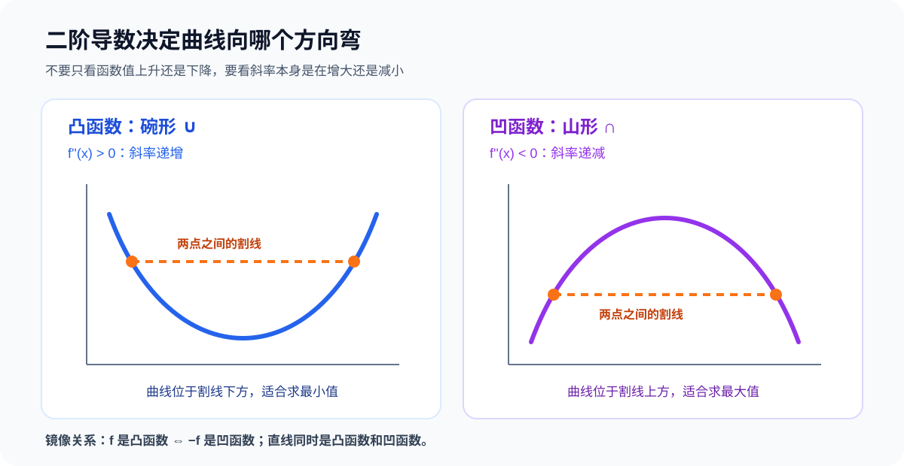

# MSE 为什么是凸函数：二阶导数与凸凹性证明

## 1. 先说结论

“均方误差（Mean Squared Error，MSE）是凸函数”必须说明是对什么变量而言。

1. MSE 对预测值 $\hat{y}$ 是凸函数。
2. 在线性回归中，预测值是参数的线性函数，因此 MSE 对参数 $w,b$ 也是凸函数。
3. 在神经网络中，预测值通常是参数的复杂非线性函数，因此即使使用 MSE，损失对网络参数通常也不是凸函数。

最重要的限定是：

$$
\boxed{\text{损失函数对预测值凸，不等于它对所有模型参数都凸}}
$$

---

## 2. 一阶导数和二阶导数分别表示什么

一阶导数：

$$
f'(x)
$$

表示函数在当前位置的斜率。

二阶导数：

$$
f''(x)
$$

表示斜率本身的变化速度。

| 二阶导数 | 斜率变化 | 曲线方向 |
|---|---|---|
| $f''(x)>0$ | 斜率越来越大 | 向上弯，碗形 $\cup$ |
| $f''(x)<0$ | 斜率越来越小 | 向下弯，山形 $\cap$ |
| $f''(x)=0$ | 斜率保持不变 | 局部表现为直线；还需结合整个区间判断 |

这里的关键不是“函数值在增大还是减小”，而是“斜率在增大还是减小”。

---

## 3. 为什么二阶导数大于零会向上弯

以函数为例：

$$
f(x)=x^2
$$

一阶导数：

$$
f'(x)=2x
$$

不同位置的斜率：

| $x$ | $f'(x)$ |
|---:|---:|
| $-2$ | $-4$ |
| $-1$ | $-2$ |
| $0$ | $0$ |
| $1$ | $2$ |
| $2$ | $4$ |

从左向右，斜率的变化是：

$$
-4\rightarrow-2\rightarrow0\rightarrow2\rightarrow4
$$

因此曲线经历：

1. 先快速下降。
2. 下降速度逐渐变慢。
3. 到最低点时斜率为 0。
4. 随后开始上升。
5. 上升速度越来越快。

二阶导数为：

$$
f''(x)=2>0
$$

它说明斜率始终在增大，所以曲线形成向上开的碗形。

---

## 4. 凸函数的严格定义

凸函数不能只依靠外观判断。

在定义域中任取两个点 $x_1,x_2$，再取：

$$
0\leq\lambda\leq1
$$

两个点之间的位置可以写成：

$$
(1-\lambda)x_1+\lambda x_2
$$

如果函数满足：

$$
f\big((1-\lambda)x_1+\lambda x_2\big)
\leq
(1-\lambda)f(x_1)+\lambda f(x_2)
$$

那么 $f$ 是凸函数。

右边表示连接 $(x_1,f(x_1))$ 与 $(x_2,f(x_2))$ 的割线，在中间位置的高度。

所以凸函数的几何定义是：

$$
\boxed{\text{曲线位于任意两点割线的下方或与割线重合}}
$$

凹函数的方向相反：

$$
f\big((1-\lambda)x_1+\lambda x_2\big)
\geq
(1-\lambda)f(x_1)+\lambda f(x_2)
$$

即曲线位于割线上方。

---

## 5. 用二阶导数正式证明凸性

假设函数在一个区间上二阶可导，并且：

$$
f''(x)\geq0
$$

这意味着一阶导数 $f'(x)$ 单调不减。

取三个位置：

$$
x_1<x<x_2
$$

根据中值定理，左边区间和右边区间分别存在 $\xi_1,\xi_2$，满足：

$$
\frac{f(x)-f(x_1)}{x-x_1}=f'(\xi_1)
$$

$$
\frac{f(x_2)-f(x)}{x_2-x}=f'(\xi_2)
$$

由于：

$$
x_1<\xi_1<x<\xi_2<x_2
$$

而 $f'$ 单调不减，所以：

$$
f'(\xi_1)\leq f'(\xi_2)
$$

因此：

$$
\frac{f(x)-f(x_1)}{x-x_1}
\leq
\frac{f(x_2)-f(x)}{x_2-x}
$$

交叉相乘：

$$
(x_2-x)\big(f(x)-f(x_1)\big)
\leq
(x-x_1)\big(f(x_2)-f(x)\big)
$$

整理后得到：

$$
(x_2-x_1)f(x)
\leq
(x_2-x)f(x_1)+(x-x_1)f(x_2)
$$

两边除以 $x_2-x_1$：

$$
f(x)
\leq
\frac{x_2-x}{x_2-x_1}f(x_1)
+
\frac{x-x_1}{x_2-x_1}f(x_2)
$$

右边正是两个端点割线在 $x$ 位置的高度，所以曲线位于割线下方。

因此：

$$
\boxed{f''(x)\geq0\Rightarrow f\text{ 是凸函数}}
$$

如果整个区间上都有：

$$
f''(x)>0
$$

那么可以保证函数严格凸。

需要注意，$f''(x)>0$ 是严格凸的充分条件，但不是必要条件。例如 $f(x)=x^4$ 是严格凸函数，但它在 $x=0$ 处的二阶导数等于 0。

---

## 6. 单个样本的平方误差为什么凸

一个样本的平方误差为：

$$
L(\hat{y})=(y-\hat{y})^2
$$

把真实值 $y$ 看成常数，把预测值 $\hat{y}$ 看成变量。

展开：

$$
L(\hat{y})=\hat{y}^2-2y\hat{y}+y^2
$$

一阶导数：

$$
\frac{dL}{d\hat{y}}
=2\hat{y}-2y
=2(\hat{y}-y)
$$

二阶导数：

$$
\frac{d^2L}{d\hat{y}^2}=2>0
$$

所以平方误差对预测值 $\hat{y}$ 严格凸。

当：

$$
\hat{y}=y
$$

一阶导数为 0，损失也达到唯一最低点 0。

---

## 7. 多个样本的 MSE 为什么凸

MSE 定义为：

$$
L(\hat{y}_1,\ldots,\hat{y}_n)
=
\frac{1}{n}\sum_{i=1}^{n}(y_i-\hat{y}_i)^2
$$

每一个平方误差都是凸函数。

凸函数具有两个基本封闭性质：

1. 凸函数相加仍然是凸函数。
2. 凸函数乘以非负常数仍然是凸函数。

所以多个平方误差相加，再乘以正数 $1/n$，仍然是凸函数。

使用向量表示：

$$
L(\hat{\boldsymbol y})
=
\frac{1}{n}
\|\hat{\boldsymbol y}-\boldsymbol y\|^2
$$

它对预测向量的 Hessian 矩阵是：

$$
\nabla^2L
=
\frac{2}{n}I
$$

其中 $I$ 是单位矩阵。

对于任意非零向量 $\boldsymbol v$：

$$
\boldsymbol v^T\nabla^2L\boldsymbol v
=
\frac{2}{n}\boldsymbol v^TI\boldsymbol v
=
\frac{2}{n}\|\boldsymbol v\|^2
>0
$$

因此 Hessian 正定，MSE 对完整预测向量严格凸。

---

## 8. 线性回归的 MSE 为什么对参数也凸

线性回归写成矩阵形式：

$$
\hat{\boldsymbol y}=X\boldsymbol w
$$

暂时省略截距。截距可以通过在 $X$ 中增加一列全 1 特征统一处理。

MSE 为：

$$
L(\boldsymbol w)
=
\frac{1}{n}\|X\boldsymbol w-\boldsymbol y\|^2
$$

展开：

$$
L(\boldsymbol w)
=
\frac{1}{n}
(X\boldsymbol w-\boldsymbol y)^T
(X\boldsymbol w-\boldsymbol y)
$$

继续展开：

$$
L(\boldsymbol w)
=
\frac{1}{n}
\left(
\boldsymbol w^TX^TX\boldsymbol w
-2\boldsymbol y^TX\boldsymbol w
+\boldsymbol y^T\boldsymbol y
\right)
$$

梯度为：

$$
\nabla L(\boldsymbol w)
=
\frac{2}{n}X^T(X\boldsymbol w-\boldsymbol y)
$$

Hessian 为：

$$
\nabla^2L(\boldsymbol w)
=
\frac{2}{n}X^TX
$$

要判断它是否凸，只需要判断 $X^TX$ 是否半正定。

对于任意向量 $\boldsymbol v$：

$$
\boldsymbol v^TX^TX\boldsymbol v
=
(X\boldsymbol v)^T(X\boldsymbol v)
=
\|X\boldsymbol v\|^2
\geq0
$$

因此：

$$
X^TX\succeq0
$$

从而：

$$
\nabla^2L(\boldsymbol w)\succeq0
$$

所以：

$$
\boxed{\text{线性回归的 MSE 对参数 }\boldsymbol w\text{ 是凸函数}}
$$

---

## 9. 一个参数的具体例子

假设模型为：

$$
\hat{y}=wx
$$

只有一个样本：

$$
x=3,\qquad y=10
$$

损失为：

$$
L(w)=(3w-10)^2
$$

展开：

$$
L(w)=9w^2-60w+100
$$

一阶导数：

$$
L'(w)=18w-60
$$

二阶导数：

$$
L''(w)=18>0
$$

所以它是严格凸函数。

令一阶导数为 0：

$$
18w-60=0
$$

得到：

$$
w=\frac{10}{3}
$$

因为损失严格凸，这个驻点不是某个局部低谷，而是唯一的全局最低点。

---

## 10. 凸与严格凸的区别

线性回归的 Hessian 为：

$$
\nabla^2L=\frac{2}{n}X^TX
$$

### 10.1 $X$ 满列秩

如果特征列线性无关，那么对于任意非零向量 $\boldsymbol v$：

$$
X\boldsymbol v\neq0
$$

因此：

$$
\boldsymbol v^TX^TX\boldsymbol v
=
\|X\boldsymbol v\|^2
>0
$$

此时 $X^TX$ 正定，损失严格凸，最优参数唯一。

### 10.2 $X$ 不满列秩

如果特征之间完全线性相关，例如：

$$
x_2=2x_1
$$

就可能存在非零向量 $\boldsymbol v$，使得：

$$
X\boldsymbol v=0
$$

于是：

$$
\boldsymbol v^TX^TX\boldsymbol v=0
$$

损失仍然凸，但不再严格凸。此时可能有多组参数产生完全相同的预测结果。

| 性质 | 含义 |
|---|---|
| 凸 | 任意局部最小值都是全局最小值，但最优参数不一定唯一 |
| 严格凸 | 全局最小值至多有一个，因此最优参数唯一 |

---

## 11. 凸函数和凹函数是不是一回事

它们是方向相反、可以互相转换的对偶关系：

$$
\boxed{f\text{ 是凸函数}\iff-f\text{ 是凹函数}}
$$

例如：

$$
f(x)=x^2
$$

是凸函数，而：

$$
-f(x)=-x^2
$$

是凹函数。

二阶导数也正好变号：

$$
(-f)''=-f''
$$

但两者在优化中的自然方向不同：

| 函数 | 形状 | 自然优化目标 |
|---|---|---|
| 凸函数 | 碗形 $\cup$ | 求最小值 |
| 凹函数 | 山形 $\cap$ | 求最大值 |

所以“最小化凸函数”和“最大化凹函数”本质上可以互相转换。

---

## 12. 直线为什么既凸又凹

考虑仿射函数：

$$
f(x)=ax+b
$$

二阶导数：

$$
f''(x)=0
$$

任取两个点，函数都满足：

$$
f\big((1-\lambda)x_1+\lambda x_2\big)
=
(1-\lambda)f(x_1)+\lambda f(x_2)
$$

它既满足凸函数的不等式，也满足凹函数的不等式，因为两边始终相等。

因此：

$$
\boxed{\text{仿射函数既凸又凹，但通常既不严格凸也不严格凹}}
$$

---

## 13. 为什么神经网络使用 MSE 仍然可能非凸

MSE 对预测值 $\hat{y}$ 是凸的，但神经网络中的预测值：

$$
\hat{y}=f_{\theta}(X)
$$

是参数 $\theta$ 的复杂非线性函数。

一个最小反例是：

$$
\hat{y}=w^2,\qquad y=1
$$

MSE 变成：

$$
L(w)=(w^2-1)^2
$$

展开：

$$
L(w)=w^4-2w^2+1
$$

二阶导数：

$$
L''(w)=12w^2-4
$$

当 $w=0$ 时：

$$
L''(0)=-4<0
$$

所以它对参数 $w$ 不是凸函数。

同时它有两个最低点：

$$
w=-1,\qquad w=1
$$

因此必须区分：

| 问题 | 结论 |
|---|---|
| MSE 对预测值是否凸 | 是 |
| 线性模型加 MSE 对参数是否凸 | 是 |
| 任意非线性模型加 MSE 对参数是否凸 | 不一定 |
| 神经网络加 MSE 对参数是否凸 | 通常不是 |

问题不在 MSE 本身，而在从参数到预测值的非线性映射。

---

## 14. 最终判断方法

### 一维二阶可导函数

如果在整个区间上：

$$
f''(x)\geq0
$$

那么函数凸。

如果在整个区间上：

$$
f''(x)\leq0
$$

那么函数凹。

### 多维二阶可导函数

检查 Hessian 矩阵：

$$
\nabla^2f(\boldsymbol x)
$$

| Hessian 性质 | 函数性质 |
|---|---|
| 半正定 | 凸 |
| 正定 | 可保证严格凸 |
| 半负定 | 凹 |
| 正负方向都有 | 非凸也非凹 |

线性回归 MSE 的关键证明浓缩为：

$$
L(\boldsymbol w)=\frac1n\|X\boldsymbol w-\boldsymbol y\|^2
$$

$$
\nabla^2L=\frac2nX^TX
$$

$$
\boldsymbol v^TX^TX\boldsymbol v
=
\|X\boldsymbol v\|^2
\geq0
$$

因此：

$$
\boxed{\text{线性回归的 MSE 对参数是凸函数}}
$$

最后记住：

> 二阶导数为正，表示斜率越来越大，所以曲线向上弯；凸函数像碗，割线在曲线上方，适合求最小值。
