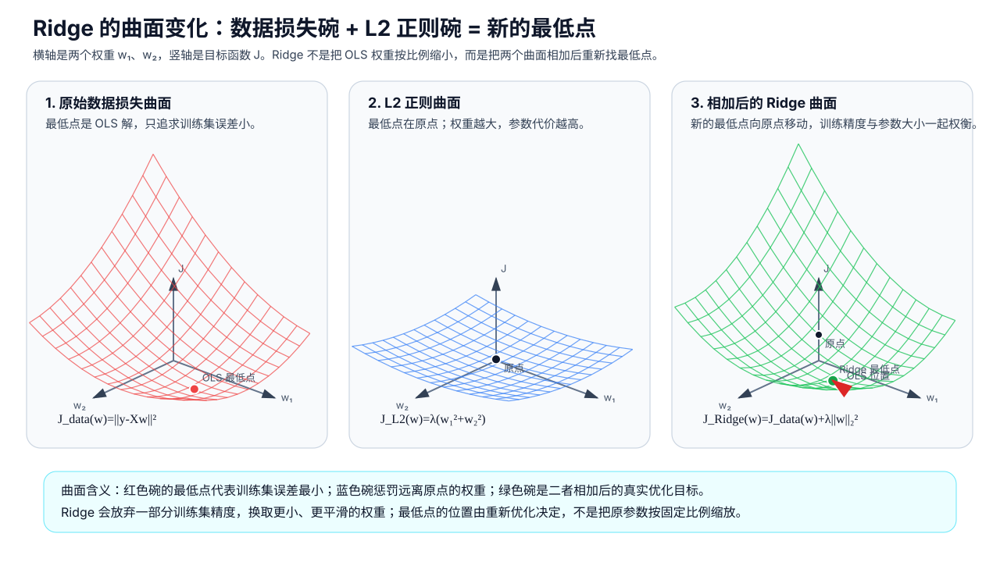
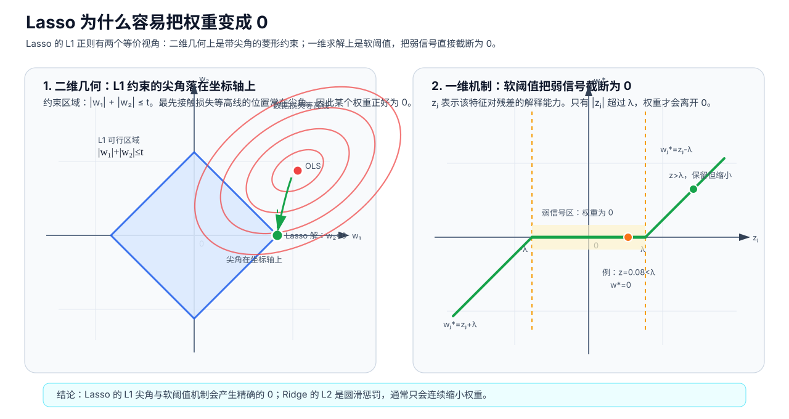

# 正则化到底在正则什么：从残差、损失函数到 Ridge、Lasso、ElasticNet 与 Huber

## 1. 残差、损失函数与正则化

### 1.1 残差

残差（Residual）通常定义为真实值减去预测值：

$$
r_i=y_i-\hat y_i
$$

其中：

- $y_i$：第 $i$ 个样本的真实值；
- $\hat y_i$：第 $i$ 个样本的预测值；
- $r_i$：第 $i$ 个样本的残差。

房价真实值为 320 万元，模型预测 300 万元：

$$
r=320-300=20
$$

残差为正，表示预测偏低。若模型预测 350 万元：

$$
r=320-350=-30
$$

残差为负，表示预测偏高。

残差保留方向。直接相加会出现正负抵消：

$$
20+(-20)=0
$$

这不表示模型没有误差，只表示两个方向相反的残差相互抵消。因此训练模型时需要损失函数把残差转换为数据损失。

这里不要把“残差”和“偏差”混用：

- **残差**：某个样本上的真实值与预测值之差，$r_i=y_i-\hat y_i$。它是已经训练好的某个模型在某个样本上的具体错误。
- **偏差**：机器学习里通常指模型假设与真实规律之间的系统性差距，属于偏差-方差分析里的概念。它不是某一个样本的 $y_i-\hat y_i$。
- **偏置**：线性模型里的截距项 $b$，英文也常写作 bias term。它和“偏差-方差”里的偏差也不是一回事。

本文后面讨论 MSE、MAE、Huber 时，核心对象都是**残差**，不用“偏差”替代残差。

### 1.2 损失函数

损失函数（Loss Function）把残差 $r_i$ 转换为非负代价，并把多个样本的误差汇总成一个可优化目标。

同样是残差 $r=20$：

| 损失写法 | 代价 | 含义 |
|---|---:|---|
| 绝对误差 $|r|$ | 20 | 按误差绝对值计入损失 |
| 平方误差 $r^2$ | 400 | 大残差会被更强地放大 |
| Huber 损失 $L_\delta(r)$ | 取决于阈值 $\delta$ | 小残差用平方形式，大残差近似线性 |

常见数据损失包括 RSS、MSE、RMSE、MAE 和 Huber。它们都作用在残差上，区别在于残差进入目标函数的方式不同。

### 1.3 正则化

正则化（Regularization）在数据损失之外增加参数惩罚项。训练目标通常写成：

$$
\boxed{
\text{训练目标}
=
\text{数据损失}
+
\text{正则化强度}
\times
\text{参数惩罚}
}
$$

参数形式：

$$
\min_{w,b}
\left[
L_{data}(y,\hat y)
+
\lambda\Omega(w)
\right]
$$

其中：

- $L_{data}(y,\hat y)$：由残差和损失函数得到，例如 MSE、MAE、Huber；
- $\Omega(w)$：作用在模型权重 $w$ 上的正则项，例如 L1、L2；
- $\lambda$：正则化强度，越大表示参数惩罚越强。

Ridge 回归的目标是：

$$
\min_{w,b}
\left[
\frac{1}{m}\sum_{i=1}^{m}(y_i-\hat y_i)^2
+
\lambda\sum_{j=1}^{n}w_j^2
\right]
$$

前半部分是 MSE 数据损失，来自残差平方；后半部分是 L2 正则项，惩罚过大的权重。

权重接近 0 表示对应特征对当前预测的额外贡献变小。正则化表达的是参数选择偏好：训练误差接近时，优先选择参数更受约束的模型。原因有四：

1. **用少量训练精度换稳定泛化：L2 / Ridge 会压低极端的大正权重和大负权重**。Ridge 在训练误差和权重大小之间做权衡；当极端正负权重只是在训练集上精细贴合相关特征、噪声或偶然关系时，L2 会提高这种参数组合的代价，倾向于选择更平滑的权重。

2. **减少冗余特征参与预测：L1 / Lasso 可能把部分重复特征的权重压到 0**。Lasso 倾向于用更少的特征完成预测；对信息重复、贡献不足的特征，L1 可能把对应权重压到 0，从而形成稀疏模型和特征选择。但在高度相关特征中，保留哪一个不一定稳定。

3. **降低对噪声或异常样本的迁就**。如果少数样本的标签有误，模型可能通过增大某些权重去贴合这些样本。正则化提高大权重的代价，使模型更难为了少数异常样本改变整体参数。

4. **降低输入扰动对预测的放大**。在线性模型中，权重越大，同样大小的输入变化越容易造成更大的预测变化。正则化限制权重大小，可以让预测对小幅输入变化更稳定。

因此，正则化的作用不是单一的。Ridge 主要减少极端权重补偿；Lasso 主要产生稀疏特征选择；ElasticNet 同时保留这两类效果。最终是否更好，仍要看验证集或测试集表现。

这种偏好也会带来代价。正则太弱，模型可能为了追逐训练集噪声而出现大权重和过拟合；正则太强，真实关系也可能被压弱，导致欠拟合。

### 1.4 中文名与命名来源

| 英文名 | 常见中文名 | 本质 | 命名来源 |
|---|---|---|---|
| **Ridge Regression** | **岭回归 / 岭估计** | 平方损失 + L2 正则 | “Ridge”沿用了 ridge analysis / ridge estimator 的叫法。多重共线性会让 $X^TX$ 接近不可逆，最小二乘解在某些方向非常不稳定；Ridge 在 $X^TX$ 的对角线上加 $\lambda I$，稳定病态求解，所以中文按字面译作“岭回归”。 |
| **Lasso** | **套索回归** | 平方损失 + L1 正则 | Lasso 是 **Least Absolute Shrinkage and Selection Operator** 的缩写，直译是“最小绝对收缩与选择算子”。英文 lasso 是“套索”，对应 L1 正则把部分权重收缩到 0 的特征选择效果。 |
| **ElasticNet** | **弹性网回归** | 平方损失 + L1/L2 混合正则 | 它把 Lasso 的 L1 和 Ridge 的 L2 结合起来，既能筛掉部分特征，又能保留一组相关特征，因此叫 Elastic Net。 |
| **Huber Loss / Huber Regression** | **Huber 损失 / 休伯损失 / 胡贝尔损失；Huber 回归** | 稳健损失函数 | 以统计学家 Peter J. Huber 命名。它小残差用平方损失，大残差改成近似线性损失，用来降低异常值影响。 |

---

## 2. 常见损失函数

RSS、MSE、RMSE、MAE 和 Huber 的差异主要体现在计算方式、误差敏感性和适用场景。

### 2.1 RSS：残差平方和

残差平方和（Residual Sum of Squares，RSS）是：

$$
RSS=\sum_{i=1}^{m}r_i^2
=\sum_{i=1}^{m}(y_i-\hat y_i)^2
$$

例如三个样本的残差为：

$$
2,\quad-3,\quad10
$$

那么：

$$
RSS=2^2+(-3)^2+10^2=113
$$

RSS 越小，表示模型在这批数据上的总体平方误差越小。

### 2.2 MSE：平均平方误差

均方误差（Mean Squared Error，MSE）是 RSS 除以样本数：

$$
MSE=\frac{1}{m}RSS
=\frac{1}{m}\sum_{i=1}^{m}r_i^2
$$

在同一批固定数据上，最小化 RSS 和最小化 MSE 得到的参数相同，因为二者只差常数 $1/m$。MSE 更方便比较不同样本数量的数据集。

平方损失的特点是：**大残差的损失贡献增长很快**。

| 残差绝对值 | 绝对误差 | 平方误差 |
|---:|---:|---:|
| 1 | 1 | 1 |
| 2 | 2 | 4 |
| 5 | 5 | 25 |
| 10 | 10 | 100 |
| 100 | 100 | 10000 |

残差从 10 增加到 100，绝对误差增加 10 倍，平方误差增加 100 倍。因此少量异常样本可能在 MSE 中占据绝大部分损失。

### 2.3 RMSE：回到原单位的误差

均方根误差（Root Mean Squared Error，RMSE）是：

$$
RMSE=\sqrt{MSE}
$$

MSE 的单位是目标变量单位的平方，而 RMSE 又回到了目标变量原来的单位。例如房价单位是万元，RMSE 的单位仍然是万元。

### 2.4 MAE：平均绝对误差

平均绝对误差（Mean Absolute Error，MAE）是：

$$
MAE=\frac{1}{m}\sum_{i=1}^{m}|r_i|
$$

对于残差 $2,-3,10$：

$$
MAE=\frac{2+3+10}{3}=5
$$

MAE 对异常残差比 MSE 稳健，因为残差变大时，代价只是线性增加，而不是平方增加。

### 2.5 Huber 损失（休伯损失 / 胡贝尔损失）：MSE 和 MAE 的折中

Huber 损失定义为：

$$
L_\delta(r)=
\begin{cases}
\frac{1}{2}r^2,&|r|\leq\delta\\
\delta\left(|r|-\frac{1}{2}\delta\right),&|r|>\delta
\end{cases}
$$

计算方式：

```text
小残差：使用平方形式，便于精细优化
大残差：使用近似线性形式，限制异常值的梯度影响
```

参数 $\delta$ 控制“多大的残差开始被当成大残差”：

| $\delta$ | 效果 |
|---:|---|
| 较大 | 更多残差进入平方区间，更接近 MSE |
| 较小 | 更多残差进入线性区间，更接近 MAE |

### 2.6 常见损失函数的选择依据

| 损失函数 | 主要用于 | 优点 | 需要注意 |
|---|---|---|---|
| MSE / RSS | 回归 | 数学性质好，容易求导，对大错敏感 | 容易受异常大残差影响 |
| RMSE | 回归评价指标 | 单位直观，和目标变量同单位 | 仍继承 MSE 对大误差敏感的特点 |
| MAE | 回归 | 更稳健，解释为平均绝对误差 | 在 0 处不可导，优化相对不如 MSE 顺滑 |
| Huber | 回归 | 小错精细，大错限幅 | 阈值需要调；不能自动处理所有高杠杆点 |
| Log loss / BCE | 二分类 | 直接惩罚概率预测错误 | 常用于逻辑回归、分类模型 |
| Cross Entropy | 多分类 | 适合概率分类 | 和类别概率建模相关 |

损失函数只处理残差到数据损失的转换。特征很多、样本有限或特征高度相关时，还需要处理过拟合和参数不稳定，这对应正则化。

---

## 3. L1、L2 的 L 与数字含义

### 3.1 L 通常来自 $L_p$ 范数

数学上，向量 $v=(v_1,v_2,\ldots,v_n)$ 的 $L_p$ 范数是：

$$
\|v\|_p=
\left(\sum_{j=1}^{n}|v_j|^p\right)^{1/p}
$$

这里的 $p$ 就是 L1、L2 里的 1、2。L 表示范数（norm）这一类度量，1/2 表示幂次和开方方式。

- **L1 范数**：

$$
\|v\|_1=\sum_j|v_j|
$$

- **L2 范数**：

$$
\|v\|_2=\sqrt{\sum_jv_j^2}
$$

在机器学习里，为了优化方便，很多时候会用平方 L2：

$$
\|v\|_2^2=\sum_jv_j^2
$$

所以你看到的“L2 正则”经常写成 $\sum_jw_j^2$，严格说这是**平方 L2 范数**，但习惯上也叫 L2 正则。

### 3.2 L1 / L2 既可以作用在残差上，也可以作用在权重上

| 名称 | 作用对象 | 常见公式 | 含义 |
|---|---|---|---|
| L1 损失 | 残差 $r$ | $\sum_i|r_i|$ | 预测误差按绝对值计入损失 |
| L2 损失 | 残差 $r$ | $\sum_ir_i^2$ | 预测误差按平方计入损失 |
| L1 正则 | 权重 $w$ | $\sum_j|w_j|$ | 权重按绝对值计入惩罚项，容易产生稀疏 |
| L2 正则 | 权重 $w$ | $\sum_jw_j^2$ | 权重按平方计入惩罚项，平滑缩小权重 |

同样叫 L1，作用对象不同，含义就不同：

```text
使用 L1 损失：对预测残差取绝对值。
使用 L1 正则：对模型权重取绝对值并加入训练目标。
```

Huber 主要是一种作用在**残差**上的损失；Ridge、Lasso、ElasticNet 主要描述作用在**权重**上的正则化。

### 3.3 L3 与其他范数

数学上当然可以定义 L3：

$$
\|v\|_3=\left(\sum_j|v_j|^3\right)^{1/3}
$$

也可以定义 L4、L5，甚至 $L_\infty$：

$$
\|v\|_\infty=\max_j|v_j|
$$

但在常见机器学习正则化里，L1 和 L2 最常见，原因是：

- **L1** 有尖角，容易把某些权重压到精确的 0，适合做稀疏化和特征选择；
- **L2** 平滑可导，优化稳定，能均匀地缩小权重，适合提升参数稳定性；
- **L3 或更高阶** 会更重地惩罚大权重，但通常没有 L1 的稀疏性，也不如 L2 那样常见和方便解释；
- **L0** 有时也会被提到，它表示非零权重的个数，但严格来说不是范数，直接优化通常很困难。

因此，不是没有 L3，而是 L1 和 L2 在稀疏性、稳定性、优化便利性之间更实用。

---

## 4. 正则化：在数据损失之外给参数加约束

### 4.1 目标函数变化

没有正则化时，模型只求：

$$
\min_w L_{data}(w)
$$

加入正则化以后，模型求的是：

$$
\min_w
\left[
L_{data}(w)+\lambda\Omega(w)
\right]
$$

正则化从一开始就参与优化：

```text
每一个候选参数，都要同时接受两次评价：

1. 它对训练数据拟合得怎么样？
2. 它自己的参数代价大不大？
```

### 4.2 一个只有一个权重的例子

假设：

$$
x=1,\qquad y=10,\qquad \hat y=wx=w
$$

没有正则化时：

$$
J(w)=(10-w)^2
$$

最优结果是 $w=10$，因为预测误差为 0。

加入 L2 正则并令 $\lambda=1$：

$$
J(w)=(10-w)^2+w^2
$$

不同候选权重的总目标如下：

| $w$ | 数据误差 $(10-w)^2$ | 正则项 $w^2$ | 总目标 |
|---:|---:|---:|---:|
| 0 | 100 | 0 | 100 |
| 3 | 49 | 9 | 58 |
| 5 | 25 | 25 | **50** |
| 8 | 4 | 64 | 68 |
| 10 | 0 | 100 | 100 |

只看拟合误差时，$w=10$ 最好；加入正则后，$w=5$ 的综合代价最小。正则化改变的是优化标准，而不是残差定义。

### 4.3 在梯度下降中，正则化就是另一股力量

假设使用 L2 正则：

$$
J(w)=L_{data}(w)+\lambda w^2
$$

它的梯度是：

$$
\frac{\partial J}{\partial w}
=
\frac{\partial L_{data}}{\partial w}
+2\lambda w
$$

梯度下降更新为：

$$
w\leftarrow
w-\eta
\left(
\frac{\partial L_{data}}{\partial w}+2\lambda w
\right)
$$

梯度里有两项：

```text
数据损失的梯度：把权重推向更好拟合训练数据的位置
正则项的梯度：让权重向更小、更受约束的方向更新
最终权重：停在两项梯度合计为 0 或接近 0 的位置
```

在前面的例子中：

$$
J(w)=(10-w)^2+w^2
$$

求导：

$$
J'(w)=2(w-10)+2w
$$

当 $w=5$ 时：

$$
2(5-10)+2\times5=-10+10=0
$$

数据损失想让权重继续增大，正则项想让权重继续减小，两者正好抵消。

---

## 5. 权重接近 0 的作用

### 5.1 0 是“该特征不起作用”的自然基线

在线性模型中：

$$
\hat y=w_1x_1+\cdots+w_nx_n+b
$$

如果 $w_j=0$，表示第 $j$ 个特征不参与当前预测。特别是在特征已经中心化、标准化，而且模型有截距 $b$ 时，0 是一个自然的“无额外影响”基线。

这是建模偏好；真实关系是否需要较大权重，要由数据和验证结果判断。

### 5.2 大权重会放大输入中的小变化

输入发生小扰动 $\Delta x$ 时，线性模型输出变化为：

$$
\Delta\hat y=w^T\Delta x
$$

根据柯西不等式：

$$
|\Delta\hat y|
\leq
\|w\|_2\|\Delta x\|_2
$$

在同样的输入扰动下，$\|w\|_2$ 越大，模型输出可能变化得越剧烈。

例子：

```text
模型 A：y_hat = 2x，x 变化 0.01，预测约变化 0.02
模型 B：y_hat = 200x，x 变化 0.01，预测约变化 2
```

如果大权重来自真实稳定关系，它是必要的；如果大权重只是为了追逐噪声、异常点或相关特征之间的补偿，它会使模型对未来数据更脆弱。

### 5.3 有限样本中经常存在多组近似答案

假设两个标准化后的特征 $x_1$ 和 $x_2$ 在训练集中高度相关：

$$
x_2\approx x_1
$$

这时，模型主要靠 $w_1+w_2$ 的合并效果做预测。下面两个模型在训练集里都可能接近 $2x_1$：

$$
\hat y=x_1+x_2
$$

$$
\hat y=11x_1-9x_2
$$

因为：

$$
x_1+x_2\approx2x_1
$$

$$
11x_1-9x_2\approx2x_1
$$

第二个模型甚至可能在训练集上更准，因为它利用了 $x_1$ 和 $x_2$ 的细微差异。但这种精细关系可能只存在于当前训练集。Ridge 会把 $11^2+(-9)^2$ 这种 L2 代价很高的方案压下去，倾向于选择权重更平滑、对新数据更稳定的参数组合。这里不是把 $11:-9$ 按比例缩小，而是在新的优化目标下重新求解。

### 5.4 正则化本质上是在增加归纳偏好

正则化表达的是：

> 有限训练数据不能唯一确定未来规律；在多个拟合效果接近的候选模型中，优先选择参数更受约束的模型。

这种偏好经常能降低模型方差，提高新数据上的稳定性，但是否有效必须通过验证集或交叉验证判断。

---

## 6. 正则化过强的影响

### 6.1 真实关系本来就需要较大权重

仍然假设真实关系为：

$$
y=10x
$$

使用目标：

$$
J(w)=(10-w)^2+\lambda w^2
$$

最优解为：

$$
w=\frac{10}{1+\lambda}
$$

| $\lambda$ | 最优权重 $w$ | 结果 |
|---:|---:|---|
| 0 | 10 | 完整表达真实关系 |
| 0.1 | 9.09 | 轻微收缩 |
| 1 | 5 | 关系被明显削弱 |
| 9 | 1 | 严重欠拟合 |
| 99 | 0.1 | 几乎不学习关系 |

“正则过强”的含义：

> 相对于数据中的真实关系，模型为了少交参数罚款，宁愿承受更大的预测误差，也不愿意使用足够大的权重。

常见表现是训练误差和验证误差都较大，回归线过于平缓，分类概率过于保守。

### 6.2 没有标准化时，惩罚会受单位影响

假设同一个长度分别用米和厘米表示：

$$
y=3x_{米}=0.03x_{厘米}
$$

两种写法表达的是完全相同的关系，但 L2 正则项分别是：

$$
3^2=9
$$

和：

$$
0.03^2=0.0009
$$

仅仅换了单位，正则罚款就相差一万倍。因此 Ridge、Lasso 和 ElasticNet 前通常要标准化数值特征：

$$
x' = \frac{x-\mu}{\sigma}
$$

否则模型可能因为计量单位而不公平地偏向某些特征。

### 6.3 正则化不能替代数据治理

正则化不能自动解决：

- 标签定义错误；
- 数据泄漏；
- 训练数据不代表未来人群；
- 录入错误和单位错误；
- 缺少关键特征；
- 真实关系明显非线性；
- 因果关系和预测关系被混淆。

正则化只是模型约束，不是数据质量修复工具。

---

## 7. Ridge（岭回归）：平方损失 + L2 正则

Ridge（岭回归）的典型目标是：

$$
\min_{w,b}
\left[
\frac{1}{m}\sum_i(y_i-\hat y_i)^2
+
\lambda\sum_jw_j^2
\right]
$$

即：

```text
Ridge = MSE 数据损失 + L2 参数正则
```

Ridge 通常会牺牲一部分训练集精度。它不是把普通最小二乘得到的权重按比例缩小，而是重新最小化“数据损失 + L2 参数代价”。当某组极端权重只是在训练集上更精细地贴合了相关特征、噪声或样本偶然关系时，Ridge 会倾向于放弃这部分训练集优势，换取更平滑的参数。



图中横轴是两个权重 $w_1$、$w_2$，竖轴是目标函数值 $J$。红色曲面是原始数据损失，碗底是普通最小二乘解；蓝色曲面是 L2 正则项，碗底在原点，离原点越远参数代价越大；绿色曲面是二者相加后的 Ridge 目标。新的最低点会从 OLS 解向原点方向移动。这个移动不是固定比例缩放，而是由数据损失和 L2 参数代价共同决定。

它的主要特点是：

1. 平滑地缩小权重；
2. 通常不会把权重精确变成 0；
3. 能缓解多重共线性下的大正、大负权重补偿；
4. 当特征都可能包含一点信号时，经常比强制删除特征更稳定。

在不考虑截距的简化情况下，普通最小二乘为：

$$
\hat w=(X^TX)^{-1}X^Ty
$$

Ridge 为：

$$
\hat w_{ridge}=(X^TX+\lambda I)^{-1}X^Ty
$$

$\lambda I$ 会把矩阵各个方向上的特征值向上移动，使接近奇异的求解更稳定。

从一维角度看，L2 收缩近似为：

$$
w^*=\frac{z}{1+\lambda}
$$

所以只要 $z\neq0$，权重通常只是变小，而不会直接等于 0。

Ridge 适合：

- 特征较多且多数可能有用；
- 特征之间存在相关性；
- 希望保留全部特征；
- 更关注预测稳定性，而不是自动筛选特征。

---

## 8. Lasso（套索回归）：平方损失 + L1 正则

Lasso（套索回归）的典型目标是：

$$
\min_{w,b}
\left[
\frac{1}{2m}\sum_{i=1}^{m}(y_i-\hat y_i)^2
+
\lambda\sum_{j=1}^{n}|w_j|
\right]
$$

预测值为：

$$
\hat y_i=b+w_1x_{i1}+w_2x_{i2}+\cdots+w_nx_{in}
$$

即：

```text
Lasso = MSE 数据损失 + L1 参数正则
```

其中：

- $\frac{1}{2m}\sum_i(y_i-\hat y_i)^2$：数据损失，衡量预测误差；
- $\sum_j|w_j|$：L1 正则项，把所有权重的绝对值加起来；
- $\lambda$：正则强度，越大表示权重不为 0 的代价越高。

Lasso 能把部分权重变成 0，关键原因是 L1 正则使用绝对值 $|w_j|$。绝对值函数在 0 点有尖角：权重只要离开 0，就要立刻付出固定方向的正则代价。

对某个特征来说，优化过程在比较两件事：

1. 这个特征能让训练误差下降多少；
2. 这个特征的权重不为 0，要额外付出多少 L1 代价。

如果一个特征降低训练误差的能力抵不过 L1 代价，Lasso 会把它的权重直接设为 0。

在特征已经标准化的简化情况下，单个权重可以写成软阈值形式：

$$
w_j^*=\operatorname{sign}(z_j)\max(|z_j|-\lambda,0)
$$

这里的 $z_j$ 可以理解为“第 $j$ 个特征对当前残差的解释能力”：

- $|z_j|$ 越大，说明这个特征对降低训练误差越有帮助；
- $\lambda$ 越大，说明保留这个权重的代价越高。

当：

$$
|z_j|\leq\lambda
$$

就有：

$$
w_j^*=0
$$

例如：

$$
z_j=0.08,\quad \lambda=0.10
$$

因为 $|z_j|<\lambda$，所以：

$$
w_j^*=0
$$

这个特征不会参与最终预测。

当：

$$
|z_j|>\lambda
$$

权重会被保留，但数值会缩小。例如：

$$
z_j=0.35,\quad \lambda=0.10
$$

则：

$$
w_j^*=0.35-0.10=0.25
$$

所以 Lasso 的行为是：小信号直接归零，大信号保留但缩小。



图左侧是二维权重空间。L1 约束 $|w_1|+|w_2|\leq t$ 是一个带尖角的菱形，尖角正好落在坐标轴上；当损失函数等高线先碰到尖角时，就会得到 $w_2=0$ 或 $w_1=0$。图右侧是一维软阈值：当 $|z_j|\leq\lambda$ 时，$w_j^*=0$；只有 $|z_j|>\lambda$ 时，权重才会保留但缩小。

这也是 Lasso 和 Ridge 的关键区别。Ridge 使用 $w_j^2$，通常把权重连续缩小；Lasso 使用 $|w_j|$，可以把权重截断为 0。因此 Lasso 适合做稀疏建模和特征选择。

Lasso 适合：

- 特征很多，但预计只有少数真正重要；
- 希望得到更稀疏、部署成本更低的模型；
- 希望减少冗余特征参与预测；
- 可以接受部分相关特征被任意选择。

局限：

- 高度相关特征中，Lasso 可能只选择一个；
- 换一批数据后选择结果可能变化；
- 正则过强会误删真实的弱信号；
- 不能把权重为 0 直接解释成没有业务价值或不存在因果关系。

## 9. ElasticNet（弹性网回归）：L1 与 L2 的组合

ElasticNet（弹性网回归）的典型目标是：

$$
\min_{w,b}
\left[
L_{data}
+
\lambda
\left(
\rho\sum_j|w_j|
+
(1-\rho)\sum_jw_j^2
\right)
\right]
$$

其中：

- $\lambda$ 控制整体正则强度；
- $\rho$ 控制 L1 和 L2 的比例。

| $\rho$ | 倾向 |
|---:|---|
| 接近 1 | 更像 Lasso，稀疏性更强 |
| 介于 0 和 1 | 同时具有稀疏和稳定效果 |
| 接近 0 | 更像 Ridge，以平滑收缩为主 |

不同库对常数因子的写法可能不同，但“整体强度 + L1/L2 比例”的思想相同。

ElasticNet 常用于：

- 特征数量多；
- 希望产生一定稀疏性；
- 特征之间又存在明显相关性；
- 单独使用 Lasso 时，特征选择过于不稳定。

对比：

```text
Ridge：相关特征经常一起保留，并分摊权重
Lasso：相关特征中可能只留下少数几个
ElasticNet：既允许筛掉部分特征，又比纯 Lasso 更愿意成组保留相关特征
```

---

## 10. 异常值、Huber 损失与正则化

### 10.1 异常数据怎样影响权重

考虑无截距的一元线性回归：

$$
\hat y_i=wx_i
$$

残差为：

$$
r_i=y_i-wx_i
$$

平方损失为：

$$
L(w)=\frac{1}{m}\sum_i r_i^2
$$

这里对权重 $w$ 求导时会出现 $x_i$，原因是预测值里含有 $wx_i$。对第 $i$ 个样本：

$$
L_i=(y_i-wx_i)^2
$$

先看残差对权重的变化：

$$
\frac{\partial r_i}{\partial w}
=
\frac{\partial (y_i-wx_i)}{\partial w}
=-x_i
$$

再用链式法则：

$$
\frac{\partial L_i}{\partial w}
=
\frac{\partial L_i}{\partial r_i}\cdot\frac{\partial r_i}{\partial w}
=2r_i\cdot(-x_i)
=-2x_ir_i
$$

所以整体损失对权重的导数是：

$$
\frac{\partial L}{\partial w}
=-\frac{2}{m}\sum_i x_ir_i
$$

梯度下降更新为：

$$
w\leftarrow
w+\frac{2\eta}{m}\sum_i x_ir_i
$$

单个样本对权重更新的推动大小，核心取决于：

$$
\boxed{x_i\times r_i}
$$

因此两类样本特别容易强烈影响权重：

1. **残差很大**：$|r_i|$ 很大；
2. **特征位置很远**：$|x_i|$ 很大，也就是高杠杆点。

如果二者同时很大，推动作用会更强。

### 10.2 一个具体数字过程

正常数据遵循：

$$
y=2x
$$

三个正常样本是：

$$
(1,2),\quad(2,4),\quad(3,6)
$$

现在加入一个异常样本：

$$
(10,100)
$$

当模型还处在正确斜率 $w=2$ 时：

| 样本 | $x$ | $y$ | 预测 $wx$ | 残差 $r=y-wx$ | 推动力 $x r$ |
|---|---:|---:|---:|---:|---:|
| 正常 1 | 1 | 2 | 2 | 0 | 0 |
| 正常 2 | 2 | 4 | 4 | 0 | 0 |
| 正常 3 | 3 | 6 | 6 | 0 | 0 |
| 异常点 | 10 | 100 | 20 | 80 | **800** |

前三个样本认为当前模型已经正确，不推动权重变化；异常点却产生巨大的正向更新，使斜率增大。

无截距普通最小二乘的解析解为：

$$
\hat w=\frac{\sum_i x_iy_i}{\sum_i x_i^2}
$$

代入数据：

$$
\hat w
=
\frac{1\times2+2\times4+3\times6+10\times100}
{1^2+2^2+3^2+10^2}
=
\frac{1028}{114}
\approx9.02
$$

真实多数规律是 $w=2$，但异常点使最终权重变为约 9.02。

### 10.3 Huber 主要限制大残差

平方损失下，单个样本：

$$
L_i=r_i^2
$$

对残差的导数是：

$$
\frac{\partial L_i}{\partial r_i}=2r_i
$$

残差越大，梯度也越大。因此异常点不但损失贡献大，在梯度更新中施加的力量也大。

Huber 的导数是：

$$
\frac{\partial L_\delta}{\partial r}=
\begin{cases}
r,&|r|\leq\delta\\
\delta\operatorname{sign}(r),&|r|>\delta
\end{cases}
$$

所以 Huber 可以把大残差的影响限制住：

```text
MSE：残差越大，影响越大
MAE：大残差仍然只给固定强度的方向
Huber：小残差使用平方形式，大残差使用近似线性形式
```

Huber 作用在**残差损失**上，不直接约束权重大小。

### 10.4 Ridge 对异常点的局限

对于前面的无截距一元例子，Ridge 解为：

$$
\hat w_{ridge}
=
\frac{\sum_i x_iy_i}{\sum_i x_i^2+\lambda}
$$

它会缩小斜率，但不等于识别并降低异常点的损失贡献。只要异常点仍然产生巨大的平方残差，它仍然可能主导数据损失。

> 正则化主要限制参数复杂度；稳健损失主要限制异常残差的影响。两者对应不同问题。

两者可以组合：

```text
Huber：限制大残差的影响
Ridge / Lasso / ElasticNet：限制参数复杂度
```

---

## 11. 回归和分类中常见的“损失 + 正则”组合

损失函数和正则化是两个独立维度，可以组合。

| 模型 | 数据损失 | 参数正则 |
|---|---|---|
| `LinearRegression` | 平方损失 | 无显式正则 |
| `Ridge` | 平方损失 | L2 |
| `Lasso` | 平方损失 | L1 |
| `ElasticNet` | 平方损失 | L1 + L2 |
| `HuberRegressor` | Huber 损失 | sklearn 中还可用 `alpha` 加 L2 正则 |
| `QuantileRegressor` | 分位数 / Pinball 损失；中位数回归与 MAE 密切相关 | sklearn 中 `alpha` 控制 L1 参数正则 |
| `LogisticRegression` | 对数损失 / BCE | 通常使用 L2，也可配置 L1 或 ElasticNet |

示例：Huber 损失 + ElasticNet 正则

```python
from sklearn.linear_model import SGDRegressor

model = SGDRegressor(
    loss="huber",         # 残差使用 Huber 损失
    penalty="elasticnet", # 权重使用 ElasticNet 正则
    alpha=0.001,          # 整体正则强度
    l1_ratio=0.2,         # L1 所占比例
    random_state=42,
)
```

---

## 12. sklearn 中的参数方向

| 模型 | 主要参数 | 参数越大表示 |
|---|---|---|
| `Ridge` | `alpha` | 正则越强 |
| `Lasso` | `alpha` | 正则越强 |
| `ElasticNet` | `alpha` | 整体正则越强 |
| `ElasticNet` | `l1_ratio` | L1 比例越高 |
| `HuberRegressor` | `epsilon` | 更多残差按平方损失处理，更接近 MSE |
| `HuberRegressor` | `alpha` | 参数 L2 正则越强 |
| `LogisticRegression` | `C` | 正则越弱 |

逻辑回归中的 `C` 大致与正则强度成反向关系：

$$
C\propto\frac{1}{\lambda}
$$

因此：

```text
Ridge / Lasso / ElasticNet：alpha 越大，约束越强
LogisticRegression：C 越小，约束越强
```

不要把不同模型中的同名参数或默认值直接横向比较。参数有效范围会受到样本量、特征尺度、损失函数实现和库中常数因子的影响。

---

## 13. 正则强度判断

| 状态 | 训练集表现 | 验证集表现 | 常见解释 |
|---|---|---|---|
| 正则太弱 | 很好 | 明显较差 | 可能过拟合，参数方差大 |
| 正则合适 | 略有下降 | 更稳定或更好 | 牺牲少量训练拟合换取泛化 |
| 正则太强 | 较差 | 也较差 | 欠拟合，真实信号被压掉 |

合理流程是：

```text
先划分训练集与测试集
          ↓
只在训练集内部做交叉验证
          ↓
比较多个正则强度
          ↓
选择验证表现和参数稳定性合适的设置
          ↓
最后只用一次测试集做最终评价
```

常见代码：

```python
import numpy as np
from sklearn.linear_model import ElasticNetCV, LassoCV, RidgeCV
from sklearn.pipeline import make_pipeline
from sklearn.preprocessing import StandardScaler

ridge = make_pipeline(
    StandardScaler(),
    RidgeCV(alphas=np.logspace(-4, 4, 50), cv=5),
)

lasso = make_pipeline(
    StandardScaler(),
    LassoCV(alphas=np.logspace(-4, 1, 50), cv=5, max_iter=10000),
)

elastic_net = make_pipeline(
    StandardScaler(),
    ElasticNetCV(
        alphas=np.logspace(-4, 1, 50),
        l1_ratio=[0.1, 0.3, 0.5, 0.7, 0.9, 1.0],
        cv=5,
        max_iter=10000,
    ),
)
```

评价时不要只看训练分数，还应结合：

- 交叉验证均值和波动；
- 测试集 MAE、RMSE、$R^2$ 或分类指标；
- 权重在不同数据切分下是否稳定；
- 稀疏程度是否符合部署需求；
- 业务解释是否合理；
- 未来数据分布是否发生变化。

---

## 14. 正则化与异常值处理的配合

可以先判断主要问题来自哪里：

| 现象 | 更直接的方法 |
|---|---|
| 训练集很好、验证集差，权重波动大 | Ridge、Lasso、ElasticNet、减少特征或增加数据 |
| 相关特征导致大正大负权重 | Ridge、删除/合并、PCA，并检查 Pearson 和 VIF |
| 少量 $y$ 方向大残差主导 MSE | MAE、Huber、目标变换、业务核查 |
| 极端 $X$ 远离主体数据 | 杠杆值、Cook 距离、RANSAC、分群或限定适用范围 |
| 标签错误或单位错误 | 修正数据，不能只靠正则 |
| 真实关系非线性 | 增加合理非线性特征或更换模型 |

关键是判断原则：

```text
预测错得离谱：优先看损失函数、异常值和数据质量
参数长得离谱：优先看正则化、特征尺度和共线性
```

---

## 15. 常见边界问题

### 15.1 小权重的边界

权重过小可能无法表达真实关系。更准确的表述是：

> 在特征尺度一致、预测表现接近的候选模型之间，较小的参数范数经常意味着模型对扰动更不敏感，但最终仍要用未见数据验证。

### 15.2 Ridge 与异常值

Ridge 不能当成异常值检测或稳健回归。它可能限制异常点导致权重过大，但平方损失仍然会让大残差占据很高的损失贡献。

如果主要问题是异常残差，应考虑 MAE、Huber、RANSAC、数据核查、目标变换等方法。

### 15.3 Huber 的类别

Huber 首先是一种残差损失函数。某个具体模型可以在 Huber 损失外面再增加 L1 或 L2 参数正则。

---

## 16. 一张总图

```text
真实值 y 与预测值 y_hat
          ↓
残差 r = y - y_hat
          ↓
损失函数决定“残差如何计入数据损失”
 ┌────────────┬────────────┬─────────────┐
 │ MSE / RSS  │ MAE        │ Huber       │
 │ 大错重罚   │ 大错线性罚 │ 小错平方、大错线性 │
 └────────────┴────────────┴─────────────┘
          ↓
再加上参数正则，决定“参数复杂度如何计入惩罚项”
 ┌────────────┬────────────┬─────────────┐
 │ Ridge / L2 │ Lasso / L1 │ ElasticNet  │
 │ 平滑缩小   │ 可压成 0   │ L1 + L2     │
 └────────────┴────────────┴─────────────┘
          ↓
优化器最小化：数据损失 + 正则惩罚
          ↓
得到训练误差、参数稳定性和泛化能力之间的折中
```

---

## 17. 总结

> 残差是 $y-\hat y$；损失函数把残差转成数据损失；正则化在数据损失之外增加参数代价。Ridge 使用 L2 正则，倾向于平滑缩小权重；Lasso 使用 L1 正则，可能把部分权重压到 0；ElasticNet 结合 L1 和 L2；Huber 是稳健损失函数，用来降低大残差的影响。损失函数处理残差的代价计算，正则化处理参数的约束与惩罚；二者可以组合，但不能互相替代。
